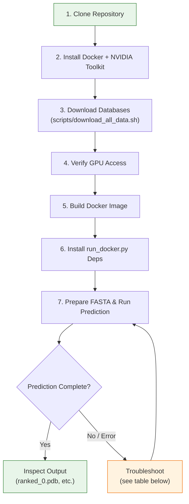
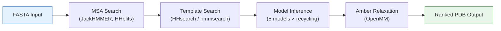

AlphaFold predicts protein 3D structures from amino acid sequences with near-experimental accuracy. This guide walks you from a freshly cloned repository to your first structure prediction in seven concrete steps. The entire pipeline—MSA search, template lookup, neural network inference, and Amber relaxation—runs inside a Docker container, so you don't need to install any scientific dependencies on the host machine.


Sources: [README.md](/README.md#L1-L37), [run_alphafold.py](/run_alphafold.py#L15-L16)

## Prerequisites at a Glance

Before you begin, confirm your environment meets these hard requirements. AlphaFold is **Linux-only** and demands an NVIDIA GPU with sufficient VRAM (larger proteins need more memory).

| Requirement | Minimum | Recommended |
|---|---|---|
| Operating System | Linux (x86_64) | Ubuntu 20.04+ |
| GPU | Any NVIDIA CUDA-capable | A100 (40 GB VRAM) |
| Disk (full DBs) | 2.62 TB (SSD) | 3 TB NVMe SSD |
| Disk (reduced DBs) | ~600 GB | 800 GB SSD |
| RAM | 12 GB | 85 GB |
| CPU cores | 4 | 12+ |
| Docker | Installed + non-root user | Latest stable |
| NVIDIA Container Toolkit | Installed | Latest stable |

> [!TIP]
> Use the **reduced_dbs** preset for your first run—it cuts database size from ~2.62 TB to ~600 GB while still producing good predictions. You can switch to full databases later without re-installing anything.

Sources: [README.md](/README.md#L40-L44), [README.md](/README.md#L345-L356)

## Step-by-Step Pipeline

The following flowchart maps the complete journey from cloning the repo to inspecting your predicted structure:



Sources: [README.md](/README.md#L46-L149), [docker/run_docker.py](/docker/run_docker.py#L159-L318)

## Step 1 — Clone the Repository

```bash
git clone https://github.com/deepmind/alphafold.git
cd ./alphafold
```

This gives you the project structure shown below. The two files you'll interact with most are `run_alphafold.py` (the core inference script, executed *inside* the container) and `docker/run_docker.py` (the host-side launcher that orchestrates Docker mounts and GPU flags).

```
alphafold/                          # Repository root
├── run_alphafold.py                # Core inference entry point (runs inside Docker)
├── docker/
│   ├── Dockerfile                  # Container image definition
│   ├── run_docker.py               # Host-side Docker launcher script
│   └── requirements.txt            # Host-side deps (absl-py, docker)
├── scripts/
│   └── download_all_data.sh        # Database download orchestrator
├── alphafold/                      # Python package (model, data, relax, common)
├── notebooks/
│   └── AlphaFold.ipynb             # Colab notebook (lite version)
└── requirements.txt                # Container-side Python deps
```

Sources: [README.md](/README.md#L55-L59), [docker/run_docker.py](/docker/run_docker.py#L15-L16)

## Step 2 — Install Docker and NVIDIA Container Toolkit

Install [Docker](https://www.docker.com/), then configure it to run [as a non-root user](https://docs.docker.com/engine/install/linux-postinstall/#manage-docker-as-a-non-root-user). Next, install the [NVIDIA Container Toolkit](https://docs.nvidia.com/datacenter/cloud-native/container-toolkit/install-guide.html) so Docker can pass GPU devices into containers.

Sources: [README.md](/README.md#L47-L54)

## Step 3 — Download Genetic Databases and Model Parameters

AlphaFold relies on multiple sequence alignment (MSA) databases and structural templates. The `download_all_data.sh` script fetches everything:

```bash
# Install required download tools
sudo apt install aria2 rsync

# Full databases (~556 GB download, ~2.62 TB uncompressed)
scripts/download_all_data.sh /path/to/download_dir > download.log 2> download_all.log &

# OR reduced databases (~200 GB download, ~600 GB uncompressed)
scripts/download_all_data.sh /path/to/download_dir reduced_dbs > download.log 2> download_all.log &
```

The script orchestrates nine sub-scripts in sequence, downloading and decompressing each database:

| Database | Full Size | Purpose | Monomer Required? | Multimer Required? |
|---|---|---|---|---|
| UniRef90 | ~67 GB | MSA via JackHMMER | ✅ | ✅ |
| MGnify | ~120 GB | Metagenomic MSA via JackHMMER | ✅ | ✅ |
| BFD / small_bfd | ~1.8 TB / ~17 GB | MSA via HHblits | ✅ | ✅ |
| UniRef30 | ~206 GB | MSA via HHblits (full only) | ✅ | ✅ |
| PDB70 | ~56 GB | Template search via HHsearch | ✅ | ❌ |
| PDB mmCIF | ~238 GB | Template structures | ✅ | ✅ |
| PDB seqres | ~0.2 GB | Template search via hmmsearch | ❌ | ✅ |
| UniProt | ~105 GB | Paired MSA for multimer | ❌ | ✅ |
| Model params | ~5.3 GB | 5 monomer + 5 pTM + 5 multimer | ✅ | ✅ |

> [!TIP]
> **Critical**: The download directory must **not** be a subdirectory of the AlphaFold repository. If it is, Docker will copy the entire multi-terabyte dataset into the build context, making `docker build` extremely slow. Place databases on a separate disk mount.

After completion, your download directory will have this structure:

```
$DOWNLOAD_DIR/
├── bfd/                    # (full_dbs only)
├── small_bfd/              # (reduced_dbs only)
├── mgnify/
├── params/                 # 15 model .npz files + LICENSE
├── pdb70/
├── pdb_mmcif/mmcif_files/
├── pdb_seqres/
├── uniref30/
├── uniprot/
└── uniref90/
```

Sources: [scripts/download_all_data.sh](/scripts/download_all_data.sh#L37-L79), [README.md](/README.md#L62-L100), [README.md](/README.md#L209-L237), [scripts/download_alphafold_params.sh](/scripts/download_alphafold_params.sh#L32-L41)

## Step 4 — Verify GPU Access

Confirm Docker can see your GPU:

```bash
docker run --rm --gpus all nvidia/cuda:11.0-base nvidia-smi
```

If this doesn't list your GPUs, revisit the NVIDIA Container Toolkit installation or consult [this NVIDIA Docker issue](https://github.com/NVIDIA/nvidia-docker/issues/1447#issuecomment-801479573).

Sources: [README.md](/README.md#L86-L101)

## Step 5 — Build the Docker Image

```bash
docker build -f docker/Dockerfile -t alphafold .
```

The Dockerfile builds on `nvidia/cuda:12.2.2-cudnn8-runtime-ubuntu20.04`, installs HHsuite (v3.3.0, compiled from source), Miniconda with Python 3.11, and all pip dependencies including JAX 0.4.26 with CUDA 12 support. The entrypoint wraps `run_alphafold.py` with an `ldconfig` preamble required for GPU visibility inside the container.

| Build Component | Version | Purpose |
|---|---|---|
| Base image | nvidia/cuda:12.2.2-cudnn8 | CUDA runtime + cuDNN |
| HHsuite | v3.3.0 | HHsearch, HHblits for MSA/template |
| Python | 3.11 | Runtime |
| JAX / jaxlib | 0.4.26 + CUDA12 | Neural network inference |
| TensorFlow | 2.16.1 (CPU) | Feature processing |
| OpenMM | 8.2.0 (CUDA12) | Amber relaxation |
| Haiku | 0.0.12 | Neural network modules |

Sources: [docker/Dockerfile](/docker/Dockerfile#L15-L91), [requirements.txt](/requirements.txt#L1-L14)

## Step 6 — Install Host-Side Dependencies

The `run_docker.py` launcher needs only two lightweight packages:

```bash
pip3 install -r docker/requirements.txt
```

This installs `absl-py` (for flag parsing) and `docker` (the Python Docker SDK). Consider using a [virtual environment](https://docs.python.org/3/tutorial/venv.html) to avoid conflicts with your system Python.

Sources: [docker/requirements.txt](/docker/requirements.txt#L1-L4), [README.md](/README.md#L119-L126)

## Step 7 — Run Your First Prediction

### Prepare Your FASTA File

Create a FASTA file with your target sequence. For a **monomer** (single chain):

```fasta
>my_protein
MVELVETLGVGLDIGDMIVEVTERQAKRGRVVAASTLDSGEYVLRLKGDVDAVIVEAGF
```

For a **multimer** (protein complex), include each chain as a separate sequence:

```fasta
>chain_A
MVELVETLGVGLDIGDMIVEVTERQAKRGRVVAASTLDSGEYVLRLKGDVDAVIVEAGF
>chain_B
MKTYVQKVEELFKRLSQELLDTLNKLPDVIARIIKLGEKYNIEEGVFISRGV
```

### Launch the Prediction

```bash
python3 docker/run_docker.py \
  --fasta_paths=my_protein.fasta \
  --max_template_date=2024-01-01 \
  --data_dir=$DOWNLOAD_DIR \
  --output_dir=/home/user/alphafold_output
```

### Key Parameters Explained

| Parameter | Required? | Default | Description |
|---|---|---|---|
| `--fasta_paths` | **Yes** | — | Comma-separated paths to FASTA files |
| `--max_template_date` | **Yes** | — | ISO-8601 date (YYYY-MM-DD); templates released after this date are excluded |
| `--data_dir` | **Yes** | — | Absolute path to downloaded databases |
| `--output_dir` | No | `/tmp/alphafold` | Absolute path for output files |
| `--model_preset` | No | `monomer` | One of: `monomer`, `monomer_casp14`, `monomer_ptm`, `multimer` |
| `--db_preset` | No | `full_dbs` | `full_dbs` or `reduced_dbs` (must match downloaded data) |
| `--models_to_relax` | No | `best` | `best` (top-ranked only), `all`, or `none` |
| `--use_precomputed_msas` | No | `False` | Reuse MSAs from a previous run (same output dir) |
| `--gpu_devices` | No | `all` | Comma-separated GPU UUIDs/indices |
| `--num_multimer_predictions_per_model` | No | `5` | Seeds per model (multimer only; total = 5 models × this value) |

### Common Run Configurations

| Scenario | Command |
|---|---|
| **Monomer (fast, reduced DBs)** | `--model_preset=monomer --db_preset=reduced_dbs` |
| **Monomer with pTM/PAE scores** | `--model_preset=monomer_ptm` |
| **Protein complex** | `--model_preset=multimer` (multi-sequence FASTA required) |
| **Batch two monomers** | `--fasta_paths=prot1.fasta,prot2.fasta --model_preset=monomer` |
| **Skip relaxation** | `--models_to_relax=none` |
| **Reuse MSAs from prior run** | `--use_precomputed_msas=true` (same `--output_dir`) |

Sources: [docker/run_docker.py](/docker/run_docker.py#L29-L127), [docker/run_docker.py](/docker/run_docker.py#L266-L277), [run_alphafold.py](/run_alphafold.py#L57-L257), [README.md](/README.md#L131-L149)

## Understanding the Output

After a successful run, your output directory contains:

```
<output_dir>/<target_name>/
├── features.pkl                  # Input feature dict (pickled)
├── ranked_{0..4}.pdb             # PDBs ranked by confidence (0 = best)
├── ranking_debug.json            # Confidence scores + rank order
├── relax_metrics.json            # Amber relaxation violation counts
├── timings.json                  # Per-stage elapsed seconds
├── msas/                         # Intermediate MSA files
├── result_model_1.pkl            # Raw model outputs per model
├── unrelaxed_model_1.pdb        # Unrelaxed predictions per model
├── relaxed_model_1.pdb          # Relaxed predictions (if enabled)
├── confidence_model_1.json      # pLDDT per-residue scores
└── pae_model_1.json             # Predicted aligned error (pTM models)
```

**Start with `ranked_0.pdb`**—this is your best prediction. The per-residue confidence is encoded in the B-factor column as pLDDT (0–100 scale; >90 = very high confidence, <50 = low confidence). For detailed interpretation, see [Output Interpretation](3-output-interpretation).

Sources: [run_alphafold.py](/run_alphafold.py#L360-L555), [README.md](/README.md#L547-L560)

## Troubleshooting Common Issues

| Symptom | Cause | Fix |
|---|---|---|
| `nvidia-smi` empty inside Docker | NVIDIA Container Toolkit missing/misconfigured | Reinstall toolkit; verify with `docker run --rm --gpus all nvidia/cuda:11.0-base nvidia-smi` |
| Docker build extremely slow (>30 min) | Download dir is inside repo tree | Move `$DOWNLOAD_DIR` outside the cloned repository |
| GPG error: `NO_PUBKEY A4B469963BF863CC` | Stale NVIDIA repo signing key | See [workaround](https://github.com/deepmind/alphafold/issues/463#issuecomment-1124881779) |
| Opaque MSA tool errors | Insufficient file permissions on DBs | `sudo chmod 755 --recursive "$DOWNLOAD_DIR"` |
| OOM during large protein prediction | GPU VRAM exceeded | Set `TF_FORCE_UNIFIED_MEMORY=1` and `XLA_PYTHON_CLIENT_MEM_FRACTION=4.0` (enabled by default in `run_docker.py`) |
| Relaxation fails/stalls | Amber minimizer instability | Use `--models_to_relax=none` or `--enable_gpu_relax=false` |
| Slow MSA stage | Using full DBs on HDD | Use SSD for databases; or switch to `--db_preset=reduced_dbs` |

Sources: [README.md](/README.md#L109-L117), [README.md](/README.md#L201-L204), [docker/run_docker.py](/docker/run_docker.py#L293-L300)

## What Happens Inside the Container

When `run_docker.py` launches, it mounts your FASTA files, database directories, and output directory into the container, then executes `run_alphafold.py` with the translated paths. The internal pipeline proceeds through four major stages:



For monomer predictions, templates are found via **HHsearch** against PDB70; for multimer, **hmmsearch** against PDB seqres is used instead. Five model checkpoints (model_1 through model_5) each run inference with 3 recycling iterations by default, producing 5 ranked predictions.

Sources: [run_alphafold.py](/run_alphafold.py#L611-L716), [docker/run_docker.py](/docker/run_docker.py#L221-L277), [alphafold/model/config.py](/alphafold/model/config.py#L30-L53)

## Where to Go Next

Now that you've run your first prediction, explore these topics in depth:

- **[Output Interpretation](3-output-interpretation)** — Understand pLDDT, pTM, and PAE confidence metrics in your prediction results
- **[Model Presets and Variants](21-model-presets-and-variants)** — Deep comparison of monomer, monomer_ptm, monomer_casp14, and multimer configurations
- **[Genetic Database Setup](24-genetic-database-setup)** — Advanced database management, reduced vs. full presets, and incremental updates
- **[Docker Deployment](23-docker-deployment)** — Production deployment patterns, GPU selection, and resource tuning
- **[Architecture Overview](7-architecture-overview)** — How the MSA pipeline, Evoformer, and structure module connect end-to-end
