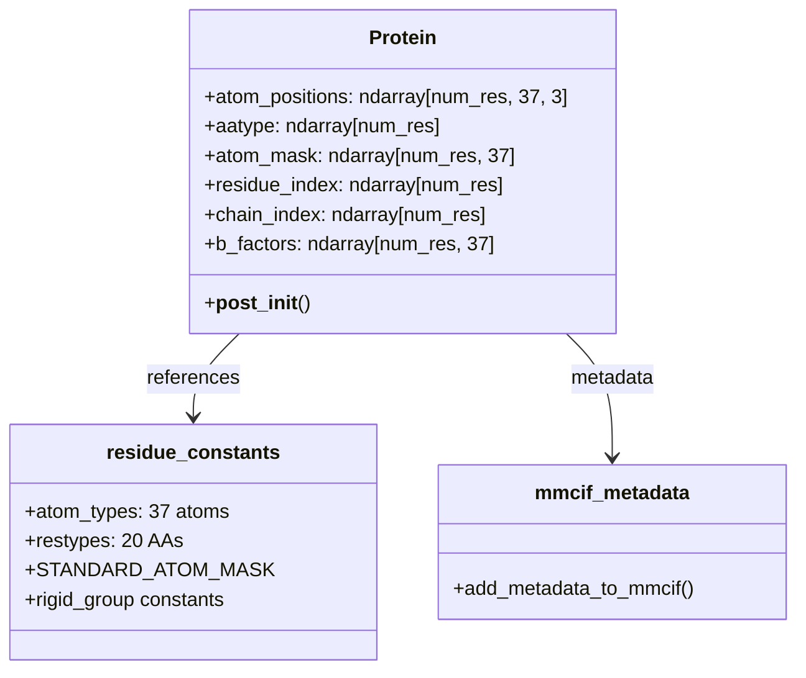
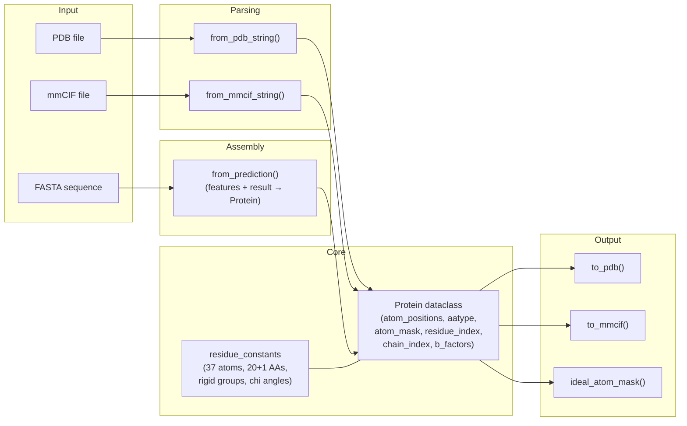

AlphaFold's protein data representation is the foundational data contract that bridges every stage of the pipeline — from input parsing through neural network inference to final structure output. At its core lives a frozen dataclass that distills a three-dimensional macromolecule into six numpy arrays, balanced between geometric precision and computational efficiency. Understanding this representation is essential for anyone extending the pipeline, interpreting model outputs, or integrating AlphaFold predictions into downstream workflows.

Sources: [protein.py](alphafold/common/protein.py#L1-L31), [residue_constants.py](alphafold/common/residue_constants.py#L1-L29)

## The Protein Dataclass

The `Protein` class is an **immutable** (`frozen=True`) dataclass that serves as AlphaFold's canonical in-memory structure representation. Every field is a `np.ndarray`, enabling vectorized operations across all residues simultaneously. The design choice of immutability prevents accidental mutation during pipeline stages and makes the object safely hashable.



The six fields encode the complete structural state:

| Field | Shape | Type | Description |
|---|---|---|---|
| **`atom_positions`** | `[num_res, 37, 3]` | `float` | Cartesian coordinates in Ångströms for all 37 possible atom slots per residue |
| **`aatype`** | `[num_res]` | `int` | Amino acid type index (0–19 for standard, 20 for unknown 'X') |
| **`atom_mask`** | `[num_res, 37]` | `float` | Binary presence mask — 1.0 if atom exists, 0.0 otherwise |
| **`residue_index`** | `[num_res]` | `int` | PDB residue number (not necessarily contiguous or 0-indexed) |
| **`chain_index`** | `[num_res]` | `int` | 0-indexed chain identifier for multimer support |
| **`b_factors`** | `[num_res, 37]` | `float` | Temperature factors in Ų, representing positional uncertainty |

The **37-atom slot system** is a critical design decision. Rather than using variable-length atom lists per residue type (glycine has 4 heavy atoms, tryptophan has 14), AlphaFold pads every residue to 37 slots using the canonical `atom_types` ordering. This enables uniform array operations without conditional branching — a mask of zeros silently handles the absence of atoms like `NZ` (lysine-specific) in an alanine residue.

Sources: [protein.py](alphafold/common/protein.py#L64-L97), [residue_constants.py](alphafold/common/residue_constants.py#L526-L534)

## Atom Type System and Fixed-Width Encoding

The 37-slot atom ordering is defined in `residue_constants.atom_types` and establishes a global coordinate system for per-atom data:

```
Index:  0   1   2   3   4   5    6    7    8    9   10   11   12   13   ...
Atom:   N  CA   C  CB   O  CG  CG1  CG2  OG  OG1   SG   CD  CD1  CD2  ...
```

The first four atoms — **N, CA, C, CB** — are the backbone frame plus the first sidechain carbon, shared across all non-glycine residues. This ordering is not arbitrary: the backbone atoms occupy the lowest indices because they define the rigid body frame from which all sidechain positions are reconstructed via torsion angles.

A more compact **14-atom encoding** (`restype_name_to_atom14_names`) is also maintained for certain model internals. This encoding lists only the real heavy atoms for each residue type, padded with empty strings to length 14. For example, alanine uses slots `['N', 'CA', 'C', 'O', 'CB', '', '', '', '', '', '', '', '', '']` while tryptophan fills all 14 slots. The 14-atom representation is used specifically for computing **bond violation bounds** in the structure module's loss function.

Sources: [residue_constants.py](alphafold/common/residue_constants.py#L526-L567), [residue_constants.py](alphafold/common/residue_constants.py#L541-L564)

## Residue Type Encoding

AlphaFold uses a **dual encoding** for amino acid types. The primary representation is integer indices 0–20, where 0–19 map to the 20 standard amino acids in **alphabetical order of their three-letter codes**, and index 20 represents the unknown type 'X':

| Index | 1-letter | 3-letter | Index | 1-letter | 3-letter |
|:---:|:---:|:---:|:---:|:---:|:---:|
| 0 | A | ALA | 10 | L | LEU |
| 1 | R | ARG | 11 | K | LYS |
| 2 | N | ASN | 12 | M | MET |
| 3 | D | ASP | 13 | F | PHE |
| 4 | C | CYS | 14 | P | PRO |
| 5 | Q | GLN | 15 | S | SER |
| 6 | E | GLU | 16 | T | THR |
| 7 | G | GLY | 17 | W | TRP |
| 8 | H | HIS | 18 | Y | TYR |
| 9 | I | ILE | 19 | V | VAL |

A separate **HHblits-compatible encoding** (`HHBLITS_AA_TO_ID`) handles MSA parsing, mapping ambiguous codes like B→D, Z→E, and U→C. A translation table `MAP_HHBLITS_AATYPE_TO_OUR_AATYPE` converts between these two index spaces, ensuring seamless data flow from MSA input to model features.

Sources: [residue_constants.py](alphafold/common/residue_constants.py#L570-L584), [residue_constants.py](alphafold/common/residue_constants.py#L698-L765)

## Parsing: From External Formats to Protein

AlphaFold supports two input formats through Biopython-backed parsers, both routing through a shared internal function `_from_bio_structure`:

```mermaid
flowchart TD
    A["PDB String"] -->|PDBParser| B["Biopython Structure"]
    C["mmCIF String"] -->|MMCIFParser| B
    B --> D["_from_bio_structure()"]
    D --> E["Protein dataclass"]
    
    F["Model Prediction"] -->|from_prediction()| E
    
    style D fill:#e8f5e9,stroke:#2e7d32
    style E fill:#fff3e0,stroke:#e65100
```

**`from_pdb_string(pdb_str, chain_id=None)`** and **`from_mmcif_string(mmcif_str, chain_id=None)`** parse their respective formats via Biopython's `PDBParser` and `MMCIFParser`, then delegate to `_from_bio_structure`. The internal converter enforces several constraints:

- **Single model only** — multi-model NMR structures raise `ValueError`
- **No insertion codes** — residues with PDB insertion codes (e.g., residue 57A) are rejected
- **Non-standard residues → UNK** — any residue not in the 20 standard types maps to index 20 ('X')
- **Non-standard atoms are silently dropped** — only atoms present in `atom_types` are retained
- **Empty residues are skipped** — if no known atom positions survive filtering, the residue is omitted entirely

Chain ID strings (e.g., 'A', 'B') are mapped to integer indices via `np.unique` sorting, establishing the `chain_index` array. The optional `chain_id` parameter allows extracting a single chain from a multichain structure.

Sources: [protein.py](alphafold/common/protein.py#L100-L199), [protein.py](alphafold/common/protein.py#L202-L221)

## Assembling from Model Predictions

The **`from_prediction()`** function constructs a `Protein` instance directly from model output, representing the critical bridge between neural network inference and serializable structure. It extracts:

- **Atom positions** from `result['structure_module']['final_atom_positions']`
- **Atom mask** from `result['structure_module']['final_atom_mask']`
- **Amino acid types** from `features['aatype']`
- **Residue index** from `features['residue_index']` (shifted by +1 to match 1-based PDB convention)
- **Chain index** from `features['asym_id']` (multimer) or zeros (monomer)

The `remove_leading_feature_dimension` flag handles the batch dimension that features carry during inference — when `True`, the leading dimension is sliced away (`arr[0]`). B-factors default to zero and are typically overwritten by the caller with pLDDT scores after confidence computation.

> [!TIP]
> When integrating AlphaFold into a custom pipeline, `from_prediction()` is your primary hook. Supply pLDDT scores as `b_factors` to embed confidence directly into the structure — this is what the standard `run_alphafold.py` does before serialization.

Sources: [protein.py](alphafold/common/protein.py#L343-L381)

## Serialization: Protein to PDB and mmCIF

### PDB Output

**`to_pdb(prot)`** generates a PDB-format string with strict columnar formatting. Key details:

- **Chain IDs** are mapped from integer indices to characters using `PDB_CHAIN_IDS` — the 62-character string `ABCDEFGHIJKLMNOPQRSTUVWXYZabcdefghijklmnopqrstuvwxyz0123456789`, supporting up to **62 chains** (the PDB format limit)
- **TER records** are inserted between chains to signal chain boundaries
- All lines are **padded to 80 characters** per PDB specification
- The `MODEL 1` / `ENDMDL` wrapper is always included

### mmCIF Output

**`to_mmcif(prot, file_id, model_type)`** produces a richer, mmCIF-format string containing structured metadata beyond what PDB can express:

| mmCIF Category | Content |
|---|---|
| `_atom_site` | Full atom coordinate table with label/auth asymmetric ID fields |
| `_entity_poly_seq` | Gapless residue sequence per chain (gaps filled with UNK) |
| `_struct_asym` | Chain-to-entity mapping |
| `_entity` / `_entity_poly` | Entity type declarations (`polypeptide(L)`, `polymer`) |
| `_chem_comp` | Chemical component definitions for standard amino acids |
| `_audit_author` / `_citation` | AlphaFold paper attribution and Nature citation |
| `_software` | AlphaFold version identification |
| `_ma_qa_metric` | pLDDT metric declarations (local + global) |

The `_entity_poly_seq` table deserves attention: it **fills gaps** in residue numbering with UNK entries. For a protein with residues at indices 2 (MET), 3 (LYS), 6 (GLY), the output would contain entries 1→UNK, 2→MET, 3→LYS, 4→UNK, 5→UNK, 6→GLY. Chain IDs in mmCIF use **reverse spreadsheet naming** (A, B, ..., Z, AA, BA, ...) via the cached `_int_id_to_str_id` function.

> [!TIP]
> The mmCIF round-trip (`from_mmcif_string` → `to_mmcif`) does **not** perfectly preserve non-standard residues (they become UNK) or original chain indices. If you need lossless mmCIF storage, preserve the original file alongside the `Protein` object.

Sources: [protein.py](alphafold/common/protein.py#L232-L324), [protein.py](alphafold/common/protein.py#L384-L520), [protein.py](alphafold/common/protein.py#L546-L601)

## Ideal Atom Mask

The **`ideal_atom_mask(prot)`** function computes the theoretically expected atom presence for a given amino acid sequence, independent of what the input PDB actually reported. It indexes into `STANDARD_ATOM_MASK` — a precomputed `[21, 37]` array mapping each residue type (including UNK) to its canonical heavy-atom set. The distinction matters: `prot.atom_mask` reflects what was *observed* in the input (a crystal structure might lack sidechain atoms due to disorder), while `ideal_atom_mask` reflects what *should* exist for that amino acid type. This differential is used during loss computation to distinguish between missing data and genuine structural absence.

Sources: [protein.py](alphafold/common/protein.py#L327-L340), [residue_constants.py](alphafold/common/residue_constants.py#L768-L781)

## Rigid Group Geometry Constants

The most intricate aspect of `residue_constants.py` is the **rigid group decomposition** — the mathematical framework that parameterizes atom positions via torsion angles. Each residue's atoms are partitioned into 8 rigid groups:

| Group Index | Name | Atoms (example: ARG) |
|:---:|---|---|
| 0 | Backbone | N, CA, C, CB |
| 1 | Pre-omega | (empty — currently unused) |
| 2 | Phi | (empty — defines only hydrogens) |
| 3 | Psi | O |
| 4 | Chi-1 | CG |
| 5 | Chi-2 | CD |
| 6 | Chi-3 | NE |
| 7 | Chi-4 | NH1, NH2, CZ |

Atoms within the same rigid group maintain fixed relative positions — only rigid-body transformations (rotation + translation) change their coordinates. The `rigid_group_atom_positions` dictionary stores each atom's position **relative to its group's local frame**, with the x-axis aligned to the rotation axis and the y-axis chosen so the dihedral-angle-defining atom lies in the xy-plane.

The **default frame matrices** (`restype_rigid_group_default_frame`, shape `[21, 8, 4, 4]`) encode the 4×4 homogeneous transformation from each rigid group's local frame back to the backbone frame. These are computed via `_make_rigid_transformation_4x4`, which constructs orthonormal frames from two defining axes and a translation vector. The backbone group (index 0) is the identity; the psi-frame uses the C−CA axis; chi-frames chain successively, each defined relative to the previous frame's origin.

Sources: [residue_constants.py](alphafold/common/residue_constants.py#L131-L142), [residue_constants.py](alphafold/common/residue_constants.py#L847-L936)

## Chi Angle System

Sidechain conformations are governed by **chi (χ) torsion angles**, with 0–4 angles per residue type. The `chi_angles_atoms` dictionary specifies the four atoms defining each chi angle as a list of atom names. For instance, arginine's χ₁ is defined by atoms N→CA→CB→CG. The `chi_angles_mask` array `[21, 4]` indicates which chi angles are valid for each residue type, while `chi_pi_periodic` flags angles with π-periodic symmetry (e.g., ASP's χ₂, PHE's χ₂) — these angles produce identical structures when rotated by π, a critical consideration for symmetry-aware loss computation.

The `chi_angles_atom_indices` array converts named references to integer indices and pads to exactly 4 chi angles per residue, while `chi_atom_1_one_hot` and `chi_atom_2_one_hot` provide one-hot encodings of the second and third atoms in each chi angle (the atoms defining the rotation axis), shaped `[21, 4, 37]` — directly usable in the neural network's torsion angle prediction layers.

Sources: [residue_constants.py](alphafold/common/residue_constants.py#L34-L103), [residue_constants.py](alphafold/common/residue_constants.py#L786-L828)

## Bond Length and Angle Constraints

The `load_stereo_chemical_props()` function parses `stereo_chemical_props.txt` to populate **literature bond lengths** and **bond angles** with standard deviations for each residue type. These are represented as named tuples:

- **`Bond(atom1_name, atom2_name, length, stddev)`** — e.g., C−N bond length 1.329±0.014 Å
- **`BondAngle(atom1_name, atom2_name, atom3name, angle_rad, stddev)`** — three-atom angle in radians

**Virtual bonds** are derived from bond angles via the **law of cosines**: given two bonded lengths and the angle between them, the distance between the outer atoms is computed as `c = √(a² + b² − 2ab·cos(γ))`, with propagated uncertainty from all three sources. The `make_atom14_dists_bounds()` function combines these with Van der Waals radii to produce per-residue **lower and upper distance bounds** `[21, 14, 14]` for violation detection, using overlap tolerance (1.5 Å) and bond length tolerance factor (15σ).

Sources: [residue_constants.py](alphafold/common/residue_constants.py#L403-L511), [residue_constants.py](alphafold/common/residue_constants.py#L939-L983)

## Atom Naming Ambiguity

Four amino acids — **ASP, GLU, PHE, TYR** — have symmetric atom naming that creates ambiguity. For aspartate, OD1 and OD2 are interchangeable under a 180° rotation about the CG axis. The `residue_atom_renaming_swaps` dictionary captures these symmetries:

```python
residue_atom_renaming_swaps = {
    'ASP': {'OD1': 'OD2'},
    'GLU': {'OE1': 'OE2'},
    'PHE': {'CD1': 'CD2', 'CE1': 'CE2'},
    'TYR': {'CD1': 'CD2', 'CE1': 'CE2'},
}
```

This mapping is essential for the all-atom confidence metric (LDDT) computation, where incorrect atom naming would produce spuriously low scores for these residue types.

Sources: [residue_constants.py](alphafold/common/residue_constants.py#L382-L393)

## Complete Data Flow Summary



Sources: [protein.py](alphafold/common/protein.py#L64-L98), [protein.py](alphafold/common/protein.py#L100-L179), [protein.py](alphafold/common/protein.py#L343-L381)

## Next Steps

With the protein data representation understood, you can explore how these structures flow into downstream processing. The confidence scores embedded in `b_factors` are computed in [pLDDT and pTM Scoring](17-plddt-and-ptm-scoring), the geometric transforms that populate `atom_positions` are detailed in [Quaternion Affine Transforms](15-quaternion-affine-transforms), and the AMBER relaxation that refines the final structure is covered in [Amber Relaxation](19-amber-relaxation).