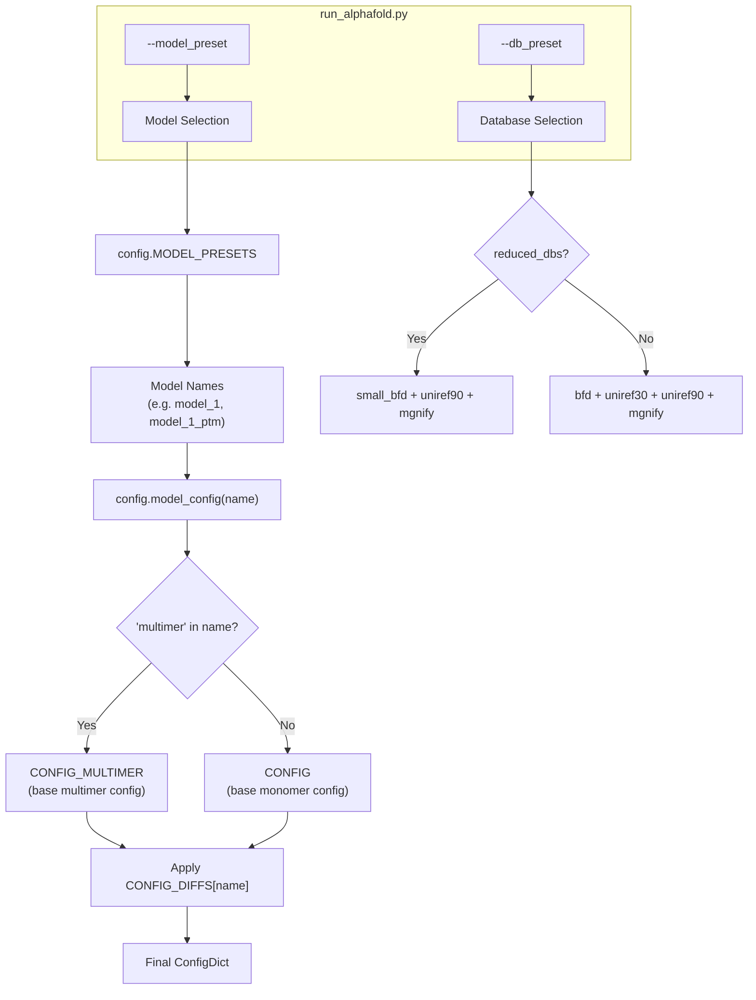
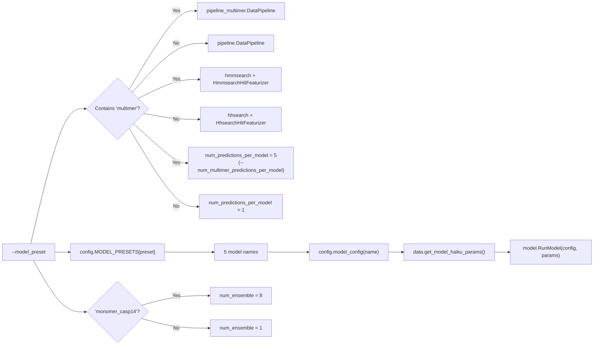

AlphaFold's prediction behavior is governed by two orthogonal preset axes: **model presets** (which neural network weights and architecture to use) and **database presets** (which genetic search databases to query). Together, they define the full operational profile of a prediction run — from MSA construction through to confidence scoring. Understanding how these presets decompose into base configurations and per-model diffs is essential for anyone customizing runs, diagnosing output differences, or extending AlphaFold to new use cases.

Sources: [config.py](/alphafold/model/config.py#L1-L1152), [run_alphafold.py](/run_alphafold.py#L1-L733)

## Preset Architecture: Two Independent Axes

AlphaFold exposes two command-line flags that independently control the prediction pipeline. The **`--model_preset`** flag selects which trained model parameters and architectural configuration to apply, while the **`--db_preset`** flag selects which genetic databases feed the MSA construction. These two axes are fully decoupled — any model preset can be combined with any database preset.



The `--db_preset` flag accepts `full_dbs` (default) or `reduced_dbs`. The reduced variant substitutes the full BFD database with a smaller version (`small_bfd`) and omits UniRef30, trading MSA depth for significantly faster runtime and lower memory. This selection is enforced at startup via the `_check_flag` validation function, which ensures that the correct database paths are provided for the chosen preset.

Sources: [run_alphafold.py](/run_alphafold.py#L137-L151), [run_alphafold.py](/run_alphafold.py#L559-L575)

## The Four Model Presets

The `MODEL_PRESETS` dictionary maps each preset name to a tuple of five model variant identifiers. Each variant within a preset corresponds to a differently trained checkpoint, providing ensemble diversity for ranking predictions.

| Preset | Flag Value | Model Variants | pTM Head | Multimer | Typical Use |
|---|---|---|---|---|---|
| **Monomer** | `monomer` | `model_1` … `model_5` | ✗ | ✗ | Single-chain proteins |
| **Monomer CASP14** | `monomer_casp14` | `model_1` … `model_5` | ✗ | ✗ | CASP14 competition (8× ensemble) |
| **Monomer pTM** | `monomer_ptm` | `model_1_ptm` … `model_5_ptm` | ✓ | ✗ | Single-chain with interface confidence |
| **Multimer** | `multimer` | `model_1_multimer_v3` … `model_5_multimer_v3` | ✓ (iPTM) | ✓ | Multi-chain complexes |

The **monomer_casp14** preset is an alias for the monomer models (`MODEL_PRESETS['monomer_casp14'] = MODEL_PRESETS['monomer']`) but activates a critical behavioral difference: the ensemble size is set to **8** instead of the default **1**, providing the extra ensembling that was used during CASP14 competition submissions. This is applied directly in `main()` when the flag matches `'monomer_casp14'`.

Sources: [config.py](/alphafold/model/config.py#L19-L37), [run_alphafold.py](/run_alphafold.py#L576-L580)

## Per-Model Configuration Diffs

Rather than storing five complete configuration dictionaries per preset, AlphaFold uses a **base + diff** pattern. A single base configuration (`CONFIG` for monomer or `CONFIG_MULTIMER` for multimer) defines all parameters, and the `CONFIG_DIFFS` dictionary specifies only the values that differ per model variant. The `model_config()` function deep-copies the appropriate base, then applies the flattened diff:

```python
def model_config(name: str) -> ml_collections.ConfigDict:
  if 'multimer' in name:
    cfg = copy.deepcopy(CONFIG_MULTIMER)
  else:
    cfg = copy.deepcopy(CONFIG)
  cfg.update_from_flattened_dict(CONFIG_DIFFS[name])
  return cfg
```

This architecture means that the 15+ model variants are defined by only a handful of diff keys rather than 15 full configurations. The following table shows the critical differentiation axes across all models.

Sources: [config.py](/alphafold/model/config.py#L1009-L1016)

### Monomer Model Diffs (Models 1–5)

The five monomer models cluster into two families distinguished by **template usage** and **extra MSA depth**, corresponding to Jumper et al. (2021) Supplementary Table 5.

| Property | model_1 (§1.1.1) | model_2 (§1.1.2) | model_3 (§1.2.1) | model_4 (§1.2.2) | model_5 (§1.2.3) |
|---|---|---|---|---|---|
| Templates enabled | ✓ | ✓ | ✗ | ✗ | ✗ |
| Embed torsion angles | ✓ | ✓ | — | — | — |
| `max_extra_msa` | 5120 | 1024 (default) | 5120 | 5120 | 1024 (default) |
| `reduce_msa_clusters_by_max_templates` | ✓ | ✓ | ✗ | ✗ | ✗ |

**Models 1 and 2** form the template-enabled family (§1.1.x). They activate template embedding and torsion angle embedding, and reduce MSA cluster counts by the number of templates found. Model 1 additionally increases `max_extra_msa` to 5120 (from the default 1024), providing a richer extra MSA stack for the template-conditioned pathway.

**Models 3, 4, and 5** form the template-free family (§1.2.x). Templates are disabled entirely. Models 3 and 4 use the larger `max_extra_msa` of 5120, while model 5 uses the default — making it the most lightweight monomer variant.

Sources: [config.py](/alphafold/model/config.py#L39-L63)

### Monomer pTM Model Diffs (Models 1–5 pTM)

The pTM variants are **fine-tuned** from their corresponding monomer models with one additional head: the **predicted aligned error (PAE)** head, which enables both the predicted TM-score (pTM) and pairwise aligned error outputs. The diff for each pTM model is identical to its monomer counterpart with one added key:

```python
'model.heads.predicted_aligned_error.weight': 0.1
```

This weight of 0.1 indicates that the PAE loss was a secondary objective during fine-tuning — the primary structure prediction weights were preserved from the base monomer models. The result is that pTM models produce structurally identical predictions to their monomer counterparts but additionally output confidence metrics that capture both global (pTM) and pairwise (PAE) structural uncertainty.

> [!TIP]
> The pTM score is essential for ranking predictions in multimer mode (via iPTM), but even for monomers it provides a global confidence measure that is more informative than mean pLDDT for assessing overall fold correctness.

Sources: [config.py](/alphafold/model/config.py#L64-L85)

### Multimer v3 Model Diffs (Models 1–5 multimer_v3)

The multimer v3 models are the current production multimer variant. They are built on the `CONFIG_MULTIMER` base, which differs substantially from the monomer `CONFIG` in several architectural dimensions.

| Property | model_1–3 multimer_v3 | model_4–5 multimer_v3 |
|---|---|---|
| `num_extra_msa` | 2048 (base default) | **1152** |

Models 1 through 3 use the `CONFIG_MULTIMER` defaults without modification (empty diff dicts). Models 4 and 5 reduce `num_extra_msa` from 2048 to 1152, trading extra MSA representation capacity for computational efficiency. This mirrors the monomer family's pattern where later models use progressively fewer resources.

Sources: [config.py](/alphafold/model/config.py#L86-L96)

## Base Configuration: Monomer vs. Multimer

The two base configurations — `CONFIG` and `CONFIG_MULTIMER` — encode the fundamental architectural differences between monomer and multimer prediction. Understanding these differences is critical because they determine everything from feature shapes to recycling behavior.

| Parameter | CONFIG (Monomer) | CONFIG_MULTIMER | Impact |
|---|---|---|---|
| `global_config.multimer_mode` | `False` | `True` | Switches model class in `RunModel` |
| `num_recycle` | 3 | 20 | Multimer recycles far more |
| `recycle_early_stop_tolerance` | (none) | 0.5 | Early stopping for multimer |
| `num_msa` | (not set) | 508 | Explicit MSA row count for multimer |
| `num_extra_msa` | (not set) | 2048 | Explicit extra MSA for multimer |
| `fuse_projection_weights` | `False` | `True` | Numerical optimization in triangle mult |
| `use_chain_relative` | (not set) | `True` | Chain-relative position encoding |
| `bfloat16` | (not set) | `True` | Mixed precision for multimer |
| `template.enabled` | `False` | `True` | Templates on by default in multimer |
| `outer_product_mean.first` | `False` | `True` | Different op ordering |
| `position_scale` (struct module) | 10.0 | 20.0 | Wider positional range for complexes |
| `num_ensemble_eval` | (not set) | 1 | Single ensemble eval for multimer |

The **recycling disparity** is the most consequential difference: monomer models recycle 3 times, while multimer models recycle up to 20 times with an early stopping tolerance of 0.5 Å. This means multimer predictions can take substantially longer per model but converge to more stable multi-chain arrangements. The `fuse_projection_weights=True` setting in the multimer config is a numerical optimization in the `TriangleMultiplication` module that fuses two separate projection weights into a single operation, reducing memory footprint at the cost of slightly different numerical behavior.

> [!TIP]
> The `multimer_mode` flag in `global_config` is the single boolean that dispatches between `modules.AlphaFold` and `modules_multimer.AlphaFold` in `RunModel.__init__()`. All other config differences flow from this architectural fork — it's the root of the monomer/multimer decision tree.

Sources: [config.py](/alphafold/model/config.py#L395-L599), [model.py](/alphafold/model/model.py#L94-L112)

## Legacy Multimer Variants (v1 and v2)

The codebase retains configuration diffs for multimer v1 and v2 models, though the current `MODEL_PRESETS` dictionary only references v3. These legacy variants share a common set of updates applied via the `_common_updates` function:

```python
CONFIG_DIFFS.update(
    {f'model_{i}_multimer': common_updates for i in range(1, 6)}
)
CONFIG_DIFFS.update(
    {f'model_{i}_multimer_v2': common_updates for i in range(1, 6)}
)
```

The `common_updates` dict applies these overrides to the base `CONFIG` (not `CONFIG_MULTIMER`), which is notable — v1 and v2 multimer models were built on the monomer base config with specific numerical adjustments:

| Override | Value | Purpose |
|---|---|---|
| `num_msa` | 252 | Reduced MSA rows vs v3's 508 |
| `num_extra_msa` | 1152 | Same as v3 models 4/5 |
| `fuse_projection_weights` (4 locations) | `False` | Unfused projections (older numerics) |

These entries exist to support loading and evaluating older trained checkpoints. They are not selectable via the `--model_preset` flag but can be accessed programmatically by calling `config.model_config('model_1_multimer')` directly.

Sources: [config.py](/alphafold/model/config.py#L97-L114), [config.py](/alphafold/model/config.py#L1069-L1093)

## Preset Resolution Flow at Runtime

When `run_alphafold.py` executes, the preset system drives four major pipeline decisions:



**Template search** is the first preset-driven fork. Multimer mode uses `hmmsearch` against the PDB seqres database with `HmmsearchHitFeaturizer`, while monomer modes use `hhsearch` against PDB70 with `HhsearchHitFeaturizer`. This is because multimer needs to search the full PDB sequence database to find inter-chain templates, whereas monomer can use the more efficient PDB70 clustered database.

**Prediction multiplicity** differs between modes. Monomer presets run exactly one prediction per model (5 total). Multimer runs `num_multimer_predictions_per_model` (default: 5) predictions per model with different random seeds, yielding 25 predictions by default. Each is named `{model_name}_pred_{i}` in the output directory.

**Ranking strategy** also differs. Monomer models are ranked by mean pLDDT. Multimer models are ranked by the composite metric `0.8 × iPTM + 0.2 × pTM`, which balances interface confidence with overall fold confidence. This ranking logic lives in `get_confidence_metrics()` within `model.py`.

Sources: [run_alphafold.py](/run_alphafold.py#L582-L640), [model.py](/alphafold/model/model.py#L29-L73)

## ConfigDict vs. BaseConfig: Dual API Surface

AlphaFold's config system maintains **two parallel APIs** for the same configuration data:

1. **`ml_collections.ConfigDict`** — the original dictionary-based API, used by `model_config()` and consumed by `RunModel`. Configuration diffs are applied via `update_from_flattened_dict()` with dot-separated key paths like `'model.embeddings_and_evoformer.template.enabled'`.

2. **`BaseConfig` dataclass hierarchy** — the newer typed API defined via `AlphaFoldConfig`, `Model`, `EmbeddingsAndEvoformer`, and ~20 other dataclass subclasses. Accessed via `get_model_config()`, which returns a frozen `AlphaFoldConfig` instance with proper type checking and IDE autocompletion.

Both APIs are backed by the same `CONFIG` / `CONFIG_MULTIMER` dictionaries. The `get_model_config()` function constructs an `AlphaFoldConfig` from the dict, then applies typed diff operations from `CONFIG_DIFF_OPS` (functions like `_apply_model_1_diff` that set attributes directly). The result is cached via `@functools.lru_cache` and frozen by default to prevent accidental mutation.

Sources: [config.py](/alphafold/model/config.py#L1018-L1038), [base_config.py](/alphafold/model/base_config.py#L62-L200)

## Choosing the Right Preset

The following decision framework maps common use cases to the appropriate preset combination.

| Use Case | `--model_preset` | `--db_preset` | Rationale |
|---|---|---|---|
| Production single-chain prediction | `monomer_ptm` | `full_dbs` | pTM gives global confidence; full DBs for best MSA depth |
| Quick single-chain test | `monomer` | `reduced_dbs` | Fastest path; pLDDT-only confidence is sufficient for exploration |
| Multi-chain complex | `multimer` | `full_dbs` | Required for complexes; full DBs essential for cross-chain MSA pairing |
| Reproducing CASP14 results | `monomer_casp14` | `full_dbs` | 8× ensembling matches competition configuration |
| Memory-constrained multimer | `multimer` | `reduced_dbs` | Reduced DBs lower MSA memory; models 4/5 use smaller `num_extra_msa` |

For deeper customization beyond presets, see [Config Reference](22-config-reference). For understanding how the data pipeline differs between monomer and multimer modes, see [Multimer Feature Assembly](10-multimer-feature-assembly). For confidence metric interpretation, see [pLDDT and pTM Scoring](17-plddt-and-ptm-scoring) and [Predicted Aligned Error](18-predicted-aligned-error).
