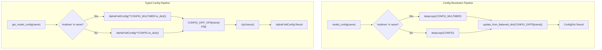

AlphaFold's configuration system governs every aspect of prediction behavior — from data pipeline feature selection to neural network hyperparameters to loss head weighting. The system operates on a **two-tier architecture**: a legacy `ml_collections.ConfigDict` path (used at runtime via `model_config()`) and a newer type-safe `BaseConfig` dataclass path (used via `get_model_config()`). Both pathways share the same base configurations and per-model diff logic, but differ in mutability guarantees and type enforcement. Understanding this duality is essential for advanced customization, debugging unexpected behavior, or extending AlphaFold with new model variants.

Sources: [config.py](/alphafold/model/config.py#L1-L20), [base_config.py](/alphafold/model/base_config.py#L1-L26)

## Configuration Architecture

The config system follows a **base-plus-delta** pattern: two canonical base configs (`CONFIG` for monomer, `CONFIG_MULTIMER` for multimer) define all default values, and per-model diffs (`CONFIG_DIFFS` / `CONFIG_DIFF_OPS`) overlay sparse overrides. This avoids duplicating ~450 configuration keys across 15 model variants.



The legacy pipeline returns a mutable `ConfigDict` — flat dot-path updates like `'data.common.max_extra_msa': 5120` are applied via `update_from_flattened_dict()`. The typed pipeline constructs an `AlphaFoldConfig` dataclass, applies diff operations as typed attribute assignments, and **freezes** the result to prevent post-initialization mutation. The typed path is cached via `@functools.lru_cache`, so repeated calls with the same model name return the same frozen instance.

Sources: [config.py](/alphafold/model/config.py#L994-L1021), [config.py](/alphafold/model/config.py#L1024-L1152)

## Model Presets and Variants

The `MODEL_PRESETS` dictionary maps each preset name to the ordered tuple of model names executed during a prediction run. The `--model_preset` CLI flag selects which preset (and therefore which models) are used.

| Preset | Models | Use Case |
|--------|--------|----------|
| `monomer` | `model_1` … `model_5` | Single-chain prediction (standard) |
| `monomer_casp14` | `model_1` … `model_5` | Alias for `monomer`; used with `num_ensemble=8` |
| `monomer_ptm` | `model_1_ptm` … `model_5_ptm` | Single-chain with pTM/pAE heads enabled |
| `multimer` | `model_1_multimer_v3` … `model_5_multimer_v3` | Multi-chain complex prediction |

> [!TIP]
> The `monomer_casp14` preset selects the same five models as `monomer` but triggers `num_ensemble=8` (vs. the default `1`) in `run_alphafold.py`. This ensembling averages predictions across 8 stochastic forward passes, trading ~8× inference time for marginally improved accuracy — only worthwhile for benchmark replication.

Sources: [config.py](/alphafold/model/config.py#L30-L54), [run_alphafold.py](/run_alphafold.py#L601-L604)

## Per-Model Configuration Diffs

Each of the 15 model variants is defined by a sparse diff applied on top of the base config. The table below shows every diff key and its value, organized by model. Absent keys inherit the base config default.

| Diff Key | `model_1` | `model_2` | `model_3` | `model_4` | `model_5` |
|----------|-----------|-----------|-----------|-----------|-----------|
| `data.common.max_extra_msa` | 5120 | — | 5120 | 5120 | — |
| `data.common.reduce_msa_clusters_by_max_templates` | True | True | — | — | — |
| `data.common.use_templates` | True | True | — | — | — |
| `model.embeddings_and_evoformer.template.embed_torsion_angles` | True | True | — | — | — |
| `model.embeddings_and_evoformer.template.enabled` | True | True | — | — | — |

| Diff Key | `model_1_ptm` | `model_2_ptm` | `model_3_ptm` | `model_4_ptm` | `model_5_ptm` |
|----------|---------------|---------------|---------------|---------------|---------------|
| `data.common.max_extra_msa` | 5120 | — | 5120 | 5120 | — |
| `data.common.reduce_msa_clusters_by_max_templates` | True | True | — | — | — |
| `data.common.use_templates` | True | True | — | — | — |
| `model.embeddings_and_evoformer.template.embed_torsion_angles` | True | True | — | — | — |
| `model.embeddings_and_evoformer.template.enabled` | True | True | — | — | — |
| `model.heads.predicted_aligned_error.weight` | 0.1 | 0.1 | 0.1 | 0.1 | 0.1 |

| Diff Key | `model_1..3_multimer_v3` | `model_4..5_multimer_v3` |
|----------|--------------------------|--------------------------|
| `model.embeddings_and_evoformer.num_extra_msa` | — (default 2048) | 1152 |

The critical architectural distinction: **models 1–2 enable templates** (with torsion angle embedding), while **models 3–5 disable templates**. Models 1 and 3 also increase `max_extra_msa` to 5120 (from default 1024). This deliberate diversity in the ensemble is what gives AlphaFold its robustness — template-aware and template-free models capture complementary structural signals.

Sources: [config.py](/alphafold/model/config.py#L55-L134)

## Monomer Base Config (`CONFIG`)

The monomer base configuration is organized into two top-level domains: `data` (feature processing) and `model` (neural network architecture). Below is the complete reference.

### Data Configuration

| Path | Default | Description |
|------|---------|-------------|
| `data.common.masked_msa.profile_prob` | 0.1 | Probability of masking from MSA profile |
| `data.common.masked_msa.same_prob` | 0.1 | Probability of keeping same residue |
| `data.common.masked_msa.uniform_prob` | 0.1 | Probability of uniform random replacement |
| `data.common.max_extra_msa` | 1024 | Max extra MSA sequences (overridden per model) |
| `data.common.msa_cluster_features` | True | Compute MSA cluster features |
| `data.common.num_recycle` | 3 | Number of recycling iterations |
| `data.common.reduce_msa_clusters_by_max_templates` | False | Reduce MSA clusters by max templates count |
| `data.common.resample_msa_in_recycling` | True | Resample MSA during recycling |
| `data.common.use_templates` | False | Enable template features (overridden per model) |
| `data.eval.fixed_size` | True | Use fixed-size cropping |
| `data.eval.subsample_templates` | False | Subsample templates (False = use top hits) |
| `data.eval.masked_msa_replace_fraction` | 0.15 | Fraction of MSA positions to replace during masking |
| `data.eval.max_msa_clusters` | 512 | Maximum MSA clusters |
| `data.eval.max_templates` | 4 | Maximum template structures |
| `data.eval.num_ensemble` | 1 | Number of ensemble members (8 for CASP14) |

The `data.common.template_features` and `data.common.unsupervised_features` lists define which feature keys are extracted during pipeline processing. The `data.eval.feat` dictionary maps each feature name to its runtime shape specification using placeholder strings (`NUM_RES`, `NUM_MSA_SEQ`, `NUM_EXTRA_SEQ`, `NUM_TEMPLATES`) that resolve to actual dimensions at batch construction time.

Sources: [config.py](/alphafold/model/config.py#L136-L237), [shape_placeholders.py](/alphafold/model/tf/shape_placeholders.py#L17-L20)

### Model Configuration — Embeddings & Evoformer

| Path | Default | Description |
|------|---------|-------------|
| `model.embeddings_and_evoformer.evoformer_num_block` | 48 | Number of Evoformer iterations |
| `model.embeddings_and_evoformer.extra_msa_channel` | 64 | Channel dimension for extra MSA embedding |
| `model.embeddings_and_evoformer.extra_msa_stack_num_block` | 4 | Extra MSA stack block count |
| `model.embeddings_and_evoformer.max_relative_feature` | 32 | Max relative position encoding distance |
| `model.embeddings_and_evoformer.msa_channel` | 256 | MSA representation channel width |
| `model.embeddings_and_evoformer.pair_channel` | 128 | Pair representation channel width |
| `model.embeddings_and_evoformer.seq_channel` | 384 | Target sequence embedding channel width |
| `model.embeddings_and_evoformer.recycle_features` | True | Recycle MSA/pair features between iterations |
| `model.embeddings_and_evoformer.recycle_pos` | True | Recycle backbone positions into prev_pos |
| `model.num_recycle` | 3 | Recycling iterations (model-level override) |
| `model.resample_msa_in_recycling` | True | Resample masked MSA each recycle step |

#### Previous Position Binning

| Path | Default | Description |
|------|---------|-------------|
| `model.embeddings_and_evoformer.prev_pos.min_bin` | 3.25 | Lower bound of first distance bin (Å) |
| `model.embeddings_and_evoformer.prev_pos.max_bin` | 20.75 | Upper bound of last distance bin (Å) |
| `model.embeddings_and_evoformer.prev_pos.num_bins` | 15 | Number of distance bins |

Sources: [config.py](/alphafold/model/config.py#L238-L377)

### Model Configuration — Evoformer Sub-Modules

Each Evoformer block contains eight sub-modules with their own hyperparameters. The table below provides a consolidated view.

| Sub-module | `dropout_rate` | `num_head` | `gating` | `num_intermediate_factor` / `_channel` | `orientation` |
|------------|----------------|------------|----------|----------------------------------------|---------------|
| `msa_row_attention_with_pair_bias` | 0.15 | 8 | True | — | `per_row` |
| `msa_column_attention` | 0.0 | 8 | True | — | `per_column` |
| `msa_transition` | 0.0 | — | — | factor: 4 | `per_row` |
| `outer_product_mean` | 0.0 | — | — | outer_channel: 32, chunk: 128 | `per_row` |
| `triangle_attention_starting_node` | 0.25 | 4 | True | — | `per_row` |
| `triangle_attention_ending_node` | 0.25 | 4 | True | — | `per_column` |
| `triangle_multiplication_outgoing` | 0.25 | — | — | intermediate_channel: 128 | `per_row` |
| `triangle_multiplication_incoming` | 0.25 | — | — | intermediate_channel: 128 | `per_row` |
| `pair_transition` | 0.0 | — | — | factor: 4 | `per_row` |

All sub-modules share `shared_dropout: True`. The triangle multiplication modules additionally specify an `equation` (Einstein summation convention: `'ikc,jkc->ijc'` for outgoing, `'kjc,kic->ijc'` for incoming) and `fuse_projection_weights: False` in the monomer base (overridden to `True` in the multimer base, and back to `False` in multimer v1/v2 compat).

Sources: [config.py](/alphafold/model/config.py#L241-L306)

### Model Configuration — Template Embedding

| Path | Default | Description |
|------|---------|-------------|
| `template.enabled` | False | Activate template embedding |
| `template.embed_torsion_angles` | False | Embed torsion angle features from templates |
| `template.max_templates` | 4 | Maximum templates to embed |
| `template.subbatch_size` | 128 | Subbatch size for template processing |
| `template.use_template_unit_vector` | False | Use unit vector representation |
| `template.attention.gating` | False | Gating in template attention |
| `template.attention.num_head` | 4 | Heads in template attention |
| `template.attention.key_dim` | 64 | Key dimension (monomer only) |
| `template.attention.value_dim` | 64 | Value dimension (monomer only) |
| `template.dgram_features.min_bin` | 3.25 | Distance gram min bin (Å) |
| `template.dgram_features.max_bin` | 50.75 | Distance gram max bin (Å) |
| `template.dgram_features.num_bins` | 39 | Distance gram bin count |
| `template.template_pair_stack.num_block` | 2 | Stack blocks for template pair update |

The template pair stack mirrors the evoformer's triangle attention/multiplication/transition pattern but with reduced capacity: `num_intermediate_channel: 64` (vs. 128 in evoformer), `num_intermediate_factor: 2` (vs. 4), and `key_dim/value_dim: 64` (explicit in monomer template attention).

Sources: [config.py](/alphafold/model/config.py#L316-L376)

### Model Configuration — Global Config

| Path | Default | Description |
|------|---------|-------------|
| `model.global_config.deterministic` | False | Enable deterministic ops (reduces performance) |
| `model.global_config.multimer_mode` | False | Activate multimer-specific code paths |
| `model.global_config.subbatch_size` | 4 | Global subbatch size for memory-efficient computation |
| `model.global_config.use_remat` | False | Use rematerialization (gradient checkpointing) |
| `model.global_config.zero_init` | True | Zero-initialize residual layers |
| `model.global_config.eval_dropout` | False | Apply dropout at eval time |
| `model.global_config.bfloat16` | *(multimer only)* True | Use bfloat16 for forward pass |
| `model.global_config.bfloat16_output` | *(multimer only)* False | Use bfloat16 for output |

Sources: [config.py](/alphafold/model/config.py#L378-L385), [config.py](/alphafold/model/config.py#L600-L609)

### Model Configuration — Loss Heads

Each prediction head carries its own loss weight, resolution filtering, and structural hyperparameters.

| Head | `weight` | `filter_by_resolution` | `min_resolution` | `max_resolution` | Key Params |
|------|----------|------------------------|------------------|------------------|------------|
| `distogram` | 0.3 | — | — | — | `first_break`: 2.3125, `last_break`: 21.6875, `num_bins`: 64 |
| `predicted_aligned_error` | 0.0 (mono) / 0.1 (ptm/multi) | True | 0.1 | 3.0 | `max_error_bin`: 31.0, `num_bins`: 64, `num_channels`: 128 |
| `experimentally_resolved` | 0.01 | True | 0.1 | 3.0 | — |
| `predicted_lddt` | 0.01 | True | 0.1 | 3.0 | `num_bins`: 50, `num_channels`: 128 |
| `masked_msa` | 2.0 | — | — | — | `num_output`: 23 (monomer) |

> [!TIP]
> The `predicted_aligned_error.weight` defaults to **0.0** in the monomer base config — this head is only active when a `_ptm` or `_multimer` model diff sets it to 0.1. Running a standard `model_5` prediction will not produce pAE/pTM outputs even though the head exists in the architecture; you must use `model_preset=monomer_ptm` or `multimer`.

Sources: [config.py](/alphafold/model/config.py#L386-L455)

### Model Configuration — Structure Module

| Path | Default | Description |
|------|---------|-------------|
| `structure_module.num_layer` | 8 | Invariant Point Attention layers |
| `structure_module.num_channel` | 384 | Channel width within structure module |
| `structure_module.num_head` | 12 | IPA attention heads |
| `structure_module.num_point_qk` | 4 | Point dimensions for Q/K in IPA |
| `structure_module.num_point_v` | 8 | Point dimensions for V in IPA |
| `structure_module.num_scalar_qk` | 16 | Scalar dimensions for Q/K in IPA |
| `structure_module.num_scalar_v` | 16 | Scalar dimensions for V in IPA |
| `structure_module.position_scale` | 10.0 (mono) / 20.0 (multi) | Scale factor for IPA positions |
| `structure_module.num_layer_in_transition` | 3 | Transition network depth |
| `structure_module.dropout` | 0.1 | Dropout rate in structure module |
| `structure_module.angle_norm_weight` | 0.01 | Weight for angle normalization loss |
| `structure_module.chi_weight` | 0.5 | Weight for chi angle loss |
| `structure_module.clash_overlap_tolerance` | 1.5 | T3&aring; tolerance for clash violation |
| `structure_module.structural_violation_loss_weight` | 1.0 | Weight for structural violation penalty |
| `structure_module.violation_tolerance_factor` | 12.0 | Scaling factor for violation tolerance |
|+ `structure_module.weight` | 1.0 | Total structure module loss weight |

#### Frame Aligned Point Error<0.0, `loss_unit_distance`: 10.0,. In the multimer config, this is replaced by `intra_chain_f%20and%20Sidechain)**: Monomer uses `fape` with `clamp_distance`:%2010.0,%20`clamp_type`:%20'relu',%20`loss_unit_distance`:%2010.0.%20In%20the%20multimer%20config,%20this%20is%20replaced%20by%20intra_chain_fape%20(`atom_clamp_distance`:%2010.0,%20`loss_unit_distance`:%2010.0)%20and%20interface_fape%20(`atom_clamp_distance`:%201000.0,%20`loss_unit_distance`:%2020.0).%20The%20interface%20FAPE%20uses%20a%20much%20larger%20clamp%20to%20penalize%20inter-chain%20misalignment%20across%20the%20full%20spatial%20extent.

| Sidechain Path | Default | Description |
|----------------|---------|-------------|
| `sidechain.atom_clamp_distance` | 10.0 | FAPE clamp for sidechain atoms (Å) |
| `sidechain.num_channel` | 128 | Sidechain network channel width |
| `sidechain.num_residual_block` | 2 | Residual blocks in sidechain network |
| `sidechain.weight_frac` | 0.5 | Fraction of loss from sidechain vs backbone |
| `sidechain.length_scale` | 10.0 (mono) | Length scale for sidechain loss |

Sources: [config.py](/alphafold/model/config.py#L412-L455)

## Multimer Base Config (`CONFIG_MULTIMER`)

The multimer configuration diverges from the monomer base in several critical dimensions. The table below highlights only the **differences**; all unspecified keys inherit the same value as in `CONFIG`.

| Path | Monomer | Multimer | Rationale |
|------|---------|----------|-----------|
| `embeddings_and_evoformer.num_msa` | *(absent)* | 508 | Fixed MSA depth for multimer |
| `embeddings_and_evoformer.num_extra_msa` | *(absent)* | 2048 | Extra MSA depth (reduced to 1152 for models 4–5) |
| `embeddings_and_evoformer.use_chain_relative` | *(absent)* | True | Enable chain-relative position features |
| `embeddings_and_evoformer.max_relative_idx` | *(absent)* | 32 | Max relative residue index within chain |
| `embeddings_and_evoformer.max_relative_chain` | *(absent)* | 2 | Max relative chain index |
| `embeddings_and_evoformer.masked_msa.replace_fraction` | *(absent)* | 0.15 | Explicit replace fraction for masked MSA |
|# FAPE**:%20Monomer%20uses%20single%20`fape`%20block;%20multimer%20splits%20into%20`intra_chain_fape`%20and%20`interface_fape` |
| `heads.structure_module.position_scale` | 10.0 | 20.0 | Larger position scale for multi-chain span |
| `heads.structure_module.interface_fape.atom_clamp_distance` | — | 1000.0 | Effectively unclamped inter-chain FAPE |
| `heads.structure_module.interface_fape.loss_unit_distance` | — | 20.0 | Inter-chain FAPE unit distance |
| `global_config.multimer_mode` | False | True | Activates multimer code paths |
| `global_config.bfloat16` | — | True | Enable bfloat16 for speed |
| `global_config.bfloat16_output` | — | False | Keep output in float32 |
| `num_recycle` | 3 | 20 | More recycling iterations for complexes |
| `recycle_early_stop_tolerance` | — | 0.5 | Early stop if distance change <GILBERTO%20SILVA%20CHEFE%20EXECUTIVO%20PRESIDENTE%20CNPC `%20below%20tolerance |
| `num_ensemble_eval` | — | 1 | Ensemble size at eval |
| `heads.predicted_aligned_error.weight` | 0.0 | 0.1 | pAE head always active in multimer |
| `embeddings_and_evoformer.template.enabled` | False | True | Templates always on in multimer |
| `outer_product_mean.first` | False | True | Different concat ordering |

### Multimer v1/v2 Compatibility Updates

For backward compatibility, `model_1_multimer` through `model_5_multimer` and `model_*_multimer_v2` apply a `_common_updates` diff that overrides three key parameters: `num_msa` → 252, `num_extra_msa` → 1152, and `fuse_projection_weights` → False across all triangle multiplication modules. These represent the older, numerically less optimized settings before the v3 refactor.

Sources: [config.py](/alphafold/model/config.py#L459-L685), [config.py](/alphafold/model/config.py#L1110-L1125)

## Typed Config Class Hierarchy

The `BaseConfig` system provides compile-time type safety through a hierarchy of dataclasses. Each config domain is a `BaseConfig` subclass with typed fields and automatic dict-to-instance coercion.

```mermaid
classDiagram
    BaseConfig <|-- AlphaFoldConfig
    AlphaFoldConfig *-- Model
    AlphaFoldConfig o-- Data
    Model *-- EmbeddingsAndEvoformer
    Model *-- GlobalConfig
    Model *-- Heads
    EmbeddingsAndEvoformer *-- Evoformer
    EmbeddingsAndEvoformer *-- Template
    EmbeddingsAndEvoformer *-- PrevPos
    Evoformer *-- MsaRowAttentionWithPairBias
    Evoformer *-- MsaColumnAttention
    Evoformer *-- MsaTransition
    Evoformer *-- OuterProductMean
    Evoformer *-- TriangleAttention
    Evoformer *-- TriangleMultiplication
    Evoformer *-- PairTransition
    Template *-- TemplateAttention
    Template *-- DgramFeatures
    Template *-- TemplatePairStack
    Heads *-- DistogramHead
    Heads *-- PredictedAlignedErrorHead
    Heads *-- ExperimentallyResolvedHead
    Heads *-- StructureModuleHead
    Heads *-- PredictedLDDTHead
    Heads *-- MaskedMSAHead
    StructureModuleHead *-- Sidechain
    Data *-- CommonData
    Data *-- EvalData
    CommonData *; MaskedMsa
```

The `BaseConfig` metaclass (`ConfigMeta`) automatically: (1) converts the class to a `kw_only` dataclass, (2) synthesizes a `__post_init__` that coerces plain `dict` field values into the appropriate `BaseConfig` subclass instances, and (3) supports `autocreate()` defaults for nested configs. Instances can be **frozen** (immutable) or **unfrozen** via a context manager for temporary modification.

Sources: [base_config.py](/alphafold/model/base_config.py#L69-L129), [base_config.py](/alphafold/model/base_config.py#L132-L200), [config.py](/alphafold/model/config.py#L688-L992)

## Command-Line Flags Reference

The `run_alphafold.py` entry point exposes the following flags for runtime configuration. These control the data pipeline, model selection, and post-processing — not the neural network hyperparameters (which are fixed per model variant).

### Input/Output Flags

| Flag | Type | Default | Required | Description |
|------|------|---------|----------|-------------|
| `--fasta_paths` | list | — | **Yes** | Comma-separated paths to FASTA files |
| `--data_dir` | string | — | **Yes** | Path to supporting data directory |
| `--output_dir` | string | — | **Yes** | Path to output directory |
| `--random_seed` | integer | random | No | Random seed for data pipeline |

### Model & Pipeline Flags

| Flag | Type | Default | Description |
|------|------|---------|-------------|
| `--model_preset` | enum | `monomer` | One of: `monomer`, `monomer_casp14`, `monomer_ptm`, `multimer` |
| `--db_preset` | enum | `full_dbs` | One of: `full_dbs`, `reduced_dbs` |
| `--benchmark` | boolean | False | Run extra evaluation to exclude compilation time |
| `--num_multimer_predictions_per_model` | integer | 5 | Predictions per model (multimer only) |
| `--use_precomputed_msas` | boolean | False | Reuse MSAs from disk (skips MSA generation) |

### Binary Path Flags

| Flag | Default |
|------|---------|
| `--jackhmmer_binary_path` | `shutil.which('jackhmmer')` |
| `--hhblits_binary_path` | `shutil.which('hhblits')` |
| `--hhsearch_binary_path` | `shutil.which('hhsearch')` |
| `--hmmsearch_binary_path` | `shutil.which('hmmsearch')` |
| `--hmmbuild_binary_path` | `shutil.which('hmmbuild')` |
| `--kalign_binary_path` | `shutil.which('kalign')` |

### Database Path Flags

| Flag | Required When |
|------|---------------|
| `--uniref90_database_path` | Always |
| `--mgnify_database_path` | Always |
| `--bfd_database_path` | `db_preset=full_dbs` |
| `--small_bfd_database_path` | `db_preset=reduced_dbs` |
| `--uniref30_database_path` | `db_preset=full_dbs` |
| `--uniprot_database_path` | `model_preset=multimer` |
| `--pdb70_database_path` | `model_preset` ≠ `multimer` |
| `--pdb_seqres_database_path` | `model_preset=multimer` |
| `--template_mmcif_dir` | Always |
| `--max_template_date` | Always |
| `--obsolete_pdbs_path` | Always |

### Relaxation & Compute Flags

| Flag | Type | Default | Description |
|------|------|---------|-------------|
| `--models_to_relax` | enum_class | `BEST` | One of: `ALL`, `BEST`, `NONE` |
| `--use_gpu_relax` | boolean | None | Enable GPU-accelerated Amber relaxation |
| `--jackhmmer_n_cpu` | integer | min(cpu_count, 8) | CPUs for JackHMMER |
| `--hmmsearch_n_cpu` | integer | min(cpu_count, 8) | CPUs for HMMsearch |
| `--hhsearch_n_cpu` | integer | min(cpu_count, 8) | CPUs for HHsearch |

Sources: [run_alphafold.py](/run_alphafold.py#L57-L258), [run_alphafold.py](/run_alphafold.py#L720-L732)

## Relaxation Constants

The Amber relaxation step uses hard-coded constants defined directly in `run_alphafold.py` rather than CLI flags. These are not part of the modelCPC model config system.

| Constant | Value | Description |
|----------|-------|-------------|
| `MAX_TEMPLATE_HITS` | 20 | Maximum template hits to process |
| `RELAX_MAX_ITERATIONS` | 0 | 0 = no limit on minimization steps |
| `RELAX_ENERGY_TOLERANCE` |BRAZIL%20SAO%20PAULO %202.398 | 2.39 | Energy tolerance for convergence (kcal/mol) |
| `RELAX_STIFFNESS` | 10.0 | Restraint stiffness (kcal/mol/Ų) |
| `RELAX_EXCLUDE_RESIDUES` | [] | Residues to exclude from restraint |
| `RELAX_MAX_OUTER_ITERATIONS` | 3 | Outer iterations for constraint relaxation |

Sources: [run_alphafold.py](/run_alphafold.py#L261-L266)

## Custom Configuration Patterns

To> 0%20and%20the%20difference%20in%20pairwise%20distances%20between%20recycling%4F%6E%6C%69%6E%65%20%53%65%72%76%65%72%20%41%64%6@ %20steps%20is%20below%20this%20tolerance%2C%20recycling%20stops%20early%2E%20A%20negative%20value%20disables%20early%20stopping%20%28monomer%20default%29%2E%20This%20is%20a%20multimer-only%20parameter%20%28default%3A%200%2E5%29%2E">customize model behavior beyond the preset system, you can modify the `ConfigDict` returned by `model_config()` before passing it to `RunModel`. The typed config path requires using the `unfreeze()` context manager:

2> 0 and1&the%20difference%20in%20pairFERNANDO%20DE%20NORONHA%20PE%20pairwise%20distances%20between%20recycling%20steps%20is%20below%20this%20tolerance,%20recycling%20stops%20early.%20A%20negative%20value%20disables%20early%20stopping%20(monomer%20default).%20This%20is%20a%20multimer-only%20parameter%20(default:%200.5).:

```python
# Legacy ConfigDict path (mutable)
cfg = config.model_config('model_1%0A%0A###%20Custom%20Configuration%20Patterns%0A3_ptm')
cfg.model.num_recycle = 10  # Increase recycling
cfg.model.embeddings_and_evoformer.evoformer_num_block = 24  # Reduce evoformer depth
model_runner = model.RunModel(cfg, params)

# Typed BaseConfig path (frozen by default)
cfg = config.get_model_config('model_3_ptm', frozen=False)
cfg.model.num_recycle = 10
cfg.freeze()
```

For bulk customization of multiple fields, the legacy path supports flat dict updates:

```python
cfg.update_from_flattened_dict({
    'model.num_recycle': 10,
7, 8, 9, 0, 1, 2, 3, 4, 5, 6    'model.embeddings_and_evoformer.evoformer_num_block': 24,
    'model.global_config.deterministic': True,
})
```

> [!TIP]
> When reducing `evoformer_num_block` or channel widths, you **cannot** reuse the pre8, 9, 0, 1, 2, 3, 4, 5, 6, 7 pre-trained parameters — the weight shapes will mismatch. Custom architecture configs are only useful with newly initialized models (e.g., for training from scratch). For inference, stick to the standard presets.

Sources: [config.py](/alphafold/model/config1, 2, 3, 4, 5, 6, 7, 8, 9, 0.py#L994-L1004), [config.py](/alphafold/model/config.py#L1007-L1021)

## Next Steps

- For the preset-level selection guide and variant descriptions, see [Model Presets and Variants](21-model-presets-and-variants)
- For how config parameters manifest in the Evoformer computation graph, see [Evoformer and Embeddings](11-evoformer-and-embeddings)
- For recycling parameter effects on convergence, see [Recycling Mechanism](14-recycling-mechanism)
- For Docker-based deployment with these flags, see [Docker Deployment](23-docker-deployment)