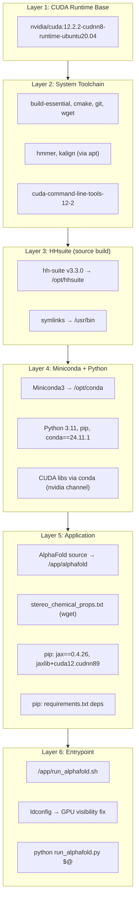
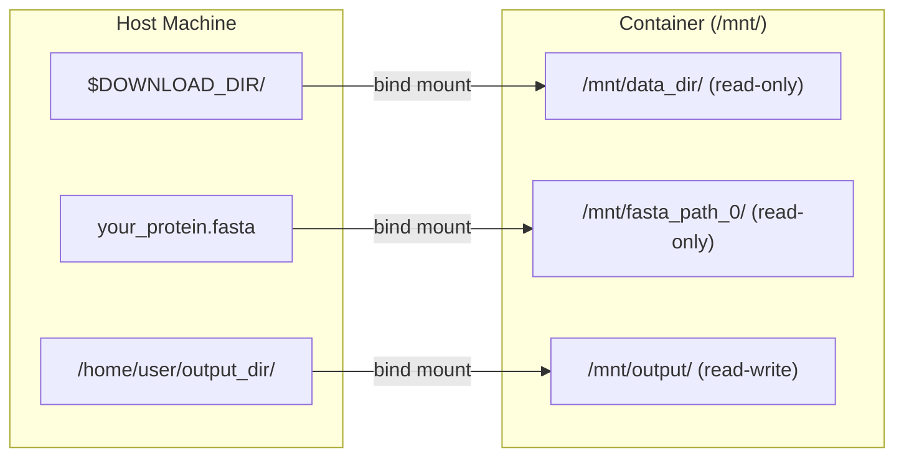
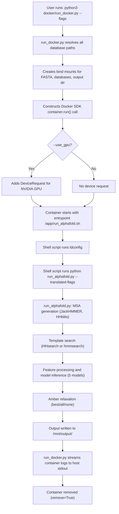

AlphaFold's Docker deployment is the **canonical and simplest way** to run the full inference pipeline. It encapsulates the entire runtime stack — CUDA libraries, HHsuite, JAX with GPU acceleration, and all Python dependencies — into a single reproducible container image, while mounting the large genetic databases and input FASTA files from the host via bind mounts. This page covers the image architecture, the build process, the host-side launcher `run_docker.py`, and all tunable parameters for production deployment.

Sources: [Dockerfile](docker/Dockerfile#L1-L92), [run_docker.py](docker/run_docker.py#L1-L319), [README.md](README.md#L39-L149)

## Image Architecture

The Docker image is built on **NVIDIA's CUDA 12.2.2 runtime base** with Ubuntu 20.04, creating a layered architecture where each layer serves a distinct role: system toolchain → bioinformatics tools → Python runtime → application code → entrypoint wrapper.



Each layer is worth understanding in detail because it dictates what you can and cannot modify without rebuilding:

| Layer | What It Provides | Modifiable Without Rebuild? |
|:------|:-----------------|:---------------------------:|
| CUDA Runtime Base | NVIDIA driver interface, cuDNN 8 | No |
| System Toolchain | `jackhmmer`, `hmmsearch`, `kalign` binaries | No |
| HHsuite v3.3.0 | `hhblits`, `hhsearch` compiled from source | No |
| Miniconda + Python 3.11 | Python runtime, CUDA shared libs via conda | No |
| Application Code | `/app/alphafold` source tree, JAX 0.4.26 | No (bind-mount overrides possible) |
| Entrypoint | `ldconfig` + `run_alphafold.py` invocation | Partially (override `ENTRYPOINT`) |

Sources: [Dockerfile](docker/Dockerfile#L15-L92)

### The Entrypoint Wrapper

The image's entrypoint is not `run_alphafold.py` directly, but a shell script `/app/run_alphafold.sh` that performs a critical two-step sequence:

```bash
#!/bin/bash
ldconfig                    # Step 1: Ensure GPU libraries are visible
python /app/alphafold/run_alphafold.py "$@"   # Step 2: Run inference
```

The `ldconfig` call is **not optional** — it resolves a well-documented Debian quirk where NVIDIA container GPU libraries are not visible to the dynamic linker without explicitly refreshing the cache. Without it, JAX would fail to detect GPU devices at runtime.

Sources: [Dockerfile](docker/Dockerfile#L81-L91)

### JAX and GPU Memory Configuration

The image installs **JAX 0.4.26** with the CUDA 12 + cuDNN 8.9 variant of `jaxlib`, fetched from Google's JAX CUDA releases bucket. This specific pairing is pinned for compatibility with the CUDA 12.2.2 base image. Additionally, two critical environment variables are set at container runtime (not build time) by `run_docker.py`:

| Environment Variable | Value | Purpose |
|:---------------------|:------|:--------|
| `TF_FORCE_UNIFIED_MEMORY` | `1` | Allows JAX to exceed GPU memory by spilling to host memory, enabling predictions on proteins that would otherwise cause OOM |
| `XLA_PYTHON_CLIENT_MEM_FRACTION` | `4.0` | Sets XLA's memory fraction above 1.0, working in tandem with unified memory to allocate more virtual address space than physical GPU RAM |

These two flags are the reason AlphaFold can predict structures for very long sequences (3000+ residues) even on GPUs with limited VRAM — the computation spills to unified memory at the cost of reduced speed.

Sources: [Dockerfile](docker/Dockerfile#L68-L73), [run_docker.py](docker/run_docker.py#L294-L300)

## Build Process

### Prerequisites

Before building the image, ensure the following are installed on your host machine:

| Requirement | Purpose | Installation |
|:------------|:--------|:-------------|
| Docker | Container runtime | [docker.com](https://www.docker.com/) |
| NVIDIA Container Toolkit | GPU passthrough to containers | [NVIDIA docs](https://docs.nvidia.com/datacenter/cloud-native/container-toolkit/install-guide.html) |
| Docker non-root user | Avoid permission issues with output files | [Docker post-install](https://docs.docker.com/engine/install/linux-postinstall/#manage-docker-as-a-non-root-user) |
| NVIDIA GPU + driver | Inference acceleration | Any modern NVIDIA GPU (more VRAM → larger proteins) |

### Building the Image

The build context is the **repository root** (not the `docker/` subdirectory), because the Dockerfile uses `COPY . /app/alphafold` to copy the entire AlphaFold source tree into the image:

```bash
docker build -f docker/Dockerfile -t alphafold .
```

The trailing `.` is critical — it sets the build context to the repository root. The `-f docker/Dockerfile` flag tells Docker to look for the Dockerfile inside the `docker/` subdirectory while keeping the context at the project root.

> [!TIP]
> **Critical: Database directory placement.** The genetic database download directory must **not** be a subdirectory of the AlphaFold repository. If it is, Docker's build context will copy the multi-terabyte databases into the image, making the build extremely slow and producing an enormous image. This check is enforced programmatically in `run_docker.py` at runtime as well.

Sources: [README.md](README.md#L103-L107), [run_docker.py](docker/run_docker.py#L214-L219)

### Verifying GPU Access

After building, confirm that the NVIDIA Container Toolkit is correctly configured:

```bash
docker run --rm --gpus all nvidia/cuda:11.0-base nvidia-smi
```

If this command lists your GPUs, the toolkit is working. If it fails, consult the [NVIDIA Docker troubleshooting guide](https://github.com/NVIDIA/nvidia-docker/issues/1447#issuecomment-801479573).

Sources: [README.md](README.md#L86-L95)

## The Host-Side Launcher: run_docker.py

The `docker/run_docker.py` script is the **primary interface** for running AlphaFold via Docker. It is not a wrapper around the Docker CLI in the trivial sense — it performs substantial orchestration: constructing bind mounts for every database and input file, configuring GPU device requests, setting runtime environment variables, and translating its own flags into the internal flags accepted by `run_alphafold.py` inside the container.

### Host-Side Dependencies

Only two lightweight packages are needed on the host machine to run `run_docker.py`:

```
absl-py==1.0.0
docker==5.0.0
```

Install them with:

```bash
pip3 install -r docker/requirements.txt
```

Sources: [docker/requirements.txt](docker/requirements.txt#L1-L4)

### Mount Architecture

`run_docker.py` uses Docker **bind mounts** to expose host directories inside the container without copying data into the image. All mounts are placed under the container-internal path `/mnt/`. The mount strategy differs between read-only data sources and the writable output directory:



The `_create_mount` function handles a subtle edge case: if a flag points to a **file** rather than a directory, it mounts the file's **parent directory** and then rewrites the flag to point to the filename within the mounted parent. This ensures Docker bind mounts always operate on directories while preserving the exact file paths expected by `run_alphafold.py`.

Sources: [run_docker.py](docker/run_docker.py#L130-L156), [run_docker.py](docker/run_docker.py#L221-L262)

### Database Mount Selection

The set of databases mounted into the container is **conditionally determined** by the `--model_preset` and `--db_preset` flags. This is a key optimization — monomer mode doesn't need the UniProt or PDB seqres databases, and `reduced_dbs` mode swaps out BFD + UniRef30 for SmallBFD:

| Condition | Databases Mounted |
|:----------|:-----------------|
| `model_preset=multimer` | UniProt, PDB seqres (in addition to base set) |
| `model_preset` ≠ `multimer` | PDB70 (instead of UniProt + PDB seqres) |
| `db_preset=full_dbs` | BFD + UniRef30 |
| `db_preset=reduced_dbs` | SmallBFD only |

Sources: [run_docker.py](docker/run_docker.py#L232-L259)

## Complete Flag Reference

The following table documents every flag accepted by `run_docker.py`, grouped by category. Flags marked as **Required** must be provided; all others have sensible defaults.

### Input and Output

| Flag | Type | Default | Required | Description |
|:-----|:-----|:--------|:--------:|:------------|
| `--fasta_paths` | comma-list | — | ✓ | Paths to FASTA files; multiple sequences in one file → multimer; comma-separated for sequential folding |
| `--output_dir` | string | `/tmp/alphafold` | | Absolute path to output directory on host |
| `--data_dir` | string | — | ✓ | Path to genetic databases and model params (target of `download_all_data.sh`) |
| `--max_template_date` | string | — | ✓ | ISO-8601 date (YYYY-MM-DD); templates released after this date are excluded |

### Model Configuration

| Flag | Type | Default | Description |
|:-----|:-----|:--------|:------------|
| `--model_preset` | enum | `monomer` | One of: `monomer`, `monomer_casp14`, `monomer_ptm`, `multimer` |
| `--db_preset` | enum | `full_dbs` | `full_dbs` for all genetic databases; `reduced_dbs` for SmallBFD (lower accuracy, faster) |
| `--models_to_relax` | enum | `best` | `best` = relax highest-confidence model only; `all` = relax every model; `none` = skip relaxation |
| `--num_multimer_predictions_per_model` | int | `5` | Number of random-seed predictions per model (multimer only; 5 models × 5 seeds = 25 predictions by default) |
| `--benchmark` | bool | `False` | Run multiple JAX evaluations to measure inference time excluding compilation |
| `--use_precomputed_msas` | bool | `False` | Reuse MSAs from a previous run's output directory (skips MSA tools; **does not validate sequence/db consistency**) |

### GPU and Container Configuration

| Flag | Type | Default | Description |
|:-----|:-----|:--------|:------------|
| `--use_gpu` | bool | `True` | Enable NVIDIA runtime for GPU acceleration |
| `--enable_gpu_relax` | bool | `True` | Run Amber relaxation on GPU (faster, potentially less stable) |
| `--gpu_devices` | string | `all` | Comma-separated GPU indices or UUIDs passed to `NVIDIA_VISIBLE_DEVICES` |
| `--docker_image_name` | string | `alphafold` | Name/tag of the Docker image to run |
| `--docker_user` | string | `uid:gid` | User:group inside container; defaults to current host user so output files have correct ownership |

Sources: [run_docker.py](docker/run_docker.py#L29-L126)

## Running AlphaFold

### Monomer Prediction

```bash
python3 docker/run_docker.py \
  --fasta_paths=monomer.fasta \
  --max_template_date=2022-01-01 \
  --data_dir=$DOWNLOAD_DIR \
  --output_dir=/home/user/alphafold_output
```

### Multimer Prediction

Provide a multi-sequence FASTA file and set `--model_preset=multimer`:

```bash
python3 docker/run_docker.py \
  --fasta_paths=complex.fasta \
  --max_template_date=2022-01-01 \
  --model_preset=multimer \
  --data_dir=$DOWNLOAD_DIR \
  --output_dir=/home/user/alphafold_output
```

### Reduced Databases (Faster, Lower Accuracy)

```bash
python3 docker/run_docker.py \
  --fasta_paths=protein.fasta \
  --max_template_date=2022-01-01 \
  --model_preset=monomer \
  --db_preset=reduced_dbs \
  --data_dir=$DOWNLOAD_DIR \
  --output_dir=/home/user/alphafold_output
```

### CPU-Only Mode

Disable GPU entirely (useful for debugging or CPU-only machines; inference will be very slow):

```bash
python3 docker/run_docker.py \
  --fasta_paths=protein.fasta \
  --max_template_date=2022-01-01 \
  --use_gpu=false \
  --data_dir=$DOWNLOAD_DIR \
  --output_dir=/home/user/alphafold_output
```

### Specific GPU Selection

```bash
python3 docker/run_docker.py \
  --fasta_paths=protein.fasta \
  --max_template_date=2022-01-01 \
  --gpu_devices=0,2 \
  --data_dir=$DOWNLOAD_DIR \
  --output_dir=/home/user/alphafold_output
```

Sources: [README.md](README.md#L310-L366), [run_docker.py](docker/run_docker.py#L279-L301)

## Execution Flow

The following diagram traces the complete lifecycle from the moment you invoke `run_docker.py` to the final output on disk:



Sources: [run_docker.py](docker/run_docker.py#L279-L309), [Dockerfile](docker/Dockerfile#L86-L91)

## Container Runtime Environment

Beyond the mount and GPU configuration, `run_docker.py` sets several container properties that are important to understand for production deployments:

### User and Permissions

The container runs as the **host user's UID:GID** by default (via `--docker_user`), ensuring that output files written to the bind-mounted output directory are owned by the calling user, not root. You can override this with `--docker_user=uid:gid` if needed.

### Container Lifecycle

The container is created with `remove=True` and `detach=True` — it runs in the background but is automatically cleaned up after completion. A **SIGINT signal handler** is registered so that Ctrl+C on the host gracefully kills the running container rather than leaving an orphaned process.

### Log Streaming

Container logs are streamed to the host's `logging.info()` output (backed by Abseil's logging), giving real-time visibility into the inference progress without needing to inspect `docker logs` separately.

Sources: [run_docker.py](docker/run_docker.py#L286-L309)

## Troubleshooting

| Problem | Cause | Solution |
|:--------|:------|:---------|
| `nvidia-smi` fails inside container | NVIDIA Container Toolkit misconfigured | Reinstall toolkit; verify with `docker run --rm --gpus all nvidia/cuda:11.0-base nvidia-smi` |
| GPG error during `docker build` | NVIDIA repo signing key rotation | Apply workaround from [issue #463](https://github.com/deepmind/alphafold/issues/463#issuecomment-1124881779) |
| Docker build is extremely slow | Database directory is inside the repo | Move `$DOWNLOAD_DIR` outside the AlphaFold repository tree |
| Opaque MSA tool errors | File permissions on database files | Run `sudo chmod 755 --recursive "$DOWNLOAD_DIR"` |
| OOM on long sequences | GPU VRAM exceeded | Already mitigated by `TF_FORCE_UNIFIED_MEMORY=1` and `XLA_PYTHON_CLIENT_MEM_FRACTION=4.0`; try `--db_preset=reduced_dbs` |
| Output files owned by root | Container ran as root | Set `--docker_user=$(id -u):$(id -g)` |
| `undefined_symbol` error at startup | `libffi` version mismatch between conda and system | Handled by the symlink `ln -sf /usr/lib/x86_64-linux-gnu/libffi.so.7 /opt/conda/lib/libffi.so.7` in the Dockerfile |

Sources: [README.md](README.md#L109-L117), [Dockerfile](docker/Dockerfile#L78-L79), [run_docker.py](docker/run_docker.py#L214-L219)

## Hardware Recommendations

The reference configuration tested by DeepMind is a Google Cloud machine with **12 vCPUs, 85 GB RAM, an A100 GPU, a 100 GB boot disk, and a 3 TB data disk** for databases. The following table summarizes requirements for both database presets:

| Resource | `full_dbs` | `reduced_dbs` |
|:---------|:----------|:-------------|
| CPU cores | 12+ recommended | 8 minimum |
| RAM | 85 GB recommended | 8 GB minimum |
| GPU | NVIDIA A100 (40 GB VRAM) recommended | Any modern NVIDIA GPU |
| Disk (databases) | ~2.62 TB (556 GB download) | ~600 GB |
| Disk type | **SSD** (critical for MSA search speed) | SSD recommended |

Sources: [README.md](README.md#L40-L43), [README.md](README.md#L196-L199)

---

<CgxTip>

**Singularity on HPC systems.** If your environment uses Singularity/Apptainer instead of Docker, the official repository does not provide a Singularity definition file. Community-maintained Singularity setups are available at [issue #10](https://github.com/deepmind/alphafold/issues/10) and [issue #24](https://github.com/deepmind/alphafold/issues/24).

</cgz_tip>

Having mastered the Docker deployment, the next critical step is ensuring your genetic databases are correctly downloaded and configured — see [Genetic Database Setup](24-genetic-database-setup). For a deeper understanding of what happens inside the container after launch, explore [Architecture Overview](7-architecture-overview) or the specific pipeline pages under the Data Pipeline section.