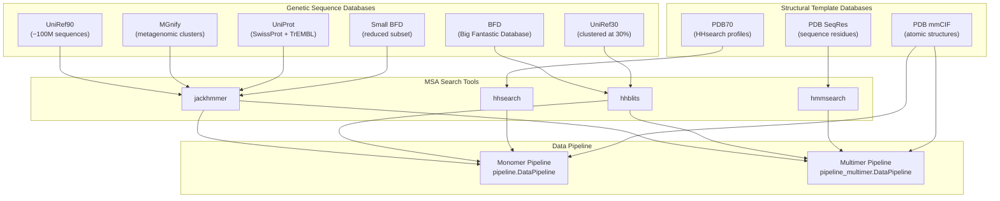
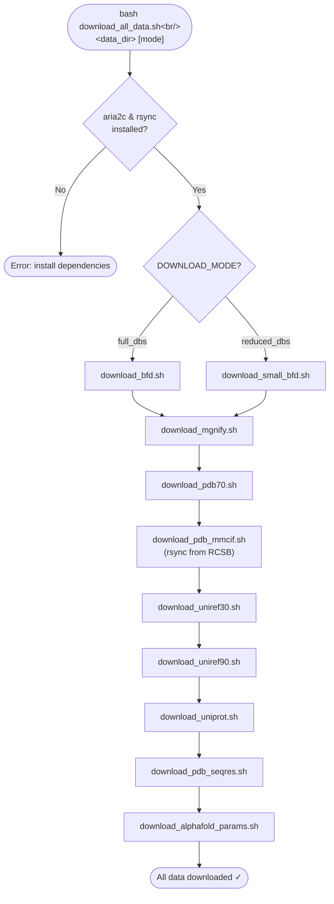

AlphaFold's prediction accuracy is fundamentally driven by the depth and diversity of its input Multiple Sequence Alignments (MSAs). These MSAs are generated by querying a carefully curated set of **genetic and structural databases** — each selected for a distinct evolutionary signal they contribute to the final alignment. This page provides a complete guide to understanding, downloading, and configuring these databases for both monomer and multimer prediction modes.

## Database Architecture Overview

The genetic databases form a three-tier hierarchy within AlphaFold's data pipeline. **Uniref90** and **MGnify** provide broad evolutionary coverage through jackhmmer searches; **BFD** and **UniRef30** supply deep, clustered homologs via hhblits; and **PDB70** / **PDB SeqRes** deliver structural templates through hhsearch or hmmsearch. The UniProt database is a multimer-specific addition that enables chain-level MSA pairing. The following diagram captures the full data flow from raw databases through MSA tools into the feature assembly stage:



Sources: [pipeline.py](/alphafold/data/pipeline.py#L123-L172), [pipeline_multimer.py](/alphafold/data/pipeline_multimer.py#L184-L216), [run_alphafold.py](/run_alphafold.py#L102-L167)

## Database Catalog

Each database occupies a specific role in the MSA generation pipeline. The table below summarizes every database, its source, the MSA tool that queries it, the download mechanism, and whether it is required for monomer, multimer, or both modes.

| Database | Role | MSA Tool | Source Host | Download Format | Monomer | Multimer | Approx. Size |
|---|---|---|---|---|---|---|---|
| **UniRef90** | Broad uniref coverage | jackhmmer | EBI FTP | `.fasta.gz` → gunzip | ✅ | ✅ | ~60 GB |
| **MGnify** | Metagenomic diversity | jackhmmer | GCS mirror | `.fa.gz` → gunzip | ✅ | ✅ | ~60 GB |
| **BFD** | Deep clustered homologs | hhblits | GCS mirror | `.tar.gz` → extract | ✅ (full) | ✅ (full) | ~270 GB |
| **Small BFD** | Reduced BFD subset | jackhmmer | GCS | `.fasta.gz` → gunzip | ✅ (reduced) | ✅ (reduced) | ~2 GB |
| **UniRef30** | 30% clustered profiles | hhblits | GCS mirror | `.tar.gz` → extract | ✅ (full) | ✅ (full) | ~30 GB |
| **UniProt** | Unclustered for pairing | jackhmmer | EBI FTP | `.fasta.gz` → merge | ❌ | ✅ | ~100 GB |
| **PDB70** | HHsearch template profiles | hhsearch | GWDG | `.tar.gz` → extract | ✅ | ❌ | ~70 GB |
| **PDB mmCIF** | Atomic template structures | (featurizer) | RCSB rsync | rsync + flatten | ✅ | ✅ | ~25 GB |
| **PDB SeqRes** | hmmsearch sequence DB | hmmsearch | wwPDB | `.txt` → filter | ❌ | ✅ | ~0.1 GB |
| **AlphaFold Params** | Neural network weights | (model loader) | GCS | `.tar` → extract | ✅ | ✅ | ~1 GB |

> [!TIP]
> The **reduced_dbs** preset replaces the BFD + UniRef30 combination (hhblits, ~300 GB total) with Small BFD alone (jackhmmer, ~2 GB). This dramatically reduces disk and memory requirements but may decrease prediction accuracy for sequences with shallow MSAs.

Sources: [download_uniref90.sh](/scripts/download_uniref90.sh#L32-L41), [download_mgnify.sh](/scripts/download_mgnify.sh#L32-L43), [download_bfd.sh](/scripts/download_bfd.sh#L32-L43), [download_small_bfd.sh](/scripts/download_small_bfd.sh#L32-L41), [download_uniref30.sh](/scripts/download_uniref30.sh#L32-L43), [download_uniprot.sh](/scripts/download_uniprot.sh#L33-L55), [download_pdb70.sh](/scripts/download_pdb70.sh#L32-L41), [download_pdb_mmcif.sh](/scripts/download_pdb_mmcif.sh#L37-L65), [download_pdb_seqres.sh](/scripts/download_pdb_seqres.sh#L32-L42)

## Downloading All Databases

The orchestration script `download_all_data.sh` fetches every required database in a single invocation. It accepts two arguments: the target download directory (required) and a download mode (optional, defaults to `full_dbs`).

```bash
# Full databases (recommended for best accuracy)
bash scripts/download_all_data.sh /path/to/data_dir full_dbs

# Reduced databases (lower disk usage, faster download)
bash scripts/download_all_data.sh /path/to/data_dir reduced_dbs
```

The script validates that **aria2c** (for high-speed parallel downloads) and **rsync** (for PDB mmCIF synchronization) are installed before proceeding. The download mode controls the BFD variant: `full_dbs` downloads the complete BFD (~270 GB) plus UniRef30, while `reduced_dbs` downloads only Small BFD (~2 GB). All other databases are downloaded regardless of mode.



Sources: [download_all_data.sh](/scripts/download_all_data.sh#L1-L80)

## Individual Database Downloads

Each database has a dedicated script under `scripts/` that handles downloading, decompression, and any post-processing. Understanding these individually is essential for selective downloads or troubleshooting.

### UniRef90 — Broad Sequence Coverage

UniRef90 is the first database queried in the pipeline and provides the widest evolutionary net. It is downloaded directly from EBI's UniProt FTP server as a gzip-compressed FASTA file.

```bash
bash scripts/download_uniref90.sh /path/to/data_dir
# Result: /path/to/data_dir/uniref90/uniref90.fasta
```

The source URL is `https://ftp.ebi.ac.uk/pub/databases/uniprot/uniref/uniref90/uniref90.fasta.gz`. The script downloads via aria2c, then gunzips in place. In the pipeline, jackhmmer queries this database first and the resulting MSA is also used as input for template search.

Sources: [download_uniref90.sh](/scripts/download_uniref90.sh#L32-L41), [pipeline.py](/alphafold/data/pipeline.py#L146-L150)

### MGnify — Metagenomic Sequence Clusters

MGnify provides metagenomic sequences that capture environmental diversity beyond curated databases. AlphaFold uses a GCS-hosted mirror of the EBI MGnify peptide database (release 2022_05) for reliability.

```bash
bash scripts/download_mgnify.sh /path/to/data_dir
# Result: /path/to/data_dir/mgnify/mgy_clusters_2022_05.fa
```

The original EBI URL (`https://ftp.ebi.ac.uk/pub/databases/metagenomics/peptide_database/2022_05/mgy_clusters.fa.gz`) is mirrored at `https://storage.googleapis.com/alphafold-databases/v2.3/mgy_clusters_2022_05.fa.gz`. In the pipeline, jackhmmer queries MGnify with a default cap of 501 hits (`mgnify_max_hits`).

Sources: [download_mgnify.sh](/scripts/download_mgnify.sh#L34-L43), [pipeline.py](/alphafold/data/pipeline.py#L163-L167)

### BFD and UniRef30 — Deep Homolog Detection (full_dbs Mode)

In `full_dbs` mode, the **BFD** (Big Fantastic Database) and **UniRef30** are queried together via hhblits. BFD provides deeply clustered homologs at 30% sequence identity, while UniRef30 (UniRef30_2021_03) offers additional profile diversity.

```bash
bash scripts/download_bfd.sh /path/to/data_dir
# Result: /path/to/data_dir/bfd/bfd_metaclust_clu_complete_id30_c90_final_seq.sorted_opt/

bash scripts/download_uniref30.sh /path/to/data_dir
# Result: /path/to/data_dir/uniref30/UniRef30_2021_03/
```

Both are GCS mirrors of their original sources. The BFD tarball extracts a directory containing multiple database files that hhblits reads as a combined profile database. The pipeline initializes a single `HHBlits` runner with `databases=[bfd_database_path, uniref30_database_path]`, meaning both databases are searched in one hhblits invocation.

Sources: [download_bfd.sh](/scripts/download_bfd.sh#L32-L43), [download_uniref30.sh](/scripts/download_uniref30.sh#L34-L43), [pipeline.py](/alphafold/data/pipeline.py#L158-L162)

### Small BFD — Reduced Database Alternative

When disk space or download time is a constraint, `reduced_dbs` mode replaces the full BFD + UniRef30 with **Small BFD** — a ~2 GB subset of BFD containing only the first non-consensus sequences. Critically, this database is queried with **jackhmmer** rather than hhblits, eliminating the HHsuite dependency for this step.

```bash
bash scripts/download_small_bfd.sh /path/to/data_dir
# Result: /path/to/data_dir/small_bfd/bfd-first_non_consensus_sequences.fasta
```

The pipeline creates a `Jackhmmer` runner for Small BFD when `use_small_bfd=True`, bypassing the hhblits path entirely.

Sources: [download_small_bfd.sh](/scripts/download_small_bfd.sh#L32-L41), [pipeline.py](/alphafold/data/pipeline.py#L151-L156)

### UniProt — Multimer MSA Pairing

UniProt is **only required for multimer predictions**. It provides unclustered SwissProt + TrEMBL sequences that jackhmmer searches to generate pairing MSAs — these are critical for correctly aligning chains from different subunits that share evolutionary partners.

```bash
bash scripts/download_uniprot.sh /path/to/data_dir
# Result: /path/to/data_dir/uniprot/uniprot.fasta
```

The download script fetches both `uniprot_trembl.fasta.gz` and `uniprot_sprot.fasta.gz` from EBI, decompresses them, then **concatenates** SwissProt into TrEMBL and renames the result to `uniprot.fasta`. In the multimer pipeline, jackhmmer queries UniProt with a default cap of 50,000 hits (`max_uniprot_hits`), and the resulting species identifiers are used for cross-chain MSA pairing.

Sources: [download_uniprot.sh](/scripts/download_uniprot.sh#L33-L55), [pipeline_multimer.py](/alphafold/data/pipeline_multimer.py#L210-L214)

### PDB70 — Monomer Template Search

PDB70 is the HHsearch-format profile database used for **monomer** template identification. It contains pre-computed HMM profiles for PDB chains clustered at 70% sequence identity.

```bash
bash scripts/download_pdb70.sh /path/to/data_dir
# Result: /path/to/data_dir/pdb70/pdb70
```

This is downloaded from the Söding lab's HHsuite database archive. In the monomer pipeline, `HHSearch` queries PDB70 with the UniRef90 MSA converted to a3m format, returning structural template hits that are then featurized.

Sources: [download_pdb70.sh](/scripts/download_pdb70.sh#L32-L41), [run_alphafold.py](/run_alphafold.py#L627-L631)

### PDB mmCIF — Template Atomic Structures

The PDB mmCIF database provides the actual atomic coordinates for template structures. Unlike other databases, it is downloaded via **rsync** from the RCSB PDB server, which provides incremental synchronization.

```bash
bash scripts/download_pdb_mmcif.sh /path/to/data_dir
# Result:
#   /path/to/data_dir/pdb_mmcif/mmcif_files/*.cif
#   /path/to/data_dir/pdb_mmcif/obsolete.dat
```

The download process has three phases: (1) rsync all gzipped mmCIF files from `rsync.rcsb.org::ftp_data/structures/divided/mmCIF/`, (2) gunzip all files, and (3) **flatten** the directory structure by moving all `.cif` files from their per-PDB-code subdirectories into a single `mmcif_files/` directory. The script also downloads `obsolete.dat` which maps deprecated PDB codes to their replacements. If download speed is slow, the script suggests using alternative mirrors: `rsync.ebi.ac.uk` (Europe) or `ftp.pdbj.org` (Asia).

Sources: [download_pdb_mmcif.sh](/scripts/download_pdb_mmcif.sh#L37-L65)

### PDB SeqRes — Multimer Template Search

PDB SeqRes is the **multimer-specific** alternative to PDB70. It contains the sequence records for all PDB entries, filtered to retain only protein sequences.

```bash
bash scripts/download_pdb_seqres.sh /path/to/data_dir
# Result: /path/to/data_dir/pdb_seqres/pdb_seqres.txt
```

The script downloads `pdb_seqres.txt` from wwPDB, then filters it with `grep` to keep only lines matching `>.* mol:protein`, removing RNA, DNA, and ligand entries. In the multimer pipeline, `hmmsearch` (not HHsearch) queries this database, requiring the additional `hmmbuild` binary to first construct a HMM from the query.

Sources: [download_pdb_seqres.sh](/scripts/download_pdb_seqres.sh#L32-L42), [run_alphafold.py](/run_alphafold.py#L612-L617)

## Directory Layout After Download

After running `download_all_data.sh`, the target directory will have the following structure. The Docker launch script and `run_alphafold.py` flags both reference paths within this layout:

```
<data_dir>/
├── params/                          # Neural network weights
│   ├── params_model_1_multimer.npz
│   ├── params_model_2_multimer.npz
│   └── ...
├── uniref90/
│   └── uniref90.fasta               # JackHMMER query target
├── mgnify/
│   └── mgy_clusters_2022_05.fa      # JackHMMER query target
├── bfd/                             # (full_dbs only)
│   └── bfd_metaclust_clu_complete_id30_c90_final_seq.sorted_opt/
├── uniref30/                        # (full_dbs only)
│   └── UniRef30_2021_03/            # HHblits query target (paired with BFD)
├── small_bfd/                       # (reduced_dbs only)
│   └── bfd-first_non_consensus_sequences.fasta
├── uniprot/                         # (multimer only)
│   └── uniprot.fasta                # SwissProt + TrEMBL merged
├── pdb70/                           # (monomer only)
│   └── pdb70                        # HHsearch profile database
├── pdb_mmcif/
│   ├── mmcif_files/                 # Flattened *.cif files
│   │   ├── 1abc.cif
│   │   └── ...
│   └── obsolete.dat                 # Obsolete PDB ID mapping
└── pdb_seqres/                      # (multimer only)
    └── pdb_seqres.txt               # Filtered protein sequences
```

Sources: [run_docker.py](/docker/run_docker.py#L166-L210), [download_all_data.sh](/scripts/download_all_data.sh#L46-L78)

## Configuration by Mode and Preset

The required databases vary based on two key flags: **`--db_preset`** (full_dbs or reduced_dbs) and **`--model_preset`** (monomer, monomer_casp14, monomer_ptm, or multimer). The pipeline validates these combinations at startup using the `_check_flag` helper, raising a `ValueError` if required database paths are missing or extraneous ones are set.

| Flag Combination | Required Databases |
|---|---|
| `full_dbs` + `monomer` | UniRef90, MGnify, **BFD**, **UniRef30**, **PDB70**, PDB mmCIF |
| `full_dbs` + `multimer` | UniRef90, MGnify, **BFD**, **UniRef30**, **UniProt**, **PDB SeqRes**, PDB mmCIF |
| `reduced_dbs` + `monomer` | UniRef90, MGnify, **Small BFD**, **PDB70**, PDB mmCIF |
| `reduced_dbs` + `multimer` | UniRef90, MGnify, **Small BFD**, **UniProt**, **PDB SeqRes**, PDB mmCIF |

The validation logic in `run_alphafold.py` enforces these rules: `small_bfd_database_path` must be set **only** when `db_preset=reduced_dbs`; `bfd_database_path` and `uniref30_database_path` must be set **only** when `db_preset=full_dbs`; `pdb70_database_path` is required for monomer modes; and `pdb_seqres_database_path` plus `uniprot_database_path` are required for multimer mode.

Sources: [run_alphafold.py](/run_alphafold.py#L576-L599)

## Docker Path Mapping

When running via Docker, the `run_docker.py` script constructs default database paths relative to the `--data_dir` flag and mounts them as read-only bind volumes into the container at `/mnt/`. The path construction follows the directory layout exactly:

| Database | Constructed Path |
|---|---|
| UniRef90 | `{data_dir}/uniref90/uniref90.fasta` |
| UniProt | `{data_dir}/uniprot/uniprot.fasta` |
| MGnify | `{data_dir}/mgnify/mgy_clusters_2022_05.fa` |
| BFD | `{data_dir}/bfd/bfd_metaclust_clu_complete_id30_c90_final_seq.sorted_opt` |
| Small BFD | `{data_dir}/small_bfd/bfd-first_non_consensus_sequences.fasta` |
| UniRef30 | `{data_dir}/uniref30/UniRef30_2021_03` |
| PDB70 | `{data_dir}/pdb70/pdb70` |
| PDB SeqRes | `{data_dir}/pdb_seqres/pdb_seqres.txt` |
| Template mmCIF | `{data_dir}/pdb_mmcif/mmcif_files` |
| Obsolete PDBs | `{data_dir}/pdb_mmcif/obsolete.dat` |

The script also validates that `data_dir` is not a subdirectory of the AlphaFold repository — otherwise the Docker build would copy the large databases into the image, making it extremely slow.

> [!TIP]
> When running without Docker, you must pass each database path explicitly via command-line flags (e.g., `--uniref90_database_path`, `--bfd_database_path`). The Docker script automates this by constructing paths from `--data_dir` and forwarding them as `--flag=value` arguments to `run_alphafold.py` inside the container.

Sources: [run_docker.py](/docker/run_docker.py#L166-L259)

## Prerequisites and Download Tools

All download scripts require **aria2c** for high-speed parallel HTTP/FTP downloads. The PDB mmCIF download additionally requires **rsync** for incremental synchronization from RCSB. The `download_all_data.sh` script validates both are installed before proceeding.

```bash
# Install required download tools (Ubuntu/Debian)
sudo apt install aria2 rsync
```

At runtime, the MSA tools that query these databases must also be installed. The Docker image handles this automatically by installing **hmmer** (providing jackhmmer, hmmsearch, hmmbuild) and **kalign** via apt, then compiling **HHsuite** v3.3.0 from source (providing hhblits and hhsearch).

| Runtime Tool | Databases Queried | Provided By |
|---|---|---|
| **jackhmmer** | UniRef90, MGnify, Small BFD, UniProt | hmmer (apt) |
| **hhblits** | BFD + UniRef30 | HHsuite v3.3.0 (compiled) |
| **hhsearch** | PDB70 | HHsuite v3.3.0 (compiled) |
| **hmmsearch** | PDB SeqRes | hmmer (apt) |
| **hmmbuild** | (helper for hmmsearch) | hmmer (apt) |
| **kalign** | (template alignment) | kalign (apt) |

Sources: [Dockerfile](/docker/Dockerfile#L25-L47), [download_all_data.sh](/scripts/download_all_data.sh#L27-L35), [run_alphafold.py](/run_alphafold.py#L562-L574)

## Troubleshooting

| Issue | Cause | Resolution |
|---|---|---|
| `aria2c could not be found` | Missing download tool | `sudo apt install aria2` |
| `rsync could not be found` | Missing sync tool | `sudo apt install rsync` |
| Slow PDB mmCIF rsync | RCSB server congestion | Switch mirror to `rsync.ebi.ac.uk` (EU) or `ftp.pdbj.org` (Asia) |
| `ValueError: bfd_database_path must be set` | Running `full_dbs` without BFD | Download BFD or switch to `--db_preset=reduced_dbs` |
| `ValueError: pdb_seqres_database_path must be set` | Running multimer without PDB SeqRes | Download PDB SeqRes: `bash scripts/download_pdb_seqres.sh` |
| `Could not find path to "hhblits" binary` | HHsuite not installed | Compile from source or use Docker image |
| Docker build extremely slow | `data_dir` inside repo directory | Move `data_dir` outside the AlphaFold repository |

Sources: [download_pdb_mmcif.sh](/scripts/download_pdb_mmcif.sh#L42-L46), [run_alphafold.py](/run_alphafold.py#L569-L574), [run_docker.py](/docker/run_docker.py#L214-L219)

---

With the genetic databases properly configured, the MSA generation pipeline can produce the alignments that feed AlphaFold's Evoformer. To understand how these MSAs flow through the neural network, proceed to [MSA Generation Workflow](8-msa-generation-workflow). For deploying the complete system with Docker, see [Docker Deployment](23-docker-deployment). For configuring which model preset and database preset to use at runtime, see [Model Presets and Variants](21-model-presets-and-variants).