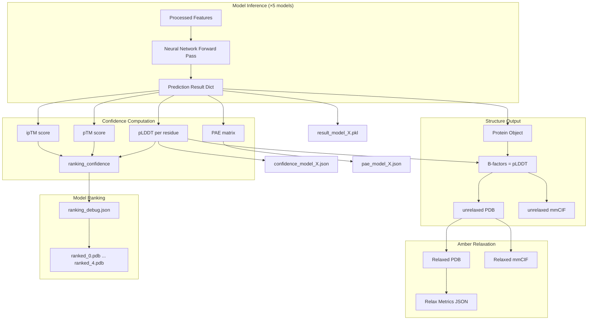

AlphaFold produces a rich, multi-layered output directory for each prediction target. Understanding what each file contains, how confidence metrics are computed, and how to read the structural representations is essential for extracting biological insight from raw predictions. This page decodes every output artifact, explains the confidence scoring system, and maps the logic by which models are ranked and selected.

## Output Directory Structure

When AlphaFold completes a prediction for a target (e.g., `my_protein`), it writes results into `<output_dir>/my_protein/`. The following diagram illustrates the complete output tree and the data flow that produces each artifact:



The table below enumerates every output file, its format, and the scope of its content:

| File Pattern | Format | Scope | Description |
|---|---|---|---|
| `features.pkl` | Pickle dict | Per target | Input feature dictionary fed to all models |
| `result_model_{1..5}.pkl` | Pickle dict | Per model | Full prediction result including logits, structure module outputs, and confidence metrics |
| `confidence_model_{1..5}.json` | JSON | Per model | Per-residue pLDDT scores and confidence categories |
| `pae_model_{1..5}.json` | JSON | Per model | Predicted Aligned Error matrix (monomer_ptm and multimer only) |
| `unrelaxed_model_{1..5}.pdb` | PDB | Per model | Predicted structure before Amber relaxation, pLDDT in B-factor column |
| `unrelaxed_model_{1..5}.cif` | mmCIF | Per model | Same structure in mmCIF format |
| `relaxed_model_{1..5}.pdb` | PDB | Per model | Amber-relaxed structure (only if relaxation enabled for this model) |
| `relaxed_model_{1..5}.cif` | mmCIF | Per model | Relaxed structure in mmCIF format |
| `ranked_{0..4}.pdb` | PDB | Per rank | Structures sorted by ranking confidence (rank 0 = best) |
| `ranked_{0..4}.cif` | mmCIF | Per rank | Ranked structures in mmCIF format |
| `ranking_debug.json` | JSON | Per target | Model ranking scores and sorted order |
| `timings.json` | JSON | Per target | Wall-clock time for each pipeline stage |
| `relax_metrics.json` | JSON | Per target | Amber relaxation violations and energy metrics |
| `msas/` | Directory | Per target | Intermediate MSA files (if not using precomputed MSAs) |

Sources: [run_alphafold.py](/run_alphafold.py#L345-L556), [run_alphold.py](/run_alphafold.py#L288-L343)

## Confidence Metrics Deep Dive

AlphaFold's confidence system is the primary mechanism for assessing prediction quality. Three interrelated metrics operate at different granularities: **pLDDT** scores individual residues, **pTM** scores the entire structure globally, and **PAE** captures pairwise positional uncertainty between residue pairs.

### pLDDT — Per-Residue Confidence

The **predicted Local Distance Difference Test (pLDDT)** estimates how close the predicted structure's local distance matrix is to the true structure, on a per-residue basis. It is computed from the `PredictedLDDTHead` logits via a softmax over bins, then an expectation over bin centers:

```
bin_width = 1.0 / num_bins
bin_centers = [0.5 × bin_width, 1.5 × bin_width, ..., (num_bins - 0.5) × bin_width]
probs = softmax(logits, axis=-1)
pLDDT = 100 × Σ(prob_i × bin_center_i)
```

The result is a `[num_res]` array with values in **[0, 100]**. AlphaFold categorizes each residue into four quality bands:

| Score Range | Category | Interpretation |
|---|---|---|
| 0 – 49 | **D** (Disordered) | Very low confidence; residue is likely unstructured or intrinsically disordered |
| 50 – 69 | **L** (Low) | Low confidence; backbone may be approximately correct but side chains unreliable |
| 70 – 89 | **M** (Medium) | Generally reliable backbone prediction; some side-chain uncertainty |
| 90 – 100 | **H** (High) | High confidence; both backbone and side chain likely correct |

> [!TIP]
> The pLDDT values are written directly into the **B-factor column** of every output PDB file. This means you can color structures by confidence in any molecular viewer (e.g., PyMOL, ChimeraX) by coloring by B-factor — the standard AlphaFold visualization uses the D/L/M/H color scheme (orange/yellow/cyan/blue).

Sources: [confidence.py](/alphafold/common/confidence.py#L30-L58), [confidence.py](/alphafold/common/confidence.py#L61-L81), [run_alphafold.py](/run_alphafold.py#L447-L456)

### pTM — Predicted TM-Score

The **predicted Template Modeling score (pTM)** provides a single scalar assessing the overall fold correctness of the predicted structure relative to the (unknown) true structure. It is derived from the `PredictedAlignedErrorHead` logits:

```
d0 = 1.24 × (clipped_num_res - 15)^(1/3) - 1.8
tm_per_bin = 1 / (1 + (bin_center / d0)²)
predicted_tm_term = Σ(prob_i × tm_per_bin_i)
pTM = max_alignment(Σ(predicted_tm_term × normed_residue_weights))
```

The `d0` constant follows the standard TM-score definition from Yang & Skolnick (2004). Values range from 0 to 1, where **pTM > 0.5** generally suggests the predicted overall fold is correct, and **pTM < 0.5** suggests the fold may be incorrect or the protein may not adopt a single stable conformation.

Sources: [confidence.py](/alphafold/common/confidence.py#L184-L244)

### ipTM — Interface Predicted TM-Score

For **multimer** predictions only, AlphaFold additionally computes the **interface pTM (ipTM)**, which restricts the TM-score computation to **residue pairs across different chains** (i.e., where `asym_id[i] ≠ asym_id[j]`). This isolates the confidence assessment to the inter-chain interface — the biologically critical region for complexes.

Sources: [model.py](/alphafold/model/model.py#L51-L58)

### PAE — Predicted Aligned Error

The **Predicted Aligned Error (PAE)** is a `[num_res × num_res]` matrix where entry `(i, j)` estimates the expected positional error (in Ångströms) of residue `j` when the predicted structure is superimposed onto the true structure at residue `i`. Computation:

```
bin_centers = breaks + step/2  (with catch-all final bin)
PAE[i,j] = Σ(aligned_distance_error_probs[i,j,k] × bin_center_k)
```

**How to read PAE**: A block-diagonal pattern with low values within blocks and high values between blocks indicates well. A uniform or noisy PAE suggests.? A **low PAE; a) between two domains indicates confidence in their relative placement+'s relative orientation. The `max_predicted2` value3` defines` the` upper bound of the error` scale` (typically ~31.75 Å).

Sources: [confidence.py](/alphafold/common/confidence.py#L102-L155), [confidence.py](/alphaf4d>old/common/confidence.py#L158-L181)

## Model Ranking Logic

AlphaFold runs1 runs 5 distinct model parameters (model_1 through model_5), each producing a complete prediction. The models are **ranked by( by by** `ranking_confidence`, which is computed differently for monomer and multimer modes:

| Mode | Ranking Formula |G | Rationale |
|---|---|---E|
| **Monomer** (`monomer`, `monomer_casp14`, `monomer_ptm`) | `mean(pLDDT)` | Average per-residue confidence across all residues |
| **Multimer**C | `B `0.8 × ipTMG + 0.2G ×5 × pTM` | Heavily weights interface quality while retaining global fold assessment |

The ranked order is written to `ranking_debug.json` along with the raw scores. The key within this JSON is either `"plddts' "`` plddts` " (monomer) or `''iptm+ptm''` `` iptm+ptm` ` (multimer), reflecting the ranking metric used.

Sources: [model.py](/alphafold/model/model.py#L31-L69), [run_alphafold.py](/run_alphafold.py#L473-L545)

## The result.pkl Dictionary

Each `result_model_{n}.pkl` contains the full, unprocessed prediction dictionary. This is the most detailed output and includes the following major keys:

| Key | Shape | Description |
|---|---|---|
| `structure_module.final_atom_positions` | `[num_res, 37, 3]` | All-atom coordinates (37 atom types per residue) |
| `structure_module.final_atom_mask` | `[num_res, 37]` | Binary mask for which atoms are present |
| `structure_module.sidechain_frames` | `[num_res, 8, 3]` | Rigid body frames for side chain atoms |
| `structure_module.sidechain_atom_pos` | `[num_res, 14, 3]` | Side chain atom positions |
| `predicted_lddt.logits` | `[num_res, num_bins]` | Raw logits from PredictedLDDTHead |
| `predicted_aligned_error.logits` | `[num_res, num_res, num_bins]` | Raw logits from PredictedAlignedErrorHead |
| `predicted_aligned_error.breaks` | `[num_bins - 1]` | Bin edge definitions for PAE |
| `plddt` | `[num_res]` | Computed pLDDT scores (0–100) |
| `predicted_aligned_error` | `[num_res, num_res]` | Computed PAE matrix (Å) |
| `max_predicted_aligned_error` | scalar | Maximum PAE value possible |
| `ptm` | scalar | Predicted TM-score |
| `iptm` | scalar | Interface pTM (multimer only) |
| `ranking_confidence` | scalar | Score used for model ranking |

Sources: [model.py](/alphafold/model/model.py#L31-L69), [protein.py](/alphafold/common/protein.py#L343-L381)

## Protein Data Representation in Output Files

The `Protein` dataclass is the canonical internal representation that bridges the neural network output and the serialized PDB/mmCIF files. Its six fields capture the complete structural state:

| Field | Shape | Content |
|---|---|---|
| `atom_positions` | `[num_res, 37, 3]` | Cartesian coordinates in Å (N, CA, CB, ... order) |
| `aatype` | `[num_res]` | Amino acid integer (0–20, where 20 = unknown) |
| `atom_mask` | `[num_res, 37]` | 1.0 if atom present, 0.0 otherwise |
| `residue_index` | `[num_res]` | PDB residue number (not necessarily 0-indexed or contiguous) |
| `chain_index` | `[num_res]` | 0-indexed chain identifier |
| `b_factors` | `[num_res, 37]` | B-factors; **set to pLDDT** in AlphaFold outputs |

> [!TIP]
> When reading AlphaFold P9 PDB output6 in downstream tools, the B-factor column contains pLDDT scores (repeated across all atoms within a residue), **not** experimental B-factors. This is an intentional design choice — it enables immediate confidence visualization. If you need true crystallographic B-factors, you must supply them separately.

The conversion from model output to `Protein` object via `from_prediction()` extracts `final_atom_positions` and `final_atom_mask` from the `structure_module` output, maps `asym_id` features to `chain_index` (multimer) or defaults to zero (monomer), and injects pLDDT as B-factors. The PDB serialization then writes each atom in strict PDB columnar format (80-character lines), while the mmCIF serialization produces a standards-compliant mmCIF with `_entity_poly_seq`, `_struct_asym`, `_chem_comp`, and `_atom_site` tables.

Sources: [protein.py](/alphafold/common/protein.py#L64-L97), [protein.py](/alphafold/common/protein.py#L343-L381), [protein.py](/alphafold/common/protein.py#L232-L324), [protein.py](/alphafold/common/protein.py#L384-L:520)

## Amber Relaxation Outputs

When enabled (via `--models_to_relax=best` or `all`), Amber relaxation performs energy minimization on the predicted structure to resolve stereochemical violations (clashing atoms, unrealistic bond lengths/angles). The relaxation process yields:

1. **Relaxed PDB/mmCIF** — the energy-minimized structure, with original pLDDT B-factors preserved via `overwrite_b_factors()`
2. **`relax_metrics.json`** — per-model dictionary containing:
   - `remaining_violations` — boolean list of per-residue violation flags after relaxation
   - `remaining_violations_count` — total number of residues still violating after relaxation

The `AmberRelaxation.process()` method additionally computes internal debug data (initial energy, final energy, RMSD between pre- and post-relaxation positions, number of minimization attempts), though these are logged rather than persisted to disk.

The `--models_to_relax` flag controls scope: `BEST` relaxes only the top-ranked model, `ALL` relaxes every model, and `NONE` skips relaxation entirely (useful if relaxation causes issues). After relaxation, the `ranked_{0..4}.pdb` files prefer the relaxed version when available, falling back to the unrelaxed PDB.

Sources: [relax.py](/alphafold/relax/relax.py#L23-L90), [run_alphafold.py](/run_alphafold.py#L481-L536)

## Interpreting Multimer vs. Monomer Outputs

The output structure differs subtly between prediction modes:

| Aspect | Monomer | Multimer |
|---|---|---|
| PAE JSON files | Only with `monomer_ptm` preset | Always present |
| ipTM value | Not computed | Computed and stored in result.pkl |
| `ranking_debug.json` key | `"plddts"` | `"iptm+ptm"` |
| `chain_index` | All zeros (single chain) | Mapped from `asym_id` feature |
| Predictions per model | 1 | `" × `num_multimer_predictions_per_model` (default 5), yielding up to 25 total predictions |
| mmCIF `_entity_poly` | Single entity | Multiple entities, one per unique chain |

For multimer predictions, the increased prediction count (5 models × 5 seeds = 25 predictions) means the output directory will contain correspondingly more `result_*.pkl`, `confidence_*.json`, and `p9ae_*.json` files, all ranked into the same `ranked_{0..N}.pdb` sequence.

Sources: [model.py](/alphafold/model/model.py#L51-L61), [run_alphafold.py](/run_alphafold.py#L538-L545)

## Quick Interpretation Checklist

When evaluating an AlphaFold prediction, follow this decision sequence:

1. **Check `ranking_debug.json`** — identify the best model and its ranking confidence score
2. **Inspect `ranked_0.pdb` B-factors** — color by confidence; residues below pLDDT 50 are likely disordered
3. **Read `pae_model_*.json`** — look for block-diagonal patterns indicating domain organization and inter-domain confidence
4. **Assess pTM/ipTM** — pTM > 0.5 suggests correct global fold; for multimers, ipTM > 0.8 indicates reliable interface
5. **Review `relax_metrics.json`** — high violation counts may indicate stereochemical issues even after relaxation
6. **Compare across models** — consistent predictions across the 5 models increase confidence in the result

For deeper understanding of the confidence algorithms, see [pLDDT and pTM Scoring](17-plddt-and-ptm-scoring) and [Predicted Aligned Error](18-predicted-aligned-error). For the protein data representation details, see [Protein Data Representation](20-protein-data-representation). For relaxation mechanics, see [Amber Relaxation](19-amber-relaxation).
