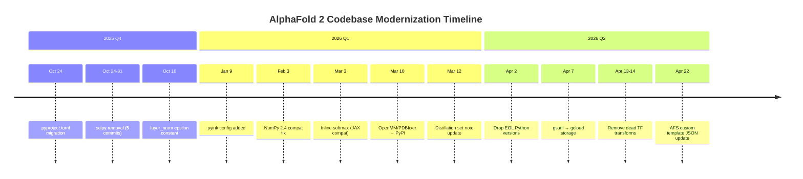

The AlphaFold 2 repository has been undergoing a quiet but consequential modernization campaign. While the broader AlphaFold ecosystem — the database, the server, the Nobel halo — grabs headlines, the open-source codebase has been getting its plumbing overhauled. Meanwhile, the institutional landscape around the project has shifted dramatically. Here is what matters.

## The Codebase Modernization Push (Oct 2025 – Apr 2026)

The last six months of commits tell a clear story: the AlphaFold 2 repo is being cleaned up for long-term maintainability. This is not feature work — it is the unglamorous but essential work of removing technical debt that accumulates in any project sitting at the intersection of three fast-moving ecosystems (Python, JAX, CUDA).

### Dependency Diet: scipy Eliminated Entirely

The single most significant arc in recent commits is the **complete removal of scipy as a dependency**, executed by Harsh Tiku across four commits in October 2025:

1. [Replace `scipy.linalg.block_diag` with a NumPy implementation](https://github.com/google-deepmind/alphafold/commit/a2581aef159492e296c16cedd33eb711f6d323e5) — Oct 24
2. [Replace custom `block_diagonal` with `jax.scipy.linalg.block_diag`](https://github.com/google-deepmind/alphafold/commit/a138beeaf1c4c6052d33e6467049aa2fe181757b) — Oct 27
3. [Migrate `softmax` calls from `scipy` to `jax.scipy`](https://github.com/google-deepmind/alphafold/commit/78a01da677c4d7705a7a8083486615d7c3c3252b) — Oct 27
4. [Use custom `ks_normal_test` to approximate normality testing](https://github.com/google-deepmind/alphafold/commit/d172b1a6c7df686e3a9766fe39d443880c41ae3b) — Oct 30
5. [Remove last traces of scipy](https://github.com/google-deepmind/alphafold/commit/40be3ec6c764fd7e8f4478ac6280f438058e271a) — Oct 31

This is a meaningful simplification. scipy is a heavy dependency — it pulls in compiled Fortran/C code via numpy and has historically been a source of build headaches in containerized and HPC environments. Replacing it with pure NumPy and `jax.scipy` equivalents reduces the installation surface area and aligns the codebase more tightly with JAX as the sole computational backend.

However, one choice deserves scrutiny: the custom `ks_normal_test` that approximates the Kolmogorov-Smirnov p-value is an *approximation*, not an exact replacement. For production structure prediction this is unlikely to matter (the normality test feeds into confidence estimation, not the core folding), but anyone forking AlphaFold for statistical research should be aware of the substitution.

### Packaging: setup.py → pyproject.toml

[Augustin Zidek migrated the project from `setup.py` to `pyproject.toml`](https://github.com/google-deepmind/alphafold/commit/cd0357af72396da3b75fe4c9cf86f8d9ba4e4d4e) on October 24, 2025 — a move that brings AlphaFold in line with [PEP 621](https://peps.python.org/pep-0621/) and modern Python packaging conventions. This also resolved [a community request](https://github.com/google-deepmind/alphafold/issues/1099) asking for the formatting configuration used in the recent `pyformat` reformatting, which was later addressed by [adding pyink configuration to pyproject.toml](https://github.com/google-deepmind/alphafold/commit/59cbb686da5a5cf1764a347f7332d7026c1b65fb).

For anyone maintaining a fork, this is a breaking change in terms of merge conflicts — but the `pyproject.toml` migration is a one-time pain that makes future tooling integration (linting, type checking, build systems) significantly cleaner.

### OpenMM and PDBfixer: Conda No More

[OpenMM and PDBfixer were previously installed via Conda](https://github.com/google-deepmind/alphafold/commit/a4315dd7b8f9f543ad5f4080af4a42d431ef3b35); as of March 10, 2026, both are now on PyPI and installed via pip. OpenMM was simultaneously bumped from 8.0.0 to 8.2.0 for PyPI compatibility. This is another simplification that eliminates Conda as a build dependency — a long-standing pain point documented in [community guides about Conda-Pack and OpenMM](https://www.blopig.com/blog/2023/07/the-dangers-of-conda-pack-and-openmm) that warned about environment portability issues with OpenMM's compiled extensions.

### Compatibility and Cleanup

The remaining commits form a consistent cleanup narrative:

| Date | Commit | Significance |
|------|--------|-------------|
| Feb 3, 2026 | [Fix Numpy 2.4 compatibility](https://github.com/google-deepmind/alphafold/commit/dc61fb4a31bd15c4b3363281217e125d34748892) | Unblocks users on latest NumPy |
| Mar 3, 2026 | [Inline softmax for old JAX compatibility](https://github.com/google-deepmind/alphafold/commit/636a18bae7137ffe7b4d946f1be12e25adc877fc) | Prevents breakage on pinned JAX |
| Apr 2, 2026 | [Remove unsupported Python versions](https://github.com/google-deepmind/alphafock/commit/4593e8c4118b12ae2260a268a18a42deb7569a31) | Drops EOL Pythons |
| Apr 7, 2026 | [Use `gcloud storage` instead of `gsutil`](https://github.com/google-deepmind/alphafold/commit/27fb0c0b898af876f2801168ab22899d043389f5) | Aligns with current GCloud CLI |
| Apr 13–14, 2026 | [Remove dead TF transform code](https://github.com/google-deepmind/alphafold/commit/7e1e321dfd7f9df5c8cf17b3f2a64fc794d18b1a) | Prunes legacy TensorFlow paths |

The NumPy 2.4 fix and the JAX softmax inlining are particularly telling — they signal that the maintainers are actively tracking upstream breakage in the scientific Python stack rather than pinning to stale versions. This is the right approach for a project that is widely deployed across heterogeneous HPC environments, even if it means more frequent compatibility patches.

## AlphaFold Database: Partnership Renewed, Complexes Released

While the codebase changes are incremental, the AlphaFold Database (AFDB) has seen major updates on the data side.

### EMBL-EBI Partnership Renewal (March 2026)

[EMBL-EBI and Google DeepMind renewed their collaboration](https://www.embl.org/news/science-technology/google-deepmind-partnership-renewal) on the AlphaFold Protein Structure Database. The renewal came with significant data updates:

- **UniProt 2025_03 sync**: The database now covers newly discovered proteins.
- **Protein isoforms**: For the first time, AFDB includes isoforms — functionally distinct variants of the same protein. This is valuable for tissue-specific and disease-associated analyses.
- **MSAs available for download**: The multiple sequence alignments used to generate predictions are now downloadable, opening a new layer of evolutionary and structural analysis.

The AFDB update was described in a [Nucleic Acids Research paper](https://pubmed.ncbi.nlm.nih.gov/41273079) (Bertoni et al., 2026), which also documents a comprehensive redesign of the entry page with integrated 3D viewers, domain tabs, and annotation overlays.

### Protein Complexes Release (May 2026)

In May 2026, a collaboration between EMBL-EBI, Google DeepMind, NVIDIA, and Seoul National University released **~2.2 million homodimeric and ~79,000 heterodimeric high-confidence protein complex structures** into AFDB. This covers ~19M homomeric and ~8M heteromeric predictions across 4,777 proteomes, including 16 model organisms and 30 WHO-prioritized proteomes. The full set of ~31 million predictions is available for bulk download. This directly addresses the long-standing community interest in multimer prediction that [issue #269](https://github.com/google-deepmind/alphafold/issues/269) (now closed) once requested.

## The Team Folds: Jumper Leaves for Anthropic

The most significant organizational development is the dissolution of the dedicated AlphaFold team at Google DeepMind.

On June 19, 2026, [John Jumper announced he was leaving DeepMind for Anthropic](https://www.cnbc.com/2026/06/19/john-jumper-to-leave-google-deepmind-for-anthropic.html), after nearly nine years. Jumper was the lead architect of AlphaFold 2 and shared the 2024 Nobel Prize in Chemistry with Demis Hassabis for the work. As [reported by Scientific American](https://www.scientificamerican.com/article/why-google-deepmind-broke-up-the-alphafold-team), some team members left the company, others were reassigned within Google, and some moved to Isomorphic Labs. A DeepMind spokesperson confirmed many of these moves happened more than a year ago.

Jumper's departure is symbolically weighty but practically nuanced. As CASP co-founder John Moult put it: *"They did it. What's the next mission?"* The AlphaFold code is open source, the database is maintained by EMBL-EBI, and independent groups (ColabFold, OpenFold, Boltz) have already reproduced and extended the core predictions. The team's dissolution is unlikely to slow the field.

However, the departure does raise questions about the maintenance trajectory of the `google-deepmind/alphafold` repository itself. The recent commits are almost entirely from Augustin Zidek and Harsh Tiku, suggesting that a small team is keeping the lights on. Whether this maintenance continues at the current pace — or whether the community picks up the slack via forks — remains to be seen.

## Hardware Frontier: Blackwell GPU Compatibility

The open [RTX PRO 6000 / SM_120 incompatibility issue](https://github.com/google-deepmind/alphafold/issues/1121) highlights a growing pain: NVIDIA's Blackwell architecture (compute capability SM_120) is not yet cleanly supported by the JAX/XLA stack that AlphaFold depends on. The issue author reports trying "a dozen possible combinations between jax, cuda, haiku, etc." with XLA failing to initialize CUDA.

This is not an AlphaFold-specific problem — it is a JAX ecosystem issue — but it is a reminder that AlphaFold's hardware compatibility is entirely downstream of JAX's. Users planning GPU purchases (as in [issue #1125](https://github.com/google-deepmind/alphafold/issues/1125) about workstation GPU selection) should verify JAX + CUDA compatibility for their target card before committing, rather than assuming that "NVIDIA GPU" is sufficient.

## What to Watch

1. **Repository maintenance cadence**: Will commits continue at the current ~2-4/month rate post-team-dissolution, or will it slow further? The [AFDB README update to `gcloud storage`](https://github.com/google-deepmind/alphafold/commit/27fb0c0b898af876f2801168ab22899d043389f5) suggests at least one maintainer is still actively tracking external tooling changes.
2. **JAX + Blackwell**: Once JAX lands SM_120 support, AlphaFold should work on Blackwell without code changes. Track the [JAX GPU support matrix](https://github.com/jax-ml/jax) for updates.
3. **Community forks**: With the core team dispersed, community-driven forks like [OpenFold](https://github.com/aqlaboratory/openfold) may become the more actively developed path for structural biologists who need modifications beyond what the official repo provides.
4. **AFDB complex data**: The ~31M complex predictions now available for bulk download will likely trigger a wave of functional annotation and interaction studies. The [bulk MSA download question](https://github.com/google-deepmind/alphafold/issues/1111) remains open — rate limits for programmatic access are still undocumented.

The codebase is cleaner than it has been in years. The institutional scaffolding around it is thinner than it has been in years. Both things are true at the same time, and both matter for anyone building on AlphaFold in production.