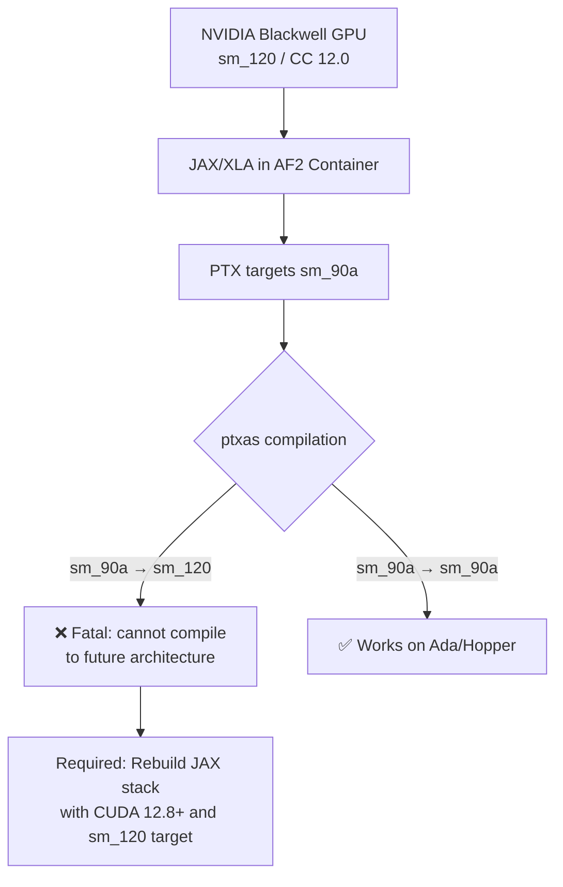
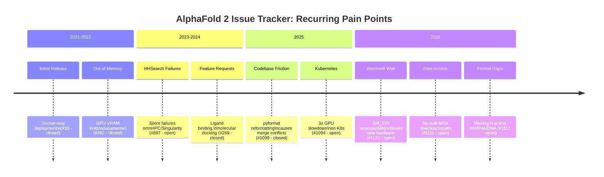

The AlphaFold 2 issue tracker is a fascinating document in its own right. With 276 open issues and a repository that sits at 14.8k stars, it captures the collision between a research-grade codebase and a production-hungry scientific community. The pattern is consistent: DeepMind ships a breakthrough, the world tries to deploy it on every conceivable hardware and workflow, and the friction points that emerge reveal structural gaps in how scientific software gets maintained after the paper is published.

What follows is a categorised tour of the most persistent and representative issues -- the ones that keep coming back, the ones that reveal real architectural limitations, and the ones where the community has stepped in with workarounds that deserve wider attention.

---

## The Long Tail of Deployment Pain

### HHSearch Silently Fails on HPC Clusters

[Issue #897](https://github.com/google-deepmind/alphafold/issues/897) -- opened February 2024, still open as of May 2026 -- is a masterclass in how hard it is to debug a silent failure in a containerised pipeline. The symptom is maddeningly terse:

```
RuntimeError: HHSearch failed:
stdout:

stderr:
```

No output at all. HHSearch runs, exits, and takes its reasoning with it. The reporter is using a Singularity image on a Slurm-managed cluster with 64 GB of memory -- well above the typical requirement -- and has tried the `-DHAVE_AVX2=1` compilation flag suggested in [hh-suite issue #282](https://github.com/soedinglab/hh-suite/issues/282) without success.

This is not an isolated case. The same error pattern appears in [ColabFold issue #575](https://github.com/sokrypton/ColabFold/issues/575), where the underlying cause turns out to be corrupted or empty `pdb70_cs219.ffindex` files. The [University of Illinois IGB cluster documentation](https://help.igb.illinois.edu/Biocluster_Alphafold) explicitly calls out this error and recommends increasing memory allocation as the first fix, which suggests the root cause is often a resource issue during the database build or copy step that silently produces truncated index files.

**The structural problem:** AlphaFold's Docker image bundles HHSearch as a pre-compiled binary against specific CPU instruction sets and database formats. When the database files are corrupted -- often due to incomplete downloads, filesystem permission issues, or memory pressure during extraction -- HHSearch fails silently. There is no pre-flight validation of the databases, no checksum verification, and no meaningful error message. For a pipeline where the MSA/template search is a prerequisite for everything that follows, this is a brittle design.

### Out of Memory: A Recurring Classic

[Issue #392](https://github.com/google-deepmind/alphafold/issues/392) documents the GPU out-of-memory error that has haunted AlphaFold since its initial release. The traceback shows XLA trying to allocate **30.46 GiB** in a single shot:

```
Allocator (GPU_0_bfc) ran out of memory trying to allocate 30.46GiB
```

This was supposedly fixed in v2.1.2 by addressing CUDA/jaxlib version incompatibilities, but the issue keeps reappearing with new GPU generations and driver versions. The [UCSF AlphaFold performance page](https://www.rbvi.ucsf.edu/chimerax/data/alphafold-jan2022/afspeed.html) documents concrete limits: a 24 GB RTX 3090 fails on proteins above ~2,500 amino acids with `CUDA_ERROR_ILLEGAL_ADDRESS`, while a 48 GB A40 can handle structures up to ~3,800 amino acids.

The practical guidance that has emerged from the community:

| GPU VRAM | Approx. Max Sequence Length | Typical Time (500 aa) |
|----------|---------------------------|----------------------|
| 16 GB (T4/P100) | ~1,000 aa | 5-10 min |
| 24 GB (3090/4090) | ~2,000 aa | 1-5 min |
| 48 GB (A40/A6000) | ~3,800 aa | 0.5-2 min |

---

## Next-Generation Hardware: The Blackwell Wall

### SM_120 Incompatibility

[Issue #1121](https://github.com/google-deepmind/alphafold/issues/1121) is the most consequential open issue for anyone investing in current-generation hardware. The question is simple: can AlphaFold 2 run on NVIDIA Blackwell GPUs (RTX PRO 6000, RTX PRO 4500)? The answer, right now, is **no**.

The core error, as documented by commenter `k127soo`:

```
jaxlib.xla_extension.XlaRuntimeError: INTERNAL:
ptxas exited with non-zero error code 65280, output:
ptxas fatal: Program with .target 'sm_90a' cannot be compiled to future architecture
```

The problem is architectural. The JAX/XLA stack inside AlphaFold 2's Docker container generates PTX code targeting `sm_90a` (Ada Lovelace / Hopper). Blackwell's compute capability 12.0 (`sm_120`) is a "future architecture" from the perspective of this PTX, and NVIDIA's `ptxas` compiler refuses to forward-compile it. This is not an AlphaFold-specific problem -- the same `cudaErrorNoKernelImageForDevice` error appears across the ecosystem, as documented in [this Cellpose forum thread](https://forum.image.sc/t/cellpose-with-nvidia-rtx-pro-6000-blackwell-problem/119144) and [vLLM discussion boards](https://discuss.vllm.ai/t/support-for-rtx-6000-blackwell-96gb-card/1707).

The fix requires rebuilding the entire JAX/jaxlib/XLA toolchain with Blackwell-compatible CUDA (12.8+), and potentially updating Haiku and every other JAX-dependent library in the dependency graph. As commenter `Russ-Peter` notes, [issue #1085](https://github.com/google-deepmind/alphafold/issues/1085) (which addresses consumer RTX 5090 cards) doesn't help with the professional Blackwell line.

**This is a maintenance gap that will only widen.** Blackwell GPUs are shipping now. Research groups buying new workstations will hit this wall immediately. The absence of an official Dockerfile update or requirements.txt that works on SM_120 is a real deployment blocker.



---

## Infrastructure and Orchestration Friction

### GPU Slowdown on Kubernetes

[Issue #1094](https://github.com/google-deepmind/alphafold/issues/1094) reports a 3x slowdown in GPU inference time when running AlphaFold 2 on Kubernetes compared to bare Docker on the same host shape. CPU-bound MSA generation time is identical -- only the GPU phase is affected. The reporter confirms there are no IOPS issues since all data runs from hostpath.

This is a known class of problem with GPU passthrough in containerised environments. Common causes include:

- **GPU device plugin overhead** in Kubernetes (NVIDIA device plugin vs. native Docker `--gpus`)
- **Memory mapping / NUMA affinity** loss when the GPU is not pinned to the correct NUMA node
- **CUDA context setup latency** repeated per pod invocation vs. persistent Docker container
- **Missing `--shm-size`** configuration in the pod spec (Kubernetes defaults to 64 MB; AlphaFold needs significantly more shared memory for XLA)

The issue has no resolution yet, which points to a broader problem: AlphaFold's deployment documentation is Docker-centric, and Kubernetes orchestration requires non-obvious pod spec tuning that most researchers discover through painful iteration.

### Best GPU for Local AlphaFold

[Issue #1125](https://github.com/google-deepmind/alphafold/issues/1125) asks the practical question: what GPU should you buy for a local workstation running ~10,000 predictions of 750-1,500 aa proteins? The candidates are RTX 4090 (24 GB), RTX 5090 (~32 GB), and RTX 6000 Ada (48 GB).

Based on the [deploybase.ai GPU comparison for protein folding](https://deploybase.ai/articles/best-gpu-cloud-for-protein-folding-provider-pricing-comparison) and community benchmarks, the answer depends critically on sequence length:

- **RTX 4090 (24 GB):** Handles sequences up to ~2,000 aa. For 750-1,500 aa proteins, this is sufficient and cost-effective (~$1,500). Prediction time: ~5-10 min per protein.
- **RTX 6000 Ada (48 GB):** Needed for sequences approaching 3,000+ aa. At ~$6,800, it's 4.5x the price for 2x the VRAM. Worth it only if you regularly hit OOM on 24 GB cards.
- **Multiple 4090s vs. single 6000:** AlphaFold 2 inference runs on a single GPU. Multiple GPUs benefit only through parallel batch processing of independent sequences. For throughput, two 4090s (~$3,000) outperform one 6000 Ada for most workloads.

**The RTX 5090 is the wildcard.** If it delivers ~32 GB VRAM at consumer pricing, it could become the sweet spot for AlphaFold 2 -- but it faces the same Blackwell SM_120 incompatibility as the professional cards until the JAX stack is updated.

---

## Data Access: The MSA Bulk Download Gap

[Issue #1111](https://github.com/google-deepmind/alphafold/issues/1111) exposes a significant gap in the AlphaFold Database infrastructure. The user needs to download MSA files for **several million proteins**, and none of the documented channels work at scale:

| Channel | Limitation |
|---------|------------|
| Individual API downloads (`alphafold.ebi.ac.uk/files/msa/`) | No documented rate limits; works per-file but uncertain at millions of requests |
| [Google Cloud public bucket](https://console.cloud.google.com/marketplace/product/bigquery-public-data/deepmind-alphafold) | Limited to v4; **does not include MSA files** |
| [EBI FTP server](https://ftp.ebi.ac.uk/pub/databases/alphafold/) | Changelog mentions MSA updates, but actual MSA files are not found in the directory structure |

The [EBI training documentation](https://www.ebi.ac.uk/training/online/courses/navigating-alphafold-database/what-is-the-afdb/accessing-searching-afdb/bulk-downloads-ftp) confirms that the FTP server provides bulk PDB/mmCIF downloads for proteomes and mentions that MSAs are available in `msas` subdirectories within collaboration chunks, but there is no documented mechanism for bulk MSA access by UniProt ID.

Community commenter `NishikaGolani` offers an AWS-specific workaround: pre-stage MSA databases on **FSx for Lustre**, so the first job pays the cold I/O cost and subsequent jobs hit cached pages. This reportedly delivers 10-15x faster startup. But this only works if you can get the data in the first place -- and the question of how to avoid EBI rate limiting during the initial fetch remains unanswered.

This issue has garnered 4 "eyes" reactions, indicating significant latent demand. The gap between what AlphaFold DB makes available (structures) and what researchers need (the MSAs that produced those structures) is a real reproducibility concern.

---

## Output Format Gaps

### Missing Hydrogen Atoms in Nucleic Acids

[Issue #1117](https://github.com/google-deepmind/alphafold/issues/1117) reports that AlphaFold predictions for RNA and DNA omit hydrogen atoms, making the structures harder to work with in [ChimeraX](https://www.cgl.ucsf.edu/chimerax/). ChimeraX developer `tomgoddard` (who built the [AlphaFold integration in ChimeraX](https://bcrf.biochem.wisc.edu/2022/03/04/alphafold-run-from-chimerax)) provides the pragmatic fix: use ChimeraX's `addh` command to add hydrogens post-hoc.

The deeper explanation is also informative: **most experimental structures in the PDB don't include hydrogens**, and since AlphaFold was trained on PDB data, it naturally reproduces this convention. Adding hydrogens is not trivial -- histidine protonation states depend on the local environment and pH, and getting this wrong can propagate errors through downstream analyses. The issue reporter accepts this reasoning, but the discussion highlights a real gap: AlphaFold's output format is optimised for structural comparison, not for molecular dynamics or docking workflows that require complete atomic models.

---

## Codebase Maintenance Friction

### The Formatting Reformat Catastrophe

[Issue #1099](https://github.com/google-deepmind/alphafold/issues/1099) -- now closed -- documents a problem that anyone forking AlphaFold has likely experienced. In [commit `dbaafbc`](https://github.com/google-deepmind/alphafold/commit/dbaafbcdea0cf39fabe502928cab55754c1d5dc7), the entire codebase was reformatted with a Google-internal tool called "pyformat" (which uses [pyink](https://github.com/nicowilliams/pyink), a Google-forked version of Black). The result: every Python file changed, creating massive merge conflicts for anyone with a fork.

The reporter tried the public [`pyformat` package](https://github.com/myint/pyformat) -- a completely different tool with the same name -- and it didn't match. The issue was eventually resolved when the team added pyink configuration to `pyproject.toml` in [commit `59cbb68`](https://github.com/google-deepmind/alphafold/commit/59cbb686da5a5cf1764a347f7332d7026c1b65fb), thanks to a suggestion from `@GMNGeoffrey`.

This is a pattern that repeats across Google-maintained open source projects: internal tooling produces formatting that doesn't match any public formatter, and the gap isn't documented until external contributors hit merge conflicts. The migration from `setup.py` to `pyproject.toml` in [commit `cd0357a`](https://github.com/google-deepmind/alphafold/commit/cd0357af72396da3b75fe4c9cf86f8d9ba4e4d4e) and the subsequent pyink configuration at least make the formatting reproducible now, but the episode caused real pain for fork maintainers.

---

## The Issue Tracker as Research Forum

### Novel Geometric Findings Posted as Issues

[Issue #1122](https://github.com/google-deepmind/alphafold/issues/1122) is unusual: it's a full research report posted as a GitHub issue. The author, independent researcher Abhishek Srivastava, presents findings that conserved backbone-hydrogen-bond coupling angles in secondary structures replicate on AlphaFold predictions and correlate with pLDDT. The key result: low-confidence helices show **79% more >10 degree violations** than high-confidence ones (Mann-Whitney p = 5.50e-6).

This is scientifically interesting but raises a meta-question: should the GitHub issue tracker be used for this? The findings are published on [Zenodo (doi:10.5281/zenodo.19391357)](https://zenodo.org/records/19391357) under CC BY 4.0, with a reproducible analysis script. The issue format actually works well here -- it creates a persistent, searchable record tied to the repository, and it invites discussion from the community. But it also dilutes the signal-to-noise ratio for people looking for actual bug reports and deployment help.

---

## Recurring Themes: A Visual Summary



---

## What the Pattern Reveals

Looking across these issues, three structural themes emerge:

**1. The deployment surface is too wide for the maintenance team.** AlphaFold 2 was released as research code with a Docker wrapper. The community now expects it to run on Singularity, Kubernetes, bare metal, consumer GPUs, professional GPUs, next-generation GPUs, and every HPC scheduler on the planet. Each combination produces unique failure modes that the small maintainer team (primarily Augustin Zidek and Harsh Tiku, based on recent commits) cannot realistically address.

**2. Data infrastructure hasn't kept pace with model infrastructure.** The AlphaFold Database at EBI provides structures but not MSAs at scale. The genetic databases required for local runs are ~2.6 TB and require undocumented tools like `rsync` ([issue #1032](https://github.com/google-deepmind/alphafold/issues/1032) - closed). There's no official mirror, no checksum verification, and no incremental update mechanism.

**3. The JAX dependency chain is a deployment landmine.** Every GPU generation transition requires rebuilding the JAX/jaxlib/XLA stack, and each rebuild potentially breaks Haiku, Optax, and every other library in the graph. The Blackwell incompatibility ([#1121](https://github.com/google-deepmind/alphafold/issues/1121)) is the current instance, but it won't be the last. The recent commits removing scipy dependency ([commit `d172b1a`](https://github.com/google-deepmind/alphafold/commit/d172b1a6c7df686e3a9766fe39d443880c41ae3b)), migrating softmax to JAX ([commit `78a01da`](https://github.com/google-deepmind/alphafold/commit/78a01da677c4d7705a7a8083486615d7c3c3252b)), and fixing NumPy 2.4 compatibility ([commit `dc61fb4`](https://github.com/google-deepmind/alphafold/commit/dc61fb4a31bd15c4b3363281217e125d34748892)) show the team is actively reducing the dependency surface -- but the JAX core remains a fixed point that constrains every deployment decision.

The AlphaFold 2 issue tracker is, in many ways, a case study in what happens when research software achieves impact far beyond its original deployment scope. The code works. The science works. The friction is all at the boundary between the lab and the cluster.