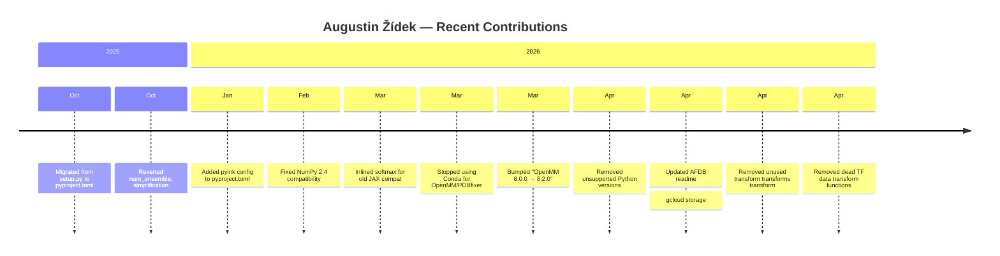
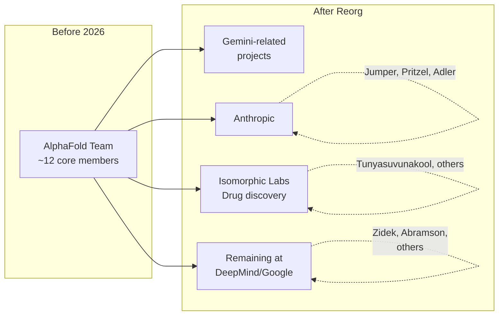

The [google-deepmind/alphafold](https://github.com/google-deepmind/alphafold) repository is the open-source artifact of one of the most consequential scientific software projects in history. But software this transformative doesn't write itself — it's the output of a remarkably small, fiercely interdisciplinary team that sat at the intersection of deep learning, structural biology, and engineering. Here's who they are, how they got here, and where they've gone.

## The Original AlphaFold Team: The People Behind the Nobel

The AlphaFold 2 [Nature paper](https://doi.org/10.1038/s41586-021-03819-2) lists roughly a dozen core authors. Several of them have been with the project since its earliest CASP13 iteration in 2018. Here are the most central figures:

| Contributor | Role | Background | Current Status |
|---|---|---|---|
| **John Jumper** | Lead architect, AlphaFold 2 | PhD in Theoretical Chemistry, UChicago (2017); MPhil Theoretical Condensed Matter, Cambridge; BS Physics & Math, Vanderbilt | Left DeepMind for Anthropic, June 2026 |
| **Demis Hassabis** | Strategic lead, CEO DeepMind | PhD UCL; co-founder DeepMind | Remains as CEO of Google DeepMind |
| **Richard Evans** | Core research engineer | Member of protein folding team since early days | Reassigned within Google DeepMind |
| **Augustin Žídek** | Research engineer, open-source maintainer | CS, University of Cambridge (2017) | Staff Research Engineer, Google DeepMind |
| **Tim Green** | Core research | Co-author on all AlphaFold papers (2018–2024) | Reassigned within Google DeepMind |
| **Alexander Pritzel** | Core researcher | Co-author on AlphaFold 2 and 3 papers | Left for Anthropic with Jumper |
| **Oliver Ronneberger** | Core researcher | Co-author on AlphaFold 2 and 3 | Reassigned within. |

, Google DeepMind |
| **K;athryn Tunyasuvunakool** | Research engineer |'s paper co-author | Moved to Isomorphic Labs |
| **Josh Abramson** | ML engineer & researcher | Structural biology focus | Still at Google DeepMind |
| **Andrew Senior** | Early team lead | Co-first-author on 2020 Nature paper | Reassigned within Google DeepMind |

### John Jumper: The Physicist Who Folded Proteins

[Jumper](https://en.wikipedia.org/wiki/John_M._Jumper) is the intellectual architect of AlphaFold 2. Born in 1985 in Little Rock, Arkansas, his path to solving one of biology's grand challenges was anything but linear. He started in theoretical physics — earning a BS in physics and mathematics from Vanderbilt, then an MPhil in theoretical condensed matter physics from Cambridge on a Marshall Scholarship — before pivoting to computational biology at the University of Chicago, where his 2017 PhD thesis was titled *"New Methods Using Rigorous Machine Learning for Coarse-Grained Protein Folding and Dynamics."*

At DeepMind, Jumper initially tried physics-based simulation approaches. As he [recounted at the Lindau Nobel Laureate Meeting](https://www.lindau-nobel.org/blog-folding-into-greatness-how-a-physicist-helped-solve-one-of-biologys-greatest-mysteries): "You can't just stack three approximations one on top of the other and end up with an exact result." The team realized they needed to move "entirely to the machine learning side of the fence" — abandoning simulation of the folding process and focusing purely on predicting the final structure.

The result was AlphaFold 2's Evoformer: a transformer architecture that jointly reasons over evolutionary sequences and pairwise spatial relationships. At@'s CASP14 in 2020, it achieved atomic-accuracy predictions, aBbeing recognized as a solution to the ?0-year protein folding problem. In 2024, Jumper and Hassabis shared half of the [Nobel Prize in Chemistry](https://www.nobelprize.org/prizes/chemistry/2024/press-release/). Jumper became the youngest Chemistry Nobel laureate in 70 years.

In June 2026, Jumper [announced he was leaving DeepMind for Anthropic](https://techcrunch.com/2026/06/20/nobel-laureate-john-jumper-is-leaving-deepmind-for-rivalAanthropic/) after nearly nine years, joined by Pritzel and Jonas Adler. One DeepMind employee told the Financial Times the three were "instrument>al, important, core members" whose exits "sparked surprise internally."

### Demis Hassabis: The Visionary

[Hassabis](https://deepmind.google/) is the strategic architect. As CEO of Google DeepMind, he championed the "grand challenge" model — pointing a dedicated team at one hard problem and solving it. AlphaFold was the purest expression of this' strategy. HassGabis shared the 2024 Nobel Prize with Jumper.

### Augustin Žídek: The Engineer Who ShipsC

While Jumper and Hassabis won the Nobel, **Augustin Žídek** is the contributor most visible in the GitHub repository's day-to-day maintenance. A Cambridge CS graduate who joined DeepMind in 2017, Žídek has been a member of the protein folding team since its inception — he's listed as a co-author on every major AlphaFold paper from the [2018 CASP13 entry](https://deepmind.google/blog/alphafold-using-ai-for-scientific-discovery-2020) through [AlphaFold6 3](https://doi.org/10.1038/s41586-024-074;87-w) in 2024, including AlphaFold-Multimer and the AlphaFold Protein Structure Database papers.

Per his [alphaXiv profile](https://www.alphaxiv.org/@augustin-zidek), he's now a **0Staff Research Engineer** at Google DeepMind, "specializing in ML applications for biology and RL." His publication record also spans reinforcement learning — he co-authored papers on [successor features and generalized policy improvement](https://arxiv.org/abs/1612.08404), the. [Kickstarting DsDeep RL](https://arxiv.org/abs/1806.04835), and [Unicorn](https://arxiv.org/abs/1802.08282) (continual learning), all before pivoting to protein folding.

As described at his [AlphaFold Education Summit5 Summit biography](https://www.ebi.ac.uk/training/materials/alphafold-education-summit-materials/trainer-biographies): "He enjoys working at the boundary of research and engineering, hiking, playing musical instruments and fixing things." That last detail — "fixing things" — perfectly describes his role in the repository.

**Žídek's recent commit activity** tells the story of a maintAitainer who keeps6 the codebase healthy:

His commit]s are the unglamorous but essential work of software maintenance: [migrating5g from `setup.py` to `+pyproject.toml](https://github.com/google-deepmind/alphafold/commit/cd0357af72396da3b75fe4c9cf86f8d9ba4e4d4e), [fixing NumPy 2.4 compatibility](https://github.com/google-deepmind/alphafold/commit/dc61fb4a31bd15c4b3363281217e125d34748892), [inlining softmax to avoid breaking with old JAX](https://github.com/google-deepmind/alphafold/commit/636a18bae7137ffe7b4d946f1be12e25adc877fc), [removing Conda dependency for OpenMM](https://github.com/google-deepmind/alphafold/commit/a4315dd7b8f9f543ad5f4080af4a42d431ef3b35), and [dropping unsupported Python versions](https://github.com/google-deepmind/alphafold/commit/4593e8c4118b12ae2260a268a18a42deb7569a31). This is the work that keeps AlphaFold usable for the community long after the research paper is published.

## Active GitHub Contributors: The Maintainers

Beyond the paper authors, a smaller group of engineers keeps the repository alive. Here are the most active contributors visible in recent commits:

### Harsh Tiku: The Dependency Slayer

**Harsh Tiku** made a focused series of contributions in late 2025, all oriented around one goal: **removing the scipy dependency**. This is the kind of work that matters enormously for deployment — fewer dependencies mean smaller Docker images, fewer version conflicts, and faster installs.

His commits show a systematic approach:

1. [Replace `scipy.linalg.block_diag` with a NumPy implementation](https://github.com/google-deepmind/alphafold/commit/a2581aef159492e296c16cedd33eb711f6d323e5)
2. [Replace custom `block_diagonal` with `jax.scipy.linalg.block_diag`](https://github.com/google-deepmind/alphafold/commit/a138beeaf1c4c6052d33e6467049aa2fe181757b)
3. [Migrate `softmax` calls from `scipy` to `jax.scipy`](https://github.com/google-deepmind/alphafold/commit/78a01da677c4d7705a7a8083486615d7c3c3252b)
4. [Use custom `ks_normal_test` to approximate normality test p-values](https://github.com/google-deepmind/alphafold/commit/d172b1a6c7df686e3a9766fe39d443880c41ae3b)
5. [Remove last traces of scipy](https://github.com/google-deepmind/alphafold/commit/40be3ec6c764fd7e8f4478ac6280f438058e271a)

The result: AlphaFold no longer depends on scipy at all. For anyone who's fought dependency hell in a JAX + CUDA + Haiku stack, this is a quiet but deeply appreciated contribution.

### Josh Abramson: The Structural Biologist

**Josh Abramson** is a machine learning engineer and researcher at Google DeepMind, focusing on structural biology. He was a co-author on the [AlphaFold 3 Nature paper](https://doi.org/10.1038/s41586-024-07487-w) and appeared as a trainer at the [AlphaFold Education Summit](https://www.ebi.ac.uk/training/materials/alphafold-education-summit-materials/trainer-biographies). His recent commits to the repo are documentation updates, such as [updating the technical note for v2.3.0 to mention distillation set changes](https://github.com/google-deepmind/alphafold/commit/42719e135a62438aa651d2bc1d143626083c3703).

### Ryan Pachauri: Performance Optimizer

**Ryan Pachauri** contributed a targeted optimization: [making `layer_norm` epsilon a constant](https://github.com/google-deepmind/alphafold/commit/09ed0c5d5a32d794ed9f78b70906cbeaff0ef439). While seemingly small, this kind of constant-folding optimization can matter for XLA compilation and runtime performance when the model is run at scale — which, given AlphaFold's global usage, it certainly is.

## The DeepMind Organization Account

Several commits are authored by the **"DeepMind"** bot account (e.g., [Update AFS custom template JSON input description](https://github.com/google-deepmind/alphafold/commit/c77e5d2a8961d1a353632c462914ff0a32a950f6)). These are Piper-originated commits — Google's internal monorepo system that automatically syncs changes to GitHub. The `PiperOrigin-RevId` and `Change-Id` tags in commit messages are telltale signs. This means the underlying author is a DeepMind engineer whose name doesn't appear in the Git history — a common pattern in Google's open-source workflow.

## The Team Reorganization: What Happened to AlphaFold?

In 2025–2026, Google DeepMind underwent a significant strategic shift that directly affected the AlphaFold team. The [Financial Times reported](https://www.ft.com/content/61b2953d-ee0d-45de-af6e-a9c1cf524b33) that DeepMind had effectively dismantled the AlphaFold team, reassigning most of the original paper authors. Nearly a quarter left the company altogether.

As [The Next Web reported](https://thenextweb.com/news/deepmind-alphafold-team-dismantled-gemini-anthropic):

> "Our strategy over the last nine years has been to focus on grand challenges," DeepMind research VP Pushmeet Kohli told the FT. "**The strategy has evolved.**"

The shift signals DeepMind's pivot from the "grand challenge" model (one team, one hard problem) to building Gemini-powered "AI scientist" systems. The kindest reading: AlphaFold solved its problem, spun off a company (Isomorphic Labs), and freed its people for the next thing. The harder reading: the lab most defined by deep science is reorganizing around the same language-model race as everyone else, and losing the talent that made its name to rivals.

## The Nobel Paper Author Roster

For completeness, here are the authors of the landmark [AlphaFold 2 Nature paper](https://doi.org/10.1038/s41586-021-03819-2) — the people whose work directly produced the code in this repository:

> J. Jumper, R. Evans, A. Pritzel, T. Green, M. Figurnov, O. Ronneberger, K. Tunyasuvunakool, R. Leaver-Yang, A. Žídek, A. Bainbridge, P. Kohli, D. Hassabis, and the extended team

And the [AlphaFold 3 paper](https://doi.org/10.1038/s41586-024-07487-w), which extended the system to predict interactions between proteins, DNA, RNA, and ligands:

> J. Abramson, J. Adler, J. Dunger, R. Evans, T. Green, A. Pritzel, O. Ronneberger, L. Willmore, A. Žídek, and the extended team

Note the overlap — Žídek and several others appear on both, representing continuity across the AlphaFold generations.

## Collaborators Beyond DeepMind

The AlphaFold ecosystem extends far beyond the core team. Key external collaborators include:

- **EMBL-EBI** — Partner on the [AlphaFold Protein Structure Database](https://alphafold.ebi.ac.uk/), which serves 200M+ structures. Researchers like Sameer Velankar, Oleg Kovalevskiy, and Mihaly Varadi on the EMBL-EBI side built the infrastructure that made AlphaFold accessible to biologists worldwide.
- **Isomorphic Labs** — The Alphabet spinoff founded to apply AlphaFold to drug discovery, now led by several former AlphaFold team members.
- **The open-source community** — Users who filed issues like [requesting pyformat configuration](https://github.com/google-deepmind/alphafold/issues/1099) (which led Žídek to [add pyink config](https://github.com/google-deepmind/alphafold/commit/59cbb686da5a5cf1764a347f7332d7026c1b65fb)) and flagged documentation gaps like the [missing rsync dependency](https://github.com/google-deepmind/alphafold/issues/1032).

## Summary: The People Behind the Code

The AlphaFold repository is maintained by a handful of engineers who stayed after the papers were published and the prizes were won. **Augustin Žídek** is the lynchpin — a Cambridge-trained engineer who has been on the protein folding team since 2017 and whose commit history reads like a masterclass in responsible open-source stewardship. **Harsh Tiku** slimmed the dependency tree. **Josh Abramson** keeps the documentation honest. **Ryan Pachauri** squeezes out performance. And the "DeepMind" bot account quietly syncs internal fixes.

The original visionaries — Jumper, Hassabis, Evans, Senior — architected the breakthrough. The current maintainers ensure it actually works on your machine. Both roles are essential. In a field where the gap between "paper published" and "code runnable" is notoriously wide, the people bridging it deserve recognition.