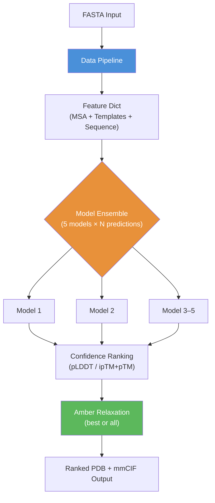
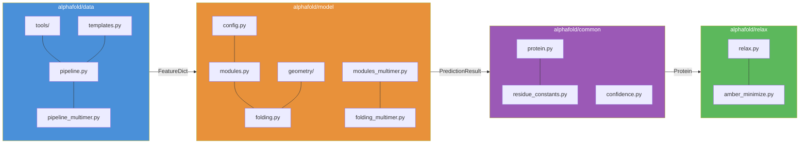
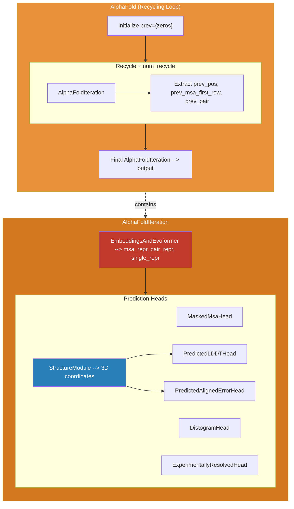

AlphaFold is a **three-phase inference system** that transforms a raw amino acid sequence into a fully relaxed 3D protein structure. The architecture is organized as a sequential pipeline — **Data Pipeline → Neural Network Inference → Post-Processing** — where each phase is a self-contained subsystem with clearly defined inputs and outputs. The entire orchestration is driven by a single entry point, `run_alphafold.py`, which wires together database-backed alignment tools, a JAX-accelerated deep learning model, and physics-based relaxation into a unified prediction workflow.


## Top-Level Execution Flow

The `predict_structure` function in `run_alphafold.py` is the central orchestrator. It executes three stages in strict sequence: (1) feature extraction via the data pipeline, (2) multi-model inference with recycling, and (3) Amber relaxation on ranked outputs. Each model in the ensemble shares the same feature dict but receives a unique random seed, producing independent predictions that are then ranked by confidence.



The `main` function constructs all pipeline objects before entering the prediction loop. It instantiates the `DataPipeline` (monomer or multimer), loads model parameters via `data.get_model_haiku_params`, wraps each in a `RunModel` runner, and creates a single `AmberRelaxation` instance shared across all predictions.

Sources: [run_alphafold.py](/run_alphafold.py#L322-L398), [run_alphafold.py](/run_alphafold.py#L599-L733)

## Subsystem Architecture

The codebase is partitioned into four top-level packages under `alphafold/`, each responsible for a distinct architectural concern:



| Package | Responsibility | Key Abstraction | Output Type |
|---|---|---|---|
| `alphafold/data` | MSA generation, template search, feature assembly | `DataPipeline.process()` | `FeatureDict` (NumPy arrays) |
| `alphafold/model` | Neural network inference with JAX/Haiku | `RunModel.predict()` | `PredictionResult` (JAX arrays) |
| `alphafold/common` | Shared data types, residue encoding, confidence | `Protein` dataclass | PDB/mmCIF strings |
| `alphafold/relax` | Stereochemical refinement via Amber force field | `AmberRelaxation.process()` | Relaxed PDB string |

Sources: [alphafold/__init__.py](/alphafold/__init__.py#L1-L15), [run_alphafold.py](/run_alphafold.py#L26-L41)

## Data Pipeline — Feature Extraction

The data pipeline bridges biological sequence databases and the neural network by converting a FASTA sequence into a dense `FeatureDict` of NumPy arrays. It orchestrates external bioinformatics tools — **JackHMMER**, **HHblits**, **HHsearch/Hmmsearch** — to build multiple sequence alignments (MSAs) and identify structural templates from the PDB.

The pipeline has **two variants** selected by `model_preset`:

| Variant | Pipeline Class | Template Search | MSA Strategy |
|---|---|---|---|
| **Monomer** | `pipeline.DataPipeline` | HHsearch against PDB70 | UniRef90 → BFD/UniRef30 → MGnify |
| **Multimer** | `pipeline_multimer.DataPipeline` | Hmmsearch against PDB seqres | Per-chain monomer pipeline + UniProt pairing |

The **monomer pipeline** runs three MSA searches sequentially (UniRef90 via JackHMMER, BFD+UniRef30 via HHblits, MGnify via JackHMMER), merges and deduplicates results, then searches for structural templates. It produces features like `msa`, `deletion_matrix_int`, `template_aatype`, and `template_all_atom_positions`.

The **multimer pipeline** wraps the monomer pipeline, running it independently per chain, then performs **cross-chain MSA pairing** via UniProt identifiers and adds assembly-level features (`asym_id`, `sym_id`, `entity_id`) to distinguish between chains and symmetric copies.

Sources: [alphafold/data/pipeline.py](/alphafold/data/pipeline.py#L67-L200), [alphafold/data/pipeline_multimer.py](/alphafold/data/pipeline_multimer.py#L1-L200)

## Neural Network Core — Model Inference

The neural network is implemented in **JAX with Haiku** (a neural network library on top of JAX). The `RunModel` class serves as the inference container, JIT-compiling the forward pass and dispatching to either `modules.AlphaFold` (monomer) or `modules_multimer.AlphaFold` (multimer) based on configuration.

### Two-Level Module Hierarchy

The model follows a **recycling-outer / iteration-inner** design:

- **`AlphaFold`** — the outer module that manages **recycling**. It feeds the output of one iteration (prev positions, prev MSA row, prev pair representation) back as input to the next iteration, running up to `num_recycle` times (default 3). This iterative refinement is critical for prediction quality.

- **`AlphaFoldIteration`** — the inner module that performs a single full forward pass. It first runs `EmbeddingsAndEvoformer` to produce MSA and pair representations, then dispatches to multiple prediction heads.



The **prediction heads** execute in a specific dependency order: `StructureModule` must complete before `PredictedLDDTHead` and `PredictedAlignedErrorHead` can run, since they consume structure-level representations. The confidence metrics (pLDDT, pTM, ipTM) are computed in `get_confidence_metrics` after inference.

Sources: [alphafold/model/modules.py](/alphafold/model/modules.py#L119-L349), [alphafold/model/model.py](/alphafold/model/model.py#L56-L185)

## Monomer vs. Multimer Architecture Split

The most significant architectural divergence is between monomer and multimer modes. This split manifests at **every layer** of the system:

| Layer | Monomer | Multimer |
|---|---|---|
| **Data Pipeline** | `pipeline.DataPipeline` — single-chain MSA | `pipeline_multimer.DataPipeline` — per-chain MSAs + cross-chain pairing |
| **Template Search** | HHsearch (PDB70) | Hmmsearch (PDB seqres) |
| **Feature Processing** | `features.np_example_to_features()` with subbatching | Raw features passed through (MSA sampling moved into JAX model) |
| **Model Module** | `modules.AlphaFold` | `modules_multimer.AlphaFold` |
| **Structure Module** | `folding.StructureModule` | `folding_multimer.StructureModule` |
| **All-Atom Recovery** | `all_atom.py` | `all_atom_multimer.py` |
| **Ranking Confidence** | Mean pLDDT | 0.8 × ipTM + 0.2 × pTM |
| **Predictions per Model** | 1 | 5 (different random seeds) |

A key design decision in the multimer: **MSA sampling was moved inside the JAX model** to properly handle recycling and ensembling. The multimer model uses Gumbel-max sampling for MSA subset selection within the JAX computation graph, rather than pre-processing in NumPy.

Sources: [alphafold/model/modules_multimer.py](/alphafold/model/modules_multimer.py#L1-L30), [alphafold/model/model.py](/alphafold/model/model.py#L83-L100), [alphafold/data/pipeline_multimer.py](/alphafold/data/pipeline_multimer.py#L100-L200)

## Model Ensemble and Configuration

AlphaFold runs **five independently trained models** per prediction. Each model differs in training configuration (use of templates, extra MSA depth, pTM head), defined in `CONFIG_DIFFS`:

| Model | Templates | Extra MSA | pTM Head | CASP14 Ensemble |
|---|---|---|---|---|
| model_1 | ✓ (embed torsion) | 5120 | ✗ | ✗ |
| model_2 | ✓ (embed torsion) | default | ✗ | ✗ |
| model_3 | ✗ | 5120 | ✗ | ✗ |
| model_4 | ✗ | 5120 | ✗ | ✗ |
| model_5 | ✗ | default | ✗ | ✗ |
| model_*_ptm | (same as base) | (same as base) | ✓ (weight 0.1) | ✗ |

The `model_preset` flag selects which five-model set to use: `monomer`, `monomer_casp14` (same models with 8-ensemble), `monomer_ptm`, or `multimer`. In CASP14 mode, `num_ensemble=8` averages Evoformer representations across 8 randomly subsampled MSA clusters per model.

> [!TIP]
> The five models are **not** identical copies — they were trained with different data augmentations and loss weights. Model diversity is the primary source of prediction robustness. Always run all five for production use.

Sources: [alphafold/model/config.py](/alphafold/model/config.py#L27-L93), [alphafold/model/config.py](/alphafold/model/config.py#L94-L155)

## Post-Processing — Relaxation and Output

After inference, predictions undergo **Amber relaxation** — a physics-based energy minimization using the Amber force field with L-BFGS optimization. This corrects stereochemical violations (clashing atoms, distorted bond angles) introduced by the neural network. The `AmberRelaxation` class supports three strategies controlled by `models_to_relax`:

- **ALL** — relax every model (slowest, most correct)
- **BEST** — relax only the top-ranked model (default, recommended)
- **NONE** — skip relaxation (fastest, may have violations)

The relaxation uses an iterative violation-informed procedure: it runs up to `max_outer_iterations` (default 3) rounds, each time adjusting restraints on residues with remaining violations. After relaxation, outputs are written in rank order as both PDB and mmCIF files.

The final output directory for each prediction contains: `features.pkl`, per-model `result_*.pkl` / `unrelaxed_*.pdb` / `relaxed_*.pdb`, `ranking_debug.json`, `confidence_*.json`, `pae_*.json`, and ranked `ranked_*.pdb` / `ranked_*.cif` files.

Sources: [alphafold/relax/relax.py](/alphafold/relax/relax.py#L24-L91), [run_alphafold.py](/run_alphafold.py#L460-L580)

## Project Directory Map

```
alphafold/
├── common/              # Shared types: Protein dataclass, residue constants, confidence
│   ├── protein.py       # Protein ↔ PDB/mmCIF serialization
│   ├── residue_constants.py  # Amino acid encoding, atom naming
│   └── confidence.py    # pLDDT, pTM, PAE computation
├── data/                # Feature extraction pipeline
│   ├── pipeline.py      # Monomer DataPipeline
│   ├── pipeline_multimer.py  # Multimer DataPipeline (wraps monomer)
│   ├── templates.py     # Template hit featurization
│   ├── msa_pairing.py   # Cross-chain MSA pairing logic
│   ├── feature_processing.py  # Multimer feature cropping/padding
│   └── tools/           # Wrappers for external bioinformatics tools
│       ├── jackhmmer.py # JackHMMER runner (UniRef90, MGnify)
│       ├── hhblits.py   # HHblits runner (BFD, UniRef30)
│       ├── hhsearch.py  # HHsearch runner (PDB70 templates)
│       └── hmmsearch.py # Hmmsearch runner (PDB seqres templates)
├── model/               # Neural network modules
│   ├── modules.py       # Monomer: AlphaFold, AlphaFoldIteration, Evoformer, heads
│   ├── modules_multimer.py  # Multimer: in-model MSA sampling, modified heads
│   ├── folding.py       # Monomer StructureModule + InvariantPointAttention
│   ├── folding_multimer.py  # Multimer StructureModule
│   ├── model.py         # RunModel (JAX inference container)
│   ├── config.py        # Model presets and CONFIG_DIFFS
│   ├── features.py      # Feature preprocessing for monomer
│   ├── quat_affine.py   # Quaternion-based rigid body transforms
│   ├── r3.py            # R³ vectors and rigid body algebra
│   ├── geometry/        # Structured geometry module (multimer)
│   └── common_modules.py  # Shared Linear, LayerNorm, etc.
├── relax/               # Post-processing
│   ├── relax.py         # AmberRelaxation orchestrator
│   └── amber_minimize.py  # L-BFGS minimization via OpenMM/Amber
└── notebooks/           # Colab notebook utilities
```

Sources: [run_alphafold.py](/run_alphafold.py#L1-L50), [alphafold/common/protein.py](/alphafold/common/protein.py#L42-L80)

## Where to Go Next

The architecture overview establishes the big picture. To understand each subsystem in depth, follow this reading progression:

1. **Data Pipeline** — Start with [MSA Generation Workflow](8-msa-generation-workflow) to understand how biological databases feed the model, then [Template Search and Featurization](9-template-search-and-featurization) and [Multimer Feature Assembly](10-multimer-feature-assembly)
2. **Neural Network Core** — Dive into [Evoformer and Embeddings](11-evoformer-and-embeddings) for the representation learning backbone, then [Invariant Point Attention](12-invariant-point-attention), [Structure Module and Folding](13-structure-module-and-folding), and [Recycling Mechanism](14-recycling-mechanism)
3. **Geometry & Confidence** — Explore [Quaternion Affine Transforms](15-quaternion-affine-transforms) and [Rigid Body and Vector Algebra](16-rigid-body-and-vector-algebra), then [pLDDT and pTM Scoring](17-plddt-and-ptm-scoring) and [Predicted Aligned Error](18-predicted-aligned-error)
4. **Post-Processing & Configuration** — Finish with [Amber Relaxation](19-amber-relaxation), [Protein Data Representation](20-protein-data-representation), and [Model Presets and Variants](21-model-presets-and-variants)