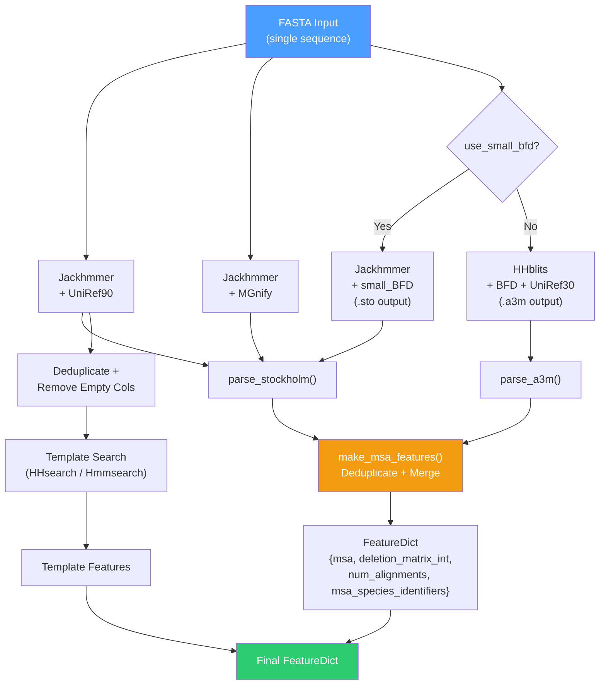
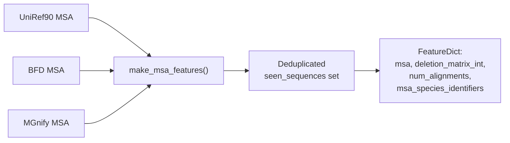
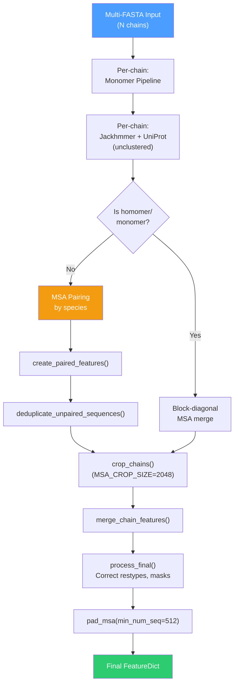
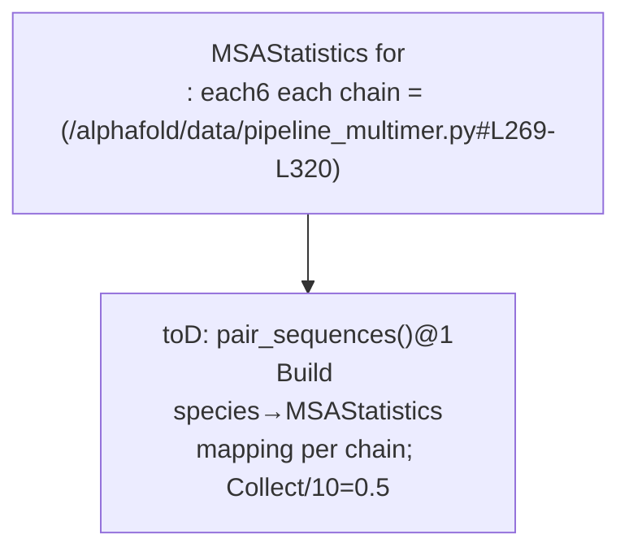

The Multiple Sequence Alignment (MSA) generation workflow is AlphaFold's most computationally expensive and architecturally critical preprocessing stage. It transforms a raw amino acid sequence into the evolutionary signal that powers the Evoformer — without a deep, diverse MSA, even the most sophisticated neural architecture cannot recover a protein's 3D structure. This page dissects the complete MSA pipeline: from the external bioinformatics tools that search genetic databases, through the parsers that normalize alignment formats, to the feature assembly logic that deduplicates and merges everything into the NumPy arrays consumed by the model.

## The Central Role of MSA in AlphaFold

AlphaFold's insight is that the co-evolutionary information encoded in an MSA — which positions mutate in concert across evolutionary time — is the strongest signal for inter-residue contacts. The MSA is not merely "homology information"; it is the **primary input representation** for the Evoformer stack, which iteratively refines MSA and pair representations. A shallow MSA (few diverse sequences) yields low-confidence predictions; a deep MSA with broad taxonomic coverage is the difference between a pLDDT of 50 and 95.

The MSA generation workflow is orchestrated by two pipeline classes depending on the prediction mode. The monomer pipeline performs three sequential database searches. The multimer pipeline extends this with per-chain searches and a cross-chain pairing step that stitches together evolutionary information from complex subunits.

Sources: [pipeline.py](/alphafold/data/pipeline.py#L123-L173), [pipeline_multimer.py](/alphafold/data/pipeline_multimer.py#L184-L216)

## Monomer MSA Pipeline Architecture

The `DataPipeline` class in `pipeline.py` is the monomer's central orchestrator. It constructs three MSA runner instances at initialization and executes them in a fixed order during `process()`. The following diagram shows the complete flow from FASTA input to the merged feature dictionary:



Sources: [pipeline.py](/alphafold/data/pipeline.py#L174-L280)

### The Three Database Searches

Each database search targets a different level of the evolutionary tree, and together they provide broad coverage:

| Search Step | Tool | Database | Output Format | Default Max Hits | Purpose |
|---|---|---|---|---|---|
| 1 | Jackhmmer | UniRef90 | Stockholm (.sto) | 10,000 | Clustered UniProt reference — broad evolutionary coverage |
| 2 | Jackhmmer | MGnify | Stockholm (.sto) | 501 | Metagenomic sequences — environmental/uncultured organisms |
| 3a | HHblits | BFD + UniRef30 | A3M (.a3m) | unlimited | Deep diversity from big fragmented database (full_dbs preset) |
| 3b | Jackhmmer | small_bfd | Stockholm (.sto) | unlimited | Reduced database for faster execution (reduced_dbs preset) |

The `use_small_bfd` flag (set by `--db_preset=reduced_dbs`) switches between HHblits with the full BFD+UniRef30 databases and Jackhmmer with the smaller clustered BFD. The full configuration is dramatically slower but yields richer MSAs.

Sources: [pipeline.py](/alphafold/data/pipeline.py#L146-L167), [pipeline.py](/alphafold/data/pipeline.py#L236-L255)

## The `run_msa_tool` Abstraction

Both Jackhmmer and HHblits are invoked through the shared `run_msa_tool()` function, which adds a critical caching layer. When `use_precomputed_msas=True`,D` and the output file already exists on disk, the tool execution is skipped entirely and the cached result is read instead4 directly. This makes iterative development and re-runs feasible without re-executing the expensive bioinformatics searches:

```python
def run_msa_tool(
    msa_runner,
    input_fasta_path: str,
    msa_out_path: str,
    msa_format: str,
    use_precomputed_msas: bool,
    max_sto_sequences: Optional[int] = None,
) -> Mapping[str, Any]:
```

The function also handles truncation of Stockholm-format MSAs to `max_sto_sequences` — this limits the UniRef90 search to 10,000 sequences and MGnify to 501 sequences. A3M-format results from HHblits are not truncated at this stage.

Sources: [pipeline.py](/alphafold/data/pipeline.py#L94-L120)

## Jackhmmer: Iterative HMM Search

Jackhmmer (from HMMER3) performs **iterative profile HMM searches** — each iteration builds a profile from the current hits and searches again, discovering increasingly remote homologs. AlphaFix configures it with a single iteration (`n_iter=1`) by default, relying on the database clustering to handle diversity. Key configuration parameters:

| Parameter | Default | Role |
|---|---|---|
| `n_cpu` | 8 | Parallel threads (diminishing returns above 8) |
| `n_iter` | 1 | Number of iterative search rounds |
| `e_value` | 0.0001 | Inclusion threshold — sequences with E-value > this are excluded |
| `filter_f1` | 0.0005 | MSV/biased composition pre-filter proportion |
| `filter_f2` | 0.00005 | Viterbi pre-filter proportion |
| `filter_f3` | 0.0000005 | Forward pre-filter proportion |

The aggressively low filter values (`F1/F2/F3`) are intentional — they trade sensitivity for speed, which is critical for the massive MGnify database. The `_query_chunk()` method constructs the command-line invocation, executes it as a subprocess, and reads the Stockholm output. For chunked streaming (used with very large databases), it supports `num_streamed_chunks` to process the database in segments.

Sources: [jackhmmer.py](/alphafold/data/tools/jackhmmer.py#L31-L169)

## HHblits: HMM-HMM Alignment

HHblits (from HH-suite) performs **HMM-HMM comparison**, which is more sensitive than HMM-sequence comparison because it compares entire profile distributions rather than single sequences. This makes it the preferred tool for the deep BFD database. Key distinctions from Jackhmmer:

- **Output format**: A3M (not Stockholm) — lower-case letters encode insertions relative to the query
- **Multiple databases**: Searches BFD and UniRef30 simultaneously via `-d` flags
- **Default iterations**: 3 (vs. Jackhmmer's 1) — the more sensitive algorithm benefits from iteration
- **No max_sequences truncation**: Returns all hits passing the E-value threshold

| Parameter | Default | Role |
|---|---|---|
| `n_cpu` | 4 | Parallel threads |
| `n_iter` | 3 | Iterative search rounds |
| `e_value` | 0.001 | E-value inclusion threshold |
| `maxseq` | 1,000,000 | Max rows in input alignment |
| `realign_max` | 100,000 | Max HMM-HMM hits to realign |
| `p` | 20 | Minimum probability for inclusion in output |

Sources: [hhblits.py](/alphafold/data/tools/hhblits.py#L32-L163)

## MSA Parsing and Format Conversion

The `parsers.py` module defines the `Msa` dataclass — the canonical in-memory representation used throughout the pipeline:

```python
@dataclasses.dataclass(frozen=True)
class Msa:
    sequences: Sequence[str]
    deletion_matrix: DeletionMatrix
    descriptions: Sequence[str]
```

Each field must have identical length (validated in `__post_init__`). The **deletion matrix** is particularly important: `deletion_matrix[i][j]` counts how many residues were deleted from aligned sequence `i` at position `j` relative to the query. This information is preserved as `deletion_matrix_int` in the final features and used by the Evoformer to weight the importance of each MSA row.

Two format-specific parsers populate this dataclass:

- **`parse_stockholm()`** — Reads Stockholm format (used by Jackhmmer). Strips gap columns from the query sequence, computes deletion vectors by comparing each aligned sequence to the query.
- **`parse_a3m()`** — Reads A3M format (used by HHblits). Lower-case characters represent insertions; the parser counts them into the deletion matrix and strips them to produce the aligned sequence.

Additional utility functions clean and transform MSA data before it reaches the feature assembler:

| Function | Purpose |
|---|---|
| `deduplicate_stockholm_msa()` | Removes duplicate sequences (ignoring insertions w.r.t. query) — applied to UniRef90 before template search |
| `remove_empty_columns_from_stockholm_msa()` | Strips all-gap columns — applied to UniRef90 before template search |
| `convert_stockholm_to_a3m()` | Converts Stockholm to A3M — used when template searcher requires A3M input |
| `truncate_stockholm_msa()` | Reads only the first N sequences from a Stockholm file to limit memory |

Sources: [parsers.py](/alphafold/data/parsers.py#L29-L58), [parsers.py](/alphafold/data/parsers.py#L104-L202), [parsers.py](/alphafold/data/parsers.py#L317-L389)

## Feature Assembly: `make_msa_features`

After parsing, the three independent MSA objects are merged into a single feature dictionary by `make_msa_features()`. This function performs the critical **cross-MSA deduplication** step — a sequence seen in UniRef90 is not duplicated when it also appears in BFD or MGnify:



The function iterates through each MSA in order (UniRef90 → BFD → MGnify), skipping sequences already in `seen_sequences`. For each unique sequence, it:

1. Converts residues to integer IDs via `HHBLITS_AA_TO_ID` mapping
2. Appends the corresponding deletion matrix row
3. Extracts the **species identifier** from the description line via `msa_identifiers.get_identifiers()`

The resulting features include `msa` (integer-coded alignment matrix), `deletion_matrix_int`, `num_alignments` (total unique sequences), and `msa_species_identifiers` (species codes for each row).

Sources: [pipeline.py](/alphafold/data/pipeline.py#L570-L91), [msa_identifiers.py](/alphafold/data/msa_identifiers.py#L84-L91)

## Species Identification for MSA Pairing

The `msa_identifiers.py` module extracts taxonomic species codes from MSA description lines. These codes are essential for the multimer pipeline's cross-chain pairing logic. The parser handles UniProtKB format identifiers like `tr|A0A146SKV9|A0A146SKV9_FUNHE`, where `FUNHE` is the 5-character species mnemonic. The regex pattern `_UNIPROT_PATTERN` captures the `SpeciesIdentifier` group, which is stored in the feature dict as bytes for efficient numpy operations.

Sources: [msa_identifiers.py](/alphafold/data/msa_identifiers.py#L25-L72)

## Multimer MSA Pipeline: Per-Chain Search and Cross-Chain Pairing

The multimer pipeline (`pipeline_multimer.DataPipeline`) fundamentally extends the monomer workflow. For a heterodimer with chains A and B, it must answer two questions: (1) what is the evolutionary information for each chain independently? and (2) which sequences across chains come from the **same organism** and therefore represent co-evolved partners?



### Per-Chain Monomer Pipeline

Each chain independently runs the full monomer `DataPipeline.process()`, producing its own UniRef90, BFD, and MGnify MSAs. This ensures deep per-chain evolutionary coverage. For homomers (identical sequences), the pipeline runs only once and deep-copies the features.

### UniProt Search for Pairing

For heteromers, an additional Jackhmmer search against the **unclustered UniProt database** is performed per chain (`_all_seq_msa_features()`). This is distinct from the clustered UniRef90 — the unclustered database preserves individual organism entries needed for species-level pairing. Results are truncated to `max_uniprot_hits=50,000` and stored with the `_all_seq` suffix (e.g., `msa_all_seq`, `deletion_matrix_int_all_seq`).

Sources: [pipeline_multimer.py](/alphafold/data/pipeline_multimer.py#L218-L267)

## MSA Pairing: Stitching Cross-Chain Evolutionary Signal

The pairing logic in `msa_pairing.py` is the multimer's most distinctive operation. It identifies sequences from the **same species** across different chains' MSAs and aligns them into paired rows — creating a combined MSA where each row represents a potential real-world complex rather than independent subunit homologs.

### The Pairing Algorithm



The `pair_sequences()` function operates in three phases:

1. **Species grouping**: For each chain, `MSAStatistics.from_chain_features()` computes per-row species identifiers, sequence similarity to the target, and gap percentage. The `to_species_dict()` method partitions each chain's MSA rows by species.

2. **Cross-chain matching**: For each species present in **two or more chains**, `_match_rows_by_sequence_similarity()` sorts each chain's rows by similarity to its target sequence and pairs them in order. Species present in only one chain are skipped (no pairing signal). Species with >600 sequences in any chain are also skipped (computational guard).

3. **Priority ordering**: `reorder_paired_rows()` sorts paired rows by the number of chains paired (all-chain pairings first), then by the product of row indices (proxy for E-value ranking). This ensures the most informative pairings occupy the top MSA rows.

### Post-Pairing Processing

After pairing, `create_paired_features()` selects the paired row indices from each chain's `_all_seq` features. Then `deduplicate_unpaired_sequences()` removes any unpaired MSA rows that duplicate a paired row — the paired version is always preferred since it carries cross-chain information. Finally, `_concatenate_paired_and_unpaired_features()` stacks the paired MSA above the block-diagonal unpaired MSA, so the Evoformer sees both signals.

Sources: [msa_pairing.py](/alphafold/data/msa_pairing.py#L153-L185), [msa_pairing.py](/alphafold/data/msa_pairing.py#L256-L319), [msa_pairing.py](/alphafold/data/msa_pairing.py#L546-L567)

## MSA Cropping and Final Processing

The `feature_processing.py` module handles the transition from raw merged features to model-ready arrays. The `pair_and_merge()` function orchestrates:

1. **`process_unmerged_features()`** — Converts deletion matrices to float32, computes `deletion_mean` (average deletions per position), and adds dummy atom positions.

2. **`crop_chains()`** — Limits each chain's MSA to `MSA_CROP_SIZE=2048` rows. For paired MSAs, the crop is split: up to `msa_crop_size // 2` paired rows, with the remainder allocated to unpaired rows minus any non-gapped paired rows already included. Templates are cropped to `MAX_TEMPLATES=4`.

3. **`merge_chain_features()`** — For homomers, merges identical chains by concatenating MSA features along the residue dimension (dense MSA). For heteromers, block-diagonalizes unpaired MSA features and concatenates paired features. Computes `cluster_bias_mask` and `bert_mask`.

4. **`process_final()`** — Corrects MSA residue type ordering via `MAP_HHBLITS_AATYPE_TO_OUR_AATYPE`, generates `seq_mask` and `msa_mask`, and filters to `REQUIRED_FEATURES`.

Sources: [feature_processing.py](/alphafold/data/feature_processing.py#L74-L107), [feature_processing.py](/alphafold/data/pipeline.py#L142-L195)

## Output Artifacts

The MSA pipeline writes intermediate results to `msa_output_dir` for caching and debugging:

| File | Pipeline | Content |
|---|---|---|
| `uniref90_hits.sto` | Monomer | Stockholm MSA from UniRef90 |
| `mgnify_hits.sto` | Monomer | Stockholm MSA from MGnify |
| `bfd_uniref_hits.a3m` | Monomer (full_dbs) | A3M MSA from HHblits |
| `small_bfd_hits.sto` | Monomer (reduced_dbs) | Stockholm MSA from small BFD |
| `pdb_hits.hhr` | Monomer | Template search results |
| `<chain_id>/uniprot_hits.sto` | Multimer | UniProt MSA for pairing |
| `chain_id_map.json` | Multimer | Chain ID → sequence mapping |

Sources: [pipeline.py](/alphafold/data/pipeline.py#L187-L255), [pipeline_multimer.py](/alphafold/data/pipeline_multimer.py#L280-L286)

## Performance Characteristics and Tuning

The MSA generation step dominates end-to-end runtime — typically 10–30 minutes for a 300-residue monomer with full databases. Key performance knobs:

| Lever | Effect | Trade-off |
|---|---|---|
| `--db_preset=reduced_dbs` | Replaces HHblits+BFD+UniRef30 with Jackhmmer+small_bfd | 3–5× faster, slightly shallower MSA |
| `use_precomputed_msas=True` | Skips all tool execution if output files exist | Zero cost on re-runs; stale data risk |
| `mgnify_max_hits` | Limits MGnify sequences (default 501) | Lower = faster but less metagenomic signal |
| `uniref_max_hits` | Limits UniRef90 sequences (default 10,000) | Lower = faster but less diversity |
| `msa_tools_n_cpu` | CPU threads for Jackhmmer/HHblits | Diminishing returns above 8 |

> [!TIP]
> When debugging MSA quality, check the logged output: `Uniref90 MSA size`, `BFD MSA size`, `MGnify MSA size`, and `Final (deduplicated) MSA size`. A final MSA below ~30 sequences for a typical globular protein signals poor evolutionary coverage and likely low prediction confidence.

> [!TIP]
> In the multimer pipeline, the UniProt search for pairing can be extremely expensive against the full unclustered database. If you only need monomer predictions, use `--model_preset=monomer` to avoid this cost entirely. For multimer, the `max_uniprot_hits=50,000` cap prevents runaway memory usage.

Sources: [pipeline.py](/alphafold/data/pipeline.py#L267-L278), [run_alphafold.py](/run_alphafold.py#L160-L167)

## Architectural Summary

The MSA workflow follows a clear **search → parse → merge → pair → crop** pipeline pattern. The monomer path is a three-way fan-out (UniRef90, BFD, MGnify) with a single merge point. The multimer path nests the monomer pipeline per chain, adds a UniProt fan-out for pairing, and introduces a sophisticated species-based pairing algorithm that transforms independent per-chain evolutionary signals into a joint representation capturing inter-chain co-evolution. Both paths converge on the same feature contract — a `FeatureDict` with `msa`, `deletion_matrix_int`, and `num_alignments` arrays — that feeds directly into [Evoformer and Embeddings](11-evoformer-and-embeddings).

The next step in the data pipeline after MSA generation is [Template Search and Featurization](9-template-search-and-featurization), which uses the UniRef90 MSA to find structural homologs in the PDB. For the multimer-specific aspects of feature assembly after MSA pairing, see [Multimer Feature Assembly](10-multimer-feature-assembly).
