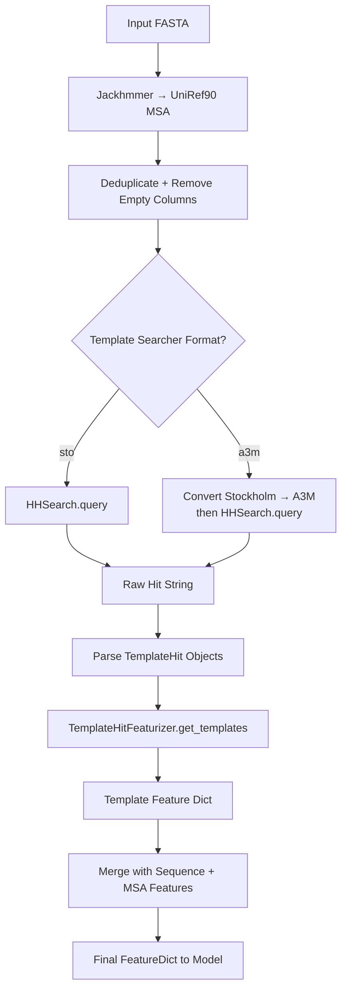
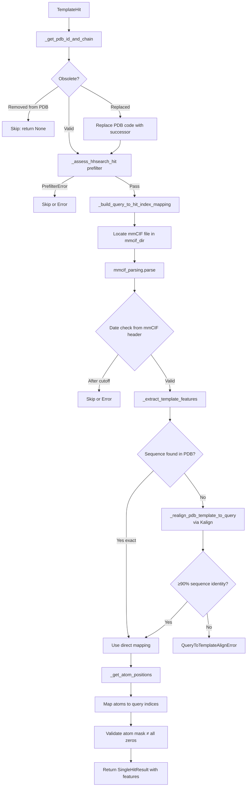

AlphaFold's template pipeline bridges **structural homology search** and **neural network input assembly** — it discovers known PDB structures related to the query sequence and distills their 3D coordinates into fixed-shape NumPy arrays that the Evoformer can consume. The entire flow is orchestrated by `DataPipeline.process()`, which delegates to two collaborating subsystems: a **template searcher** (HHSearch or Hmmsearch) that identifies candidate structures, and a **template featurizer** (`HhsearchHitFeaturizer` or `HmmsearchHitFeaturizer`) that converts raw hits into the six `template_*` feature tensors. Understanding this pipeline is essential for diagnosing why a prediction may lack structural templates or why a specific template was rejected.

Sources: [templates.py](/alphafold/data/templates.py#L1-L31), [pipeline.py](/alphafold/data/pipeline.py#L1-L34)

## Pipeline Integration: Where Templates Enter the Data Flow

The `DataPipeline` class wires template search into the broader feature assembly. After generating the UniRef90 MSA via Jackhmmer, the pipeline deduplicates and cleans the Stockholm MSA, then feeds it into the template searcher. The searcher returns raw hit strings (`.hhr` or `.dom` format), which are parsed into `TemplateHit` objects and passed to the featurizer. The resulting template features are merged with sequence and MSA features into a single `FeatureDict` returned to the caller.



The critical integration code in `DataPipeline.process()` selects the input format, invokes the searcher, parses hits, and calls the featurizer:

```python
# Pipeline feeds UniRef90 MSA to template searcher
if self.template_searcher.input_format == 'sto':
    pdb_templates_result = self.template_searcher.query(msa_for_templates)
elif self.template_searcher.input_format == 'a3m':
    uniref90_msa_as_a3m = parsers.convert_stockholm_to_a3m(msa_for_templates)
    pdb_templates_result = self.template_searcher.query(uniref90_msa_as_a3m)

# Parse raw output into structured TemplateHit objects
pdb_template_hits = self.template_searcher.get_template_hits(
    output_string=pdb_templates_result, input_sequence=input_sequence
)

# Featurize all hits → template feature arrays
templates_result = self.template_featurizer.get_templates(
    query_sequence=input_sequence, hits=pdb_template_hits
)
```

> [!TIP]
> The template searcher operates on the **UniRef90 MSA** (not BFD or MGnify), because HHSearch/Hmmsearch require a profile-style input derived from a diverse but manageable sequence search. Using the deeper BFD MSA would be computationally prohibitive and offers diminishing returns for template identification.

Sources: [pipeline.py](/alphafold/data/pipeline.py#L206-L280), [pipeline.py](/alphafold/data/pipeline.py#L123-L172)

## The Six Template Feature Tensors

The featurizer's output is constrained to exactly six named arrays, defined in the `TEMPLATE_FEATURES` constant. These tensors have a consistent shape aligned to the query sequence length `N_res`, enabling direct consumption by the template embedding stack in the Evoformer.

| Feature Name | Dtype | Shape | Description |
|---|---|---|---|
| `template_aatype` | `float32` | `(T, N_res, 22)` | One-hot amino acid type per residue, mapped via `HHBLITS_AA_TO_ID` (22 classes including gap and X) |
| `template_all_atom_positions` | `float32` | `(T, N_res, 37, 3)` | Cartesian (x,y,z) coordinates for all 37 atom types per residue |
| `template_all_atom_masks` | `float32` | `(T, N_res, 37)` | Binary mask: 1.0 if atom position is experimentally observed, 0.0 if missing |
| `template_domain_names` | `object` | `(T,)` | PDB ID + chain identifier string (e.g. `b"6x2a_A"`) |
| `template_sequence` | `object` | `(T,)` | Aligned template sequence with gaps (`-`) for unaligned query positions |
| `template_sum_probs` | `float32` | `(T,)` | Sum of per-position alignment probabilities from HHSearch, used as a quality/confidence score |

Where `T` is the number of valid templates (up to `max_hits`, typically 4 after downstream filtering). Unaligned query residues receive **zero-filled** atom positions and masks, with `-` in the template sequence — this sparse alignment pattern is exactly what the Evoformer's template attention mechanism learns to exploit.

Sources: [templates.py](/alphafold/data/templates.py#L88-L95), [templates.py](/alphafold/data/templates.py#L676-L689)

## Hit Prefiltering: Four Gates Before Featurization

Before any mmCIF file is parsed, each `TemplateHit` must pass through `_assess_hhsearch_hit()`, which enforces four sequential prefilter checks. Any failure raises a `PrefilterError` subclass, and the hit is silently skipped (or promoted to a hard error under `strict_error_check`). This prefilter is a **performance optimization** — it avoids expensive mmCIF parsing for obviously invalid hits.

| Check | Exception | Threshold | Rationale |
|---|---|---|---|
| **Date cutoff** | `DateError` | `release_date > max_template_date` | Prevents information leakage from structures solved after the query's experimental date |
| **Alignment ratio** | `AlignRatioError` | `aligned_cols / len(query) ≤ 0.1` | Rejects hits covering <10% of the query — too fragmentary to provide useful structural guidance |
| **Duplicate/subsequence** | `DuplicateError` | `template ∈ query ∧ length_ratio > 0.95` | Filters near-identical sequences (e.g., the query itself deposited in PDB) |
| **Minimum length** | `LengthError` | `len(template_sequence) < 10` | Discards trivially short fragments that cannot contribute meaningful 3D constraints |

The **date cutoff** is the most critical gate for CASP-style evaluations — it ensures AlphaFold cannot "cheat" by using structures that were only solved after the prediction deadline. The `max_template_date` is configured at pipeline initialization and enforced both in the prefilter (using a precomputed release dates file) and again after mmCIF parsing (using the actual release date in the mmCIF header).

Sources: [templates.py](/alphafold/data/templates.py#L175-L241), [templates.py](/alphafold/data/templates.py#L831-L845)

## Single Hit Processing: The Core Featurization Path

The function `_process_single_hit()` orchestrates the full lifecycle of converting one `TemplateHit` into a feature dictionary. Its logic follows a strict sequence: **identify → prefilter → map → parse → extract → validate**.



### Query-to-Template Index Mapping

The alignment between query and template residues is captured by `_build_query_to_hit_index_mapping()`, which produces a `Mapping[int, int]` — a dictionary from query residue indices to template residue indices. This mapping accounts for the fact that HHSearch reports only the **aligned subsequence** of the query, not the full query. The function computes an offset (`hhsearch_query_offset`) by locating the aligned query fragment within the original query sequence, then pairs each query position with its corresponding template position using the hit's `indices_query` and `indices_hit` arrays.

Sources: [templates.py](/alphafold/data/templates.py#L763-L904), [templates.py](/alphafold/data/templates.py#L692-L746)

## Template Sequence Matching: Exact → Sequence-Only → Fuzzy

When extracting features from a parsed mmCIF, `_find_template_in_pdb()` attempts three progressively relaxed strategies to locate the template chain within the PDB structure:

1. **Exact match** (chain ID + subsequence): Checks if the template sequence appears as a contiguous substring of the chain with the matching chain ID. This is the fastest and most reliable path.
2. **Sequence-only match**: If the chain ID doesn't match, scans **all chains** in the mmCIF object for a subsequence match. Handles cases where HHSearch reports a different chain ID than what appears in the mmCIF.
3. **Fuzzy match** (wildcard X): Constructs a regex where each template residue matches itself **or** the ambiguity code `X`. This accommodates sequences with unresolved residues that are marked as `X` in the PDB but identified more precisely by HHSearch.

If all three strategies fail, a `SequenceNotInTemplateError` is raised, triggering the **realignment fallback** via `_realign_pdb_template_to_query()`.

Sources: [templates.py](/alphafold/data/templates.py#L244-L313)

## Realignment: When the mmCIF Sequence Differs from the Hit

A subtle but important edge case arises when PDB70 (the HHsearch database) contains a **different version** of the template sequence than the actual mmCIF file — for example, when the PDB entry was updated or re-refined after PDB70 was built. In this case, `_find_template_in_pdb()` raises `SequenceNotInTemplateError`, and `_extract_template_features()` falls back to realignment:

The realignment procedure uses **Kalign** to align the old template sequence (from the HHSearch hit) against the new template sequence (from the mmCIF file). It then requires **≥90% sequence identity** between the two (measured against the shorter sequence). If this threshold is met, the old query-to-template mapping is composed with the old-to-new mapping to produce a corrected `new_query_to_template_mapping`. If the threshold is not met, a `QueryToTemplateAlignError` is raised — the mmCIF structure has diverged too far from what HHSearch reported, and using it would introduce misleading structural information.

Sources: [templates.py](/alphafold/data/templates.py#L316-L450), [templates.py](/alphafold/data/templates.py#L600-L628)

## Atom Position Extraction and Validation

The function `_get_atom_positions()` reads all-atom 3D coordinates from the parsed mmCIF structure and produces two arrays:

- **`all_positions`**: Shape `(num_res, 37, 3)` — Cartesian coordinates for each of 37 atom types (N, CA, C, O, CB, ...) per residue.
- **`all_positions_mask`**: Shape `(num_res, 37)` — Binary indicator for whether each atom has experimental coordinates.

Two special atom-handling rules are applied during extraction:

1. **Selenomethionine (MSE)**: The selenium atom (`SE`) coordinates are placed in the **sulphur column** (`SD`), allowing the model to treat MSE like standard methionine without adding a special atom type.
2. **Arginine NH1/NH2 swap**: In some PDB entries, the NH1 and NH2 atom names are incorrectly assigned such that NH2 is closer to CD than NH1. The code detects this geometric inconsistency and swaps the coordinates and masks.

After extraction, `_check_residue_distances()` validates that consecutive **Cα–Cα distances** between unmasked residues do not exceed `max_ca_ca_distance` (set to **150.0 Å** in `_extract_template_features` — effectively infinity, acting as a sanity check for catastrophically malformed structures rather than a strict geometric filter).

> [!TIP]
> The 150.0 Å Cα–Cα distance threshold is intentionally permissive. A normal peptide bond yields ~3.8 Å Cα–Cα spacing. The high threshold avoids rejecting templates with chain breaks or missing residues, which are common in experimental PDB structures. Only genuinely corrupt coordinate data (e.g., serialization errors) would exceed this limit.

Sources: [templates.py](/alphafold/data/templates.py#L477-L541), [templates.py](/alphafold/data/templates.py#L453-L474), [templates.py](/alphafold/data/templates.py#L630-L639)

## Feature Assembly: Mapping Atoms onto the Query Index Space

The final step in `_extract_template_features()` projects the template's all-atom data onto the **query sequence's index space**. This is where the alignment mapping becomes critical:

```python
# Initialize all positions to zeros (for unaligned residues)
for _ in query_sequence:
    templates_all_atom_positions.append(np.zeros((37, 3)))
    templates_all_atom_masks.append(np.zeros(37))
    output_templates_sequence.append('-')

# Overwrite with template data where alignment exists
for k, v in mapping.items():
    template_index = v + mapping_offset
    templates_all_atom_positions[k] = all_atom_positions[template_index][0]
    templates_all_atom_masks[k] = all_atom_masks[template_index][0]
    output_templates_sequence[k] = template_sequence[v]
```

The key insight: **`k` indexes the query sequence**, while **`v + mapping_offset` indexes the template structure**. Residues in the query that have no corresponding template residue retain their zero-initialized positions and masks — this sparse pattern is how the model learns which structural constraints are available. After assembly, the template sequence is one-hot encoded via `sequence_to_onehot()` using the `HHBLITS_AA_TO_ID` mapping (22 classes), producing the `template_aatype` feature.

Sources: [templates.py](/alphafold/data/templates.py#L641-L689)

## HhsearchHitFeaturizer vs HmmsearchHitFeaturizer

AlphaFold provides two concrete implementations of the `TemplateHitFeaturizer` abstract class, corresponding to the two supported template search backends:

| Aspect | `HhsearchHitFeaturizer` | `HmmsearchHitFeaturizer` |
|---|---|---|
| **Search backend** | HHSearch (profile HMM vs. profile HMM) | Hmmsearch (profile HMM vs. sequence) |
| **Hit ordering** | Sorted by `sum_probs` descending | Sorted by `sum_probs` descending (if available) |
| **Deduplication** | None (relies on HHSearch to deduplicate) | Tracks `already_seen` set by `template_sequence` key |
| **Empty result handling** | Returns empty array with correct dtype | Returns **default zero-filled template** with shape `(1, N_res, ...)` |
| **Input format** | A3M (via `input_format='a3m'`) | Sto (via `input_format='sto'`) |

The `HmmsearchHitFeaturizer`'s deduplication logic prevents the same template sequence from appearing multiple times under different chain IDs — a common situation in PDB entries with symmetric homomultimers. Its empty-result fallback produces a single dummy template of all zeros rather than an empty array, ensuring downstream tensor shapes remain consistent even when no templates are found.

Sources: [templates.py](/alphafold/data/templates.py#L914-L983), [templates.py](/alphafold/data/templates.py#L985-L1050), [templates.py](/alphafold/data/templates.py#L1053-L1141)

## Error Handling Philosophy: Warnings vs. Hard Errors

The template pipeline implements a **two-tier error model** controlled by the `strict_error_check` flag:

- **Soft mode** (`strict_error_check=False`, default): Template failures are **warnings** — the hit is silently skipped, and processing continues. This maximizes the number of valid templates returned. Errors like `NoChainsError`, `NoAtomDataInTemplateError`, and `TemplateAtomMaskAllZerosError` are treated as indicators of missing experimental data, not bugs.
- **Strict mode** (`strict_error_check=True`): `DateError` and `DuplicateError` from the prefilter become **hard errors** that propagate to the caller. Feature extraction failures also become errors. This mode is used during validation and testing to ensure template quality.

Both modes collect all errors and warnings into the `TemplateSearchResult` dataclass, preserving a complete audit trail even when processing succeeds.

Sources: [templates.py](/alphafold/data/templates.py#L788-L904), [templates.py](/alphafold/data/templates.py#L907-L912)

## Obsolete PDB Handling

PDB entries are occasionally deprecated and replaced by newer entries. The `_parse_obsolete()` function reads the PDB's obsolete entries file, which can map an old PDB ID to a replacement ID or to `None` (indicating removal). During hit processing:

1. If the hit's PDB code is obsolete with **no replacement** → skip immediately.
2. If the hit's PDB code is obsolete **with a replacement** → substitute the replacement PDB code before prefiltering and mmCIF lookup.

This ensures the pipeline can still find the correct structural data even when HHSearch returns hits referencing deprecated entries.

Sources: [templates.py](/alphafold/data/templates.py#L133-L153), [templates.py](/alphafold/data/templates.py#L775-L785)

## From Templates to the Evoformer

The assembled template features flow directly into the Evoformer's **template embedding stack**, where each of the `T` templates is independently embedded and then aggregated via attention. The `template_sum_probs` score weights template influence — higher-probability alignments contribute more strongly to the initial pairwise representation. The sparse `template_all_atom_masks` guide the model to attend only to experimentally observed coordinates, ignoring gaps introduced by alignment.

For the complete picture of how template features interact with the Evoformer's attention mechanisms, see [Evoformer and Embeddings](11-evoformer-and-embeddings). For the multimer-specific template assembly logic, see [Multimer Feature Assembly](10-multimer-feature-assembly).
