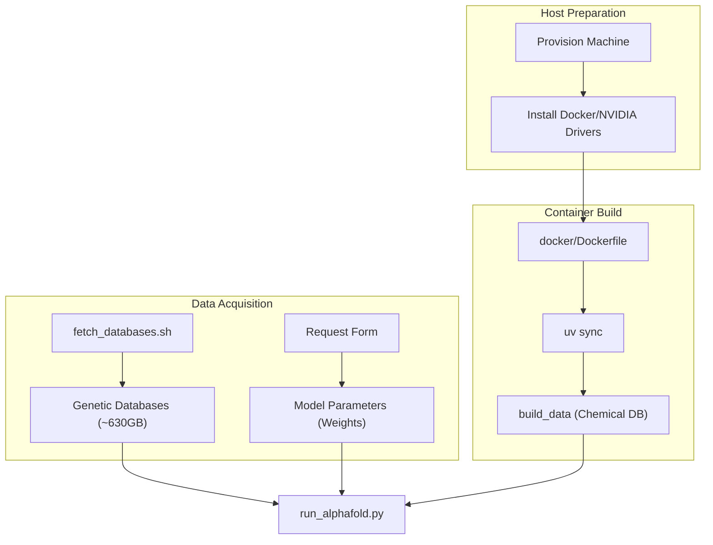

# Installation Guide

<details>
<summary>Relevant source files</summary>

The following files were used as context for generating this wiki page:

- [README.md](README.md)
- [docker/Dockerfile](docker/Dockerfile)
- [docker/easel_fast_fasta_parsing.patch](docker/easel_fast_fasta_parsing.patch)
- [docker/jackhmmer_parallel_fasta.patch](docker/jackhmmer_parallel_fasta.patch)
- [docs/installation.md](docs/installation.md)

</details>


This guide provides a high-level overview of the installation and setup process for AlphaFold 3. It covers system requirements, environment configuration, and initial setup steps. For deep technical details, refer to the child pages linked throughout this section.

## System Requirements

AlphaFold 3 is designed for high-performance structural biology tasks and has specific hardware and software prerequisites.

*   **Operating System**: Linux is the only supported operating system [docs/installation.md:3-4]().
*   **GPU**: NVIDIA GPU with Compute Capability 8.0 or greater (e.g., A100 or H100 80 GB). Numerical accuracy has been verified on these specific architectures [docs/installation.md:5-9]().
*   **Memory**: At least 64 GB of RAM is recommended due to the memory-intensive genetic search stage [docs/installation.md:11-12]().
*   **Storage**: Up to 1 TB of disk space for genetic databases; SSD storage is highly recommended for performance [docs/installation.md:4-5]().
*   **Software**: Python 3.12 or higher is required [pyproject.toml:14]().

Sources: [docs/installation.md:1-12](), [pyproject.toml:11-14]()

## Installation Workflow

The setup process involves preparing the host environment, acquiring data, and building the execution container.

### High-Level Setup Diagram
This diagram maps the high-level installation steps to the scripts and configurations found in the codebase.



Sources: [docs/installation.md:23-31](), [docker/Dockerfile:71-75](), [fetch_databases.sh:1-49](), [docker/Dockerfile:88]()

## Component Overview

### 1. Database Setup
AlphaFold 3 relies on large genetic and structural databases. The `fetch_databases.sh` script automates downloading and extraction using `zstd` [fetch_databases.sh:26-45](). High-speed storage configuration is critical for performance during the genetic search phase.

For details, see [Database Setup](#2.1).

### 2. Container Configuration
The system is primarily distributed via Docker to ensure reproducible builds of complex dependencies like HMMER 3.4 (with custom sequence limit patches) and RDKit [docker/Dockerfile:11-58](). The container leverages `uv` for fast Python dependency resolution and virtual environment creation [docker/Dockerfile:25-31]().

For details, see [Container Setup](#2.2).

### 3. Build System and Dependencies
The project uses `scikit-build-core` as the build backend [pyproject.toml:9]() and `uv` for package management [docker/Dockerfile:71-72](). Key numerical and neural network dependencies include `jax` and `dm-haiku` [pyproject.toml:17-27]().

```mermaid
classDiagram
    class "Build Backend" {
        scikit_build_core
        pybind11
        cmake
    }
    class "Python Dependencies" {
        jax==0.9.1
        dm-haiku==0.0.16
        rdkit==2025.9.4
        tokamax==0.0.11
    }
    class "Native Tools" {
        HMMER 3.4
        jackhmmer_seq_limit_patch
        zstd
    }
    "Build Backend" ..> "Python Dependencies" : manages via uv
    "Build Backend" ..> "Native Tools" : compiles via docker/Dockerfile
```

Sources: [pyproject.toml:1-27](), [docker/Dockerfile:13-58](), [uv.lock:35-47]()

## Initial Execution Environment

The entry point for inference is `run_alphafold.py` [docker/Dockerfile:88](). Before execution, the system builds the chemical components database via the `build_data` script [pyproject.toml:64](), [docker/Dockerfile:75]().

To maintain numerical stability and performance under XLA, specific environment flags are configured:
*   `XLA_FLAGS="--xla_gpu_enable_triton_gemm=false"` [docker/Dockerfile:83]()
*   `XLA_PYTHON_CLIENT_PREALLOCATE=true` [docker/Dockerfile:85]()
*   `XLA_CLIENT_MEM_FRACTION=0.95` [docker/Dockerfile:86]()

For a complete guide on running your first prediction, see the **[User Guide](#3)**.

## Troubleshooting and Known Issues
Common setup issues involve rootless Docker permissions, NVIDIA driver mismatches, and GPU-specific XLA compilation constraints on older architectures [docs/installation.md:107-150](), [docker/Dockerfile:77-81]().

For details, see [Known Issues](#2.3).

Sources: [docs/installation.md:23-31](), [docker/Dockerfile:77-86](), [src/alphafold3/version.py:13]()

---