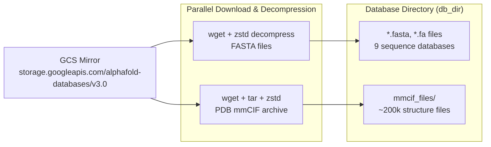
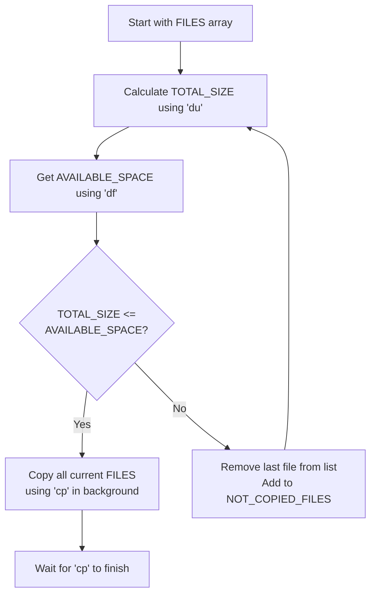

# Database Setup

<details>
<summary>Relevant source files</summary>

The following files were used as context for generating this wiki page:

- [README.md](README.md)
- [docs/installation.md](docs/installation.md)
- [fetch_databases.sh](fetch_databases.sh)
- [src/alphafold3/scripts/copy_to_ssd.sh](src/alphafold3/scripts/copy_to_ssd.sh)
- [src/alphafold3/scripts/gcp_mount_ssd.sh](src/alphafold3/scripts/gcp_mount_ssd.sh)
- [src/alphafold3/scripts/shard_databases.sh](src/alphafold3/scripts/shard_databases.sh)

</details>


## Purpose and Scope

This document provides detailed instructions for downloading, organizing, and optimizing the genetic databases required by AlphaFold 3. It covers the use of the `fetch_databases.sh` script, database directory structure, SSD optimization strategies using `gcp_mount_ssd.sh` and `copy_to_ssd.sh`, and parallel sharding via `shard_databases.sh` for improved search performance.

For instructions on building the Docker container that will use these databases, see [Container Setup](2.2). For information on running AlphaFold 3 with these databases, see [Running AlphaFold 3](3.2).

## Prerequisites

Before downloading databases, ensure the following tools are installed on your system:

| Tool | Purpose | Installation (Debian-based) |
|------|---------|---------------------------|
| `wget` | Database download | `sudo apt install wget` |
| `zstd` | Database decompression | `sudo apt install zstd` |
| `tar` | Archive extraction | Usually pre-installed |

**Disk Space Requirements:**
- Download size: ~252 GB
- Uncompressed size: ~630 GB
- Recommended: 1 TB total storage with SSD for optimal performance [docs/installation.md:4-5]()

**Sources:** [docs/installation.md:4-5](), [fetch_databases.sh:16-30]()

## Required Genetic Databases

AlphaFold 3 requires multiple genetic databases for protein and RNA Multiple Sequence Alignment (MSA) generation and template search. The following table describes each database:

| Database | Type | Purpose | Size (Uncompressed) |
|----------|------|---------|---------------------|
| BFD (small) | Protein sequences | MSA generation for proteins | ~272 GB |
| UniRef90 | Protein sequences | MSA generation for proteins | ~59 GB |
| MGnify | Metagenomic clusters | MSA generation for proteins | ~120 GB |
| UniProt | Protein sequences | Reference protein sequences | ~99 GB |
| PDB seqres | Protein sequences | Template search sequences | ~0.2 GB |
| PDB mmCIF | Protein structures | Template structures (~200k files) | ~78 GB |
| RNACentral | RNA sequences | MSA generation for RNA | ~0.5 GB |
| NT | Nucleotide sequences | MSA generation for RNA/DNA | ~1.5 GB |
| RFam | RNA families | MSA generation for RNA | ~0.05 GB |

**Sources:** [fetch_databases.sh:35-58](), [src/alphafold3/scripts/copy_to_ssd.sh:28-35]()

### Data Flow Overview

The following diagram illustrates how external databases are utilized by the AlphaFold 3 pipeline.

```mermaid
graph TB
    subgraph ProteinDatabases["Protein Sequence Databases"]
        BFD["bfd-first_non_consensus_sequences.fasta<br/>272 GB"]
        UniRef90["uniref90_2022_05.fa<br/>59 GB"]
        MGnify["mgy_clusters_2022_05.fa<br/>120 GB"]
        UniProt["uniprot_all_2021_04.fa<br/>99 GB"]
        PDBSeqres["pdb_seqres_2022_09_28.fasta<br/>0.2 GB"]
    end
    
    subgraph RNADatabases["RNA/DNA Sequence Databases"]
        RNACentral["rnacentral_active_seq_id_90_cov_80_linclust.fasta<br/>0.5 GB"]
        NT["nt_rna_2023_02_23_clust_seq_id_90_cov_80_rep_seq.fasta<br/>1.5 GB"]
        RFam["rfam_14_9_clust_seq_id_90_cov_80_rep_seq.fasta<br/>0.05 GB"]
    end
    
    subgraph StructureDatabases["Structure Databases"]
        PDBMMCIF["pdb_2022_09_28_mmcif_files.tar<br/>~200k PDB structures<br/>78 GB"]
    end
    
    DataPipeline["Data Pipeline<br/>MSA & Template Search"]
    
    BFD --> DataPipeline
    UniRef90 --> DataPipeline
    MGnify --> DataPipeline
    UniProt --> DataPipeline
    PDBSeqres --> DataPipeline
    RNACentral --> DataPipeline
    NT --> DataPipeline
    RFam --> DataPipeline
    PDBMMCIF --> DataPipeline
```



**Sources:** [fetch_databases.sh:35-58](), [src/alphafold3/scripts/copy_to_ssd.sh:28-35]()

## Database Download with fetch_databases.sh

### Basic Usage

The `fetch_databases.sh` script downloads all required databases from a Google Cloud Storage mirror. All database versions match those used in the AlphaFold 3 paper.

```bash
cd alphafold3  # Navigate to AlphaFold 3 repository
./fetch_databases.sh [<DB_DIR>]
```

**Default directory:** `$HOME/public_databases` (if `<DB_DIR>` is not specified) [fetch_databases.sh:23]()

**Important:** The download directory should NOT be a subdirectory of the AlphaFold 3 repository. This prevents slow Docker builds caused by copying large databases during image creation.

**Sources:** [fetch_databases.sh:21-24]()

### Script Implementation Details

The `fetch_databases.sh` script performs parallel downloads and decompression using background tasks.



**Key implementation details:**
- Uses `wget --quiet --output-document=-` to stream downloads [fetch_databases.sh:40-41]()
- Pipes directly to `zstd --decompress` or `tar` for decompression [fetch_databases.sh:41-43, 55-56]()
- Background processes (`&`) enable parallel downloads [fetch_databases.sh:43, 57]()
- `wait -n` command ensures background tasks complete safely [fetch_databases.sh:60-62]()

**Sources:** [fetch_databases.sh:35-63]()

## Database Directory Structure

After successful download, the database directory should contain:

```
<DB_DIR>/
├── mmcif_files/                                                    # ~200k files
├── bfd-first_non_consensus_sequences.fasta                        # 272 GB
├── mgy_clusters_2022_05.fa                                        # 120 GB
├── nt_rna_2023_02_23_clust_seq_id_90_cov_80_rep_seq.fasta       # 1.5 GB
├── pdb_seqres_2022_09_28.fasta                                    # 0.2 GB
├── rfam_14_9_clust_seq_id_90_cov_80_rep_seq.fasta               # 0.05 GB
├── rnacentral_active_seq_id_90_cov_80_linclust.fasta            # 0.5 GB
├── uniprot_all_2021_04.fa                                         # 99 GB
└── uniref90_2022_05.fa                                            # 59 GB
```

**Sources:** [fetch_databases.sh:35-58](), [src/alphafold3/scripts/copy_to_ssd.sh:28-35]()

## SSD Optimization for Performance

Database I/O is a significant bottleneck during MSA generation and template search. Storing databases on SSDs dramatically improves performance. AlphaFold 3 provides scripts to automate the mounting of local SSDs and the migration of database files.

### GCP SSD Setup (gcp_mount_ssd.sh)

For Google Cloud Platform deployments, the `gcp_mount_ssd.sh` script mounts and formats local NVMe SSDs, creating a RAID-0 array if multiple NVMe disks are attached.

```bash
src/alphafold3/scripts/gcp_mount_ssd.sh [<SSD_MOUNT_PATH>]
```

**Default mount path:** `/mnt/disks/ssd` [src/alphafold3/scripts/gcp_mount_ssd.sh:23]()

**Script behavior:**
1. Searches for Google Cloud local SSD devices in `/dev/disk/by-id/` [src/alphafold3/scripts/gcp_mount_ssd.sh:31]()
2. Assembles multiple NVMe disks into a RAID-0 array via `mdadm` if multiple devices exist, or configures single disks [src/alphafold3/scripts/gcp_mount_ssd.sh:34-48, 60-66]()
3. Formats with `ext4` if unformatted [src/alphafold3/scripts/gcp_mount_ssd.sh:44-48, 63-66]()
4. Mounts the device to the target directory and sets permissions [src/alphafold3/scripts/gcp_mount_ssd.sh:54-57, 76-79]()

**Sources:** [src/alphafold3/scripts/gcp_mount_ssd.sh:21-82]()

### Copying Databases to SSD (copy_to_ssd.sh)

The `copy_to_ssd.sh` script intelligently copies as many databases as will fit on the SSD, prioritizing files based on the list order.

```bash
src/alphafold3/scripts/copy_to_ssd.sh [<SOURCE_DIR>] [<TARGET_DIR>]
```

**Default source:** `$HOME/public_databases` [src/alphafold3/scripts/copy_to_ssd.sh:23]()
**Default target:** `/mnt/disks/ssd/public_databases` [src/alphafold3/scripts/copy_to_ssd.sh:24]()



**Priority order for migration:**
1. `pdb_seqres_2022_09_28.fasta`
2. `uniprot_all_2021_04.fa`
3. `mgy_clusters_2022_05.fa`
4. `uniref90_2022_05.fa`
5. `bfd-first_non_consensus_sequences.fasta`
6. `rfam_14_9_clust_seq_id_90_cov_80_rep_seq.fasta`
7. `nt_rna_2023_02_23_clust_seq_id_90_cov_80_rep_seq.fasta`
8. `rnacentral_active_seq_id_90_cov_80_linclust.fasta`

The script uses `du -sbc` to calculate sizes [src/alphafold3/scripts/copy_to_ssd.sh:42]() and `df --portability` to check available space [src/alphafold3/scripts/copy_to_ssd.sh:45](). Files are copied in parallel using background processes [src/alphafold3/scripts/copy_to_ssd.sh:52-54]().

**Sources:** [src/alphafold3/scripts/copy_to_ssd.sh:21-65]()

### Parallel Database Sharding (shard_databases.sh)

To accelerate sequence searching across large multi-core machines, the `shard_databases.sh` script splits genetic databases into numbered shards using SeqKit round-robin splitting (`seqkit split2`) [src/alphafold3/scripts/shard_databases.sh:21-53]().

```bash
src/alphafold3/scripts/shard_databases.sh [<DB_SOURCE_DIR>] [<SHARDED_DIR>] [<TMP_DIR>]
```

- **BFD:** 60 shards [src/alphafold3/scripts/shard_databases.sh:76]()
- **UniRef90:** 144 shards [src/alphafold3/scripts/shard_databases.sh:77]()
- **UniProt:** 204 shards [src/alphafold3/scripts/shard_databases.sh:78]()
- **MGnify:** 564 shards [src/alphafold3/scripts/shard_databases.sh:79]()
- **RFam:** 16 shards [src/alphafold3/scripts/shard_databases.sh:80]()
- **RNACentral:** 64 shards [src/alphafold3/scripts/shard_databases.sh:81]()
- **NT RNA:** 384 shards [src/alphafold3/scripts/shard_databases.sh:82]()

**Sources:** [src/alphafold3/scripts/shard_databases.sh:21-86]()

## Integration with Runtime

When running AlphaFold 3 via Docker, the database directory must be mounted as a volume. If databases are split across multiple storage locations (e.g., some on SSD, some on HDD), multiple `--db_dir` flags can be used to provide fallback paths.

**Example configuration:**
```bash
docker run -it \
    --volume /mnt/disks/ssd/public_databases:/root/public_databases \
    --volume $HOME/public_databases:/root/public_databases_fallback \
    alphafold3 \
    python run_alphafold.py \
    --db_dir=/root/public_databases \
    --db_dir=/root/public_databases_fallback
```

**Sources:** [docs/installation.md:78-89]()

---