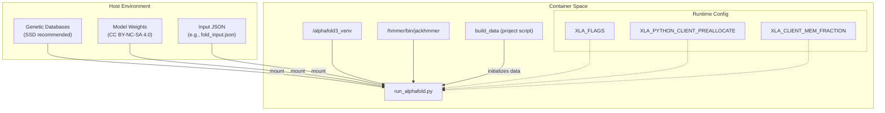
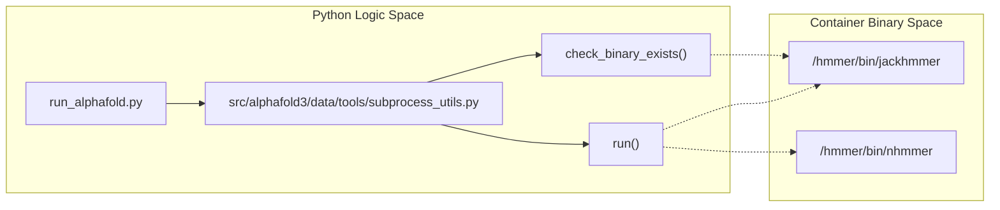

# Container Setup

<details>
<summary>Relevant source files</summary>

The following files were used as context for generating this wiki page:

- [docker/Dockerfile](docker/Dockerfile)
- [docker/easel_fast_fasta_parsing.patch](docker/easel_fast_fasta_parsing.patch)
- [docker/jackhmmer_parallel_fasta.patch](docker/jackhmmer_parallel_fasta.patch)
- [docker/jackhmmer_seq_limit.patch](docker/jackhmmer_seq_limit.patch)
- [src/alphafold3/data/tools/subprocess_utils.py](src/alphafold3/data/tools/subprocess_utils.py)

</details>


## Purpose and Scope

This document provides detailed instructions for building and configuring Docker and Singularity containers for AlphaFold 3. Containers ensure a reproducible environment by bundling the specific versions of Python 3.12, CUDA 12.6, and the patched HMMER suite required for accurate predictions. The setup utilizes `uv` for dependency management and `scikit-build-core` for compiling C++ extensions like `mmcif_utils`.

Sources: [docker/Dockerfile:1-100]()

## Container Architecture and Data Flow

The AlphaFold 3 container acts as a compute engine that requires external data (databases and model weights) to be mounted from the host system. It encapsulates the execution of `run_alphafold.py` within a specialized virtual environment managed by `uv`.

### System Interaction Diagram
The following diagram maps the high-level system components to the specific code entities and environment variables defined in the `Dockerfile`.


Sources: [docker/Dockerfile:20-100]()

## Docker Setup

### Dockerfile Implementation Details
The Docker image is based on `nvidia/cuda:12.6.3-base-ubuntu24.04` [docker/Dockerfile:20-20](). It uses the `uv` package manager (pinned to version `0.13.1`) for fast, reproducible dependency resolution [docker/Dockerfile:32-34]().

Key build stages:
1.  **System Dependencies**: Installs `python3.12`, `python3.12-dev`, `git`, `wget`, `gcc`, `g++`, `make`, `zlib1g-dev`, and `zstd` [docker/Dockerfile:27-30](). `git` is specifically required for the `pyproject.toml` toolchain's interaction with `CMakeLists.txt` [docker/Dockerfile:24-24]().
2.  **HMMER Compilation**: Downloads HMMER 3.4 from `eddylab.org`, verifies its SHA-256 checksum (`ca70d94fd0cf271bd7063423aabb116d42de533117343a9b27a65c17ff06fbf3`), applies performance and feature patches, and compiles from source to `/hmmer` [docker/Dockerfile:52-69]().
3.  **Python Environment**: Creates a virtual environment at `/alphafold3_venv` via `uv venv` [docker/Dockerfile:38-40](). It syncs dependencies using `uv sync --frozen --all-groups --no-editable` [docker/Dockerfile:83-84]().
4.  **Data Preparation**: Executes the `build_data` script via `uv run build_data` to initialize the chemical components database [docker/Dockerfile:86-87]().

### HMMER Patches
AlphaFold 3 applies three critical patches to the HMMER 3.4 and EASEL source code during container build:
- `jackhmmer_seq_limit.patch`: Adds the `--seq_limit` argument to truncate hits after a specified threshold [docker/jackhmmer_seq_limit.patch:1-32]().
- `easel_fast_fasta_parsing.patch`: Optimizes FASTA parsing speed within EASEL [docker/easel_fast_fasta_parsing.patch:1-162]().
- `jackhmmer_parallel_fasta.patch`: Enables multi-threaded FASTA processing in `jackhmmer` [docker/jackhmmer_parallel_fasta.patch:1-196]().

| Code Entity | File | Description |
| :--- | :--- | :--- |
| `jackhmmer_seq_limit.patch` | [docker/jackhmmer_seq_limit.patch:1-32]() | Modifies `src/jackhmmer.c` to add `--seq_limit` logic [docker/jackhmmer_seq_limit.patch:7-28](). |
| `easel_fast_fasta_parsing.patch` | [docker/easel_fast_fasta_parsing.patch:1-162]() | Speeds up buffer parsing in `esl_sqio_ascii.c` [docker/easel_fast_fasta_parsing.patch:52-100](). |
| `jackhmmer_parallel_fasta.patch` | [docker/jackhmmer_parallel_fasta.patch:1-196]() | Implements chunk-based parallel FASTA reading for threads [docker/jackhmmer_parallel_fasta.patch:48-103](). |
| `jackhmmer_seq_limit_supported` | [src/alphafold3/data/tools/subprocess_utils.py:53-64]() | Validation function checking for the patch's existence via a help-flag check. |

Sources: [docker/Dockerfile:20-88](), [docker/jackhmmer_seq_limit.patch:1-32](), [docker/easel_fast_fasta_parsing.patch:1-162](), [docker/jackhmmer_parallel_fasta.patch:1-196](), [src/alphafold3/data/tools/subprocess_utils.py:53-64]()

## GPU Configuration

The container is optimized for NVIDIA Ampere (A100) and Hopper (H100) architectures. Specific environment variables are set in the `Dockerfile` to manage XLA compilation and JAX memory allocation.

### Default Runtime Environment
| Variable | Value | Purpose |
| :--- | :--- | :--- |
| `XLA_FLAGS` | `--xla_gpu_enable_triton_gemm=false` | Disables Triton GEMM to avoid a known XLA compilation hang [docker/Dockerfile:95-95](). |
| `XLA_PYTHON_CLIENT_PREALLOCATE` | `true` | Enables JAX memory preallocation for performance [docker/Dockerfile:97-97](). |
| `XLA_CLIENT_MEM_FRACTION` | `0.95` | Allocates 95% of VRAM to the AlphaFold process, sufficient for 5,120 tokens on A100 80GB [docker/Dockerfile:98-98](). |

### Support for Older GPUs (CUDA Capability 7.x)
For NVIDIA V100 or other Capability 7.x GPUs, the `XLA_FLAGS` must be overridden because Triton GEMM is not supported, and custom kernel fusion can cause issues:
`ENV XLA_FLAGS="--xla_disable_hlo_passes=custom-kernel-fusion-rewriter"` [docker/Dockerfile:91-94]().

Sources: [docker/Dockerfile:89-100]()

## Singularity for HPC Environments

In high-performance computing (HPC) environments where root access for Docker is unavailable, AlphaFold 3 can be run via Singularity (Apptainer).

### Dependency Resolution in HPC
Because environment dependencies are locked via `uv`, Singularity images should ideally be built on the target architecture (x86_64 or aarch64) to ensure binary compatibility.

### Building from Docker
To convert the Docker image to a Singularity Image File (`.sif`), use a local registry or direct docker-daemon transport:

1.  **Tag and Push**:
    ```bash
    docker tag alphafold3 localhost:5000/alphafold3
    docker push localhost:5000/alphafold3
    ```
2.  **Build SIF**:
    ```bash
    SINGULARITY_NOHTTPS=1 singularity build alphafold3.sif docker://localhost:5000/alphafold3:latest
    ```

### Execution with Singularity
When running with Singularity, the `--nv` flag is required for GPU passthrough. Note that the `UV_PROJECT_ENVIRONMENT` path must be accessible within the container.

```bash
singularity exec \
    --nv \
    --bind /path/to/databases:/root/public_databases \
    --bind /path/to/weights:/root/models \
    --bind $PWD/input:/root/af_input \
    --bind $PWD/output:/root/af_output \
    alphafold3.sif \
    python3 run_alphafold.py \
    --json_path=/root/af_input/input.json \
    --model_dir=/root/models \
    --output_dir=/root/af_output
```

Sources: [docker/Dockerfile:38-40]()

## Internal Tool Integration

The container setup ensures that external binaries are correctly mapped and accessible to the Python runtime via `subprocess_utils.py`.



| Function / Utility | File | Role |
| :--- | :--- | :--- |
| `run` | [src/alphafold3/data/tools/subprocess_utils.py:67-134]() | Executes subprocess commands, logs stdout/stderr, times execution, and raises `RuntimeError` on failure [src/alphafold3/data/tools/subprocess_utils.py:76-134](). |
| `check_binary_exists` | [src/alphafold3/data/tools/subprocess_utils.py:42-51]() | Verifies that binary paths exist on disk and raises `RuntimeError` if missing [src/alphafold3/data/tools/subprocess_utils.py:42-51](). |
| `jackhmmer_seq_limit_supported` | [src/alphafold3/data/tools/subprocess_utils.py:53-64]() | Validates whether the installed `jackhmmer` binary supports `--seq_limit` [src/alphafold3/data/tools/subprocess_utils.py:53-64](). |
| `create_query_fasta_file` | [src/alphafold3/data/tools/subprocess_utils.py:31-39]() | Writes sequence query FASTA files with configured line-width wrapping [src/alphafold3/data/tools/subprocess_utils.py:31-39](). |

Sources: [docker/Dockerfile:32-34](), [src/alphafold3/data/tools/subprocess_utils.py:31-134]()

---