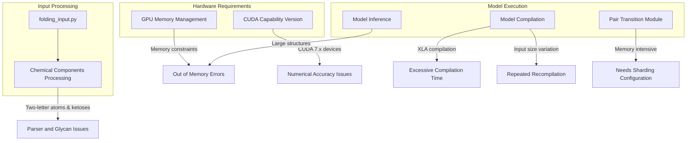
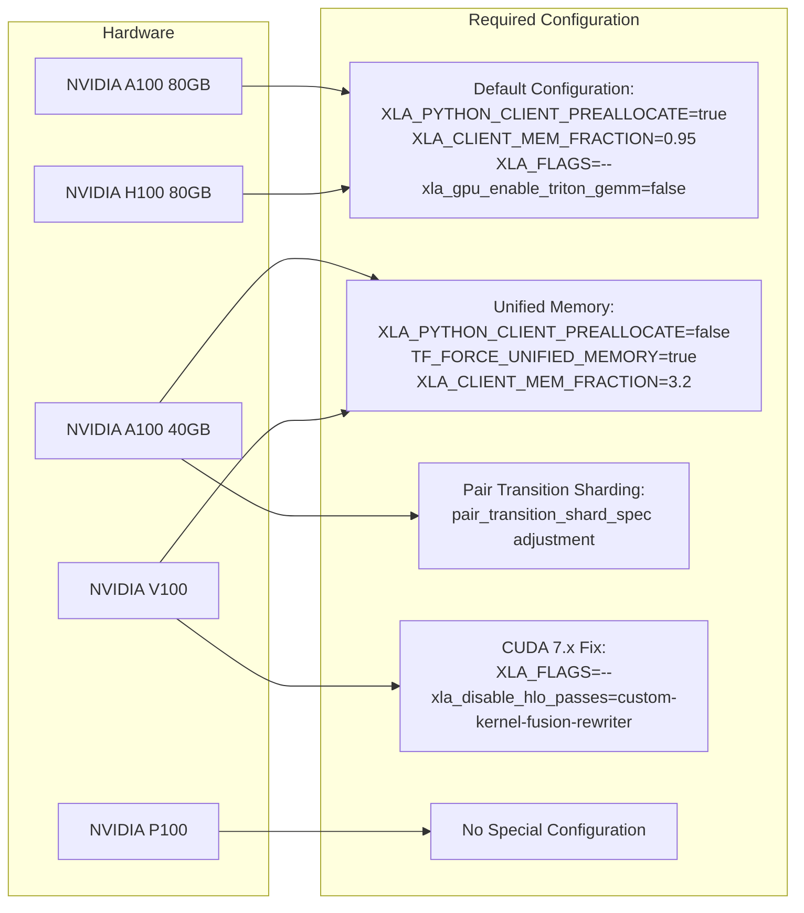
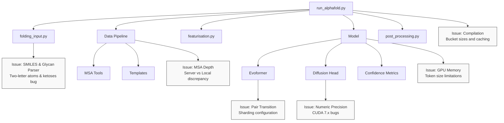

# Known Issues

<details>
<summary>Relevant source files</summary>

The following files were used as context for generating this wiki page:

- [docs/known_issues.md](docs/known_issues.md)
- [docs/performance.md](docs/performance.md)

</details>


This document provides a comprehensive list of known issues and workarounds when running AlphaFold 3. It covers hardware compatibility problems, memory limitations, chemical parsing bugs, MSA discrepancies, and other technical challenges you may encounter during installation and execution. For performance optimization strategies, see [Performance Optimization](#8). For installation instructions, see [Installation Guide](#2).

Sources: [docs/known_issues.md:1-105](), [docs/performance.md:1-236]()

## Hardware Compatibility Issues

### CUDA Capability 7.x GPUs

GPUs with CUDA Capability 7.x (e.g., NVIDIA V100) require special configuration to avoid numerical issues that result in obviously incorrect predictions.

```
Symptoms: Predictions show severe atomic clashes, resulting in ranking scores of -99 or lower.
```

**Workaround:** Set the following environment variable:

```bash
XLA_FLAGS="--xla_disable_hlo_passes=custom-kernel-fusion-rewriter"
```

Note that for these GPUs, you don't need to disable Triton GEMM kernels as they aren't supported for these devices.

Sources: [docs/known_issues.md:3-9](), [docs/performance.md:113-132]()

### Memory Limitations by GPU Type

Different GPU models have different maximum token limits when running AlphaFold 3:

| GPU Model | Memory | Maximum Tokens | Special Configuration Required |
|:----------|:-------|:---------------|:------------------------------|
| NVIDIA A100 | 80 GB | 5,120 | Default configuration |
| NVIDIA H100 | 80 GB | 5,120 | Default configuration |
| NVIDIA A100 | 40 GB | 4,352 | Unified Memory + Adjusted shard specs |
| NVIDIA V100 | 16/32 GB | 1,280 | Unified Memory + XLA flags |
| NVIDIA P100 | 16 GB | 1,024 | None |

Sources: [docs/performance.md:62-132]()

## Memory Management Issues

### Out of Memory Errors

For inputs larger than the default maximum size (5,120 tokens) or when using GPUs with less memory, you may encounter out-of-memory errors.

**Workaround:** Enable unified memory to allow GPU memory to spill into host memory:

```bash
XLA_PYTHON_CLIENT_PREALLOCATE=false
TF_FORCE_UNIFIED_MEMORY=true
XLA_CLIENT_MEM_FRACTION=3.2
```

Note: This workaround trades performance for memory capacity.

Sources: [docs/performance.md:203-221]()

### Pair Transition Shard Specification

For A100 (40 GB) GPUs, you'll need to adjust the pair transition shard specification in the model configuration:

```python
pair_transition_shard_spec: Sequence[_Shape2DType] = (
    (2048, None),
    (3072, 1024),
    (None, 512),
)
```

This tells the model:
- For sequences up to 2,048 tokens: no sharding
- For sequences up to 3,072 tokens: shard in chunks of 1,024
- For larger sequences: shard in chunks of 512

Sources: [docs/performance.md:84-107]()

## Performance and Compilation Issues

### Excessive Compilation Time

AlphaFold 3 may experience extremely long compilation times due to a known XLA issue.

**Workaround:** Set the following environment variable (included by default in the provided Dockerfile):

```bash
XLA_FLAGS="--xla_gpu_enable_triton_gemm=false"
```

Sources: [docs/performance.md:171-179]()

### Repeated Model Compilation

When processing inputs of different sizes, the model may need to be recompiled for each unique size, leading to excessive compilation time.

**Workaround:** Use the JAX persistent compilation cache and adjust compilation bucket sizes:

1. Enable the compilation cache via the `run_alphafold.py` flag:
   `--jax_compilation_cache_dir <YOUR_DIRECTORY>`

2. For large inputs exceeding the default 5,120 token limit, redefine bucket sizes using the `--buckets` flag:
   `--buckets 256,512,768,1024,1280,1536,2048,2560,3072,3584,4096,4608,5120,5376,6144`

Sources: [docs/performance.md:134-167](), [docs/performance.md:222-236]()

## Input, Ligand, and Chemical Component Discrepancies

### Two-Letter Atoms in SMILES Ligands

Between commits `f8df1c7` and `4e4023c`, AlphaFold 3 handled incorrectly any two-letter atoms (e.g. `Cl`, `Br`) in ligands defined using SMILES strings. 

**Workaround:** Ensure your installation uses a commit later than `4e4023c`.

Sources: [docs/known_issues.md:10-16]()

### Linked Ketoses Keep Their Leaving Atom

When a glycan component is bonded to another residue using `bondedAtomPairs`, AlphaFold 3 removes the atom named `O1` from it (unless `O1` itself takes part in the bond). The CCD leaving-atom flag (`_chem_comp_atom.pdbx_leaving_atom_flag`) is not used to pick the atom. This matches aldoses such as glucose, galactose, or mannose, whose anomeric carbon is `C1` and whose leaving atom is `O1`. It does not match ketoses, whose anomeric carbon is `C2` and whose leaving atom is `O2`:

* Sialic acids (e.g. `SIA`, `SLB`, `NGC`, `KDN`) and `KDO` have no atom named `O1`, so nothing is removed and `O2` is kept.
* Fructose, psicose, sorbose, and tagatose (e.g. `FRU`, `BDF`, `PSV`, `SOE`, `T6T`) have a C1 hydroxyl named `O1`, which is removed while `O2` is kept.

In both cases the linked `C2` ends up with five heavy-atom neighbours (see GitHub issue #752).

**Workaround:** Provide the ketose as a user-provided CCD component under a new name, with `O2`, `HO2`, and their bonds removed. Components not in the CCD glycan sets have no atoms removed, so `O1` is also kept.

Sources: [docs/known_issues.md:17-39]()

## MSA Discrepancy vs AlphaFold Server

Local AlphaFold 3 runs may produce shallower Multiple Sequence Alignments (MSAs) than the AlphaFold Server, occasionally leading to lower accuracy (e.g., lower ipTM/pTM for complex structures). This is caused by the Server running sharded Jackhmmer without the `--domZ` flag, resulting in a ~100x more permissive `--domE` filter.

**Workaround:** 
1. Increase the Jackhmmer/Nhmmer `--domE` flag value by 100x compared to its default value.
2. Alternatively, implement sharded database searches as documented in [Performance Optimization](8.3) without setting the `--domZ` value.

Sources: [docs/known_issues.md:40-86](), [docs/performance.md:85-148]()

## Gated Linear Unit Tokamax `NotImplementedError`

When running AlphaFold 3 in certain configurations (e.g., on Mac OS with the MPS backend), you might see errors like:

```
NotImplementedError: Not supported on gpu.
Failed to run implementation
Traceback (most recent call last):
File "tokamax/_src/ops/gated_linear_unit/api.py", line 114, in gated_linear_unit
  return fn(x, weights, activation=activation, precision=precision)
          ^^^^^^^^^^^^^^^^^^^^^^^^^^^^^^^^^^^^^^^^^^^^^^^^^^^^^^^^^^
File "tokamax/_src/ops/op.py", line 197, in __call__
  raise NotImplementedError(f"Not supported on {device.device_kind}.")
NotImplementedError: Not supported on gpu.
```

Tokamax will choose another implementation and run the prediction successfully, so these are safe to ignore.

Sources: [docs/known_issues.md:87-105]()

## Integration Points Where Issues Occur

The following diagram illustrates the key components of AlphaFold 3 and where known issues typically occur:

Title: "Mapping Known Issues to Code Components"


Sources: [docs/known_issues.md:1-105](), [docs/performance.md:1-236]()

## Hardware Compatibility and Configuration Matrix

This diagram shows how different hardware configurations relate to required configuration changes and environment variables:

Title: "Hardware and Configuration Mapping"


Sources: [docs/performance.md:62-132](), [docs/known_issues.md:3-9]()

## System Architecture and Issue Locations

This diagram maps specific issues to their location in the AlphaFold 3 system architecture:

Title: "System Architecture and Issue Hotspots"


Sources: [docs/known_issues.md:1-105](), [docs/performance.md:1-236]()

---