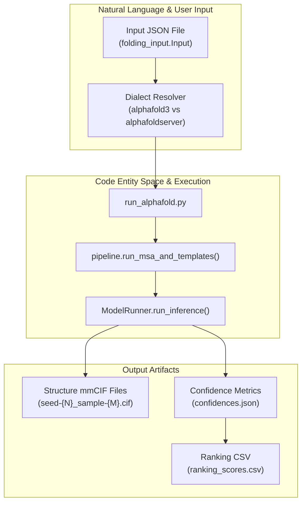
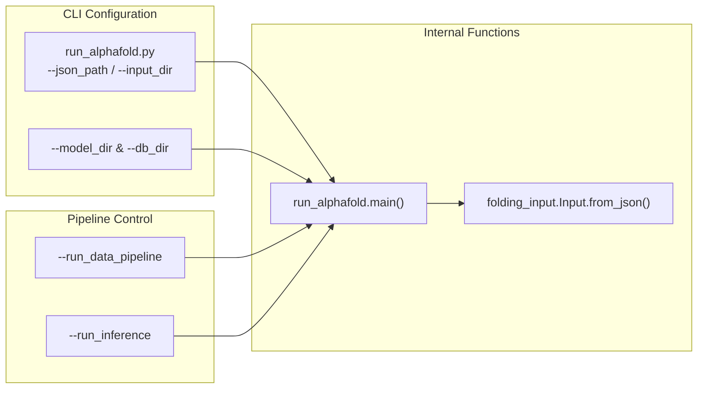

# User Guide

Relevant source files

The following files were used as context for generating this wiki page:

- [docs/community_tools.md](docs/community_tools.md)
- [docs/input.md](docs/input.md)
- [docs/metadata_antibody_antigen.csv](docs/metadata_antibody_antigen.csv)
- [docs/metadata_antibody_antigen.md](docs/metadata_antibody_antigen.md)
- [examples/barnase_barstar.json](examples/barnase_barstar.json)
- [examples/calmodulin_4calcium.json](examples/calmodulin_4calcium.json)
- [examples/erk2_phosphorylated.json](examples/erk2_phosphorylated.json)
- [examples/streptavidin_biotin_smiles.json](examples/streptavidin_biotin_smiles.json)
- [examples/tetr_dimer_dna.json](examples/tetr_dimer_dna.json)
- [examples/tetr_dimer_tetracycline.json](examples/tetr_dimer_tetracycline.json)

This guide provides a practical overview for end users to prepare inputs, execute predictions, and interpret results in AlphaFold 3. As a parent page, it introduces core workflows and concepts at a high level and links to dedicated child pages for comprehensive technical details.

For detailed documentation, see:
- **Input preparation**: [Input Format](#3.1) — Comprehensive documentation of JSON input formats (`alphafold3` and `alphafoldserver` dialects), sequences, ligands, MSAs, templates, bonds, and the `examples/` directory [docs/input.md:27-48]().
- **Execution**: [Running AlphaFold 3](#3.2) — Step-by-step instructions for executing predictions via `run_alphafold.py`, including command-line flags, staged execution, and configuration options [run_alphafold.py:62-129]().
- **Outputs**: [Output Format](#3.3) — Explanation of the output directory structure, predicted mmCIF files, confidence JSONs, ranking scores, and optional embeddings.

---

## Overview and End-to-End Workflow

The AlphaFold 3 user workflow bridges biological sequence specification to structural model evaluation through a two-stage pipeline: a CPU-bound data pipeline for MSA and template retrieval, followed by a GPU-bound neural network model inference stage [src/alphafold3/data/pipeline.py:11-151](), [run_alphafold.py:401-491]().

**Diagram: End-to-end user workflow bridging natural language inputs to code execution and output artifacts.**

Sources: [run_alphafold.py:724-829](), [docs/input.md:3-31](), [src/alphafold3/data/pipeline.py:11-151]()

---

## Input Preparation and Example Inputs

Inputs are provided via JSON files containing job metadata, random seeds, and sequence definitions for proteins, RNA, DNA, and ligands. AlphaFold 3 supports both its native format (`alphafold3` dialect) and compatibility conversion from the AlphaFold Server format (`alphafoldserver` dialect) [docs/input.md:27-64]().

Users can inspect several ready-to-use example inputs provided in the repository:
- **Protein-protein complexes**: `examples/barnase_barstar.json` [examples/barnase_barstar.json:1-22]()
- **Post-translational modifications**: `examples/erk2_phosphorylated.json` (modifying residues like TPO and PTR) [examples/erk2_phosphorylated.json:1-19]()
- **Ligands and ions**: `examples/calmodulin_4calcium.json` (calcium ions via CCD codes) [examples/calmodulin_4calcium.json:1-22](), `examples/tetr_dimer_tetracycline.json` [examples/tetr_dimer_tetracycline.json:1-22]()
- **Small-molecule SMILES**: `examples/streptavidin_biotin_smiles.json` [examples/streptavidin_biotin_smiles.json:1-22]()
- **DNA-protein complexes**: `examples/tetr_dimer_dna.json` [examples/tetr_dimer_dna.json:1-29]()

For comprehensive details on formatting sequences, custom MSAs, user-provided CCD dictionaries, and covalent `bondedAtomPairs`, see [Input Format](#3.1).

Sources: [docs/input.md:27-158](), [examples/barnase_barstar.json:1-22](), [examples/erk2_phosphorylated.json:1-19](), [examples/calmodulin_4calcium.json:1-22](), [examples/tetr_dimer_tetracycline.json:1-22](), [examples/streptavidin_biotin_smiles.json:1-22](), [examples/tetr_dimer_dna.json:1-29]()

---

## Execution and Command-Line Interface

Predictions are executed using the main Python script `run_alphafold.py`. The script accepts flags for input paths, model directories, and genetic databases, supporting staged execution where data processing and model inference can be toggled independently [run_alphafold.py:62-129]().

**Diagram: Mapping command-line interface arguments to internal execution entry points.**

Sources: [run_alphafold.py:724-860]()

For complete documentation on command-line flags, staging options, and resource allocation, see [Running AlphaFold 3](#3.2).

Sources: [run_alphafold.py:62-129](), [run_alphafold.py:724-860]()

---

## Output Interpretation

The inference run generates structured output directories containing predicted atomic coordinates, confidence metrics, and ranking summaries [run_alphafold.py:401-491](). 

Key outputs include:
- **mmCIF Structure Files**: Atomic coordinates stored in standard mmCIF format, representing predicted complexes across different random seeds and diffusion samples [run_alphafold.py:440-475]().
- **Confidence JSONs**: Detailed scoring metrics including pTM, ipTM, Predicted Aligned Error (PAE), and Predicted Distance Error (PDE).
- **Ranking Scores**: Aggregated CSV summaries (`ranking_scores.csv`) determining the best-performing structural predictions.

For a detailed breakdown of file naming conventions, confidence metrics interpretation, and optional distogram/embedding outputs, see [Output Format](#3.3).

Sources: [run_alphafold.py:401-491]()

---

## Community Tools and Research Metadata

Several external tools and curated datasets assist users in preparing inputs and interpreting complex assemblies:

- **JAAG**: A lightweight web-based GUI tool (`https://biofgreat.org/JAAG`) for generating AlphaFold 3 input JSON files with integrated glycan support and automated `bondedAtomPairs` syntax [docs/community_tools.md:3-12]().
- **Glycan Modeling Resources**: Step-by-step tutorials, ready-to-run scripts, and ModelArchive entries (`https://doi.org/10.5452/ma-af3glycan`) for modeling glycans and complex ligands [docs/community_tools.md:17-31]().
- **Antibody-Antigen Metadata**: Curated metadata covering 71 antibody-antigen complexes and 166 interfaces (associated with Figure 5a in the AlphaFold 3 paper), provided in `docs/metadata_antibody_antigen.csv` [docs/metadata_antibody_antigen.md:1-11](), [docs/metadata_antibody_antigen.csv:1-167]().

Sources: [docs/community_tools.md:1-31](), [docs/metadata_antibody_antigen.md:1-11](), [docs/metadata_antibody_antigen.csv:1-167]()

---