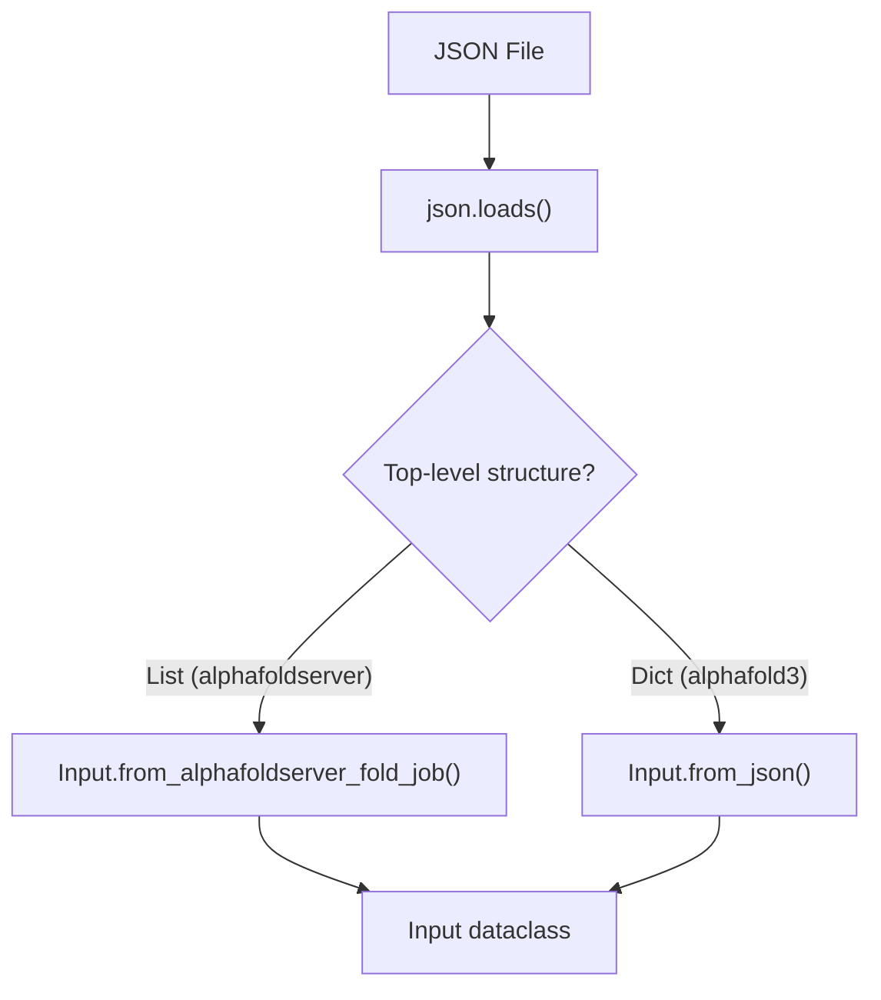
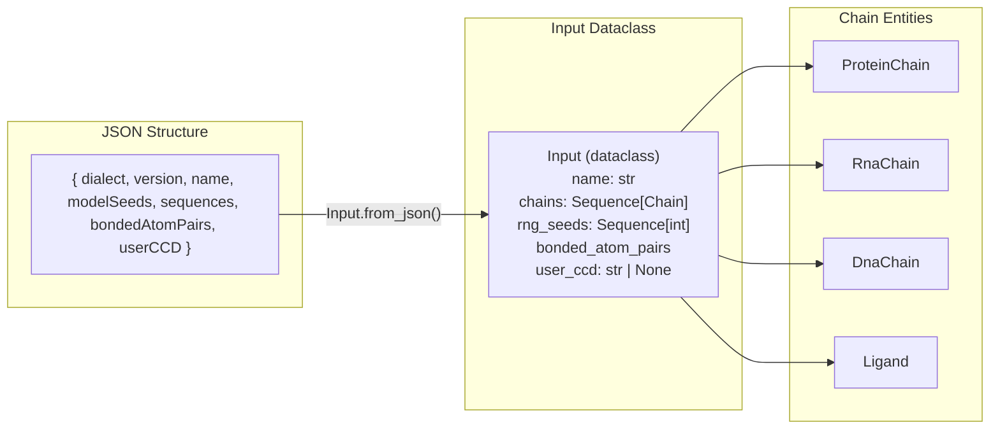
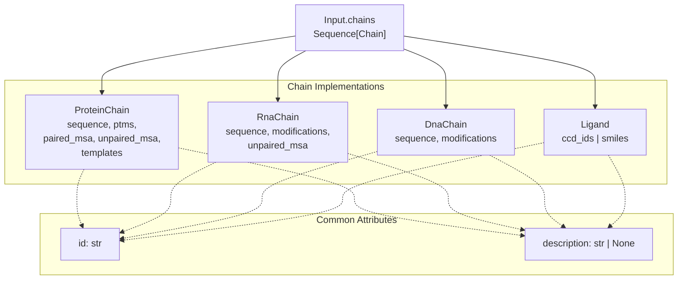

# Input Format

<details>
<summary>Relevant source files</summary>

The following files were used as context for generating this wiki page:

- [docs/input.md](docs/input.md)
- [examples/kras_g12c_sotorasib.json](examples/kras_g12c_sotorasib.json)
- [examples/modified_rna.json](examples/modified_rna.json)
- [src/alphafold3/common/folding_input.py](src/alphafold3/common/folding_input.py)
- [src/alphafold3/common/folding_input_test.py](src/alphafold3/common/folding_input_test.py)

</details>


This page documents the JSON input format used to specify prediction jobs for AlphaFold 3 [docs/input.md:1-6](). The input format defines molecular entities (proteins, RNA, DNA, ligands), custom MSAs, structural templates, covalent bonds, and random seeds [docs/input.md:33-46](). 

For information about how inputs are processed and validated internally, see [Input Processing](#4.1). For details on the internal data structures that represent these inputs, see [Input Data Model](#5.1).

## Overview

AlphaFold 3 accepts inputs in JSON format [docs/input.md:29](). The system supports two JSON dialects [docs/input.md:30-31,58-64]():

1.  **`alphafold3` dialect**: The primary format defined in `src/alphafold3/common/folding_input.py` offering full control over MSAs, templates, bonds, and custom ligands [docs/input.md:33-44,58-64]().
2.  **`alphafoldserver` dialect**: A simplified format compatible with [AlphaFold Server](https://alphafoldserver.com/), automatically converted to `alphafold3` format by the input parser [docs/input.md:52-64]().

The input parser is implemented in `src/alphafold3/common/folding_input.py` and handles both dialects through `Input.from_json()` and `Input.from_alphafoldserver_fold_job()` [src/alphafold3/common/folding_input.py:38-44]().

Sources: [src/alphafold3/common/folding_input.py:38-44](), [docs/input.md:14-76]()

## JSON Dialects

### Dialect Detection and Conversion

Title: "Dialect Detection Logic"

Sources: [src/alphafold3/common/folding_input.py:38-44](), [docs/input.md:58-76]()

The system automatically detects the dialect by examining whether the top-level JSON structure is a list (`alphafoldserver`) or a dictionary (`alphafold3`) [docs/input.md:72-76]().

### Dialect Comparison

| Feature | alphafold3 | alphafoldserver |
| :--- | :--- | :--- |
| Multiple inputs per file | No (one input per JSON) | Yes (top-level list) |
| Custom MSA specification | Full control (paired/unpaired) | Not supported |
| Custom templates | Full control (mmCIF + mapping) | Limited (enable/disable only) |
| Ligands via SMILES | Supported | Not supported |
| Custom CCD | Supported | Not supported |
| Covalent bonds | Supported | Not supported |
| Chain IDs | User-specified | Auto-assigned (A, B, ..., Z, AA, BA, ...) |
| Glycans | Supported via bonds | Not supported |
| Random seeds | Required (at least one) | Optional (auto-sampled if empty) |

Sources: [docs/input.md:32-101]()

## Top-Level Structure

### alphafold3 Dialect

```json
{
  "dialect": "alphafold3",
  "version": 4,
  "name": "Job name",
  "modelSeeds": [1, 2, 3],
  "sequences": [...],
  "bondedAtomPairs": [...],
  "userCCD": "...",
  "userCCDPath": "..."
}
```

### Code Representation

Title: "Mapping JSON to Code Entities"

Sources: [src/alphafold3/common/folding_input.py:38-44](), [docs/input.md:120-158]()

### Top-Level Fields

| Field | Type | Required | Description |
| :--- | :--- | :--- | :--- |
| `dialect` | `str` | Yes | Must be `"alphafold3"` [src/alphafold3/common/folding_input.py:46](). |
| `version` | `int` | Yes | Format version (1, 2, 3, or 4 for alphafold3) [src/alphafold3/common/folding_input.py:47-48](). |
| `name` | `str` | Yes | Job name (sanitized for output filenames) [docs/input.md:144-145](). |
| `modelSeeds` | `list[int]` | Yes | Random seeds (at least one required) [docs/input.md:146-149](). |
| `sequences` | `list` | Yes | List of molecular entities (Protein, RNA, DNA, or Ligand) [docs/input.md:150-151](). |
| `bondedAtomPairs` | `list` | No | Covalent bonds between atoms [docs/input.md:152-154](). |
| `userCCD` | `str` | No | User-defined chemical components (CIF format) [docs/input.md:155-156](). |
| `userCCDPath` | `str` | No | Path to user CCD file (mutually exclusive with `userCCD`) [docs/input.md:136](). |

Sources: [src/alphafold3/common/folding_input.py:46-48](), [docs/input.md:123-158]()

### Version History

| Version | Features Added |
| :--- | :--- |
| 1 | Initial AlphaFold 3 input format [docs/input.md:159-160](). |
| 2 | External MSA/template paths: `unpairedMsaPath`, `pairedMsaPath`, `mmcifPath` [docs/input.md:161-163](). |
| 3 | External user CCD: `userCCDPath` [docs/input.md:164-165](). |
| 4 | Textual descriptions: `description` field for all chain types [docs/input.md:166-167](). |

Sources: [docs/input.md:159-171](), [src/alphafold3/common/folding_input.py:46-48]()

## Molecular Entities

### Chain Type Hierarchy

Title: "Chain Implementation Class Hierarchy"

Sources: [src/alphafold3/common/folding_input.py:38-44]()

### Protein Chains

Proteins are defined by their amino acid sequence and optional modifications (`ProteinChain` class).

| Field | Type | Description |
| :--- | :--- | :--- |
| `id` | `str` or `list[str]` | Chain identifier(s). List implies multiple copies [docs/input.md:195](). |
| `sequence` | `str` | Amino acid sequence (1-letter codes) [docs/input.md:196](). |
| `modifications` | `list[dict]` | PTMs via `ptmType` (CCD code) and `ptmPosition` (1-based) [docs/input.md:197](). |
| `description` | `str \| None` | Optional textual description [docs/input.md:198](). |
| `pairedMsa` | `str \| None` | A3M format MSA for pairing [docs/input.md:199](). |
| `unpairedMsa` | `str \| None` | A3M format MSA for unpaired features [docs/input.md:200](). |
| `templates` | `list[dict] \| None` | Structural templates [docs/input.md:201](). |

The `ProteinChain` class implements validation in its constructor to ensure sequences contain valid amino acid codes and PTM indices are within range [src/alphafold3/common/folding_input.py:169-172]().

Sources: [src/alphafold3/common/folding_input.py:99-245](), [docs/input.md:178-234]()

### RNA and DNA Chains

RNA (`RnaChain`) and DNA (`DnaChain`) chains support sequences and base modifications. RNA also supports custom MSAs (`unpairedMsa`) [docs/input.md:235-306]().

| Field | Type | Description |
| :--- | :--- | :--- |
| `id` | `str` or `list[str]` | Chain identifier(s) [docs/input.md:240](). |
| `sequence` | `str` | Nucleotide sequence (A, C, G, U for RNA; A, C, G, T for DNA) [docs/input.md:241](). |
| `modifications` | `list[dict]` | Modified bases via `modificationType` and `basePosition` [docs/input.md:242](). |
| `unpairedMsa` | `str \| None` | (RNA only) A3M format MSA [docs/input.md:243](). |

Sources: [src/alphafold3/common/folding_input.py:38-44](), [docs/input.md:235-306]()

### Ligands

Ligands (`Ligand` class) can be specified using three approaches:

1.  **CCD Codes**: Using standard or user-provided `ccdCodes` [docs/input.md:315-320]().
2.  **SMILES**: Using a SMILES string [docs/input.md:321-325](). SMILES ligands cannot participate in covalent bonds as they lack uniquely named atoms.
3.  **Multi-Component**: A single ligand entity containing multiple CCD components (e.g., glycans) [docs/input.md:326-330]().

The `Ligand` class enforces mutual exclusivity between `ccd_ids` and `smiles` [src/alphafold3/common/folding_input.py:809-816]().

Sources: [src/alphafold3/common/folding_input.py:789-894](), [docs/input.md:308-384]()

## Multiple Sequence Alignments

The system can either generate MSAs using its internal data pipeline or use user-provided MSAs [docs/input.md:416-420]().

### MSA Input Logic

| `unpairedMsa` | `pairedMsa` | Behavior |
| :--- | :--- | :--- |
| `null` | `null` | Data pipeline builds both MSAs [docs/input.md:421-425](). |
| A3M string | `""` | Use custom unpaired MSA, no pairing [docs/input.md:426-430](). |
| `""` | A3M string | Use custom paired MSA (not recommended) [docs/input.md:431-435](). |
| A3M string | A3M string | Use both custom MSAs (expert mode) [docs/input.md:436-440](). |
| `""` | `""` | MSA-free prediction [docs/input.md:441-445](). |

For RNA, only `unpairedMsa` is supported [docs/input.md:446-450](). If set to `null`, the pipeline runs `Nhmmer` [docs/input.md:451-455](). For proteins, the pipeline runs `Jackhmmer` against UniRef90, MGnify, and BFD [docs/input.md:456-460]().

Sources: [docs/input.md:416-515](), [src/alphafold3/common/folding_input.py:38-44]()

## Structural Templates

Templates provide structural context for protein chains. A `Template` class instance contains an mmCIF string and a mapping between query residues and template residues [src/alphafold3/common/folding_input.py:99-135]().

### Template Fields

| Field | Type | Description |
| :--- | :--- | :--- |
| `mmcif` | `str` | Protein structure in mmCIF format [src/alphafold3/common/folding_input.py:108-109](). |
| `mmcifPath` | `str` | Path to mmCIF file (mutually exclusive with `mmcif`) [src/alphafold3/common/folding_input.py:170-173](). |
| `queryIndices` | `list[int]` | 0-based residue indices in query sequence [src/alphafold3/common/folding_input.py:110-111,178-180](). |
| `templateIndices` | `list[int]` | 0-based residue indices in template structure [src/alphafold3/common/folding_input.py:110-111,178-181](). |

Sources: [src/alphafold3/common/folding_input.py:99-194](), [docs/input.md:554-647]()

## Covalent Bonds

Covalent bonds are defined in the `bondedAtomPairs` top-level list [docs/input.md:134,152-154](). Each bond connects two atoms identified by `[chain_id, residue_index, atom_name]` [examples/kras_g12c_sotorasib.json:19-21]().

```json
"bondedAtomPairs": [
  [["A", 145, "SG"], ["L", 1, "C04"]]
]
```

Bonds are validated during input parsing to ensure atoms exist and refer to valid chain and residue indices [src/alphafold3/common/folding_input.py:38-44]().

Sources: [src/alphafold3/common/folding_input.py:38-44](), [docs/input.md:660-703](), [examples/kras_g12c_sotorasib.json:19-21]()

## User-Provided Chemical Components (CCD)

Custom ligands or modified residues not present in the standard Chemical Component Dictionary can be provided via the `userCCD` or `userCCDPath` fields [docs/input.md:135-136,724-730]().

The system uses coordinate definitions from the user-provided CIF as a structural reference during ligand parameterization [docs/input.md:746-763]().

Sources: [src/alphafold3/common/folding_input.py:38-44](), [docs/input.md:724-785]()

## File Loading and Path Resolution

The utility function `_read_file` handles reading and optional decompression of external files referenced by paths (MSAs, templates, CCDs) [src/alphafold3/common/folding_input.py:60-97]().

| Compression Format | Magic Number Header | Handling Function |
| :--- | :--- | :--- |
| gzip | `\x1f\x8b` | `gzip.open` [src/alphafold3/common/folding_input.py:86-88]() |
| xz (lzma) | `\xfd\x37\x7a\x58\x5a\x00` | `lzma.open` [src/alphafold3/common/folding_input.py:89-91]() |
| zstd | `\x28\xb5\x2f\xfd` | `zstd.open` [src/alphafold3/common/folding_input.py:92-94]() |
| Uncompressed | Any other header | `f.read().decode('utf-8')` [src/alphafold3/common/folding_input.py:95-96]() |

Relative paths are resolved against the directory containing the input JSON file via `_read_file` [src/alphafold3/common/folding_input.py:60-80]().

Sources: [src/alphafold3/common/folding_input.py:60-97]()

---