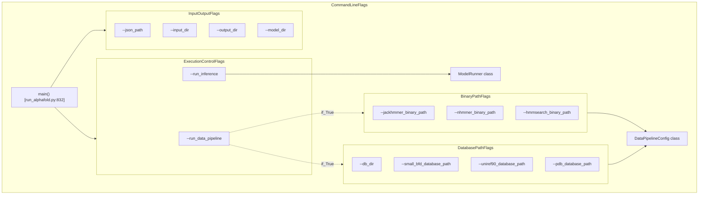
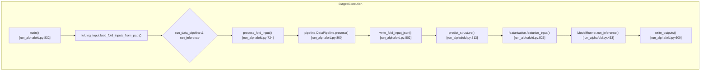

# Running AlphaFold 3

<details>
<summary>Relevant source files</summary>

The following files were used as context for generating this wiki page:

- [docs/model_parameters.md](docs/model_parameters.md)
- [run_alphafold.py](run_alphafold.py)
- [run_alphafold_test.py](run_alphafold_test.py)

</details>


## Purpose and Scope

This page provides a comprehensive, step-by-step technical guide for executing AlphaFold 3 structure predictions using the main entry point script `run_alphafold.py`. It covers command-line flags, staged execution modes, database setup, model configuration options, output handling, and execution workflows.

For input file format details, see [Input Format](#3.1). For output file structures, see [Output Format](#3.3). For underlying database preparation, see [Database Setup](#2.1). For general installation, see [Installation Guide](#2).

Sources: [run_alphafold.py:20-29]()

---

## Basic Execution

AlphaFold 3 is invoked via `run_alphafold.py`, which coordinates input validation, data pipeline execution, model featurization, JAX inference, and output serialization [run_alphafold.py:832-998]().

### Docker Execution

To execute predictions inside a containerized environment with GPU support:

```bash
docker run -it \
    --volume $HOME/af_input:/root/af_input \
    --volume $HOME/af_output:/root/af_output \
    --volume <MODEL_PARAMETERS_DIR>:/root/models \
    --volume <DB_DIR>:/root/public_databases \
    --gpus all \
    alphafold3 \
    python run_alphafold.py \
    --json_path=/root/af_input/fold_input.json \
    --model_dir=/root/models \
    --db_dir=/root/public_databases \
    --output_dir=/root/af_output
```

### Singularity Execution

For High-Performance Computing (HPC) environments using Singularity:

```bash
singularity exec \
    --nv \
    --bind $HOME/af_input:/root/af_input \
    --bind $HOME/af_output:/root/af_output \
    --bind <MODEL_PARAMETERS_DIR>:/root/models \
    --bind <DB_DIR>:/root/public_databases \
    alphafold3.sif \
    python run_alphafold.py \
    --json_path=/root/af_input/fold_input.json \
    --model_dir=/root/models \
    --db_dir=/root/public_databases \
    --output_dir=/root/af_output
```

### Multiple Database Directories

When genetic databases are distributed across different volumes (e.g., fast local NVMe SSDs alongside slower networked storage), multiple `--db_dir` flags can be specified. The system iterates through these paths in the order provided [run_alphafold.py:141-146]() via internal resolution helpers.

```bash
python run_alphafold.py \
    --json_path=/root/af_input/fold_input.json \
    --db_dir=/root/public_databases \
    --db_dir=/root/public_databases_fallback \
    --output_dir=/root/af_output
```

Sources: [run_alphafold.py:141-146](), [run_alphafold.py:832-998]()

---

## Command-Line Flags Reference

The `run_alphafold.py` script exposes multiple flag categories defined using `absl.flags`.

### Input, Output, and Model Directories

| Flag | Type | Default | Description |
|------|------|---------|-------------|
| `--json_path` | string | `None` | Path to a single input JSON file [run_alphafold.py:80-84]() |
| `--input_dir` | string | `None` | Directory containing multiple input JSON files [run_alphafold.py:85-89]() |
| `--output_dir` | string | **Required** | Directory where results and subdirectories are saved [run_alphafold.py:90-94]() |
| `--model_dir` | string | `~/models` | Path to the directory containing model weights and parameters [run_alphafold.py:95-99]() |

**Note:** Exactly one of `--json_path` or `--input_dir` must be provided during execution.

### Execution Control Flags

| Flag | Type | Default | Description |
|------|------|---------|-------------|
| `--run_data_pipeline` | bool | `True` | Whether to execute MSA generation and template search [run_alphafold.py:102-106]() |
| `--run_inference` | bool | `True` | Whether to execute model featurization and diffusion inference [run_alphafold.py:107-111]() |

### External Tool Binaries

Binary paths are auto-detected via `shutil.which` where possible, but can be overridden explicitly [run_alphafold.py:113-138]().

| Flag | Type | Default | Description |
|------|------|---------|-------------|
| `--jackhmmer_binary_path` | string | Auto-detected | Path to the `jackhmmer` executable [run_alphafold.py:114-118]() |
| `--nhmmer_binary_path` | string | Auto-detected | Path to the `nhmmer` executable [run_alphafold.py:119-123]() |
| `--hmmalign_binary_path` | string | Auto-detected | Path to the `hmmalign` executable [run_alphafold.py:124-128]() |
| `--hmmsearch_binary_path` | string | Auto-detected | Path to the `hmmsearch` executable [run_alphafold.py:129-133]() |
| `--hmmbuild_binary_path` | string | Auto-detected | Path to the `hmmbuild` executable [run_alphafold.py:134-138]() |

Sources: [run_alphafold.py:80-138](), [run_alphafold.py:832-847]()

---

## Diagram: Command-Line Flag Categories



Sources: [run_alphafold.py:80-226](), [run_alphafold.py:832-847]()

---

## Staged Execution

AlphaFold 3 supports decoupling resource-heavy sequence searches from GPU-bound inference.

### Full Pipeline (Default)
Executes both sequence database queries (Data Pipeline) and neural network inference sequentially [run_alphafold.py:102-111]().

### Data Pipeline Only
Runs only sequence alignments and template lookups, saving output as an augmented JSON file (`*_data.json`) suitable for downstream sharing or reuse:
```bash
python run_alphafold.py \
    --json_path=/root/af_input/fold_input.json \
    --output_dir=/root/af_output \
    --run_inference=false
```

### Inference Only
Bypasses external database searches by consuming pre-computed alignments and templates:
```bash
python run_alphafold.py \
    --json_path=/root/af_input/fold_input_with_msa.json \
    --output_dir=/root/af_output \
    --run_data_pipeline=false
```

Sources: [run_alphafold.py:102-111](), [run_alphafold.py:800-804]()

---

## Diagram: Staged Execution Flow



Sources: [run_alphafold.py:513-585](), [run_alphafold.py:724-829]()

---

## Model Inference & JAX Configuration

Model execution leverages JAX for compiling and running the deep learning architecture [run_alphafold.py:61-65]().

### Compilation Buckets and Caching
To avoid costly JAX recompilations when processing structures of varying sequence lengths, compilation buckets can be specified via command-line flags. Persistent JAX caching can also be enabled:
```bash
python run_alphafold.py \
    --buckets=256,512,1024,2048,4096 \
    --jax_compilation_cache_dir=/root/jax_cache
```

### Flash Attention Options
The attention mechanisms support multiple accelerated implementations via `--flash_attention_implementation`:
- `triton`: Default implementation optimized for modern NVIDIA GPUs.
- `cudnn`: Uses optimized cuDNN primitives.
- `xla`: Fallback mode required for older hardware or specific CUDA version constraints.

Sources: [run_alphafold.py:61-65](), [run_alphafold.py:302-350]()

---

## Output Management and Persistence

Output files generated by `write_outputs()` include predicted structures in mmCIF format, per-token confidence metrics (pTM, ipTM, PAE, PDE), and ranking summary scores [run_alphafold.py:600-650]().

- **Directory Collision Protection:** If an output directory already contains results for a given job name, AlphaFold 3 automatically generates a timestamped subdirectory to prevent data overwriting [run_alphafold.py:780-794]().
- **Optional Embeddings & Distograms:** Large internal representations can be serialized by setting `--save_embeddings=true` and `--save_distogram=true` [run_alphafold.py:351-360]().

Sources: [run_alphafold.py:351-378](), [run_alphafold.py:600-650](), [run_alphafold.py:780-794]()

---