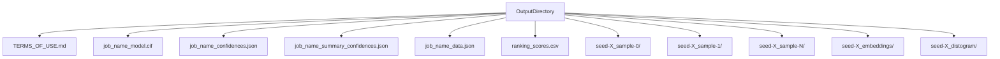
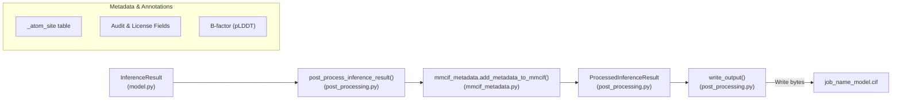
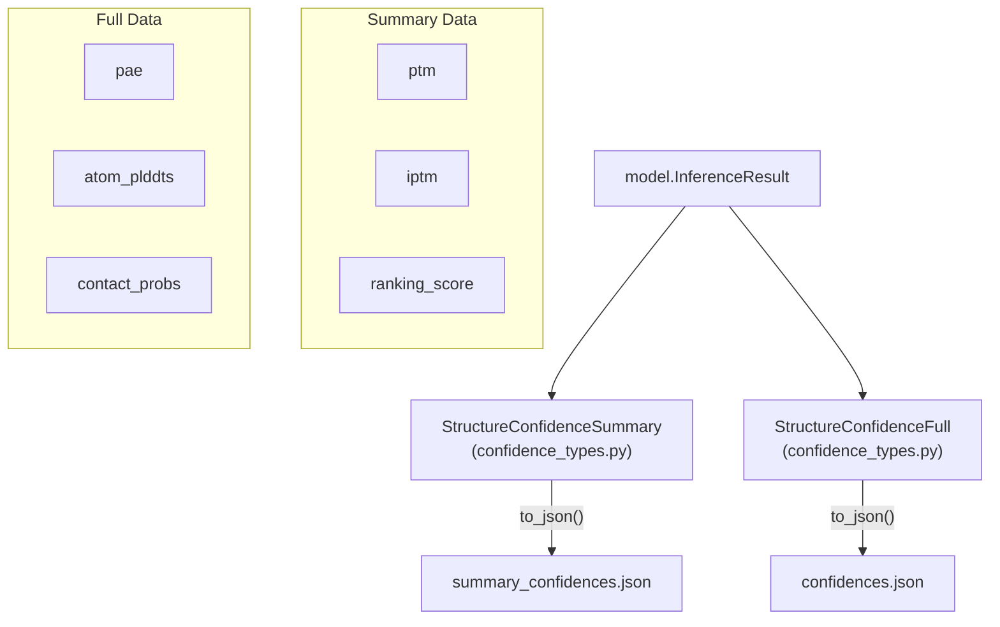
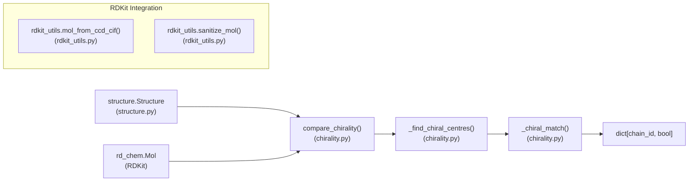

# Output Format

Relevant source files

The following files were used as context for generating this wiki page:

- [docs/output.md](docs/output.md)
- [src/alphafold3/data/tools/rdkit_utils.py](src/alphafold3/data/tools/rdkit_utils.py)
- [src/alphafold3/model/mmcif_metadata.py](src/alphafold3/model/mmcif_metadata.py)
- [src/alphafold3/model/post_processing.py](src/alphafold3/model/post_processing.py)
- [src/alphafold3/model/scoring/chirality.py](src/alphafold3/model/scoring/chirality.py)
- [src/alphafold3/structure/mmcif.py](src/alphafold3/structure/mmcif.py)

This page describes the outputs generated by AlphaFold 3, including their structure, format, and interpretation. It covers the directory structure, file formats, confidence metrics, and optional data files such as embeddings and distograms. For information about the input format, see [Input Format](3.1).

## Output Directory Structure

AlphaFold 3 organizes its outputs in a directory structure designed to separate top-ranking predictions from individual sample outputs, seeds, and optional diagnostic data.

Title: Output Organization Data Flow

Sources:
- [docs/output.md:5-79]()
- [src/alphafold3/model/post_processing.py:90-127]()

For every input job, AlphaFold 3 writes outputs in a directory named after a sanitized version of the job name [docs/output.md:5-10](). Within this directory, it produces:

1. **Top-ranking prediction files** at the root level:
    * `<job_name>_model.cif`: Top-ranked predicted structure in mmCIF format [docs/output.md:35-38]().
    * `<job_name>_confidences.json`: Full confidence metrics [docs/output.md:39-39]().
    * `<job_name>_summary_confidences.json`: Summary confidence metrics [docs/output.md:40-41]().
    * `<job_name>_data.json`: Input JSON file with MSA and template data added by the data pipeline [docs/output.md:42-43]().

2. **Individual sample subdirectories** for each seed and sample combination:
    * Named `seed-<seed_value>_sample-<sample_number>` [docs/output.md:18-22]().
    * Each contains its own `model.cif`, `confidences.json`, and `summary_confidences.json`.

3. **Optional Outputs**:
    * **Embeddings**: `seed-<seed_value>_embeddings/embeddings.npz` (saved when `--save_embeddings=true`) [docs/output.md:28-34]().
    * **Distograms**: `seed-<seed_value>_distogram/distogram.npz` (saved when `--save_distogram=true`) [docs/output.md:23-27]().

4. **Additional files**:
    * `ranking_scores.csv`: Ranking scores for all predictions [docs/output.md:44-45]().
    * `TERMS_OF_USE.md`: Output terms of use [docs/output.md:46-46]().

Sources:
- [docs/output.md:5-83]()

## Structure Files (mmCIF)

AlphaFold 3 outputs predicted structures in the mmCIF format (`.cif`) rather than PDB format. These files contain 3D coordinates, chemical descriptors, and ModelCIF-conformant metadata.

Title: Code Entity Space: mmCIF Generation Pipeline

Sources:
- [src/alphafold3/model/post_processing.py:34-101]()
- [src/alphafold3/model/mmcif_metadata.py:56-178]()
- [src/alphafold3/structure/mmcif.py:40-41]()

The `post_process_inference_result` function handles the conversion from model tensors to the final CIF string [src/alphafold3/model/post_processing.py:57-101](). It invokes `mmcif_metadata.add_metadata_to_mmcif` to append ModelCIF compliance headers, authorship details, and legal notices [src/alphafold3/model/mmcif_metadata.py:56-178](). Internally, structures are manipulated using `cif_dict.CifDict` [src/alphafold3/structure/mmcif.py:40-41]().

Sources:
- [src/alphafold3/model/post_processing.py:57-101]()
- [src/alphafold3/model/mmcif_metadata.py:56-178]()

## Confidence Files

AlphaFold 3 produces two primary JSON files containing confidence metrics for each sample:

1. **Full confidence JSON** (`<job_name>_confidences.json`): Contains detailed per-atom and per-token confidence scores, including PAE, atom-level pLDDT values, and contact probabilities [src/alphafold3/model/post_processing.py:87-93]().
2. **Summary confidence JSON** (`<job_name>_summary_confidences.json`): Contains aggregated metrics for the entire structure, such as pTM, ipTM, and ranking scores [src/alphafold3/model/post_processing.py:80-86]().

Title: Confidence Data Flow

Sources:
- [src/alphafold3/model/post_processing.py:57-101]()
- [docs/output.md:85-127]()

### Key Confidence Metrics

* **pLDDT**: A per-atom confidence estimate on a 0-100 scale [docs/output.md:90-95](). For proteins, it evaluates distances to polymer atoms; for ligands, it considers errors strictly between the ligand atom and polymers [docs/output.md:96-98]().
* **PAE (Predicted Aligned Error)**: Estimates the error in relative position and orientation between two tokens [docs/output.md:99-106]().
* **pTM and ipTM**: Global structure accuracy (pTM) and subunit interface accuracy (ipTM) [docs/output.md:107-117](). Values of ipTM above 0.8 indicate high confidence, while values below 0.6 suggest failure [docs/output.md:114-116]().

Sources:
- [docs/output.md:85-127]()

## Embeddings and Distograms

When specified via command-line flags, AlphaFold 3 saves intermediate internal representations:

* **Embeddings**: Written via `write_embeddings` into `embeddings.npz` [src/alphafold3/model/post_processing.py:143-154](). Contains `single_embeddings` (shape `[num_tokens, 384]`) and `pair_embeddings` (shape `[num_tokens, num_tokens, 128]`) with `np.float16` precision [docs/output.md:28-34]().
* **Distograms**: Written into `distogram.npz` containing a `distogram` key of shape `[num_tokens, num_tokens, 64]` and dtype `np.float16` [docs/output.md:23-27]().

Sources:
- [src/alphafold3/model/post_processing.py:143-154]()
- [docs/output.md:23-34]()

## Chirality Comparison

AlphaFold 3 includes automated validation to check the chirality of predicted ligands against reference molecules using RDKit utilities [src/alphafold3/model/scoring/chirality.py:149-190]().

Title: Code Entity Space: Chirality Validation Workflow

Sources:
- [src/alphafold3/model/scoring/chirality.py:33-78]()
- [src/alphafold3/model/scoring/chirality.py:149-190]()
- [src/alphafold3/data/tools/rdkit_utils.py:140-186]()

The `compare_chirality` function maps chain IDs to booleans indicating whether ligand chirality matches reference standards [src/alphafold3/model/scoring/chirality.py:149-190](). Reference molecules are retrieved from the Chemical Component Dictionary (CCD) via `mol_from_ccd_cif` when not explicitly provided [src/alphafold3/model/scoring/chirality.py:127-146]().

Sources:
- [src/alphafold3/model/scoring/chirality.py:33-190]()
- [src/alphafold3/data/tools/rdkit_utils.py:140-186]()

## Implementation Detail: Output Writing

The `write_output` function orchestrates file serialization, managing optional Zstandard compression (`zstandard`) and output paths [src/alphafold3/model/post_processing.py:104-142]().

| Output File | Implementation Reference | Content Generation |
| :--- | :--- | :--- |
| `model.cif` | [src/alphafold3/model/post_processing.py:121-133]() | `processed_result.cif` |
| `confidences.json` | [src/alphafold3/model/post_processing.py:122-134]() | `processed_result.structure_full_data_json` |
| `summary_confidences.json` | [src/alphafold3/model/post_processing.py:123-137]() | `processed_result.structure_confidence_summary_json` |
| `embeddings.npz` | [src/alphafold3/model/post_processing.py:143-154]() | `np.savez_compressed` |

Sources:
- [src/alphafold3/model/post_processing.py:104-154]()

---