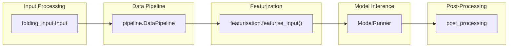

# Core Pipeline

Relevant source files

The following files were used as context for generating this wiki page:

- [run_alphafold.py](run_alphafold.py)
- [run_alphafold_test.py](run_alphafold_test.py)
- [src/alphafold3/data/featurisation.py](src/alphafold3/data/featurisation.py)
- [src/alphafold3/model/atom_layout/atom_layout.py](src/alphafold3/model/atom_layout/atom_layout.py)
- [src/alphafold3/model/pipeline/pipeline.py](src/alphafold3/model/pipeline/pipeline.py)
- [src/alphafold3/model/pipeline/structure_cleaning.py](src/alphafold3/model/pipeline/structure_cleaning.py)

The Core Pipeline in AlphaFold 3 is the complete sequence of operations that transforms input biological sequences (proteins, RNA, DNA, and ligands) into predicted 3D structures. This page provides a high-level overview of the pipeline's architecture, data flow, and major stages, connecting natural language concepts to their corresponding code entities.

As a parent page, this section introduces each stage concisely. For deep technical details, refer to the individual child pages linked below.

## Pipeline Architecture Overview

The AlphaFold 3 prediction process flows sequentially through five major stages, orchestrated by top-level runner scripts:

Sources: [run_alphafold.py:63-94](), [src/alphafold3/data/featurisation.py:47-121](), [src/alphafold3/model/pipeline/pipeline.py:86-160]()

---

## 4.1 Input Processing

AlphaFold 3 accepts input specifications via JSON files or directory streams, which are parsed, validated, and converted into structured internal representations using `folding_input.Input` classes (`ProteinChain`, `RnaChain`, `DnaChain`, and `Ligand`). This stage ensures all required sequence data, modifications, and optional pre-computed alignments are correctly structured before downstream processing.

For details, see [Input Processing](#4.1).

Sources: [run_alphafold.py:80-94](), [src/alphafold3/common/folding_input.py]()

---

## 4.2 Data Pipeline

The data pipeline stage queries biological databases to generate multiple sequence alignments (MSAs) for proteins and RNA, alongside template searches for structural references. This stage is managed by `pipeline.DataPipeline` and can be conditionally executed via flags such as `--run_data_pipeline`.

For details, see [Data Pipeline](#4.2).

Sources: [run_alphafold.py:102-204](), [src/alphafold3/data/pipeline.py:202-551]()

---

## 4.3 Featurization

The featurization stage converts biological sequences, cleaned structures, MSAs, and templates into numerical feature tensors suitable for neural network consumption. Orchestrated by `featurise_input()` [src/alphafold3/data/featurisation.py:47-121]() and `pipeline.WholePdbPipeline` [src/alphafold3/model/pipeline/pipeline.py:86-160](), this stage performs structure cleaning via `structure_cleaning.clean_structure()` [src/alphafold3/model/pipeline/structure_cleaning.py:75-111](), tokenization, bucket size padding, and tensor assembly (`features.BatchDict`).

For details, see [Featurization](#4.3).

Sources: [src/alphafold3/data/featurisation.py:47-121](), [src/alphafold3/model/pipeline/pipeline.py:86-160](), [src/alphafold3/model/pipeline/structure_cleaning.py:75-111]()

---

## 4.4 Model Inference

Model inference takes the featurized batch dictionary (`features.BatchDict`), compiles and executes the model graph via JAX, and performs diffusion sampling to generate atom coordinates and confidence scores. The execution is managed by `ModelRunner` [run_alphafold_test.py:159-164]() utilizing configuration options defined for model depth, attention mechanisms, and multi-seed sampling.

This stage encompasses detailed sub-components:
- **Network Architecture**: Evoformer trunk, diffusion head, diffusion transformer, atom cross-attention, template modules, and confidence head.
- **Model Parameters and JAX Utilities**: Parameter loading/conversion (`params.py`) and geometric transformations (`jax/geometry`).

For details, see [Model Inference](#4.4), including [Network Architecture](#4.4.1) and [Model Parameters and JAX Utilities](#4.4.2).

Sources: [run_alphafold.py:154-184](), [run_alphafold_test.py:159-184]()

---

## 4.5 Post-Processing

The post-processing stage translates raw model inference outputs into finalized structural files (such as mmCIF and PDB), computes confidence metrics (pTM, ipTM, PAE, PDE), performs quality checks (chirality and clash detection), and organizes output directories and ranking scores.

For details, see [Post-Processing](#4.5).

Sources: [run_alphafold.py:478-533]()

---