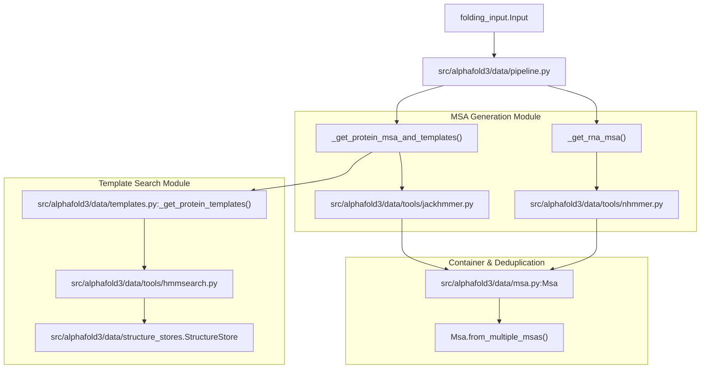
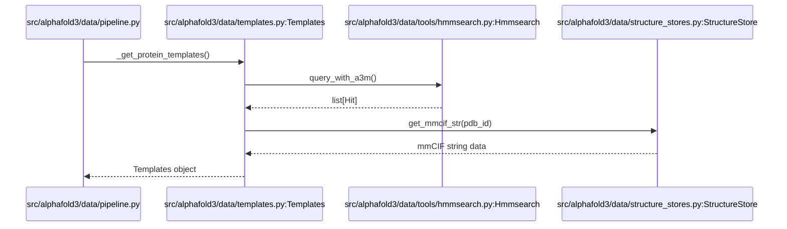

# Data Pipeline

Relevant source files

The following files were used as context for generating this wiki page:

- [src/alphafold3/cpp.cc](src/alphafold3/cpp.cc)
- [src/alphafold3/data/cpp/msa_features_pybind.cc](src/alphafold3/data/cpp/msa_features_pybind.cc)
- [src/alphafold3/data/cpp/msa_features_pybind.h](src/alphafold3/data/cpp/msa_features_pybind.h)
- [src/alphafold3/data/msa.py](src/alphafold3/data/msa.py)
- [src/alphafold3/data/msa_config.py](src/alphafold3/data/msa_config.py)
- [src/alphafold3/data/pipeline.py](src/alphafold3/data/pipeline.py)
- [src/alphafold3/data/structure_stores.py](src/alphafold3/data/structure_stores.py)
- [src/alphafold3/data/templates.py](src/alphafold3/data/templates.py)
- [src/alphafold3/data/tools/shards.py](src/alphafold3/data/tools/shards.py)

The Data Pipeline is responsible for generating Multiple Sequence Alignments (MSAs) and searching for structural templates for protein and RNA chains in AlphaFold 3. This stage transforms raw sequences from the input JSON into the rich evolutionary and structural context required by the model, orchestrating external search binaries and database lookups.

Sources: [src/alphafold3/data/pipeline.py:20-36]()

## Architecture Overview and Code Entity Mapping

The pipeline processes each chain in the input structure separately based on its polymer type (protein, RNA, or DNA), leveraging parallel execution via `futures.ThreadPoolExecutor` [src/alphafold3/data/pipeline.py:94-96](). 

Title: Data Pipeline Architecture and Code Mapping

Sources: [src/alphafold3/data/pipeline.py:79-172](), [src/alphafold3/data/msa.py:61-120](), [src/alphafold3/data/structure_stores.py:32-63]()

## Configuration

Pipeline parameters and tool configurations are managed through dataclasses defined in `src/alphafold3/data/msa_config.py` [src/alphafold3/data/msa_config.py:20-195]().

### Key Configuration Classes

| Class | Purpose | Source File Location |
|-------|---------|----------------------|
| `JackhmmerConfig` | Parameters for `Jackhmmer`, including E-values, Z-values, and CPU allocation | [src/alphafold3/data/msa_config.py:45-75]() |
| `NhmmerConfig` | Parameters for `Nhmmer`, including HMMER binary paths and RNA/DNA alphabets | [src/alphafold3/data/msa_config.py:78-108]() |
| `RunConfig` | Orchestrates MSA run configurations and crop sizes | [src/alphafold3/data/msa_config.py:110-132]() |
| `HmmsearchConfig` | Parameters for `Hmmsearch` profile searches against template databases | [src/alphafold3/data/msa_config.py:134-164]() |
| `TemplateToolConfig` | Template tool settings and database paths | [src/alphafold3/data/msa_config.py:167-177]() |
| `TemplateFilterConfig` | Criteria for hit selection: date cutoffs, identity ratios, and hit limits | [src/alphafold3/data/msa_config.py:180-195]() |

Sources: [src/alphafold3/data/msa_config.py:20-195]()

## MSA Generation

### Protein MSA Generation

Protein chains are processed by `_get_protein_msa_and_templates` [src/alphafold3/data/pipeline.py:81-90]() in `src/alphafold3/data/pipeline.py`. 

1. **Parallel Execution**: Searches against UniRef90, MgNify, Small BFD, and UniProt are dispatched concurrently using a `futures.ThreadPoolExecutor` [src/alphafold3/data/pipeline.py:94-120]().
2. **Deduplication**: Results from UniRef90, Small BFD, and MgNify are merged via `msa.Msa.from_multiple_msas` with `deduplicate=True` to create the `unpaired_protein_msa` [src/alphafold3/data/pipeline.py:133-138]().
3. **Pairing**: UniProt results are combined without deduplication (`deduplicate=False`) to form the `paired_protein_msa` [src/alphafold3/data/pipeline.py:139-141]() used for inter-chain pairing.
4. **C++ Feature Integration**: Sequence equivalence and character mapping checks are accelerated using C++ extensions in `src/alphafold3/cpp.cc` via `msa_features` [src/alphafold3/cpp.cc:53](), [src/alphafold3/data/msa.py:41-48]().

**Sharded Database Support:**
Jackhmmer database configurations support sharding using the `@NUM_SHARDS` specifier via `src/alphafold3/data/tools/shards.py` [src/alphafold3/data/tools/shards.py:20-55](). Sharded paths expand into individual file shards (`-00000-of-00020`) which are queried in parallel [src/alphafold3/data/tools/shards.py:86-103]().

Sources: [src/alphafold3/data/pipeline.py:81-161](), [src/alphafold3/data/msa.py:41-120](), [src/alphafold3/data/tools/shards.py:20-103]()

### RNA MSA Generation

RNA chains are processed via `_get_rna_msa` in `src/alphafold3/data/pipeline.py` [src/alphafold3/data/pipeline.py:165-176]().

1. **Parallel Search**: Executes `Nhmmer` concurrently against NT-RNA, Rfam, and RNACentral databases [src/alphafold3/data/pipeline.py:166-176]().
2. **Merging**: Outputs are merged into an `Msa` instance representing the alignment container for nucleic acid chains [src/alphafold3/data/pipeline.py:166-176]().

Sources: [src/alphafold3/data/pipeline.py:165-176]()

## Template Search

Title: Template Search and Structure Retrieval Flow

Sources: [src/alphafold3/data/pipeline.py:40-76](), [src/alphafold3/data/templates.py:20-43](), [src/alphafold3/data/structure_stores.py:32-74]()

1. **Query Construction**: The `unpaired_protein_msa` is converted to A3M format and passed to `templates.Templates.from_seq_and_a3m` [src/alphafold3/data/pipeline.py:51-61]().
2. **Hmmsearch Execution**: Profiles are queried against the PDB Seqres database using `hmmsearch` [src/alphafold3/data/tools/hmmsearch.py:97-132]().
3. **Filtering**: Hits are filtered using `TemplateFilterConfig` rules (e.g., `max_template_date`, sequence identity thresholds) [src/alphafold3/data/templates.py:429-523]().
4. **Structure Retrieval**: Retrieved structural records are fetched via `structure_stores.StructureStore`, which reads coordinate data from local mmCIF files or tarball archives [src/alphafold3/data/structure_stores.py:32-111]().

Sources: [src/alphafold3/data/pipeline.py:40-76](), [src/alphafold3/data/templates.py:429-551](), [src/alphafold3/data/structure_stores.py:32-111]()

## Implementation Details

### Homomer Caching
To avoid redundant tool executions in homomeric complexes, `_get_protein_msa_and_templates`, `_get_rna_msa`, and `_get_protein_templates` are decorated with `@functools.cache` [src/alphafold3/data/pipeline.py:39-46](), [src/alphafold3/data/pipeline.py:79-82](), [src/alphafold3/data/pipeline.py:164-167](). Identical sequences within a complex trigger computations only once.

### External Tool Integration
External tool wrappers in `src/alphafold3/data/tools/` handle subprocess execution, binary validation, and temporary file cleanup. For instance, Jackhmmer supports a patched sequence limit flag to constrain peak memory usage during deep alignments [src/alphafold3/data/tools/jackhmmer.py:116-172]().

Sources: [src/alphafold3/data/pipeline.py:39-82](), [src/alphafold3/data/pipeline.py:164-167](), [src/alphafold3/data/tools/jackhmmer.py:116-172]()

---