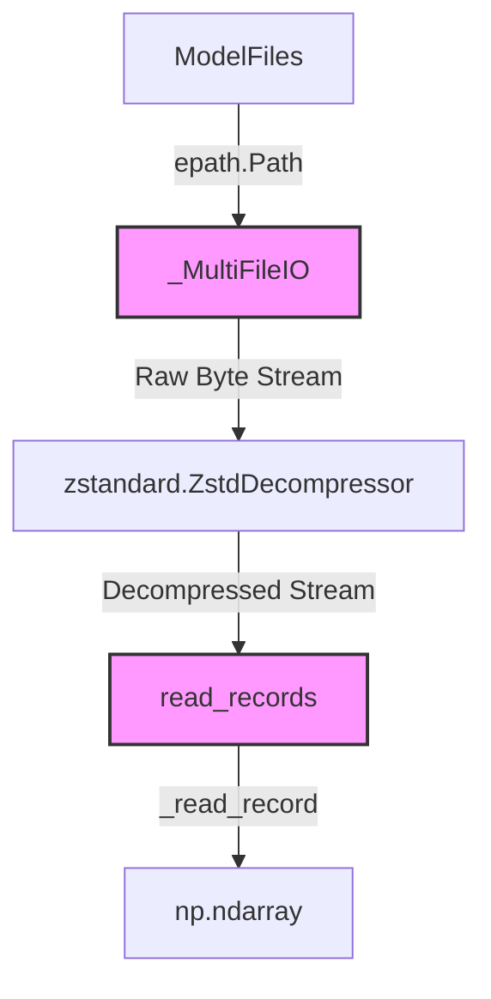
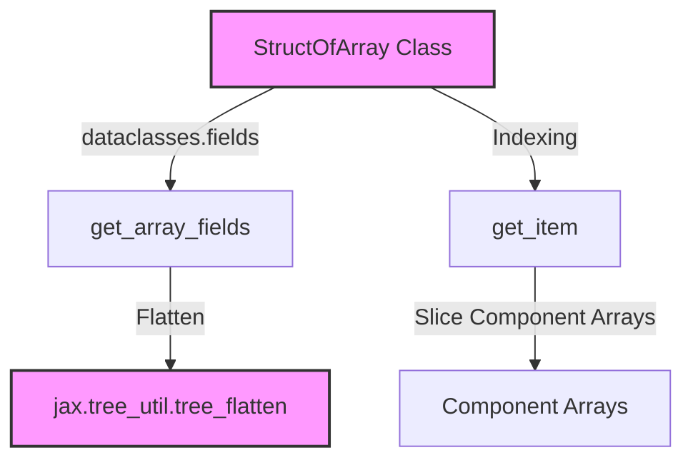

# Model Parameters and JAX Utilities

Relevant source files

The following files were used as context for generating this wiki page:

- [src/alphafold3/jax/geometry/rigid_matrix_vector.py](src/alphafold3/jax/geometry/rigid_matrix_vector.py)
- [src/alphafold3/jax/geometry/rotation_matrix.py](src/alphafold3/jax/geometry/rotation_matrix.py)
- [src/alphafold3/jax/geometry/struct_of_array.py](src/alphafold3/jax/geometry/struct_of_array.py)
- [src/alphafold3/jax/geometry/utils.py](src/alphafold3/jax/geometry/utils.py)
- [src/alphafold3/jax/geometry/vector.py](src/alphafold3/jax/geometry/vector.py)
- [src/alphafold3/model/params.py](src/alphafold3/model/params.py)

## Purpose and Scope
This page documents the parameter management system and the JAX-based geometry library used in AlphaFold 3. Specifically, it covers the binary parameter decoding and multi-file weight loading implemented in `src/alphafold3/model/params.py`, alongside the high-performance `jax/geometry` library (`vector.py`, `rotation_matrix.py`, `rigid_matrix_vector.py`, and `struct_of_array.py`) designed for numerical stability and efficient vectorization on accelerators.

---

## 1. Parameter Loading and Weight Distribution (`params.py`)

AlphaFold 3 model parameters are distributed as binary records (optionally compressed with Zstandard). The module `src/alphafold3/model/params.py` handles parsing, stream concatenation across multiple files, and decompression.

### Record Encoding and Decoding
Parameters are stored as serialized binary records. Each record encodes a Haiku parameter scope, name, data type, shape, and raw byte buffer [src/alphafold3/model/params.py:44-59](). 
- `encode_record()` packs header metadata (`<5i` format for scope length, name length, dtype length, shape length, and buffer length) followed by the concatenated byte payload [src/alphafold3/model/params.py:44-59]().
- `_read_record()` and `read_records()` reverse this process, casting raw byte buffers back into NumPy arrays with proper byte-order handling [src/alphafold3/model/params.py:62-95]().

### Multi-File and Compressed Streams
Large model weights can span multiple files or utilize compression. 
- `_MultiFileIO` inherits from `io.RawIOBase` to present a unified byte stream view across a sequence of split weight files [src/alphafold3/model/params.py:97-116](). It manages virtual file offsets, relative seeking via bisection (`bisect.bisect_right`), and block reading [src/alphafold3/model/params.py:117-171]().
- `open_for_reading()` wraps `_MultiFileIO` with a `zstandard.ZstdDecompressor` stream reader when `is_compressed` is set to `True` [src/alphafold3/model/params.py:173-181]().

*Figure 1: Parameter loading and multi-file decoding data flow.*

Sources: `src/alphafold3/model/params.py`

---

## 2. Struct-of-Array Framework (`struct_of_array.py`)

To optimize performance and avoid mixed-precision issues on accelerators (such as TPU mixed bfloat16/float32 execution), spatial coordinates and transformations are implemented using a Struct-of-Arrays (SoA) layout.

### The `@StructOfArray` Decorator
The class decorator `@StructOfArray` transforms dataclasses into SoA structures where fields represent decoupled array components (e.g., individual $x$, $y$, $z$ coordinates) rather than an array of structures [src/alphafold3/jax/geometry/struct_of_array.py:20-240]().
- `get_item()` handles custom indexing and slicing across nested SoA attributes [src/alphafold3/jax/geometry/struct_of_array.py:27-38]().
- `flatten()` integrates with JAX's transformation machinery (`vmap`, `grad`, `jit`) by flattening SoA instances into raw array leaves and metadata [src/alphafold3/jax/geometry/struct_of_array.py:143-157]().
- `post_init()` validates shape matching, trailing dimensions, and dtypes across all field components upon initialization [src/alphafold3/jax/geometry/struct_of_array.py:92-142]().

*Figure 2: Struct-of-Array transformation and JAX integration.*

Sources: `src/alphafold3/jax/geometry/struct_of_array.py`

---

## 3. Spatial Geometry Primitives

Building upon the SoA framework, the geometry library provides three core primitive classes for 3D coordinate and frame manipulation: `Vec3Array`, `Rot3Array`, and `Rigid3Array`.

### 3D Vectors (`vector.py`)
`Vec3Array` implements 3-dimensional vectors as a struct of three arrays (`x`, `y`, `z`) pinned to `jnp.float32` [src/alphafold3/jax/geometry/vector.py:38-54]().
- **Operations**: Overloads arithmetic operators (`__add__`, `__sub__`, `__mul__`, etc.) via `jax.tree.map` [src/alphafold3/jax/geometry/vector.py:66-85]().
- **Vector Math**: Implements `cross()`, `dot()`, `norm()` (with clipping via `epsilon` to prevent NaN gradients), and `normalized()` [src/alphafold3/jax/geometry/vector.py:87-112]().
- **Metrics**: Provides `square_euclidean_distance()`, `euclidean_distance()`, and `dihedral_angle()` [src/alphafold3/jax/geometry/vector.py:142-204]().

### Rotation Matrices (`rotation_matrix.py`)
`Rot3Array` represents 3x3 rotation matrices decomposed into 9 component arrays (`xx` through `zz`) [src/alphafold3/jax/geometry/rotation_matrix.py:117-130]().
- **Methods**: Supports `inverse()` (matrix transpose), `apply_to_point()`, and matrix composition via `__matmul__` [src/alphafold3/jax/geometry/rotation_matrix.py:133-159]().
- **Frame Construction**: `Rot3Array.from_two_vectors()` constructs orthonormal frames from two vectors where `e0` aligns with the x-axis and `e1` defines the xy-plane [src/alphafold3/jax/geometry/rotation_matrix.py:168-189]().
- **Custom Gradients**: Implements a custom JVP derivative for `largest_evec()` via `jax.custom_jvp` for stable eigenvalue decomposition during alignment and frame derivation [src/alphafold3/jax/geometry/rotation_matrix.py:77-111]().

### Rigid Transformations (`rigid_matrix_vector.py`)
`Rigid3Array` combines a `Rot3Array` rotation and a `Vec3Array` translation to represent elements of the Special Euclidean group $SE(3)$ [src/alphafold3/jax/geometry/rigid_matrix_vector.py:108-114]().
- **Composition & Inversion**: `__matmul__` composes two rigid transformations; `inverse()` computes the inverse rigid transform [src/alphafold3/jax/geometry/rigid_matrix_vector.py:115-124]().
- **Point Transformation**: `apply_to_point()` transforms `Vec3Array` points by applying rotation followed by translation [src/alphafold3/jax/geometry/rigid_matrix_vector.py:126-128]().
- **Interop**: Provides `to_array()`, `from_array()`, and `from_array4x4()` for converting between SoA objects and homogeneous 4x4 matrices [src/alphafold3/jax/geometry/rigid_matrix_vector.py:154-178]().
- **Covariance**: `_compute_covariance_matrix()` calculates weighted covariance matrices between point sets for structural superposition [src/alphafold3/jax/geometry/rigid_matrix_vector.py:39-105]().

Sources: `src/alphafold3/jax/geometry/vector.py`, `src/alphafold3/jax/geometry/rotation_matrix.py`, `src/alphafold3/jax/geometry/rigid_matrix_vector.py`, `src/alphafold3/jax/geometry/utils.py`

---