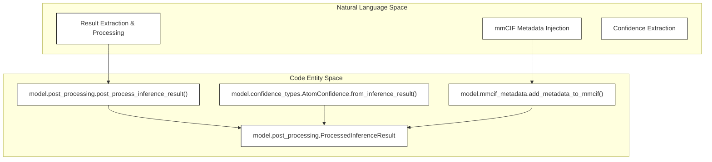
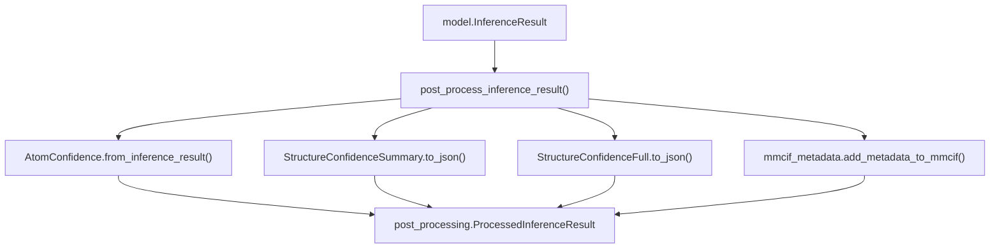
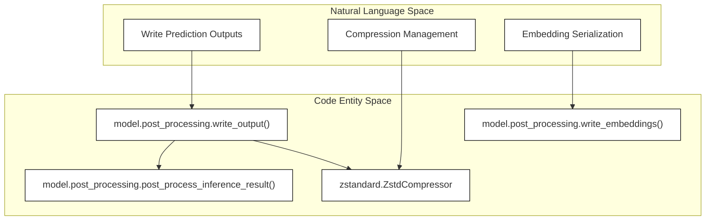

# Post-Processing

<details>
<summary>Relevant source files</summary>

The following files were used as context for generating this wiki page:

- [src/alphafold3/model/confidences.py](src/alphafold3/model/confidences.py)
- [src/alphafold3/model/mmcif_metadata.py](src/alphafold3/model/mmcif_metadata.py)
- [src/alphafold3/model/post_processing.py](src/alphafold3/model/post_processing.py)
- [src/alphafold3/model/scoring/scoring.py](src/alphafold3/model/scoring/scoring.py)

</details>


Post-processing is the final stage of the AlphaFold 3 prediction pipeline that transforms raw model outputs into structured results. This stage extracts predicted structures from diffusion samples, computes confidence and quality metrics, ranks predictions across seeds and samples, adds ModelCIF metadata and legal disclaimers, and writes all outputs to disk in standardized formats (such as mmCIF and JSON).

For information about the preceding model inference stage, see [Model Inference](#4.4). For details about the output file formats, see [Output Format](#3.3).

## Overview and Result Extraction

Post-processing operates on the results produced by model inference for each seed and diffusion sample via functions defined in `src/alphafold3/model/post_processing.py`. The key responsibilities include:

1.  **Result Extraction** - Converting raw model outputs into `ProcessedInferenceResult` objects containing serialized bytes for mmCIF, confidence summaries, full confidence data, and scalar scores [src/alphafold3/model/post_processing.py:34-55]().
2.  **Confidence Calculation** - Computing 1D and 2D confidence metrics that quantify prediction quality.
3.  **Quality Assessment** - Detecting structural issues such as surface disorder and atomic clashes.
4.  **Ranking** - Calculating scalar ranking scores to identify the best prediction across all seeds and samples.
5.  **Output Writing** - Serializing results to disk with optional `zstandard` compression [src/alphafold3/model/post_processing.py:104-142]().


**Figure 1: Bridging Concepts from Result Processing to Code Entities**

Sources: [src/alphafold3/model/post_processing.py:34-101](), [src/alphafold3/model/mmcif_metadata.py:56-62]()

## Result Extraction Pipeline

The function `post_process_inference_result()` coordinates the generation of structured metadata and confidence data from a `model.InferenceResult` object [src/alphafold3/model/post_processing.py:57-101]().



**Figure 2: Result Extraction and Processing Flow**

Key processing steps inside `post_process_inference_result()` include:
*   **Metadata Injection**: `mmcif_metadata.add_metadata_to_mmcif()` adds ModelCIF-conformant dictionaries, audit information, and citation records to the structure [src/alphafold3/model/mmcif_metadata.py:56-118]() [src/alphafold3/model/post_processing.py:66-71]().
*   **Legal Comments**: If `keep_license` is set, `mmcif_metadata.add_legal_comment()` appends terms of use and non-commercial disclaimers [src/alphafold3/model/mmcif_metadata.py:31-45]() [src/alphafold3/model/post_processing.py:73-74]().
*   **Confidence Aggregation**: 1D atom confidences are extracted, and their arithmetic mean is computed [src/alphafold3/model/post_processing.py:76-79]().
*   **JSON Serialization**: Summary and full confidence objects are converted to JSON strings and encoded to `bytes` [src/alphafold3/model/post_processing.py:80-93]().

Sources: [src/alphafold3/model/post_processing.py:57-101](), [src/alphafold3/model/mmcif_metadata.py:56-185]()

## Confidence Metrics and Scoring Utilities

AlphaFold 3 computes multiple confidence metrics to evaluate prediction reliability at different spatial resolutions.

| Metric | Scope | Range | Implementation |
| :--- | :--- | :--- | :--- |
| **pTM** | Per-structure | [0, 1] | `confidence_types` / model outputs |
| **ipTM** | Per-interface | [0, 1] | `confidence_types` / model outputs |
| **PAE** | Per-token-pair | [0, 31.75] Å | `confidence_types` matrices |
| **PDE** | Per-token-pair | [0, ∞) Å | `confidence_types` matrices |

In addition to high-level metrics, geometric scoring utilities such as `pseudo_beta_fn()` in `src/alphafold3/model/scoring/scoring.py` calculate pseudo-beta atom positions and coordinate masks from dense atom layouts, supporting structural evaluations [src/alphafold3/model/scoring/scoring.py:30-77]().

Sources: [src/alphafold3/model/confidences.py:1-30](), [src/alphafold3/model/scoring/scoring.py:30-77]()

## Quality Assessment

### Disorder Detection (AlphaFold-RSA)

Disorder is evaluated using relative solvent accessibility (RSA) through the `windowed_solvent_accessible_area` and `fraction_disordered` routines [src/alphafold3/model/confidences.py:62-137]().

1.  **DSSP Calculation**: Calls `mkdssp.get_dssp()` to compute surface accessibility [src/alphafold3/model/confidences.py:75]().
2.  **Normalization**: Residue surface area is normalized against `MAX_ACCESSIBLE_SURFACE_AREA` values [src/alphafold3/model/confidences.py:33-54,84-86]().
3.  **Smoothing**: Convolves a sliding window (default size 25) over the sequence RASA values [src/alphafold3/model/confidences.py:93-95]().
4.  **Disorder Fraction**: Computes the fraction of residues where normalized RASA exceeds `rasa_disorder_cutoff` (default 0.581) [src/alphafold3/model/confidences.py:99-137]().

Sources: [src/alphafold3/model/confidences.py:33-137]()

### Clash Detection

Physical plausibility is verified using `has_clash()` [src/alphafold3/model/confidences.py:140-191]().

*   **Spatial Indexing**: Constructs a `spatial.cKDTree` over atomic coordinates [src/alphafold3/model/confidences.py:166-167]().
*   **Clash Radius**: Evaluates interatomic distances under `cutoff_radius` (1.1 Å) across different chains or residues separated by more than 1 position [src/alphafold3/model/confidences.py:142,168-176]().
*   **Thresholding**: Flags a chain as clashing if it contains >100 clashing atoms or if >50% of its atoms clash [src/alphafold3/model/confidences.py:143-144,184-190]().

Sources: [src/alphafold3/model/confidences.py:140-191]()

## Ranking Score

Predictions across multiple seeds and samples are sorted via `get_ranking_score()` [src/alphafold3/model/confidences.py:194-228]():

```python
ranking_score = (ptm_iptm_average 
                 + _FRACTION_DISORDERED_WEIGHT * fraction_disordered 
                 - _CLASH_PENALIZATION_WEIGHT * has_clash)
```

**Weight Constants**:
*   `_IPTM_WEIGHT = 0.8` [src/alphafold3/model/confidences.py:57]()
*   `_FRACTION_DISORDERED_WEIGHT = 0.5` [src/alphafold3/model/confidences.py:58]()
*   `_CLASH_PENALIZATION_WEIGHT = 100.0` [src/alphafold3/model/confidences.py:59]()

The large clash penalty ensures physically invalid models are ranked lower than all non-clashing models.

Sources: [src/alphafold3/model/confidences.py:56-60](), [src/alphafold3/model/confidences.py:194-228]()

## Output Writing and Result Organization

The `write_output()` and `write_embeddings()` functions manage result serialization to the filesystem [src/alphafold3/model/post_processing.py:104-154]().


**Figure 3: Output Serialization Mapping**

*   **File Organization**: Writes `{prefix}model.cif`, `{prefix}confidences.json`, and `{prefix}summary_confidences.json` into the designated `output_dir` [src/alphafold3/model/post_processing.py:118-123]().
*   **Compression**: Supports optional `zstandard` stream compression when `compress=True` [src/alphafold3/model/post_processing.py:110,125-131]().
*   **Embeddings**: `write_embeddings()` serializes intermediate activations into compressed NumPy archives (`{prefix}embeddings.npz`) [src/alphafold3/model/post_processing.py:143-154]().

Sources: [src/alphafold3/model/post_processing.py:104-154]()

---