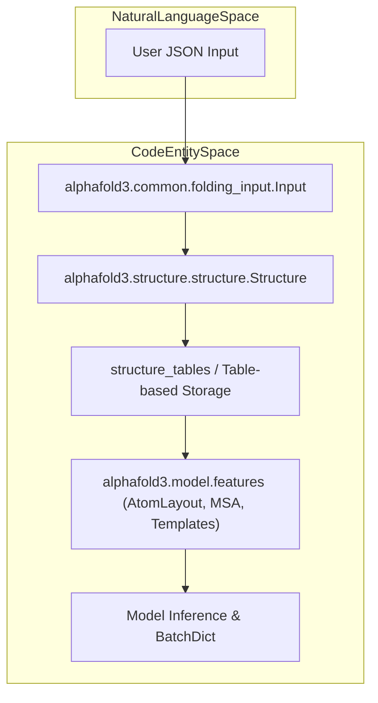
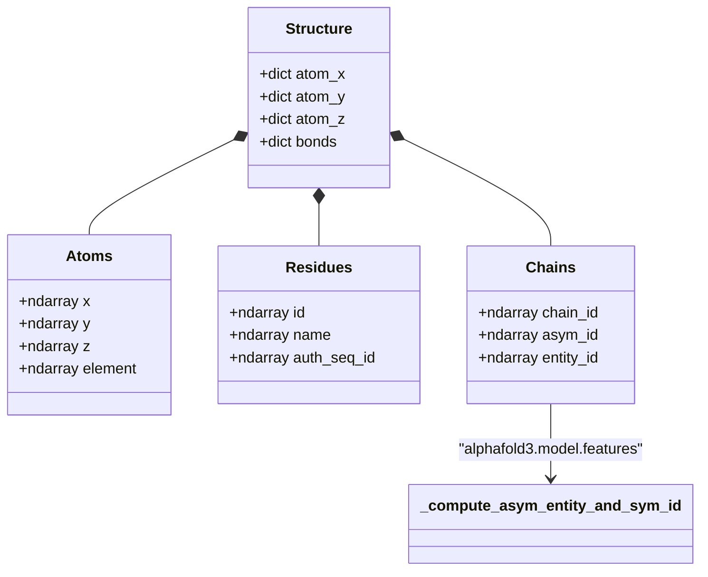

# Data Structures

Relevant source files

The following files were used as context for generating this wiki page:

- [src/alphafold3/model/data3.py](src/alphafold3/model/data3.py)
- [src/alphafold3/model/features.py](src/alphafold3/model/features.py)
- [src/alphafold3/structure/parsing.py](src/alphafold3/structure/parsing.py)
- [src/alphafold3/structure/structure.py](src/alphafold3/structure/structure.py)

This document provides a technical overview of the key data structures used throughout the AlphaFold 3 system. It describes the transition from high-level biological input definitions to internal table-based structure representations and numerical feature tensors.

## Overview of Data Flow

The AlphaFold 3 pipeline transforms data through several distinct representations, starting from a user-defined JSON input and ending with a 3D structure and associated confidence metrics.

Sources: [src/alphafold3/common/folding_input.py:488-535](), [src/alphafold3/structure/structure.py:341-450](), [src/alphafold3/model/features.py:39-53]()

## Input Data Model

The primary entry point for the system is the `Input` class. This dataclass acts as a container for the biological entities being modeled, organized into various chain types. The system supports multiple JSON dialects, including the standard `alphafold3` dialect and the `alphafoldserver` dialect [src/alphafold3/common/folding_input.py:38-43]().

For details, see [Input Data Model](#5.1).

Sources: [src/alphafold3/common/folding_input.py:38-43]()

## Structure Representation

AlphaFold 3 uses a table-based `Structure` class to manage 3D coordinates and chemical metadata. This representation is designed for efficient filtering and manipulation of large molecular systems by leveraging NumPy-backed tables [src/alphafold3/structure/structure.py:341-450]().

### Code Entity Association: Structure Tables

The following diagram maps structural concepts to specific Python classes and their underlying table layouts.

Sources: [src/alphafold3/structure/structure.py:127-173](), [src/alphafold3/model/features.py:113-170]()

For details, see [Structure Representation](#5.2).

## Feature Tensors

Before being processed by the neural network, biological data is converted into numerical tensors. This featurization process maps irregular biological structures onto fixed-size arrays managed by `AtomLayout` and packaged into dictionary structures (`BatchDict`) [src/alphafold3/model/features.py:39-53]().

For details, see [Feature Tensors](#5.3).

Sources: [src/alphafold3/model/features.py:20-68]()

## Confidence Metrics

The final output of the model includes several metrics used to assess the reliability of the predicted 3D structure. These metrics are calculated during post-processing and include pLDDT, pTM, ipTM, PAE, and PDE.

For details, see [Confidence Metrics](#5.4).

Sources: [src/alphafold3/common/folding_input.py:11-40]()

## Chemical Components and Constants

Handling chemical components relies heavily on the Chemical Components Dictionary (CCD) database, managing bond stereochemistry, atom types, and standard residue definitions.

For details, see [Chemical Components and Constants](#5.5).

Sources: [src/alphafold3/constants/chemical_components.py:1-35]()

---