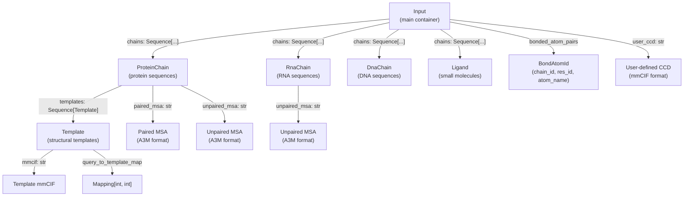
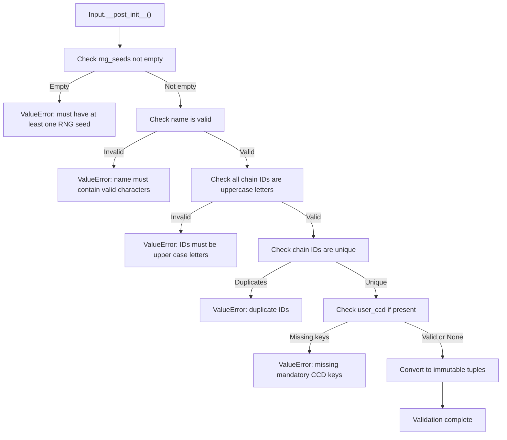
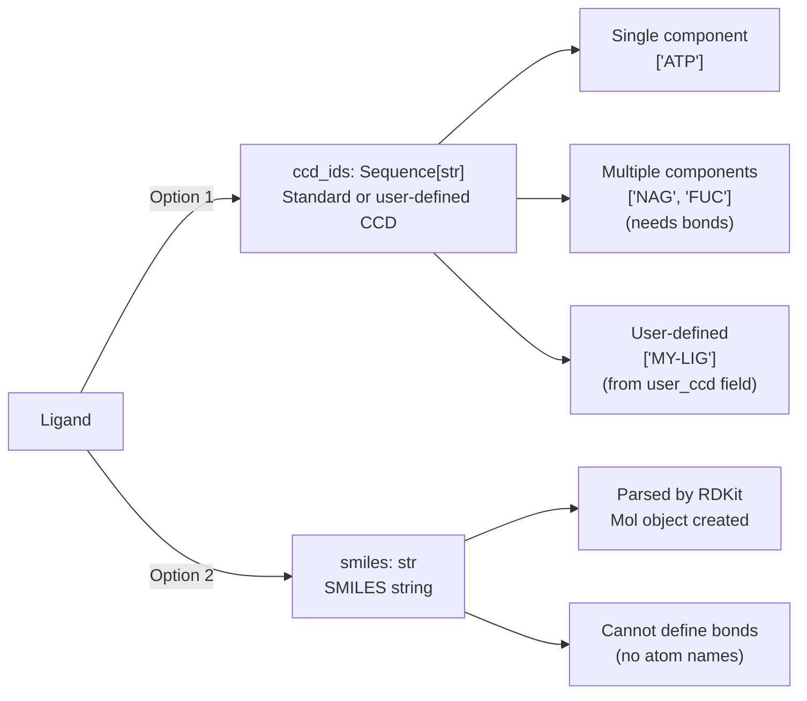
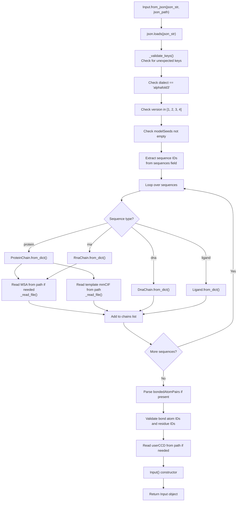
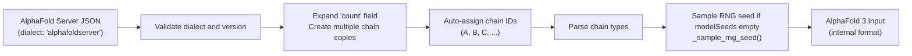
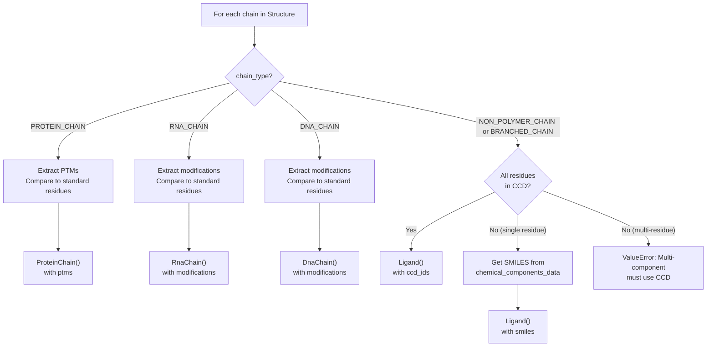
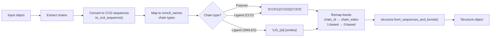
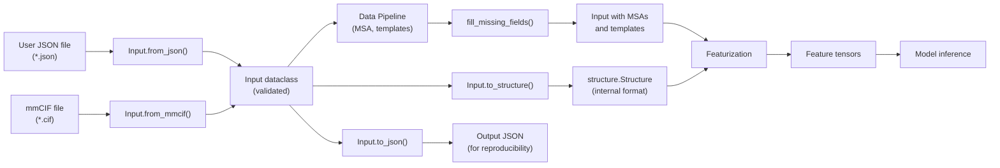

# Input Data Model

<details>
<summary>Relevant source files</summary>

The following files were used as context for generating this wiki page:

- [src/alphafold3/common/base_config.py](src/alphafold3/common/base_config.py)
- [src/alphafold3/common/folding_input.py](src/alphafold3/common/folding_input.py)
- [src/alphafold3/common/folding_input_test.py](src/alphafold3/common/folding_input_test.py)
- [src/alphafold3/common/resources.py](src/alphafold3/common/resources.py)

</details>


## Purpose and Scope

This page documents the input data model used throughout AlphaFold 3 to represent user-provided prediction targets. The data model consists of dataclasses and their methods defined in [src/alphafold3/common/folding_input.py](). These classes provide a strongly-typed, validated representation of molecular entities that serves as the internal format between JSON parsing and downstream processing stages.

For information about the user-facing JSON input format, see **3.1 Input Format**. For details on how these structures are processed and converted to features, see **4.1 Input Processing**. For the internal `Structure` representation used during model inference, see **5.2 Structure Representation**.

## Overview

The input data model provides Python dataclasses for representing molecular entities and their metadata. All classes support construction from JSON dictionaries, validation of input constraints, and conversion to various output formats.

**Diagram: Input Data Model Class Hierarchy**



Sources: [src/alphafold3/common/folding_input.py:86-1006]()

## The Input Class

The `Input` dataclass is the top-level container that represents a complete prediction job. It is immutable (frozen) and contains all information needed to run AlphaFold 3.

**Table: Input Class Attributes**

| Attribute | Type | Description | Required |
|-----------|------|-------------|----------|
| `name` | `str` | Job name, used for output file naming | Yes |
| `chains` | `Sequence[ProteinChain \| RnaChain \| DnaChain \| Ligand]` | All molecular entities in the system | Yes |
| `rng_seeds` | `Sequence[int]` | Random seeds for model inference (one per prediction) | Yes |
| `bonded_atom_pairs` | `Sequence[tuple[BondAtomId, BondAtomId]]` | Covalent bonds between atoms | No |
| `user_ccd` | `str` | User-provided chemical component dictionary in mmCIF format | No |

Sources: [src/alphafold3/common/folding_input.py:931-960]()

### Input Properties

The `Input` class provides convenience properties to filter chains by type:

```python
@property
def protein_chains(self) -> Sequence[ProteinChain]
    
@property
def rna_chains(self) -> Sequence[RnaChain]
    
@property
def dna_chains(self) -> Sequence[DnaChain]
    
@property
def ligands(self) -> Sequence[Ligand]
```

Sources: [src/alphafold3/common/folding_input.py:991-1005]()

### Input Validation

The `Input.__post_init__` method enforces several validation rules:

1. At least one RNG seed must be provided [src/alphafold3/common/folding_input.py:962-963]().
2. Job name must be non-empty and contain valid filename characters [src/alphafold3/common/folding_input.py:965-971]().
3. All chain IDs must be uppercase letters [src/alphafold3/common/folding_input.py:973-976]().
4. Chain IDs must be unique across all chains [src/alphafold3/common/folding_input.py:978-980]().
5. User-provided CCD must contain all mandatory mmCIF fields [src/alphafold3/common/folding_input.py:982-985]().

Sources: [src/alphafold3/common/folding_input.py:961-989]()

**Diagram: Input Validation Flow**



Sources: [src/alphafold3/common/folding_input.py:961-989]()

## Chain Types

### ProteinChain

The `ProteinChain` class represents a single protein chain with its sequence, modifications, MSAs, and templates.

**Table: ProteinChain Attributes**

| Attribute | Type | Description | Optional |
|-----------|------|-------------|----------|
| `id` | `str` | Unique chain identifier (uppercase letter) | No |
| `_sequence` | `str` | Amino acid sequence (1-letter codes) | No |
| `_ptms` | `Sequence[tuple[str, int]]` | Post-translational modifications (CCD code, 1-based position) | No |
| `_description` | `str \| None` | Textual description of the chain | Yes |
| `_paired_msa` | `str \| None` | Paired MSA in A3M format | Yes |
| `_unpaired_msa` | `str \| None` | Unpaired MSA in A3M format | Yes |
| `_templates` | `Sequence[Template] \| None` | Structural templates | Yes |

Sources: [src/alphafold3/common/folding_input.py:123-184]()

#### ProteinChain Methods

**Key methods:**

- `sequence` property: Returns single-letter sequence accounting for modifications [src/alphafold3/common/folding_input.py:191-199]().
- `to_ccd_sequence()`: Converts to CCD code sequence [src/alphafold3/common/folding_input.py:420-428]().
- `from_dict()`: Constructs from AlphaFold 3 JSON [src/alphafold3/common/folding_input.py:297-387]().
- `from_alphafoldserver_dict()`: Constructs from AlphaFold Server JSON [src/alphafold3/common/folding_input.py:257-295]().
- `to_dict()`: Converts to JSON dictionary [src/alphafold3/common/folding_input.py:389-418]().
- `fill_missing_fields()`: Fills unset MSA/template fields with defaults [src/alphafold3/common/folding_input.py:430-440]().
- `hash_without_id()`: Hash ignoring chain ID for deduplication [src/alphafold3/common/folding_input.py:246-255]().

Sources: [src/alphafold3/common/folding_input.py:186-440]()

### RnaChain

The `RnaChain` class represents a single-strand RNA chain with its sequence, modifications, and MSA.

**Table: RnaChain Attributes**

| Attribute | Type | Description | Optional |
|-----------|------|-------------|----------|
| `id` | `str` | Unique chain identifier (uppercase letter) | No |
| `_sequence` | `str` | RNA sequence (letters A, C, G, U) | No |
| `_modifications` | `Sequence[tuple[str, int]]` | RNA modifications (CCD code, 1-based position) | No |
| `_description` | `str \| None` | Textual description of the chain | Yes |
| `_unpaired_msa` | `str \| None` | Unpaired MSA in A3M format | Yes |

Sources: [src/alphafold3/common/folding_input.py:443-491]()

**Key differences from ProteinChain:**

1. No paired MSA support (RNA only uses unpaired MSA) [src/alphafold3/common/folding_input.py:463-465]().
2. No template support (templates are protein-only) [src/alphafold3/common/folding_input.py:443-466]().
3. Modifications called "modifications" instead of "ptms" [src/alphafold3/common/folding_input.py:455-456]().
4. Sequence uses RNA bases (A, C, G, U) instead of amino acids [src/alphafold3/common/folding_input.py:470-471]().

Sources: [src/alphafold3/common/folding_input.py:443-646]()

### DnaChain

The `DnaChain` class represents a single-strand DNA chain with its sequence and modifications.

**Table: DnaChain Attributes**

| Attribute | Type | Description | Optional |
|-----------|------|-------------|----------|
| `id` | `str` | Unique chain identifier (uppercase letter) | No |
| `_sequence` | `str` | DNA sequence (letters A, C, G, T) | No |
| `_modifications` | `Sequence[tuple[str, int]]` | DNA modifications (CCD code, 1-based position) | No |
| `_description` | `str \| None` | Textual description of the chain | Yes |

Sources: [src/alphafold3/common/folding_input.py:649-684]()

**Key differences from RnaChain and ProteinChain:**

1. No MSA support (DNA chains do not use MSA) [src/alphafold3/common/folding_input.py:649-684]().
2. No template support (templates are protein-only) [src/alphafold3/common/folding_input.py:649-684]().
3. Sequence uses DNA bases (A, C, G, T) [src/alphafold3/common/folding_input.py:669-670]().

Sources: [src/alphafold3/common/folding_input.py:649-786]()

### Ligand

The `Ligand` dataclass represents a small molecule, which can be specified using CCD codes or a SMILES string.

**Table: Ligand Attributes**

| Attribute | Type | Description | Optional |
|-----------|------|-------------|----------|
| `id` | `str` | Unique ligand identifier (uppercase letter) | No |
| `ccd_ids` | `Sequence[str] \| None` | CCD or user-defined component IDs | Yes* |
| `smiles` | `str \| None` | SMILES representation | Yes* |
| `description` | `str \| None` | Textual description | Yes |

*Exactly one of `ccd_ids` or `smiles` must be set.

Sources: [src/alphafold3/common/folding_input.py:789-821]()

#### Ligand Validation

The `Ligand.__post_init__` method validates:

1. Exactly one of `ccd_ids` or `smiles` is set (mutually exclusive) [src/alphafold3/common/folding_input.py:811-814]().
2. If SMILES is provided, it must be parseable by RDKit [src/alphafold3/common/folding_input.py:816-818]().
3. Converts `ccd_ids` to immutable tuple [src/alphafold3/common/folding_input.py:820]().

Sources: [src/alphafold3/common/folding_input.py:809-820]()

**Diagram: Ligand Specification Options**



Sources: [src/alphafold3/common/folding_input.py:789-894]()

## Template Class

The `Template` class represents a structural template for protein chains, consisting of an mmCIF structure and a query-to-template residue mapping.

**Table: Template Attributes**

| Attribute | Type | Description |
|-----------|------|-------------|
| `_mmcif` | `str` | Template structure in mmCIF format (single chain) |
| `_query_to_template` | `tuple[tuple[int, int], ...]` | Mapping from query residue indices to template residue indices |

Sources: [src/alphafold3/common/folding_input.py:86-121]()

**Key characteristics:**

1. Templates are hashable (can be used in sets/dicts) [src/alphafold3/common/folding_input.py:112-113]().
2. The mmCIF should contain only one protein chain [src/alphafold3/common/folding_input.py:95-96]().
3. The query-to-template mapping is stored as a tuple for immutability [src/alphafold3/common/folding_input.py:102]().
4. Template equality considers both mmCIF content and mapping [src/alphafold3/common/folding_input.py:115-120]().

Sources: [src/alphafold3/common/folding_input.py:86-121]()

## Construction Methods

### From JSON

The `Input.from_json()` class method constructs an `Input` object from an AlphaFold 3 JSON string.

**Diagram: from_json() Processing Flow**



Sources: [src/alphafold3/common/folding_input.py:1102-1251]()

#### Supporting File Reading

The `_read_file()` helper function reads files with optional compression detection:

**Supported compression formats:**
- gzip (detected by magic bytes `\x1f\x8b`) [src/alphafold3/common/folding_input.py:73-75]().
- xz/lzma (detected by magic bytes `\xfd\x37\x7a\x58\x5a\x00`) [src/alphafold3/common/folding_input.py:76-78]().
- zstd (detected by magic bytes `\x28\xb5\x2f\xfd`) [src/alphafold3/common/folding_input.py:79-81]().
- Plain text (fallback) [src/alphafold3/common/folding_input.py:82-83]().

Sources: [src/alphafold3/common/folding_input.py:52-83]()

### From AlphaFold Server JSON

The `Input.from_alphafoldserver_fold_job()` class method constructs an `Input` object from an AlphaFold Server JSON format.

**Key differences from AlphaFold 3 JSON:**

1. Top-level is a list allowing multiple fold jobs [src/alphafold3/common/folding_input.py:1494-1502]().
2. No chain ID specification (auto-assigned using reverse spreadsheet style) [src/alphafold3/common/folding_input.py:1026-1033]().
3. Uses `count` field to specify homomeric chains [src/alphafold3/common/folding_input.py:1052-1053]().
4. Ions and ligands are separate entity types (both mapped to `Ligand`) [src/alphafold3/common/folding_input.py:1083-1088]().
5. No bond specification support [src/alphafold3/common/folding_input.py:1013-1100]().
6. No user CCD support [src/alphafold3/common/folding_input.py:1013-1100]().
7. Empty `modelSeeds` triggers random seed sampling [src/alphafold3/common/folding_input.py:1035-1037]().

Sources: [src/alphafold3/common/folding_input.py:1013-1100]()

**Diagram: AlphaFold Server JSON to Input Conversion**



Sources: [src/alphafold3/common/folding_input.py:1013-1100]()

### From mmCIF

The `Input.from_mmcif()` class method constructs an `Input` object from an mmCIF structure string.

**Processing steps:**

1. Parse mmCIF to `structure.Structure` using various fix flags [src/alphafold3/common/folding_input.py:1269-1277]().
2. Generate default bioassembly (expand stoichiometry) [src/alphafold3/common/folding_input.py:1282-1284]().
3. Extract single-letter sequences including missing residues [src/alphafold3/common/folding_input.py:1290-1291]().
4. Iterate over chains by type:
   - Polymer chains → `ProteinChain`, `RnaChain`, or `DnaChain` [src/alphafold3/common/folding_input.py:1294-1317]().
   - Non-polymer chains → `Ligand` (using CCD or SMILES) [src/alphafold3/common/folding_input.py:1319-1347]().
5. Detect modifications by comparing to standard residues [src/alphafold3/common/folding_input.py:1301-1316]().
6. Extract covalent bonds from structure bond table [src/alphafold3/common/folding_input.py:1351-1358]().
7. Sample a random RNG seed (mmCIF doesn't store seeds) [src/alphafold3/common/folding_input.py:1360]().

Sources: [src/alphafold3/common/folding_input.py:1253-1363]()

**Diagram: from_mmcif() Chain Type Detection**



Sources: [src/alphafold3/common/folding_input.py:1294-1347]()

## Conversion Methods

### To JSON

The `Input.to_json()` method converts an `Input` object back to an AlphaFold 3 JSON string.

**Key behaviors:**

1. Deduplicates chains by content (using `hash_without_id()`) [src/alphafold3/common/folding_input.py:1438-1447]().
2. Stores deduplicated chains with list of IDs for homomers [src/alphafold3/common/folding_input.py:1438-1447]().
3. Uses `JSON_DIALECT = 'alphafold3'` and `JSON_VERSION = 4` [src/alphafold3/common/folding_input.py:1451-1452]().
4. Post-processes to remove newlines from `queryIndices`/`templateIndices` arrays [src/alphafold3/common/folding_input.py:1463-1467]().
5. Produces pretty-printed JSON with 2-space indentation [src/alphafold3/common/folding_input.py:1459]().

Sources: [src/alphafold3/common/folding_input.py:1436-1469]()

### To Structure

The `Input.to_structure()` method converts an `Input` object to a `structure.Structure` object for downstream processing.

**Conversion logic:**

1. Convert each chain to CCD sequence format [src/alphafold3/common/folding_input.py:1381-1406]().
2. Map chain types to `mmcif_names` constants [src/alphafold3/common/folding_input.py:1381-1406]():
   - `ProteinChain` → `PROTEIN_CHAIN`
   - `RnaChain` → `RNA_CHAIN`
   - `DnaChain` → `DNA_CHAIN`
   - Single-CCD `Ligand` → `NON_POLYMER_CHAIN`
   - Multi-CCD `Ligand` → `BRANCHED_CHAIN`
3. Convert SMILES ligands to `LIG_{chain_id}:{smiles}` format [src/alphafold3/common/folding_input.py:1405]().
4. Remap bonds from chain IDs to chain indices (0-based) [src/alphafold3/common/folding_input.py:1416-1430]().
5. Call `structure.from_sequences_and_bonds()` [src/alphafold3/common/folding_input.py:1432-1434]().

Sources: [src/alphafold3/common/folding_input.py:1365-1434]()

**Diagram: Input to Structure Conversion**



Sources: [src/alphafold3/common/folding_input.py:1365-1434]()

## Utility Functions

### load_fold_inputs_from_path()

Loads one or more `Input` objects from a JSON file, automatically detecting the dialect:
- List at top-level → AlphaFold Server JSON (multiple inputs) [src/alphafold3/common/folding_input.py:1501-1502]().
- Dict at top-level → AlphaFold 3 JSON (single input) [src/alphafold3/common/folding_input.py:1503-1504]().

Sources: [src/alphafold3/common/folding_input.py:1494-1521]()

### load_fold_inputs_from_dir()

Loads all `Input` objects from all `.json` files in a directory [src/alphafold3/common/folding_input.py:1523-1536]().

Sources: [src/alphafold3/common/folding_input.py:1523-1536]()

### Helper Methods

**fill_missing_fields()**: Fills unset MSA/template fields with empty defaults. Used before featurization when data pipeline is skipped [src/alphafold3/common/folding_input.py:1471-1479]().

Sources: [src/alphafold3/common/folding_input.py:1471-1479]()

**with_multiple_seeds()**: Creates a copy with multiple consecutive RNG seeds. Used for generating multiple predictions from a single seed [src/alphafold3/common/folding_input.py:1481-1491]().

Sources: [src/alphafold3/common/folding_input.py:1481-1491]()

**sanitised_name()**: Returns a filesystem-safe version of the job name [src/alphafold3/common/folding_input.py:1007-1011]().

Sources: [src/alphafold3/common/folding_input.py:1007-1011]()

## Data Flow Summary

**Diagram: Input Data Model in the AlphaFold 3 Pipeline**



Sources: [src/alphafold3/common/folding_input.py:1-1537]()

---