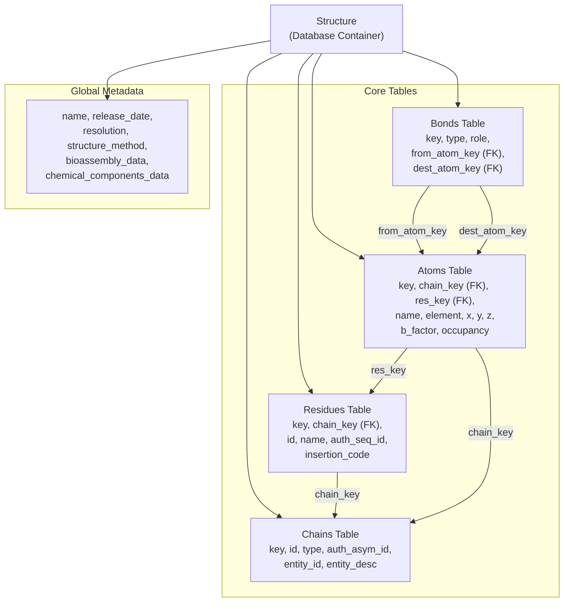
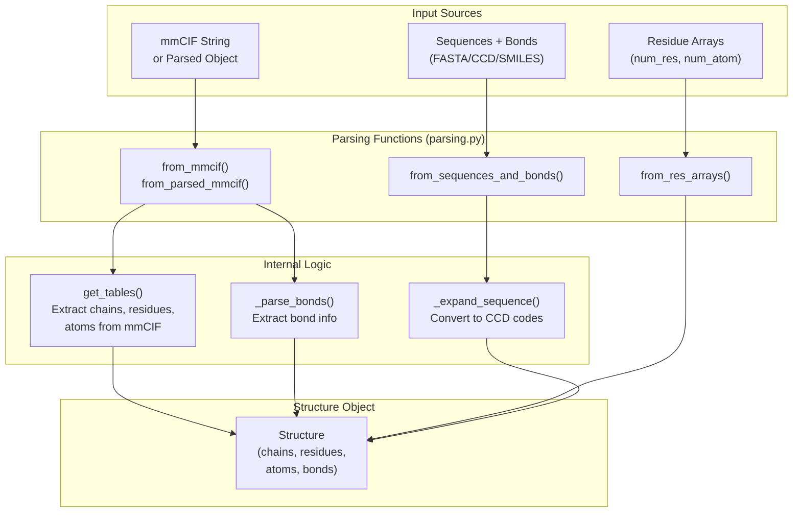
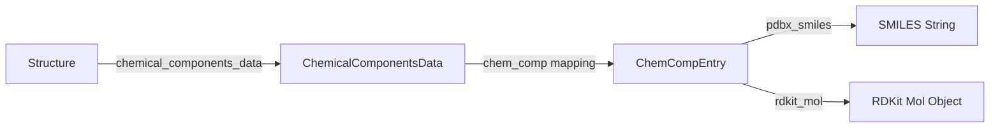

# Structure Representation

<details>
<summary>Relevant source files</summary>

The following files were used as context for generating this wiki page:

- [src/alphafold3/structure/__init__.py](src/alphafold3/structure/__init__.py)
- [src/alphafold3/structure/bioassemblies.py](src/alphafold3/structure/bioassemblies.py)
- [src/alphafold3/structure/bonds.py](src/alphafold3/structure/bonds.py)
- [src/alphafold3/structure/cpp/string_array.pyi](src/alphafold3/structure/cpp/string_array.pyi)
- [src/alphafold3/structure/parsing.py](src/alphafold3/structure/parsing.py)
- [src/alphafold3/structure/structure.py](src/alphafold3/structure/structure.py)
- [src/alphafold3/structure/structure_tables.py](src/alphafold3/structure/structure_tables.py)
- [src/alphafold3/structure/table.py](src/alphafold3/structure/table.py)

</details>


This page documents the `Structure` class and its table-based architecture for representing molecular structures in AlphaFold 3. The `Structure` class is the primary container for storing atomic coordinates, chain information, residues, and bonds in a normalized, database-like format that enables efficient filtering, iteration, and manipulation of structural data.

## Purpose and Scope

The structure representation subsystem provides the foundational data structures and manipulation utilities required to ingest, store, query, transform, and export molecular structures (proteins, nucleic acids, ligands, and covalent complexes) throughout the AlphaFold 3 data pipeline and post-processing stages.

Sources: [src/alphafold3/structure/structure.py:20-20]()

## Core Architecture

The `Structure` class implements a table-based design inspired by relational databases, where molecular data is organized into four interconnected tables: chains, residues, atoms, and bonds. This architecture provides several advantages:

- **Normalized storage**: Avoids data duplication by storing chain and residue metadata once.
- **Efficient filtering**: Operations can cascade through foreign key relationships.
- **Type safety**: Each table is a strongly-typed dataclass with validated columns.
- **Flexible indexing**: Supports both flat (atom-level) and hierarchical (chain/residue) access patterns.

**Table-Based Structure Architecture**



Sources: [src/alphafold3/structure/structure_tables.py:88-108](), [src/alphafold3/structure/bonds.py:32-52](), [src/alphafold3/structure/table.py:58-72]()

### Foreign Key Relationships

The `Structure` class enforces referential integrity through foreign keys. These relationships are validated during construction to ensure all referenced keys exist in their target tables.

```python
foreign_keys: ClassVar[Mapping[str, Collection[tuple[str, str]]]] = {
    'residues': (('chain_key', 'chains'),),
    'atoms': (('chain_key', 'chains'), ('res_key', 'residues')),
    'bonds': (('from_atom_key', 'atoms'), ('dest_atom_key', 'atoms')),
}
```

Sources: [src/alphafold3/structure/table.py:58-90]()

## Data Tables

The tables are implemented as subclasses of the `Table` base class [src/alphafold3/structure/table.py:58-72](), which provides core functionality for indexing by key [src/alphafold3/structure/table.py:100-112](), slicing by boolean mask or index [src/alphafold3/structure/table.py:136-154](), and accessing columns as numpy arrays [src/alphafold3/structure/table.py:131-135]().

### Chains Table

The `Chains` table stores metadata for each molecular chain.

| Column | Type | Description |
|--------|------|-------------|
| `key` | int64 | Unique chain identifier (internal) |
| `id` | object | Label chain ID (mmCIF `label_asym_id`) |
| `type` | object | Chain type (e.g., `"polypeptide(L)"`) |
| `auth_asym_id` | object | Author chain ID (mmCIF `auth_asym_id`) |
| `entity_id` | object | Entity identifier |
| `entity_desc` | object | Entity description |

Sources: [src/alphafold3/structure/structure_tables.py:218-228](), [src/alphafold3/structure/structure.py:98-105]()

### Residues Table

The `Residues` table stores metadata for each residue (resolved or unresolved).

| Column | Type | Description |
|--------|------|-------------|
| `key` | int64 | Unique residue identifier (internal) |
| `chain_key` | int64 | Foreign key to chains table |
| `id` | int32 | Label residue ID (mmCIF `label_seq_id`) |
| `name` | object | Residue name (CCD code, e.g., `"ALA"`) |
| `auth_seq_id` | object | Author residue ID (mmCIF `auth_seq_id`) |
| `insertion_code` | object | PDB insertion code |

Sources: [src/alphafold3/structure/structure_tables.py:203-210](), [src/alphafold3/structure/structure.py:108-114]()

### Atoms Table

The `Atoms` table stores atomic coordinates and properties. It supports multi-model data through leading dimensions in coordinate columns [src/alphafold3/structure/structure_tables.py:101-107]().

| Column | Type | Description |
|--------|------|-------------|
| `key` | int64 | Unique atom identifier (internal) |
| `chain_key` | int64 | Foreign key to chains table |
| `res_key` | int64 | Foreign key to residues table |
| `name` | object | Atom name (e.g., `"CA"`) |
| `element` | object | Element symbol |
| `x`, `y`, `z` | float32 | Cartesian coordinates |
| `b_factor` | float32 | Temperature factor |
| `occupancy` | float32 | Occupancy value |

Sources: [src/alphafold3/structure/structure_tables.py:88-107](), [src/alphafold3/structure/structure.py:115-125]()

### Bonds Table

The `Bonds` table stores connectivity information, typically parsed from `_struct_conn` categories [src/alphafold3/structure/bonds.py:32-52]().

| Column | Type | Description |
|--------|------|-------------|
| `key` | int64 | Unique bond identifier (internal) |
| `type` | object | Bond type (e.g., `"covale"`, `"disulf"`) |
| `role` | object | Bond role (e.g., `"N-Glycosylation"`) |
| `from_atom_key` | int64 | Foreign key to atoms table |
| `dest_atom_key` | int64 | Foreign key to atoms table |

Sources: [src/alphafold3/structure/bonds.py:32-52]()

## Bioassemblies and Transformations

The `bioassemblies` module defines structures for handling biological assemblies via coordinate transformations [src/alphafold3/structure/bioassemblies.py:31-64]().

- `Operation`: Represents a rigid transformation consisting of a translation vector `trans` of shape `(3,)` and a rotation matrix `rot` of shape `(3, 3)` [src/alphafold3/structure/bioassemblies.py:31-37]().
- `Transform`: Composes a sequence of `Operation`s applied in right-to-left order to specific chain IDs, along with chain ID remapping maps [src/alphafold3/structure/bioassemblies.py:43-58]().
- `BioassemblyData`: Parses and manages `_pdbx_struct_assembly`, `_pdbx_struct_assembly_gen`, and `_pdbx_struct_oper_list` mmCIF records [src/alphafold3/structure/bioassemblies.py:84-175]().

Sources: [src/alphafold3/structure/bioassemblies.py:31-175]()

## Construction Methods

**Structure Construction Pathways**



Sources: [src/alphafold3/structure/parsing.py:307-396](), [src/alphafold3/structure/parsing.py:456-588]()

### mmCIF Parsing

The `from_mmcif()` and `from_parsed_mmcif()` functions handle the conversion of mmCIF data. Alternate locations (alt-locs) and entity filters are resolved using C++ utilities [src/alphafold3/structure/parsing.py:307-396](). Bonds are parsed from `_struct_conn` records.

Sources: [src/alphafold3/structure/parsing.py:307-396]()

### from_res_arrays()

This method constructs a `Structure` from residue-centric arrays, typically used when converting model predictions back into the internal `Structure` representation [src/alphafold3/structure/parsing.py:456-588]().

Sources: [src/alphafold3/structure/parsing.py:456-588]()

### from_sequences_and_bonds()

Creates a structure from sequence strings and explicit bond definitions, utilizing the Chemical Components Dictionary (CCD) to look up standard atom names and elements [src/alphafold3/structure/parsing.py:628-827]() (referenced via [src/alphafold3/structure/__init__.py:35]()).

Sources: [src/alphafold3/structure/__init__.py:35-35]()

## Data Access and Filtering

### Iteration and Broadcasting

The `Structure` class provides properties that broadcast table data to the atom level using foreign key joins across chains and residues.

### Filtering Operations

The `filter()` method creates a new `Structure` by applying predicates to columns. Filtering supports cascade deletion via the `CascadeDelete` enum [src/alphafold3/structure/structure.py:50-55]() to remove orphaned residues or chains when atoms are filtered out.

Sources: [src/alphafold3/structure/structure.py:50-55]()

## Coordinate Representations

### Flat Atom Arrays

Coordinates are stored as `(num_atoms, 3)` arrays. For multi-model structures, the leading dimensions correspond to model indices [src/alphafold3/structure/structure_tables.py:101-107]().

Sources: [src/alphafold3/structure/structure_tables.py:101-107]()

### Residue Arrays

Structures can be converted into fixed-width residue representations via methods like `to_res_arrays()`, producing aligned atom tensors and boolean atom masks for downstream featurization and model ingestion.

Sources: [src/alphafold3/structure/structure.py:1389-1493]()

## Chemical Components Integration

The `Structure` class maintains a `ChemicalComponentsData` object containing `ChemCompEntry` definitions, which supply metadata such as SMILES strings, synonyms, and RDKit molecule instances [src/alphafold3/structure/chemical_components.py:25-79]().

**Chemical Data Mapping**



Sources: [src/alphafold3/structure/chemical_components.py:25-79]()

---