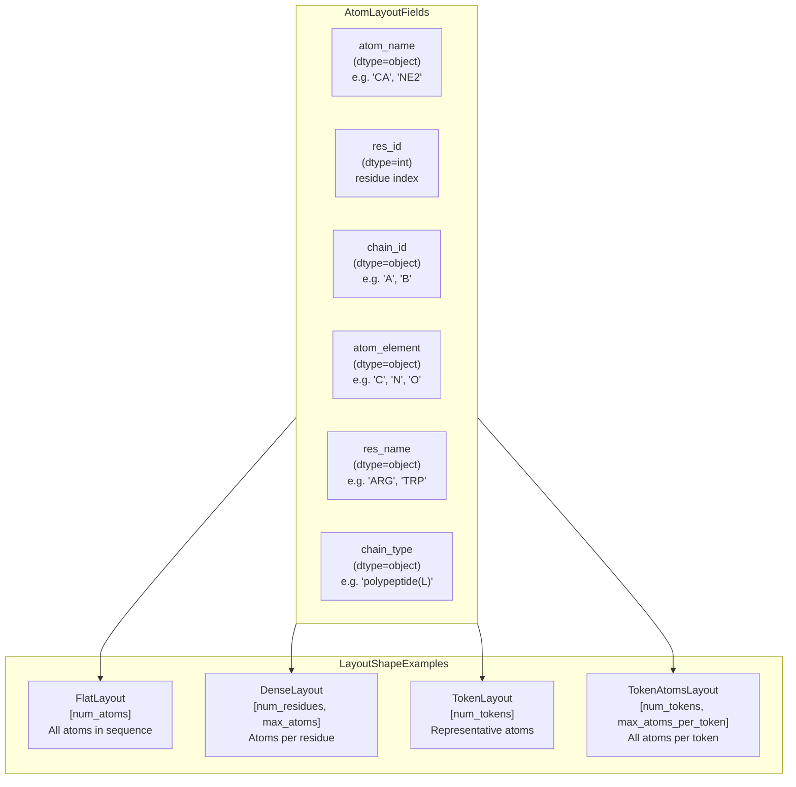
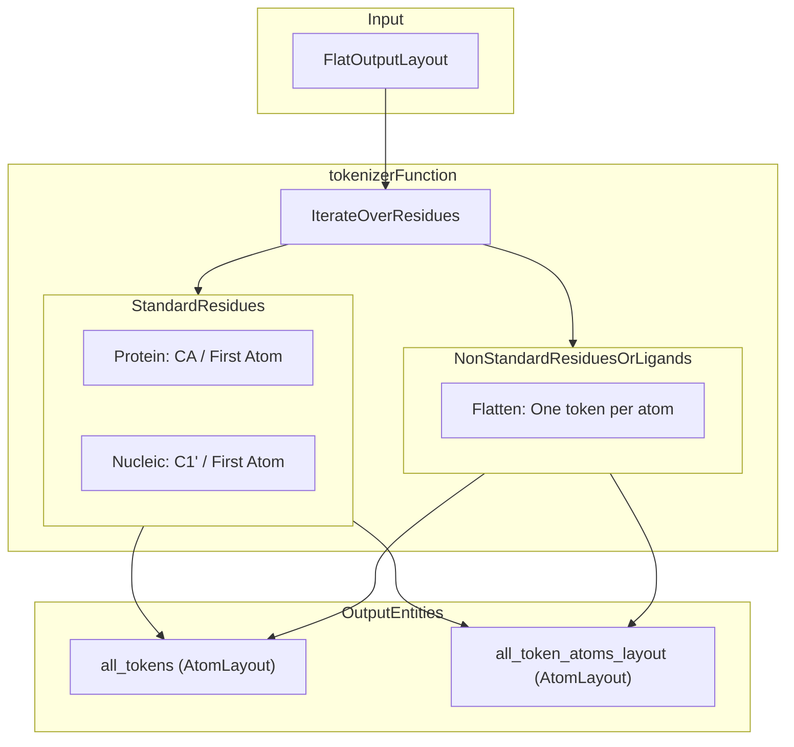

# Feature Tensors

Relevant source files

The following files were used as context for generating this wiki page:

- [src/alphafold3/data/featurisation.py](src/alphafold3/data/featurisation.py)
- [src/alphafold3/model/atom_layout/atom_layout.py](src/alphafold3/model/atom_layout/atom_layout.py)
- [src/alphafold3/model/data3.py](src/alphafold3/model/data3.py)
- [src/alphafold3/model/features.py](src/alphafold3/model/features.py)
- [src/alphafold3/model/pipeline/pipeline.py](src/alphafold3/model/pipeline/pipeline.py)
- [src/alphafold3/model/pipeline/structure_cleaning.py](src/alphafold3/model/pipeline/structure_cleaning.py)
- [src/alphafold3/model/protein_data_processing.py](src/alphafold3/model/protein_data_processing.py)

This page documents the feature tensor system in AlphaFold 3, which transforms biological data (sequences, MSAs, templates, structures) into numerical tensors suitable for model inference. This includes the `AtomLayout` system for representing atomic structures in various coordinate systems, feature dataclasses that encapsulate different types of biological information, the `feat_batch` structuring mechanism, and the end-to-end featurization data flow.

For information about the input data structures that feed into this system, see [Input Data Model](5.1). For the `Structure` representation used to manipulate molecular data, see [Structure Representation](5.2).

## Overview

The feature tensor system bridges the gap between biological data and neural network inputs through several key abstractions:

- **AtomLayout**: A flexible coordinate system for representing atoms in fixed-shape arrays (1D flat, 2D dense, etc.) [src/alphafold3/model/atom_layout/atom_layout.py:44-83]().
- **Feature Dataclasses**: Strongly-typed containers for MSA, template, token, and bond features `[src/alphafold3/model/features.py]()`.
- **Tokenization**: Conversion from residue-based representation to token-based representation (one token per polymer residue, one token per ligand atom) via `tokenizer()` [src/alphafold3/model/features.py:173-203]().
- **Padding and Bucketing**: Features are padded to fixed shapes determined by `PaddingShapes` and bucket sizes calculated by `calculate_bucket_size()` [src/alphafold3/model/features.py:60-67](), [src/alphafold3/model/pipeline/pipeline.py:43-71]().
- **BatchDict**: The final dictionary of NumPy/JAX arrays passed to the model `[src/alphafold3/model/features.py:51-53]()`.

Sources: [src/alphafold3/model/features.py:20-53](), [src/alphafold3/model/atom_layout/atom_layout.py:44-83]()

## AtomLayout System

The `AtomLayout` system provides a unified way to represent atoms in various coordinate systems while maintaining metadata about atomic identity.

### AtomLayout Class

`AtomLayout` is an immutable dataclass that represents atoms in a fixed shape (typically 1D or 2D). All fields are NumPy arrays with identical shapes [src/alphafold3/model/atom_layout/atom_layout.py:44-83]().

**Key Properties:**
- **Essential fields**: `atom_name`, `res_id`, `chain_id` (always present) [src/alphafold3/model/atom_layout/atom_layout.py:77-79]().
- **Optional fields**: `atom_element`, `res_name`, `chain_type` (can be None) [src/alphafold3/model/atom_layout/atom_layout.py:80-82]().
- **Padding**: Empty strings (`''`) in `atom_name` indicate padding/missing atoms [src/alphafold3/model/atom_layout/atom_layout.py:57-58]().
- **Indexing**: Supports NumPy-style indexing to extract sub-layouts [src/alphafold3/model/atom_layout/atom_layout.py:107-119]().
- **Equality**: Compares only non-padding elements [src/alphafold3/model/atom_layout/atom_layout.py:121-144]().

Sources: [src/alphafold3/model/atom_layout/atom_layout.py:44-144]()

## Tokenization

Tokenization converts a flat atom layout into tokens suitable for the model via `tokenizer()` [src/alphafold3/model/features.py:173-203]().

**Token Atoms Layout Construction:**
- For **standard residues**: Atoms are ordered according to the Chemical Components Dictionary (CCD) [src/alphafold3/model/features.py:173-203]().
- For **ligands**: Each atom becomes its own token (one atom per token) [src/alphafold3/model/features.py:173-203]().

Sources: [src/alphafold3/model/features.py:173-203]()

## Feature Dataclasses and Metadata

Features are organized into structures such as `Chains`, `PaddingShapes`, and feature dictionaries.

### Chains and Entity Computation
Chain identities, asymmetric unit IDs, and symmetry IDs are computed using `_compute_asym_entity_and_sym_id()` which returns a `Chains` dataclass [src/alphafold3/model/features.py:114-170]().

| Field | Type | Description |
|-------|------|-------------|
| `chain_id` | `np.ndarray` | Original chain identifiers |
| `asym_id` | `np.ndarray` | Asymmetric unit identifier index |
| `entity_id` | `np.ndarray` | Entity identifier (groups identical sequences) |
| `sym_id` | `np.ndarray` | Symmetry identifier within an entity |

Sources: [src/alphafold3/model/features.py:114-170]()

### Padding Shapes
`PaddingShapes` defines the target sizes for batch padding across various dimensions [src/alphafold3/model/features.py:60-67]().

| Field | Type | Description |
|-------|------|-------------|
| `num_tokens` | `int` | Total number of tokens in the padded sequence |
| `msa_size` | `int` | Number of sequences in the MSA dimension |
| `num_chains` | `int` | Maximum number of chains |
| `num_templates` | `int` | Number of template structures |
| `num_atoms` | `int` | Total number of atoms |

Sources: [src/alphafold3/model/features.py:60-67]()

## Featurization Data Flow

The featurization pipeline coordinates input validation, structure cleaning, pipeline execution, and batch generation.

```mermaid
graph LR
    Input["folding_input.Input"] --> Validate["featurise_input()<br/>validate_fold_input()"]
    Validate --> Pipeline["WholePdbPipeline.process_item()"]
    Pipeline --> Clean["clean_structure()"]
    Clean --> Tokenize["tokenizer()"]
    Tokenize --> Profile["get_profile_features()<br/>data3.py"]
    Profile --> Templates["fix_template_features()<br/>data3.py"]
    Templates --> Bucket["calculate_bucket_size()<br/>pipeline.py"]
    Bucket --> Batch["features.BatchDict"]
```

**Key Execution Steps:**
1. **Validation**: `validate_fold_input()` ensures all required MSAs and templates are present on input chains [src/alphafold3/data/featurisation.py:33-46]().
2. **Pipeline Initialization**: `featurise_input()` instantiates `WholePdbPipeline` and iterates over random seeds [src/alphafold3/data/featurisation.py:47-121]().
3. **Structure Cleaning**: `clean_structure()` handles removal of missing sequences, non-standard atoms, water, hydrogens, and leaving atoms [src/alphafold3/model/pipeline/structure_cleaning.py:75-111]().
4. **Profile and Template Processing**: `data3.get_profile_features()` computes MSA profiles and deletion means [src/alphafold3/model/data3.py:35-47](), while `data3.fix_template_features()` aligns template atom representations to the dense atom layout [src/alphafold3/model/data3.py:50-98]().
5. **Bucketing**: `calculate_bucket_size()` maps token counts to predefined bucket sizes to prevent unnecessary XLA recompilations [src/alphafold3/model/pipeline/pipeline.py:43-71]().

Sources: [src/alphafold3/data/featurisation.py:33-121](), [src/alphafold3/model/pipeline/pipeline.py:43-71](), [src/alphafold3/model/pipeline/structure_cleaning.py:75-111](), [src/alphafold3/model/data3.py:35-98]()

---