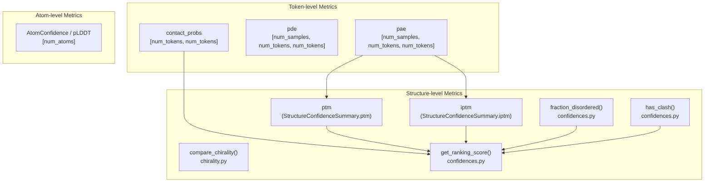
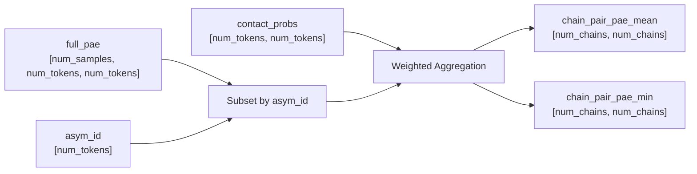

# Confidence Metrics

<details>
<summary>Relevant source files</summary>

The following files were used as context for generating this wiki page:

- [docs/output.md](docs/output.md)
- [src/alphafold3/data/tools/rdkit_utils.py](src/alphafold3/data/tools/rdkit_utils.py)
- [src/alphafold3/model/confidence_types.py](src/alphafold3/model/confidence_types.py)
- [src/alphafold3/model/confidences.py](src/alphafold3/model/confidences.py)
- [src/alphafold3/model/json_serialize_pybind.cc](src/alphafold3/model/json_serialize_pybind.cc)
- [src/alphafold3/model/json_serialize_pybind.h](src/alphafold3/model/json_serialize_pybind.h)
- [src/alphafold3/model/scoring/chirality.py](src/alphafold3/model/scoring/chirality.py)
- [src/alphafold3/structure/mmcif.py](src/alphafold3/structure/mmcif.py)

</details>


This page documents the confidence metrics used in AlphaFold 3 to evaluate prediction quality and rank candidate structures. These metrics include pTM, ipTM, PAE, PDE, disorder detection, clash detection, chirality checks, and composite ranking scores.

## Overview

AlphaFold 3 computes confidence metrics at multiple structural levels to assess prediction quality and select the best candidate models. The primary metrics and their associated code components include:

- **pTM (predicted TM-score)**: Evaluates overall structural folding quality [docs/output.md:107-113]().
- **ipTM (interface pTM)**: Evaluates inter-chain interface accuracy [docs/output.md:107-113]().
- **PAE (Predicted Aligned Error)**: Estimates positional error relative to token frames [docs/output.md:99-106]().
- **PDE (Predicted Distance Error)**: Estimates expected distance errors between tokens [src/alphafold3/model/confidences.py:200-212]().
- **pLDDT (per-atom)**: Local per-atom confidence scores stored in B-factor columns [docs/output.md:90-98]().
- **Disorder metrics**: Fraction of disordered residues via AlphaFold-RSA [src/alphafold3/model/confidences.py:62-137]().
- **Clash detection**: Identification of steric overlaps across chains [src/alphafold3/model/confidences.py:140-192]().
- **Chirality checks**: Verification of ligand stereochemistry against reference molecules or the Chemical Component Dictionary (CCD) [src/alphafold3/model/scoring/chirality.py:149-198]().
- **Ranking score**: Composite metric combining structural quality, disorder, and clash penalties [src/alphafold3/model/confidences.py:194-212]().

### Confidence Metrics Hierarchy and Code Mapping



Sources: [src/alphafold3/model/confidences.py:1-212](), [src/alphafold3/model/confidence_types.py:160-206](), [src/alphafold3/model/scoring/chirality.py:149-198]()

---

## Predicted TM-score (pTM and ipTM)

The predicted TM-score estimates alignment quality using the Template Modeling score metric [docs/output.md:107-113]().

- **pTM**: Considers all residue pairs within the structure to measure global fold accuracy. A pTM score above 0.5 indicates that the overall predicted fold may resemble the true structure [docs/output.md:112-114]().
- **ipTM**: Restricts calculations to inter-chain pairs (`asym_id` differs) to evaluate subunit arrangement. Values above 0.8 indicate high confidence, values below 0.6 suggest failure, and values between 0.6 and 0.8 form a gray zone [docs/output.md:114-118]().
- **Handling Single-Chain Models**: For single-chain structures, `iptm` is `NaN` because no interfaces exist. The scoring logic falls back entirely to `ptm` [src/alphafold3/model/confidences.py:197-200]().

Sources: [docs/output.md:107-122](), [src/alphafold3/model/confidences.py:194-200]()

---

## Predicted Aligned Error (PAE) and Predicted Distance Error (PDE)

- **PAE**: Estimates positional error (in Ångströms) between token pairs [docs/output.md:99-106](). For proteins and nucleic acids, PAE measures error relative to backbone frames; for small molecules and post-translational modifications, frames are constructed from closest reference conformer neighbors [docs/output.md:102-107]().
- **PDE**: Represents the expected error in the distance between token pairs. It is evaluated via contact-weighted averages in ranking functions [src/alphafold3/model/confidences.py:200-212]().

### Chain-Pair PAE Computation Flow



Sources: [src/alphafold3/model/confidence_types.py:160-206](), [src/alphafold3/model/confidences.py:200-212]()

---

## Disorder Detection

AlphaFold 3 detects disordered regions using **AlphaFold-RSA** (Relative Solvent Accessibility) [src/alphafold3/model/confidences.py:62-137]().

1. **DSSP Calculation**: `windowed_solvent_accessible_area()` invokes `mkdssp.get_dssp()` on the CIF string with surface accessibility calculation enabled [src/alphafold3/model/confidences.py:75]().
2. **Normalization**: Accessible surface area values are normalized against `MAX_ACCESSIBLE_SURFACE_AREA` dictionary values for each amino acid type [src/alphafold3/model/confidences.py:33-54,84-86]().
3. **Window Smoothing**: A sliding window average (default `window=25`) is applied using `np.convolve()` [src/alphafold3/model/confidences.py:93-96]().
4. **Fraction Disordered**: `fraction_disordered()` computes the proportion of protein residues with normalized RSA exceeding `rasa_disorder_cutoff` (default `0.581`) [src/alphafold3/model/confidences.py:100-137]().

Sources: [src/alphafold3/model/confidences.py:33-137]()

---

## Clash Detection

The `has_clash()` function identifies significant steric clashes between polymer chains [src/alphafold3/model/confidences.py:140-192]().

1. **Filtering**: Structures are filtered to polymer entity types (`protein`, `rna`, `dna`) [src/alphafold3/model/confidences.py:163]().
2. **Spatial KD-Tree Query**: `spatial.cKDTree` queries atom coordinates within a `cutoff_radius` (default `1.1` Å) [src/alphafold3/model/confidences.py:166-170]().
3. **Exclusion Rules**: Clashes between identical or sequentially adjacent residues (`abs(res_id[i] - res_id[j]) <= 1`) within the same chain are ignored [src/alphafold3/model/confidences.py:174-176]().
4. **Chain Thresholds**: A chain is marked as clashing if it contains more than `100` clashing atoms (`min_clashes_for_overlap`) or if more than `50%` of its atoms participate in clashes (`min_fraction_for_overlap`) [src/alphafold3/model/confidences.py:143-144,179-190]().

Sources: [src/alphafold3/model/confidences.py:140-192]()

---

## Chirality Checks

AlphaFold 3 validates ligand stereochemistry using `compare_chirality()` [src/alphafold3/model/scoring/chirality.py:149-198]() and `_chiral_match()` [src/alphafold3/model/scoring/chirality.py:58-77]().

- **Reference Acquisition**: For single-residue ligands, reference RDKit molecules (`rd_chem.Mol`) are retrieved either from user-supplied `ref_mol_by_chain` mappings or generated from the Chemical Component Dictionary via `_maybe_mol_from_ccd()` [src/alphafold3/model/scoring/chirality.py:127-146,180-183]().
- **Chiral Centre Detection**: RDKit's `rd_chem.FindMolChiralCenters()` identifies chiral centers restricted to elements in `_CHIRAL_ELEMENTS` (`{'C', 'S'}`) [src/alphafold3/model/scoring/chirality.py:30,44-55]().
- **Comparison**: `_chiral_match()` verifies that test ligand chiral centers and stereochemistry match or form a valid subset of the reference molecule [src/alphafold3/model/scoring/chirality.py:58-77]().

Sources: [src/alphafold3/model/scoring/chirality.py:20-198]()

---

## Ranking Score

The composite score used to rank multiple model predictions is calculated by `get_ranking_score()` [src/alphafold3/model/confidences.py:194-212]().

### Ranking Formula & Weights

| Component | Weight / Penalty | Constant / Code Reference |
| :--- | :--- | :--- |
| `iptm` (or `ptm` if single chain) | `0.8` | `_IPTM_WEIGHT = 0.8` [src/alphafold3/model/confidences.py:57]() |
| `ptm` | `0.2` | `1.0 - _IPTM_WEIGHT` |
| `fraction_disordered` | `0.5` | `_FRACTION_DISORDERED_WEIGHT = 0.5` [src/alphafold3/model/confidences.py:58]() |
| `has_clash` | `-100.0` | `_CLASH_PENALIZATION_WEIGHT = 100.0` [src/alphafold3/model/confidences.py:59]() |

```python
# Ranking Score Calculation Logic in confidences.py
score = ptm_iptm_average + (_FRACTION_DISORDERED_WEIGHT * fraction_disordered) - (_CLASH_PENALIZATION_WEIGHT * has_clash_)
```

Sources: [src/alphafold3/model/confidences.py:56-60,194-212]()

---

## Data Structures and Serialization

### StructureConfidenceSummary

Encapsulates global and chain-level summary scores (`ptm`, `iptm`, `ranking_score`, `fraction_disordered`, `has_clash`, `chain_pair_pae_min`, `chain_pair_iptm`, `chain_ptm`, `chain_iptm`) [src/alphafold3/model/confidence_types.py:160-188]().

### AtomConfidence and ConfidenceCategory

Per-atom pLDDT confidence scores are categorized into four discrete levels via `ConfidenceCategory` [src/alphafold3/model/confidence_types.py:46-93]():

- **HIGH**: `90 <= confidence <= 100` (`'H'`) [src/alphafold3/model/confidence_types.py:84-85]()
- **MEDIUM**: `70 <= confidence < 90` (`'M'`) [src/alphafold3/model/confidence_types.py:86-87]()
- **LOW**: `50 <= confidence < 70` (`'L'`) [src/alphafold3/model/confidence_types.py:88-89]()
- **DISORDERED**: `0 <= confidence < 50` (`'D'`) [src/alphafold3/model/confidence_types.py:90-91]()

### JSON Serialization

Serialization routines in `confidence_types.py` and `json_serialize_pybind.cc` convert NumPy arrays and dataclasses into JSON outputs (`_dump_json`, `StructureConfidenceFullToJson`), ensuring `NaN` values correctly map to `null` for JSON compatibility [src/alphafold3/model/confidence_types.py:35-44](), [src/alphafold3/model/json_serialize_pybind.cc:56-68]().

Sources: [src/alphafold3/model/confidence_types.py:20-158](), [src/alphafold3/model/json_serialize_pybind.cc:56-140]()

---