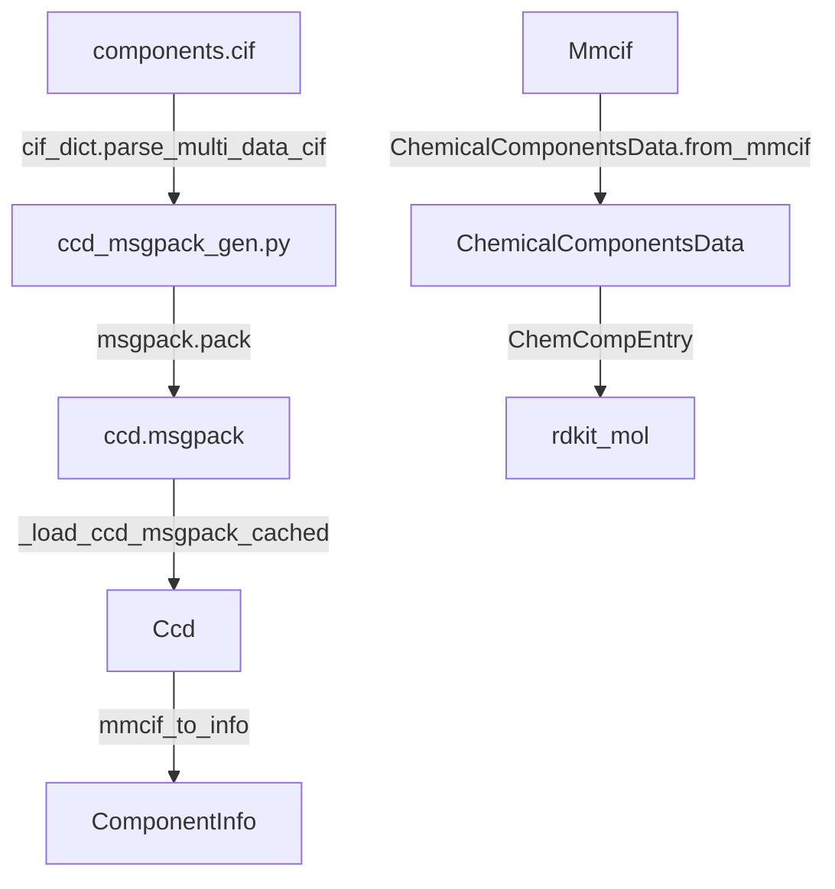
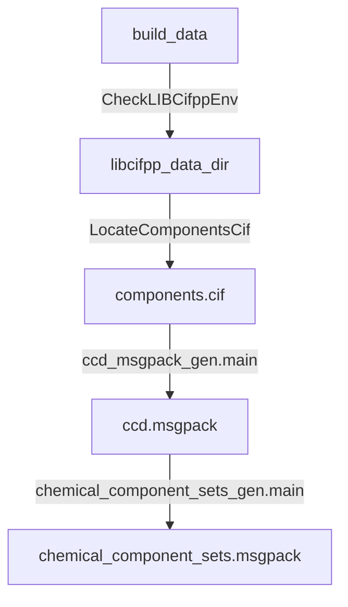

# Chemical Components and Constants

Relevant source files

The following files were used as context for generating this wiki page:

- [src/alphafold3/build_data.py](src/alphafold3/build_data.py)
- [src/alphafold3/constants/chemical_component_sets.py](src/alphafold3/constants/chemical_component_sets.py)
- [src/alphafold3/constants/chemical_components.py](src/alphafold3/constants/chemical_components.py)
- [src/alphafold3/constants/converters/ccd_msgpack_gen.py](src/alphafold3/constants/converters/ccd_msgpack_gen.py)
- [src/alphafold3/constants/converters/chemical_component_sets_gen.py](src/alphafold3/constants/converters/chemical_component_sets_gen.py)
- [src/alphafold3/constants/periodic_table.py](src/alphafold3/constants/periodic_table.py)
- [src/alphafold3/constants/side_chains.py](src/alphafold3/constants/side_chains.py)
- [src/alphafold3/model/mkdssp_pybind.cc](src/alphafold3/model/mkdssp_pybind.cc)
- [src/alphafold3/structure/chemical_components.py](src/alphafold3/structure/chemical_components.py)

## Purpose and Scope
This page documents the chemical component dictionary (CCD) handling, periodic table definitions, side chain configurations, and the database generation pipeline (`build_data`) within AlphaFold 3. These constants and data structures provide the chemical grounding required to map PDB components, compute stereochemical features, handle covalent bonds, and featurize ligands, ions, and side chains during structural modeling.

Sources:
- `src/alphafold3/constants/chemical_components.py` [1-213]()
- `src/alphafold3/build_data.py` [1-59]()

---

## CCD Handling and MessagePack Generation
The Chemical Component Dictionary (CCD) sourced from the wwPDB is packed into a compressed MessagePack format for fast runtime loading. 

### Key Classes and Functions
- `Ccd`: Defined in `src/alphafold3/constants/chemical_components.py:45-117` [()](src/alphafold3/constants/chemical_components.py:45-117), this class wraps the deserialized CCD dictionary, providing immutable access, caching via `_load_ccd_msgpack_cached` [src/alphafold3/constants/chemical_components.py:36-43](), and support for user-provided custom CCD overrides.
- `ComponentInfo`: A dataclass [src/alphafold3/constants/chemical_components.py:119-130]() holding summary fields such as `name`, `type`, `formula`, `formula_weight`, and `pdbx_smiles`.
- `mmcif_to_info`: Converts raw CCD mmCIF dictionaries into `ComponentInfo` instances [src/alphafold3/constants/chemical_components.py:131-182]().
- `ChemicalComponentsData`: Located in `src/alphafold3/structure/chemical_components.py:142-191` [()](src/alphafold3/structure/chemical_components.py:142-191), this class aggregates `ChemCompEntry`, `ChemCompAtom`, and `ChemCompBond` items extracted from structure mmCIF files, handling non-standard residues like selenomethionine (`MSE`) and unknown DNA fixes.

*Diagram 1: Data flow for CCD parsing, MessagePack serialization, and runtime consumption.*

Sources:
- `src/alphafold3/constants/chemical_components.py` [31-186]()
- `src/alphafold3/constants/converters/ccd_msgpack_gen.py` [31-62]()
- `src/alphafold3/structure/chemical_components.py` [47-191]()

---

## Chemical Component Sets
To categorize specific ligands during processing, AlphaFold 3 defines filtered sets of chemical components derived from the CCD.

- `chemical_component_sets_gen.py`: Scans the CCD MessagePack file to extract glycans and ions based on `_chem_comp.type` and `_chem_comp.name` fields [src/alphafold3/constants/converters/chemical_component_sets_gen.py:36-63]().
- `chemical_component_sets.py`: Exposes frozen sets used across the pipeline [src/alphafold3/constants/chemical_component_sets.py:34-50]():
  - `GLYCAN_LINKING_LIGANDS`: Saccharide components containing linking properties [src/alphafold3/constants/chemical_component_sets.py:36-38]().
  - `GLYCAN_OTHER_LIGANDS`: Non-linking saccharide components [src/alphafold3/constants/chemical_component_sets.py:41-43]().
  - `COMMON_CRYSTALLIZATION_AIDS`: Non-biological molecules frequently found in crystallization conditions (e.g., `SO4`, `GOL`, `EDO`, `PEG`) [src/alphafold3/constants/chemical_component_sets.py:47-50]().

Sources:
- `src/alphafold3/constants/converters/chemical_component_sets_gen.py` [36-86]()
- `src/alphafold3/constants/chemical_component_sets.py` [27-50]()

---

## Periodic Table
The periodic table implementation in `src/alphafold3/constants/periodic_table.py` defines atomic properties required for mass calculations, stereochemistry, and element identification.

- `Element`: A frozen dataclass representing chemical elements with `name`, atomic `number`, element `symbol`, and atomic `weight` [src/alphafold3/constants/periodic_table.py:29-35]().
- Weights are aligned with RDKit's atomic data definitions for cross-compatibility [src/alphafold3/constants/periodic_table.py:37]().
- Includes standard elements (`H`, `C`, `N`, `O`, `P`, `S`, etc.) as well as an unknown element descriptor `X` for unspecified CCD atoms (`UNX`) [src/alphafold3/constants/periodic_table.py:40-42]().

Sources:
- `src/alphafold3/constants/periodic_table.py` [29-196]()

---

## Side Chains and Chi Angles
Constants governing amino acid side-chain torsion angles ($\chi$ angles) are defined in `src/alphafold3/constants/side_chains.py`.

- `CHI_ANGLES_ATOMS`: Maps standard 3-letter amino acid residue names to sequences of 4-atom tuples defining $\chi_1$ through $\chi_4$ torsion angles [src/alphafold3/constants/side_chains.py:28-72]().
- `CHI_GROUPS_FOR_ATOM`: Inverse mapping from `(residue_name, atom_name)` pairs to their corresponding chi group index and intra-group atom index [src/alphafold3/constants/side_chains.py:74-86]().
- `CHI_ANGLES_MASK`: A binary mask matrix applied to fixed-length torsion arrays for each amino acid residue type [src/alphafold3/constants/side_chains.py:99-120]().

Sources:
- `src/alphafold3/constants/side_chains.py` [28-120]()

---

## Database Generation (`build_data`)
The `build_data.py` script orchestrates the generation of intermediate MessagePack constants from the underlying `libcifpp` chemical components installation [src/alphafold3/build_data.py:32-58]().

*Diagram 2: Execution flow of `build_data()` establishing intermediate converters.*

### Execution Details
1. **Environment Resolution**: Checks the `LIBCIFPP_DATA_DIR` environment variable or scans Python `site-packages` for `share/libcifpp/components.cif` [src/alphafold3/build_data.py:34-48]().
2. **CCD Compilation**: Invokes `ccd_msgpack_gen.main()` to parse multi-data CIF records and serialize them into `ccd.msgpack` [src/alphafold3/build_data.py:55]() [src/alphafold3/constants/converters/ccd_msgpack_gen.py:31-59]().
3. **Component Sets Compilation**: Invokes `chemical_component_sets_gen.main()` to extract ions and glycans, serializing them into `chemical_component_sets.msgpack` [src/alphafold3/build_data.py:56-58]() [src/alphafold3/constants/converters/chemical_component_sets_gen.py:66-82]().

Sources:
- `src/alphafold3/build_data.py` [32-59]()
- `src/alphafold3/constants/converters/ccd_msgpack_gen.py` [31-59]()
- `src/alphafold3/constants/converters/chemical_component_sets_gen.py` [66-82]()

---