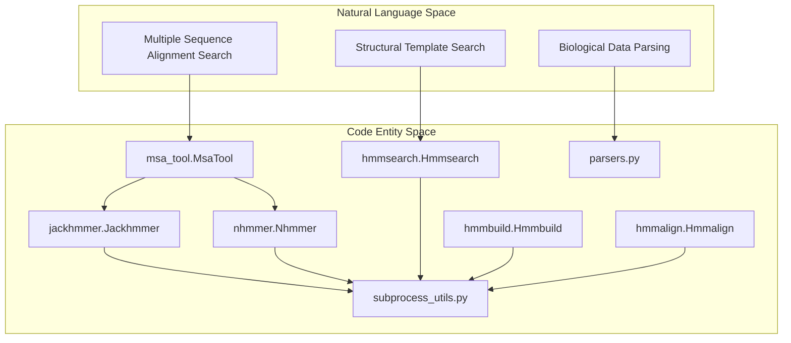
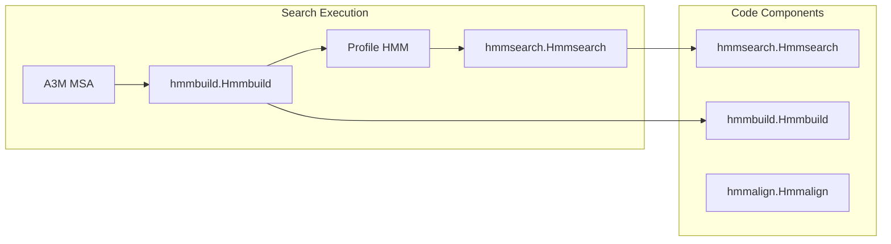

# Data Processing Tools

Relevant source files

The following files were used as context for generating this wiki page:

- [src/alphafold3/data/parsers.py](src/alphafold3/data/parsers.py)
- [src/alphafold3/data/tools/hmmalign.py](src/alphafold3/data/tools/hmmalign.py)
- [src/alphafold3/data/tools/hmmbuild.py](src/alphafold3/data/tools/hmmbuild.py)
- [src/alphafold3/data/tools/hmmsearch.py](src/alphafold3/data/tools/hmmsearch.py)
- [src/alphafold3/data/tools/jackhmmer.py](src/alphafold3/data/tools/jackhmmer.py)
- [src/alphafold3/data/tools/msa_tool.py](src/alphafold3/data/tools/msa_tool.py)
- [src/alphafold3/data/tools/nhmmer.py](src/alphafold3/data/tools/nhmmer.py)

The AlphaFold 3 data processing tools are a collection of components responsible for preprocessing biological sequence data before it enters the model. These tools handle critical tasks including multiple sequence alignment (MSA) generation, template structure search, format parsing, and external tool execution to prepare input features for the neural network.

As a parent page, this section provides a high-level overview of the data processing tools architecture. For deep technical details, refer to the child pages:
- **[MSA Tools](#6.1)** — Detail Jackhmmer and Nhmmer wrappers, including sharded database support, parallel execution, and result merging.
- **[Template Search](#6.2)** — Explain template search via HMMsearch, hmmbuild/hmmalign, hit filtering, and template feature extraction.
- **[External Tools Integration](#6.3)** — Document subprocess_utils for external tool execution, HMMER patching, RDKit utilities, and tool configuration.

## Overview

AlphaFold 3 relies on a suite of external bioinformatic tools, primarily from the HMMER suite, wrapped in Python for seamless integration into the data pipeline.

Sources:
- [src/alphafold3/data/tools/msa_tool.py:44-48]()
- [src/alphafold3/data/tools/jackhmmer.py:37-126]()
- [src/alphafold3/data/tools/nhmmer.py:43-131]()
- [src/alphafold3/data/tools/hmmsearch.py:31-76]()
- [src/alphafold3/data/parsers.py:32-70]()

## MSA Tools

MSA tools search biological databases to find sequences related to the input. These related sequences provide evolutionary information crucial for accurate structure prediction. All MSA tools implement the `MsaTool` protocol [src/alphafold3/data/tools/msa_tool.py:44-48]().

Jackhmmer is used for protein sequence searches [src/alphafold3/data/tools/jackhmmer.py:37-38](), supporting iterative searches and custom memory management via a `--seq_limit` patch [src/alphafold3/data/tools/jackhmmer.py:139-144](). Nhmmer is specialized for nucleic acid (DNA/RNA) searches [src/alphafold3/data/tools/nhmmer.py:43-44]() and coordinates with `hmmbuild` and `hmmalign` [src/alphafold3/data/tools/nhmmer.py:33-34]().

For details on sharded database support, parallel execution, and result merging, see **[MSA Tools](#6.1)**.

Sources:
- [src/alphafold3/data/tools/msa_tool.py:44-48]()
- [src/alphafold3/data/tools/jackhmmer.py:37-144]()
- [src/alphafold3/data/tools/nhmmer.py:33-44]()

## Template Search

Template processing identifies structural homologs from the Protein Data Bank (PDB) to guide the model. This involves searching with `Hmmsearch` [src/alphafold3/data/tools/hmmsearch.py:31-32]() using profile HMMs constructed via `Hmmbuild` [src/alphafold3/data/tools/hmmbuild.py:31-32]().

Sources:
- [src/alphafold3/data/tools/hmmsearch.py:31-103]()
- [src/alphafold3/data/tools/hmmbuild.py:31-60]()
- [src/alphafold3/data/tools/hmmalign.py:37-54]()

For details on template search via HMMsearch, hmmbuild/hmmalign, hit filtering, and template feature extraction, see **[Template Search](#6.2)**.

Sources:
- [src/alphafold3/data/tools/hmmsearch.py:31-103]()
- [src/alphafold3/data/tools/hmmbuild.py:31-60]()

## Format Parsing Tools

AlphaFold 3 provides specialized parsers for common biological file formats in `parsers.py`, leveraging C++ extensions for performance [src/alphafold3/data/parsers.py:20-27]().

| Function | Source | Description |
| :--- | :--- | :--- |
| `parse_fasta` | [src/alphafold3/data/parsers.py:58-70]() | Standard FASTA parsing via C++ `fasta_iterator`. |
| `lazy_parse_fasta_string` | [src/alphafold3/data/parsers.py:32-55]() | Memory-efficient iterator for large MSA files. |
| `convert_a3m_to_stockholm` | [src/alphafold3/data/parsers.py:73-110]() | Converts A3M to Stockholm for HMMER tools. |
| `convert_stockholm_to_a3m` | [src/alphafold3/data/parsers.py:113-186]() | Parses HMMER output back to A3M format. |

Sources:
- [src/alphafold3/data/parsers.py:20-186]()

## External Tools Integration

The integration layer manages the execution of the HMMER binary suite, subprocess error handling, binary existence checks, and environment-specific configurations.

For details on `subprocess_utils` for external tool execution, HMMER patching, RDKit utilities, and tool configuration, see **[External Tools Integration](#6.3)**.

Sources:
- [src/alphafold3/data/tools/subprocess_utils.py:1-50]()

---