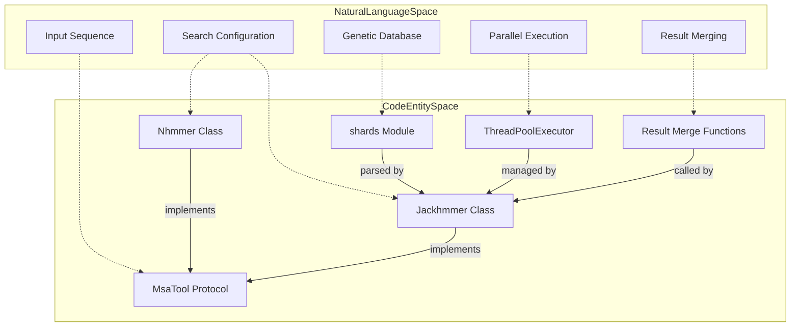
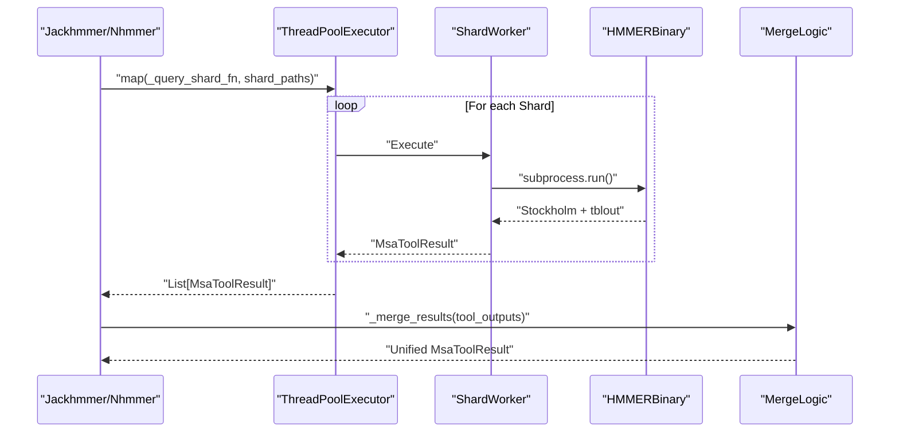

# MSA Tools

Relevant source files

The following files were used as context for generating this wiki page:

- [src/alphafold3/cpp.cc](src/alphafold3/cpp.cc)
- [src/alphafold3/data/cpp/msa_features_pybind.cc](src/alphafold3/data/cpp/msa_features_pybind.cc)
- [src/alphafold3/data/cpp/msa_features_pybind.h](src/alphafold3/data/cpp/msa_features_pybind.h)
- [src/alphafold3/data/msa.py](src/alphafold3/data/msa.py)
- [src/alphafold3/data/tools/jackhmmer.py](src/alphafold3/data/tools/jackhmmer.py)
- [src/alphafold3/data/tools/msa_tool.py](src/alphafold3/data/tools/msa_tool.py)
- [src/alphafold3/data/tools/nhmmer.py](src/alphafold3/data/tools/nhmmer.py)

## Purpose and Scope

This document describes the Multiple Sequence Alignment (MSA) generation tools used in AlphaFold 3's data pipeline. These tools wrap the HMMER suite binaries (`jackhmmer` and `nhmmer`) to search biological databases and produce MSAs that provide evolutionary information for structure prediction.

The implementation handles the complexity of sharded database support, parallel execution via thread pools, and the subsequent merging of results based on E-values to ensure consistency across distributed search environments.

Sources: [src/alphafold3/data/tools/jackhmmer.py:11-30](), [src/alphafold3/data/tools/nhmmer.py:11-36]()

## Overview

AlphaFold 3 provides two primary Python wrappers for MSA generation, both implementing the `MsaTool` protocol defined in [src/alphafold3/data/tools/msa_tool.py:44-48]().

| Tool | Class | Purpose | Primary Databases |
| :--- | :--- | :--- | :--- |
| **Jackhmmer** | `Jackhmmer` | Protein sequence alignment [src/alphafold3/data/tools/jackhmmer.py:37-38]() | UniRef90, BFD, MGnify |
| **Nhmmer** | `Nhmmer` | Nucleic acid sequence alignment [src/alphafold3/data/tools/nhmmer.py:43-44]() | RNAcentral, NT |

Both tools support **sharded databases** using a specific syntax (`path@N`) which triggers parallel execution across multiple database shards. Results from these parallel searches are merged by E-value to produce a single unified MSA.

### System Architecture: Code Entity Map

The following diagram maps high-level system components to the specific code entities that implement them.

Sources: [src/alphafold3/data/tools/msa_tool.py:44-48](), [src/alphafold3/data/tools/jackhmmer.py:37-45](), [src/alphafold3/data/tools/nhmmer.py:43-60]()

## Jackhmmer: Protein MSA Generation

### Implementation Details

The `Jackhmmer` class defined in [src/alphafold3/data/tools/jackhmmer.py:37-38]() wraps the HMMER `jackhmmer` binary. It supports iterative searching, though sharded searches are restricted to a single iteration (`n_iter=1`) to maintain consistency [src/alphafold3/data/tools/jackhmmer.py:100-102]().

A key optimization is the use of the `--seq_limit` flag. If the binary is detected to support this via `subprocess_utils.jackhmmer_seq_limit_supported()`, it is used to limit the number of sequences written to disk, reducing peak memory usage [src/alphafold3/data/tools/jackhmmer.py:139-145]().

### Configuration and Execution

When `query()` is called on a `Jackhmmer` instance:
1. It checks for sharded paths using `shards.get_sharded_paths()` [src/alphafold3/data/tools/jackhmmer.py:100]().
2. If sharded, it uses a `ThreadPoolExecutor` to run `_query_db_shard()` in parallel across available threads [src/alphafold3/data/tools/jackhmmer.py:148-175]().
3. If not sharded, it executes a single subprocess invocation [src/alphafold3/data/tools/jackhmmer.py:252-261]().

Sources: [src/alphafold3/data/tools/jackhmmer.py:37-145](), [src/alphafold3/data/tools/jackhmmer.py:146-173]()

## Nhmmer: Nucleic Acid MSA Generation

### Post-Processing Pipeline

`Nhmmer` hits often represent local alignments. To produce a full MSA, the wrapper defined in [src/alphafold3/data/tools/nhmmer.py:43-44]() implements a multi-step pipeline:
1. **Search**: Run `nhmmer` to find sequence hits [src/alphafold3/data/tools/nhmmer.py:228-253]().
2. **Build**: Use `hmmbuild` binary via `hmmbuild.py` to create a profile from the query [src/alphafold3/data/tools/nhmmer.py:34]().
3. **Align**: Use `hmmalign` binary via `hmmalign.py` to align the discovered hits to that profile [src/alphafold3/data/tools/nhmmer.py:33]().

For short sequences (length < 50), the tool automatically adjusts filtering parameters [src/alphafold3/data/tools/nhmmer.py:40-41]().

Sources: [src/alphafold3/data/tools/nhmmer.py:32-60](), [src/alphafold3/data/tools/nhmmer.py:228-278]()

## Sharded Database Support

AlphaFold 3 implements a robust sharding system where paths specifying `@N` are expanded into concrete file paths representing individual database shards.

### Parallel Data Flow

### Result Merging Logic

Merging is critical because E-values are calculated per-shard. To ensure correctness:
1. **Z-value scaling**: Users must provide a `z_value` representing the *total* database size so that E-values are correctly scaled across shards [src/alphafold3/data/tools/jackhmmer.py:78-81](), [src/alphafold3/data/tools/nhmmer.py:85-88]().
2. **Tabular Parsing**: The `tblout` files are parsed to extract E-values for every hit.
3. **Heap Merge**: Sequences are merged using `heapq.merge` with E-values as the primary sort key.
4. **Deduplication**: The tool handles deduplication to ensure the query sequence is appropriately represented.

Sources: [src/alphafold3/data/tools/shards.py:11-94](), [src/alphafold3/data/tools/jackhmmer.py:276-334](), [src/alphafold3/data/tools/nhmmer.py:295-360]()

## Key Classes and Functions

| Entity | Location | Role |
| :--- | :--- | :--- |
| `MsaToolResult` | [src/alphafold3/data/tools/msa_tool.py:26-42]() | Dataclass holding `a3m`, `tblout`, and metadata. |
| `MsaTool` | [src/alphafold3/data/tools/msa_tool.py:44-48]() | Protocol defining the interface for MSA tools. |
| `Jackhmmer` | [src/alphafold3/data/tools/jackhmmer.py:37-38]() | Python wrapper for the `jackhmmer` binary. |
| `Nhmmer` | [src/alphafold3/data/tools/nhmmer.py:43-44]() | Python wrapper for the `nhmmer` binary. |
| `Msa` | [src/alphafold3/data/msa.py:61-71]() | Multiple Sequence Alignment container and parser helper. |
| `ExtractMsaFeatures` | [src/alphafold3/data/cpp/msa_features_pybind.cc:117-118]() | C++ extension binding for extracting MSA features into NumPy arrays. |

Sources: [src/alphafold3/data/tools/msa_tool.py:26-48](), [src/alphafold3/data/tools/jackhmmer.py:37-38](), [src/alphafold3/data/tools/nhmmer.py:43-44](), [src/alphafold3/data/msa.py:61-71](), [src/alphafold3/data/cpp/msa_features_pybind.cc:117-118]()

---