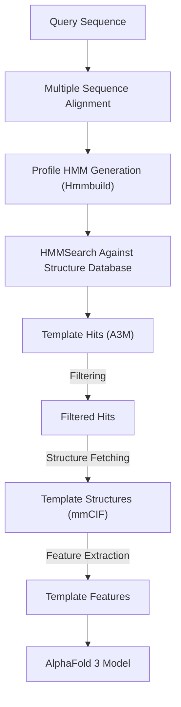
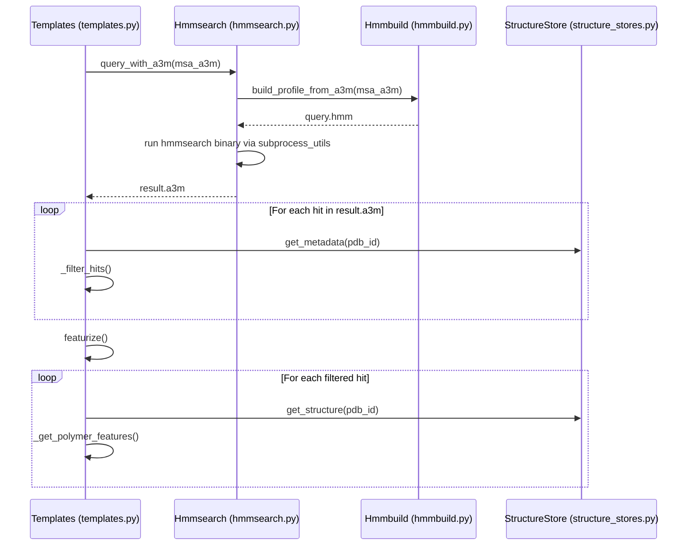

# Template Search

<details>
<summary>Relevant source files</summary>

The following files were used as context for generating this wiki page:

- [src/alphafold3/data/msa_config.py](src/alphafold3/data/msa_config.py)
- [src/alphafold3/data/parsers.py](src/alphafold3/data/parsers.py)
- [src/alphafold3/data/pipeline.py](src/alphafold3/data/pipeline.py)
- [src/alphafold3/data/templates.py](src/alphafold3/data/templates.py)
- [src/alphafold3/data/tools/hmmalign.py](src/alphafold3/data/tools/hmmalign.py)
- [src/alphafold3/data/tools/hmmbuild.py](src/alphafold3/data/tools/hmmbuild.py)
- [src/alphafold3/data/tools/hmmsearch.py](src/alphafold3/data/tools/hmmsearch.py)
- [src/alphafold3/data/tools/shards.py](src/alphafold3/data/tools/shards.py)

</details>


Template search is a critical component of the AlphaFold 3 data pipeline that identifies structural templates with similar sequences to the query polymer. These templates provide valuable structural information that guides the model's predictions, particularly for regions with conserved structural features. This document details the implementation and usage of the template search system in AlphaFold 3.

## Overview

The template search process uses `hmmsearch` to identify similar sequences from a structure database, retrieves their 3D coordinates, and transforms them into template features used by the model during inference. Templates significantly improve prediction accuracy by providing real structural examples for the model to learn from.



Sources: [src/alphafold3/data/templates.py:11-35](), [src/alphafold3/data/tools/hmmsearch.py:11-20]()

## Key Classes and Components

The template search functionality is implemented primarily through the `Templates` container and the `Hmmsearch` wrapper.

```mermaid
classDef default box

graph LR
    subgraph "Template Search System (data/templates.py)"
        Templates["Templates Class\n(alphafold3.data.templates.Templates)"]
        Hit["Hit Class\n(alphafold3.data.templates.Hit)"]
        Filter["Template Filtering\n(_filter_hits)"]
        Featurize["Template Featurization\n(featurize)"]

        Templates --> |"contains"| Hit
        Templates --> |"uses"| Filter
        Templates --> |"performs"| Featurize
    end

    subgraph "External Tool Wrappers (data/tools/)"
        Hmmsearch["Hmmsearch Class\n(alphafold3.data.tools.hmmsearch.Hmmsearch)"]
        Hmmbuild["Hmmbuild Class\n(alphafold3.data.tools.hmmbuild.Hmmbuild)"]
        Hmmalign["Hmmalign Class\n(alphafold3.data.tools.hmmalign.Hmmalign)"]
    end

    Hmmsearch --> |"uses"| Hmmbuild
    Templates --> |"invokes"| Hmmsearch
    Templates --> |"queries"| StructureStore["StructureStore\n(alphafold3.data.structure_stores.StructureStore)"]
```

Sources: [src/alphafold3/data/templates.py:157-191](), [src/alphafold3/data/templates.py:396-428](), [src/alphafold3/data/tools/hmmsearch.py:22-40](), [src/alphafold3/data/tools/hmmbuild.py:22-51](), [src/alphafold3/data/tools/hmmalign.py:28-44]()

### Templates Class

The `Templates` class serves as the primary container for template hits matched to a query sequence. It manages collections of hits and provides methods for filtering, featurizing, and accessing template structures.

Key Methods:
- `from_seq_and_a3m`: Creates templates from a query sequence and MSA in A3M format. [src/alphafold3/data/templates.py:430-484]()
- `from_hmmsearch_a3m`: Creates templates directly from HMMSearch A3M output. [src/alphafold3/data/templates.py:486-531]()
- `filter`: Filters hits based on configurable criteria such as release date and sequence identity. [src/alphafold3/data/templates.py:599-642]()
- `featurize`: Transforms the templates into features usable by the model, including atom positions and masks. [src/alphafold3/data/templates.py:665-718]()

### Hit Class

The `Hit` class represents a single template match with detailed alignment information:

| Field | Description |
|-------|-------------|
| `pdb_id` | The PDB ID of the matching structure. |
| `auth_chain_id` | The author chain ID within the structure. |
| `hmmsearch_sequence` | Template sequence with alignment information (gaps/insertions). |
| `structure_sequence` | Template sequence from the 3D structure. |
| `query_sequence` | The original query sequence. |
| `start_index/end_index` | Indices mapping to the full PDB sequence. |
| `release_date` | Structure release date. |
| `chain_poly_type` | Polymer type (protein, RNA, DNA). |

Sources: [src/alphafold3/data/templates.py:157-191]()

## Template Search Workflow

The template search workflow involves several steps from initial query to final template features:

1.  **Profile Generation**: `Hmmsearch` uses `Hmmbuild` to convert the input MSA (A3M/Stockholm) into a profile HMM. [src/alphafold3/data/tools/hmmsearch.py:134-149]()
2.  **HMMSearch Execution**: The profile HMM is searched against a database (e.g., PDB70) using the `hmmsearch` binary. [src/alphafold3/data/tools/hmmsearch.py:97-132]()
3.  **Hit Parsing**: `Templates.from_hmmsearch_a3m` parses the output to extract template hits and their alignments using regex on hit descriptions. [src/alphafold3/data/templates.py:137-140](), [src/alphafold3/data/templates.py:486-531]()
4.  **Filtering**: Removes templates based on release dates and sequence identity to prevent leakage. [src/alphafold3/data/templates.py:599-642]()
5.  **Featurization**: Transforms templates into `TemplateFeatures` mapping. [src/alphafold3/data/templates.py:50-52](), [src/alphafold3/data/templates.py:665-718]()



Sources: [src/alphafold3/data/templates.py:430-484](), [src/alphafold3/data/tools/hmmsearch.py:97-132](), [src/alphafold3/data/tools/hmmbuild.py:70-87]()

## Template Filtering

Template filtering is a crucial step to ensure that only high-quality, relevant templates are used. The filtering criteria include:

| Filter | Purpose | Implementation |
|--------|---------|----------------|
| `release_date_cutoff` | Prevents future knowledge leakage during training or evaluation. | `Hit.release_date <= cutoff`. [src/alphafold3/data/templates.py:609]() |
| `max_subsequence_ratio` | Prevents leakage from exact matches or near-exact matches. | Checks identity ratio. [src/alphafold3/data/templates.py:614]() |
| `min_hit_length` | Ensures meaningful template information is present. | Excludes short hits. [src/alphafold3/data/templates.py:618]() |
| `deduplicate_sequences` | Increases diversity of templates by removing redundancy. | Removes identical template sequences. [src/alphafold3/data/templates.py:633]() |
| `max_hits` | Controls computational cost and model input size. | Limits the total number of templates. [src/alphafold3/data/templates.py:642]() |

Sources: [src/alphafold3/data/templates.py:599-642]()

## Template Featurization

Template features are extracted and transformed into the format required by the model. The process uses `_POLYMER_FEATURES` and `_LIGAND_FEATURES` definitions to shape the output.

### Polymer Features
The `_POLYMER_FEATURES` mapping defines the expected features for protein, RNA, and DNA:

- `template_aatype`: Residue types encoded as integers using `_encode_restype`. [src/alphafold3/data/templates.py:46](), [src/alphafold3/data/templates.py:98-142]()
- `template_all_atom_masks`: Binary masks for valid atom positions (e.g., ATOM37 for protein). [src/alphafold3/data/templates.py:47]()
- `template_all_atom_positions`: 3D coordinates of atoms. [src/alphafold3/data/templates.py:48]()
- `template_domain_names`: PDB/Chain identifiers. [src/alphafold3/data/templates.py:49]()
- `template_release_date`: ISO formatted release dates. [src/alphafold3/data/templates.py:50]()
- `template_sequence`: The raw sequence string. [src/alphafold3/data/templates.py:51]()

### Ligand Features
If enabled, `_LIGAND_FEATURES` are extracted from the structure:

- `ligand_features`: Mapping containing ligand atom positions and names, typically retrieved from `StructureStore`. [src/alphafold3/data/templates.py:54-56]()

Sources: [src/alphafold3/data/templates.py:45-56]()

## External Tool Integration

The template search relies on the HMMER suite. Wrappers are provided for:

- **Hmmsearch**: Searches a profile against a sequence database. Supports various E-value and pre-filter settings. [src/alphafold3/data/tools/hmmsearch.py:31-100]()
- **Hmmbuild**: Constructs HMM profiles from MSAs (A3M or Stockholm). [src/alphafold3/data/tools/hmmbuild.py:31-97]()
- **Hmmalign**: Aligns sequences to a profile and returns results in A3M (A2M) format. [src/alphafold3/data/tools/hmmalign.py:37-120]()

These tools use `subprocess_utils` to execute binaries and manage temporary files. [src/alphafold3/data/tools/hmmsearch.py:111-137](), [src/alphafold3/data/tools/hmmbuild.py:122-150]()

Sources: [src/alphafold3/data/tools/hmmsearch.py:20-161](), [src/alphafold3/data/tools/hmmbuild.py:20-155](), [src/alphafold3/data/tools/hmmalign.py:20-153]()

---