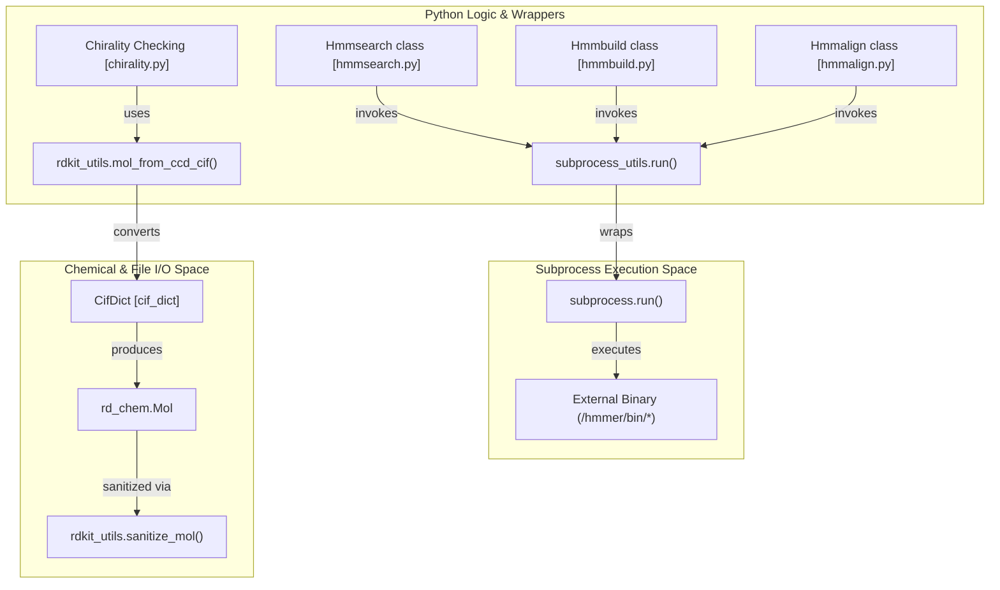
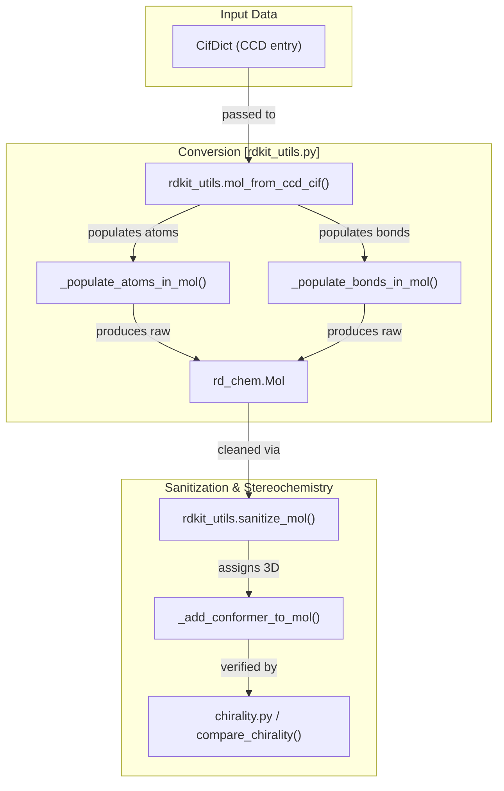

# External Tools Integration

Relevant source files

The following files were used as context for generating this wiki page:

- [docker/Dockerfile](docker/Dockerfile)
- [docker/easel_fast_fasta_parsing.patch](docker/easel_fast_fasta_parsing.patch)
- [docker/jackhmmer_parallel_fasta.patch](docker/jackhmmer_parallel_fasta.patch)
- [docker/jackhmmer_seq_limit.patch](docker/jackhmmer_seq_limit.patch)
- [docs/output.md](docs/output.md)
- [src/alphafold3/data/tools/rdkit_utils.py](src/alphafold3/data/tools/rdkit_utils.py)
- [src/alphafold3/data/tools/subprocess_utils.py](src/alphafold3/data/tools/subprocess_utils.py)
- [src/alphafold3/model/scoring/chirality.py](src/alphafold3/model/scoring/chirality.py)
- [src/alphafold3/structure/mmcif.py](src/alphafold3/structure/mmcif.py)

## Purpose and Scope

The External Tools Integration system in AlphaFold 3 provides the infrastructure for executing external bioinformatics tools, primarily from the HMMER suite (`jackhmmer`, `nhmmer`, `hmmalign`, `hmmbuild`, `hmmsearch`), as well as chemical and structural utilities via RDKit (`rdkit_utils.py`). This page documents the `subprocess_utils` module for external tool execution, HMMER installation and patching, RDKit-based ligand processing utilities, and overall tool configuration patterns. For information about how MSA tools are used in the data pipeline, see [MSA Tools](6.1) and [Template Search](6.2).

Sources: [src/alphafold3/data/tools/subprocess_utils.py:20-25](), [src/alphafold3/data/tools/rdkit_utils.py:20-22]()

## Architecture Overview

AlphaFold 3 interacts with external binaries and chemical libraries through a structured architecture. Python wrappers encapsulate tool-specific logic, a centralized `subprocess_utils` module handles process execution and logging, and `rdkit_utils` handles chemical component file translation.

### Tool and Utility Integration Map
The following diagram bridges natural language descriptions to code entities for external tools and RDKit utilities.

Sources: [src/alphafold3/data/tools/subprocess_utils.py:67-134](), [src/alphafold3/data/tools/rdkit_utils.py:164-171](), [src/alphafold3/model/scoring/chirality.py:127-146]()

## Subprocess Utilities

The `subprocess_utils.py` module provides standardized helpers to ensure that external tools are executed reliably across different environments (local, Docker, HPC).

### Key Functions
- **`run()`**: A robust wrapper around `subprocess.run`. It captures `stdout` and `stderr`, logs execution time, and provides detailed error messages including truncated output streams if a process fails [src/alphafold3/data/tools/subprocess_utils.py:67-122](). It handles `subprocess.CalledProcessError` by logging the failure line-by-line to stay within character limits [src/alphafold3/data/tools/subprocess_utils.py:108-115]().
- **`check_binary_exists()`**: Validates that a required executable is present at the specified path or raises a `RuntimeError` [src/alphafold3/data/tools/subprocess_utils.py:42-50]().
- **`create_query_fasta_file()`**: Formats a raw sequence string into a FASTA file with a fixed line width (default 80), required by HMMER tools [src/alphafold3/data/tools/subprocess_utils.py:31-39]().
- **`jackhmmer_seq_limit_supported()`**: Checks if the compiled `jackhmmer` binary accepts the `--seq_limit` optimization flag [src/alphafold3/data/tools/subprocess_utils.py:53-64]().

Sources: [src/alphafold3/data/tools/subprocess_utils.py:31-134]()

## HMMER Integration and Patching

AlphaFold 3 uses a specific version of HMMER (3.4) and applies custom patches to improve performance and support hit truncation.

### HMMER Patches
1. **`jackhmmer_seq_limit.patch`**: Modifies `hmmer-3.4/src/jackhmmer.c` to add the `--seq_limit` option [docker/jackhmmer_seq_limit.patch:1-7](). This allows the pipeline to truncate the number of hits returned by `jackhmmer` at the binary level [docker/jackhmmer_seq_limit.patch:23-28]().
2. **`easel_fast_fasta_parsing.patch`**: Optimizes FASTA file parsing within the EASEL library [docker/easel_fast_fasta_parsing.patch:1-12]().
3. **`jackhmmer_parallel_fasta.patch`**: Adds multi-threaded chunk-based FASTA database scanning support to `jackhmmer` [docker/jackhmmer_parallel_fasta.patch:1-55]().

### Docker Build Process
The HMMER suite is compiled from source within the Docker container to ensure patches are applied:
1. **Download**: HMMER 3.4 source is retrieved from `eddylab.org` and checksum-verified [docker/Dockerfile:52-56]().
2. **Patch**: Patches are applied using `patch -p0` [docker/Dockerfile:58-62]().
3. **Build**: The suite is configured, compiled with `make -j`, and installed to `/hmmer` [docker/Dockerfile:64-69]().

Sources: [docker/Dockerfile:32-70](), [docker/jackhmmer_seq_limit.patch:1-32](), [docker/easel_fast_fasta_parsing.patch:1-12](), [docker/jackhmmer_parallel_fasta.patch:1-55]()

## RDKit Utilities (`rdkit_utils.py`)

The `rdkit_utils.py` module manages the conversion and manipulation of chemical component dictionary (CCD) data into RDKit `Mol` objects (`rd_chem.Mol`), supporting ligand feature extraction, stereochemistry assignment, and structural validation.

### Key Functions and Mappings
- **`mol_from_ccd_cif()`**: Constructs an RDKit `Mol` object from a Chemical Component Dictionary data block (`cif_dict.CifDict`), handling atom properties, formal charges, leaving atom flags, and bonds [src/alphafold3/data/tools/rdkit_utils.py:164-210]().
- **`sanitize_mol()`**: Applies RDKit molecular sanitization (Kekulization, valency checks, aromaticity, and hybridization setting), followed by optional alphabetical atom sorting and hydrogen removal [src/alphafold3/data/tools/rdkit_utils.py:140-149]().
- **Bond and Stereochemistry Mappings**: Translates mmCIF bond types (`SING`, `DOUB`, `TRIP`) and stereochemistry flags into RDKit equivalents using mapping tables like `_RDKIT_MMCIF_TO_BOND_TYPE` [src/alphafold3/data/tools/rdkit_utils.py:32-48]().

### RDKit Data Flow

Sources: [src/alphafold3/data/tools/rdkit_utils.py:32-210](), [src/alphafold3/model/scoring/chirality.py:127-185]()

## Tool Wrappers

Each bioinformatics tool has a corresponding Python wrapper managing temporary files, flags, and execution:
- **`Hmmsearch`**: Runs profile-sequence searches via `hmmsearch` or builds profiles from A3M/Stockholm files using `Hmmbuild` prior to searching [src/alphafold3/data/tools/hmmsearch.py:22-150]().
- **`Hmmbuild`**: Constructs HMM profiles from alignments, automatically stripping lowercase insertion columns for consensus calculations [src/alphafold3/data/tools/hmmbuild.py:22-147]().
- **`Hmmalign`**: Aligns sequences or alignments to an existing HMM profile using `--outformat A2M` [src/alphafold3/data/tools/hmmalign.py:28-144]().

Sources: [src/alphafold3/data/tools/hmmsearch.py:22-150](), [src/alphafold3/data/tools/hmmbuild.py:22-147](), [src/alphafold3/data/tools/hmmalign.py:28-144]()

---