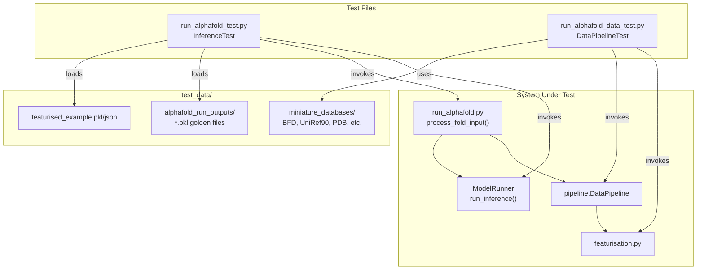

# Testing Framework

Relevant source files

The following files were used as context for generating this wiki page:

- [.github/workflows/ci.yaml](.github/workflows/ci.yaml)
- [run_alphafold_data_test.py](run_alphafold_data_test.py)
- [src/alphafold3/structure/test_utils.py](src/alphafold3/structure/test_utils.py)
- [src/alphafold3/test_data/featurised_example.json](src/alphafold3/test_data/featurised_example.json)

This page provides a high-level overview of the testing infrastructure, test data organization, and validation strategies used in AlphaFold 3. For detailed information on test organization, CI/CD pipeline, test utilities, and test execution via GitHub Actions, see [Test Infrastructure](#7.1). For detailed explanations of test data structure, miniature databases, golden pickle outputs, RMSD validation, and regression testing approaches, see [Test Data and Validation](#7.2).

Sources: [run_alphafold_data_test.py:11-20](), [.github/workflows/ci.yaml:1-45]()

## Overview

The AlphaFold 3 testing framework ensures correctness and reliability by verifying both end-to-end functionality and individual components through automated test suites implemented using the `absltest` framework [run_alphafold_data_test.py:33-34](). The framework comprises two primary test suites:
1. **End-to-End Inference Tests** (`run_alphafold_test.py`) — Validates complete pipeline execution from input JSON to structure prediction.
2. **Data Pipeline Tests** (`run_alphafold_data_test.py`) — Verifies MSA generation, template search, and featurization using miniature databases [run_alphafold_data_test.py:11-207]().

**Test Suite Architecture**

Sources: [run_alphafold_data_test.py:33-166]()

## Test Infrastructure

For detailed documentation of test organization, CI/CD pipelines, test utilities, and test execution via GitHub Actions, see [Test Infrastructure](#7.1). 

The testing framework leverages continuous integration via GitHub Actions (`.github/workflows/ci.yaml`) to run CPU-only data pipeline tests (`run_alphafold_data_test.py`) on every push and pull request [.github/workflows/ci.yaml:1-45](). Test utilities such as `StructureTestCase` in `src/alphafold3/structure/test_utils.py` provide specialized assertion helpers for comparing complex structures, bonds, and chemical components during testing [src/alphafold3/structure/test_utils.py:31-144]().

Sources: [.github/workflows/ci.yaml:1-45](), [src/alphafold3/structure/test_utils.py:31-144]()

## Test Data and Validation

For detailed explanations of test data structure, miniature databases, golden pickle outputs, RMSD validation, and regression testing approaches, see [Test Data and Validation](#7.2).

The framework relies on subsampled miniature databases located in `test_data/miniature_databases/` (such as BFD, UniRef90, and PDB mmCIF subsets) to enable rapid local and CI execution [run_alphafold_data_test.py:114-144](). Validation strategies include RMSD comparison for predicted structures, hash verification via `_hash_data()` for featurized tensors [run_alphafold_data_test.py:63-86](), and unified text diffs for configurations and JSON inputs [run_alphafold_data_test.py:97-106]().

Sources: [run_alphafold_data_test.py:63-144](), [src/alphafold3/test_data/featurised_example.json:1-65]()

## Related Pages

*   [Test Infrastructure](#7.1) — Detailed documentation of CI/CD, execution, and test utilities.
*   [Test Data and Validation](#7.2) — Deep dive into miniature databases, golden files, and RMSD validation.
*   [Data Pipeline](#4.2) — Details on the data pipeline components being tested.
*   [Model Inference](#4.4) — Details on the inference process validated by the test framework.

---