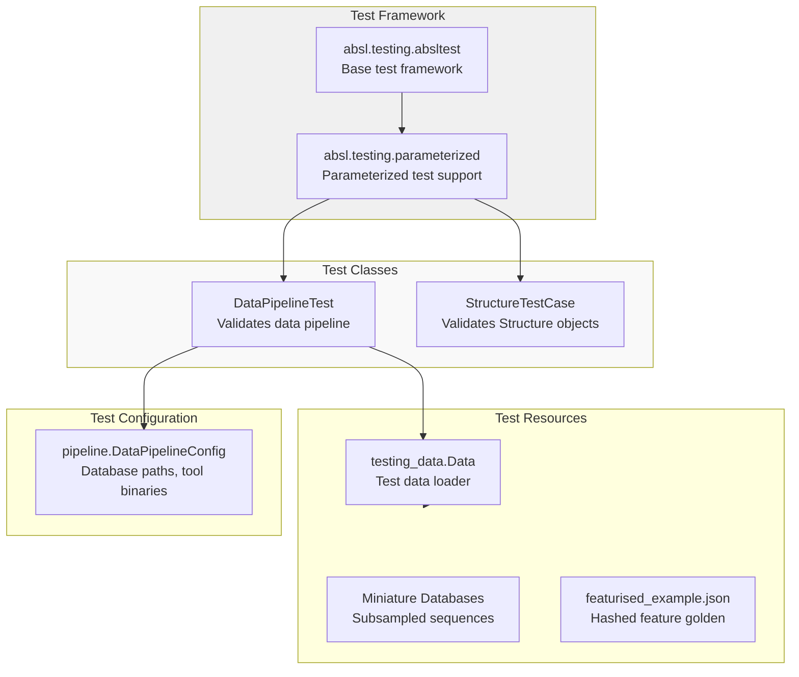
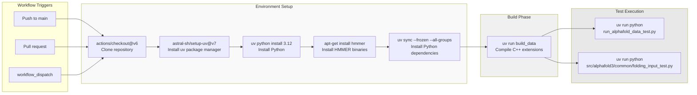
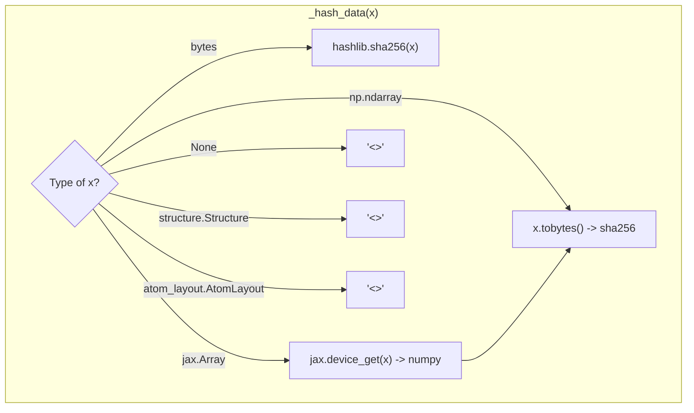

# Test Infrastructure

Relevant source files

The following files were used as context for generating this wiki page:

- [.github/workflows/ci.yaml](.github/workflows/ci.yaml)
- [run_alphafold_data_test.py](run_alphafold_data_test.py)
- [src/alphafold3/structure/test_utils.py](src/alphafold3/structure/test_utils.py)
- [src/alphafold3/test_data/featurised_example.json](src/alphafold3/test_data/featurised_example.json)

## Purpose and Scope

This document describes the testing infrastructure for AlphaFold 3, including test organization, CI/CD pipeline configuration, test utilities, and test execution mechanisms. This covers the structural aspects of how tests are organized and executed, including data pipeline validation, input parsing verification, structure comparisons, and model inference testing.

Sources: [run_alphafold_data_test.py:1-45](), [.github/workflows/ci.yaml:1-46]()

## Test Organization

The AlphaFold 3 test suite is organized around integration tests and unit tests that validate data parsing, structural manipulations, the data pipeline, and model inference stages. The primary test files include `run_alphafold_data_test.py` [run_alphafold_data_test.py:1-45](), `src/alphafold3/common/folding_input_test.py` [.github/workflows/ci.yaml:43-46](), and structural test helpers in `src/alphafold3/structure/test_utils.py` [src/alphafold3/structure/test_utils.py:20-32]().

### Test Class Structure and Utilities

**Test Class Hierarchy and Utilities**

- `DataPipelineTest` [run_alphafold_data_test.py:109-110]() extends `parameterized.TestCase` [run_alphafold_data_test.py:109](), providing support for parameterized execution of data processing stages and initializing configurations for HMMER binaries and miniature genetic databases.
- `StructureTestCase` [src/alphafold3/structure/test_utils.py:31-32]() extends `parameterized.TestCase` [src/alphafold3/structure/test_utils.py:24]() to provide specialized assertion helpers such as `assertStructuresEqual`, `assertBondsEqual`, and `assertChemicalComponentsDataEqual` for validating complex biomolecular structures.

Sources: [run_alphafold_data_test.py:109-166](), [src/alphafold3/structure/test_utils.py:31-166]()

### Test Methods and Validation

| Test Method / Class | Purpose | Implementation Detail |
|------------|---------|-----------------------|
| `DataPipelineTest` | Validates data pipeline execution | Instantiates `pipeline.DataPipelineConfig` with miniature databases [run_alphafold_data_test.py:150-166]() |
| `compare_golden` | General utility for file comparison | Uses `difflib.unified_diff` to assert equality with golden files [run_alphafold_data_test.py:97-106](), [run_alphafold_data_test.py:189-196]() |
| `StructureTestCase.assertStructuresEqual` | Compares two `Structure` instances | Iterates through global and array fields with optional tolerances [src/alphafold3/structure/test_utils.py:104-166]() |
| `StructureTestCase.assertBondsEqual` | Verifies bond table consistency | Compares atom indices, types, and roles between bond structures [src/alphafold3/structure/test_utils.py:89-103]() |

Sources: [run_alphafold_data_test.py:97-196](), [src/alphafold3/structure/test_utils.py:89-166]()

## CI/CD Pipeline

The continuous integration pipeline is defined in GitHub Actions (`.github/workflows/ci.yaml`) and orchestrates automated testing on every push and pull request to the `main` branch.

**Pipeline Configuration**

The CI workflow [.github/workflows/ci.yaml:1-46]() runs on `ubuntu-latest` with Python 3.12 [.github/workflows/ci.yaml:20-21](). Key features include:

- **Dependency Caching**: The `setup-uv` action caches dependencies based on `uv.lock` [.github/workflows/ci.yaml:25-29]().
- **System Dependencies**: The HMMER suite (jackhmmer, nhmmer, etc.) is installed via `apt-get` [.github/workflows/ci.yaml:34-35]().
- **Frozen Dependencies**: `uv sync --frozen` ensures reproducible environments [.github/workflows/ci.yaml:37-38]().
- **Build Step**: The `build_data` command compiles necessary C++ extensions before tests run [.github/workflows/ci.yaml:40-41]().
- **Execution**: The pipeline executes `run_alphafold_data_test.py` and `folding_input_test.py` as CPU-only validation steps [.github/workflows/ci.yaml:43-46]().

Sources: [.github/workflows/ci.yaml:1-46]()

## Data Pipeline Validation

The testing infrastructure employs a hashing strategy to validate complex feature tensors without storing massive binary blobs in the repository.

### Feature Hashing Mechanism

Because the output of the data pipeline contains large JAX and NumPy arrays, `run_alphafold_data_test.py` uses a single-dispatch hashing function `_hash_data` [run_alphafold_data_test.py:63-95]().

This mechanism allows the system to verify that feature processing output remains consistent by comparing SHA-256 hashes of the resulting tensors against golden files like `featurised_example.json` [src/alphafold3/test_data/featurised_example.json:1-65]().

Sources: [run_alphafold_data_test.py:63-95](), [src/alphafold3/test_data/featurised_example.json:1-65]()

### Miniature Database Configuration

The `DataPipelineTest.setUp` method [run_alphafold_data_test.py:112-166]() configures the pipeline to use subsampled "miniature" databases. This allows the full data pipeline (including MSA search) to run efficiently in a CI environment.

| Database | Source File (Subsampled) | Code Reference |
|----------|--------------------------|----------------|
| Small BFD | `bfd-first_non_consensus_sequences__subsampled_1000.fasta` | [run_alphafold_data_test.py:114-117]() |
| MGnify | `mgy_clusters__subsampled_1000.fa` | [run_alphafold_data_test.py:118-121]() |
| UniProt Cluster Annot | `uniprot_all__subsampled_1000.fasta` | [run_alphafold_data_test.py:122-125]() |
| UniRef90 | `uniref90__subsampled_1000.fasta` | [run_alphafold_data_test.py:126-129]() |
| NT/RNA | `nt_rna_2023_02_23_clust_seq_id_90_cov_80_rep_seq__subsampled_1000.fasta` | [run_alphafold_data_test.py:130-133]() |
| Rfam | `rfam_14_4_clustered_rep_seq__subsampled_1000.fasta` | [run_alphafold_data_test.py:134-137]() |
| RNA Central | `rnacentral_active_seq_id_90_cov_80_linclust__subsampled_1000.fasta` | [run_alphafold_data_test.py:138-141]() |
| PDB mmCIF | `pdb_mmcif` directory | [run_alphafold_data_test.py:142-144]() |
| SeqRes | `pdb_seqres_2022_09_28__subsampled_1000.fasta` | [run_alphafold_data_test.py:145-148]() |

Sources: [run_alphafold_data_test.py:112-148]()

## External Tool Integration

The test infrastructure integrates with external biological search tools by locating them in the system path and passing their locations to `pipeline.DataPipelineConfig` [run_alphafold_data_test.py:150-166]().

| Variable | Tool Binary | Code Reference |
|----------|-------------|----------------|
| `_JACKHMMER_BINARY_PATH` | `jackhmmer` | [run_alphafold_data_test.py:50]() |
| `_NHMMER_BINARY_PATH` | `nhmmer` | [run_alphafold_data_test.py:51]() |
| `_HMMALIGN_BINARY_PATH` | `hmmalign` | [run_alphafold_data_test.py:52]() |
| `_HMMSEARCH_BINARY_PATH` | `hmmsearch` | [run_alphafold_data_test.py:53]() |
| `_HMMBUILD_BINARY_PATH` | `hmmbuild` | [run_alphafold_data_test.py:54]() |

These paths are resolved using `shutil.which` [run_alphafold_data_test.py:50-54](), ensuring compatibility with both local development environments and the CI container where `hmmer` is installed via `apt` [.github/workflows/ci.yaml:34-35]().

Sources: [run_alphafold_data_test.py:50-54](), [.github/workflows/ci.yaml:34-35]()

## Development Workflow

Developers maintain test integrity by running the test suite locally and validating changes against expected outputs.

1. **Local Execution**: Developers run tests using `uv run python run_alphafold_data_test.py` and `uv run python src/alphafold3/common/folding_input_test.py`.
2. **Golden Updates**: If changes to the data pipeline or feature extractors are intentional, golden files (such as `featurised_example.json` [src/alphafold3/test_data/featurised_example.json:1-65]()) must be updated to match the new computed hashes.
3. **CI Validation**: GitHub Actions automatically verify pull requests against clean Ubuntu environments [.github/workflows/ci.yaml:1-46]().

Sources: [.github/workflows/ci.yaml:1-46](), [run_alphafold_data_test.py:1-45]()

---