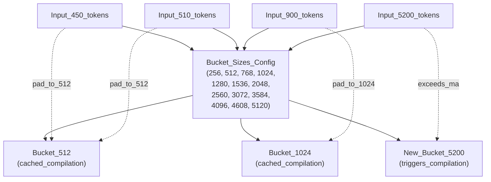
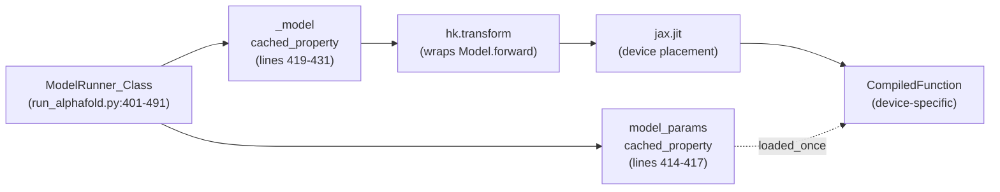
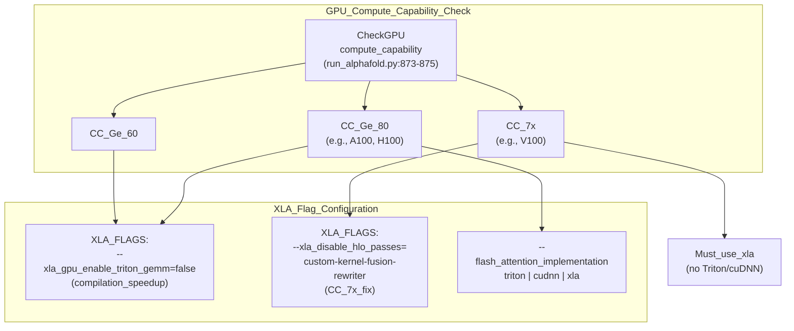
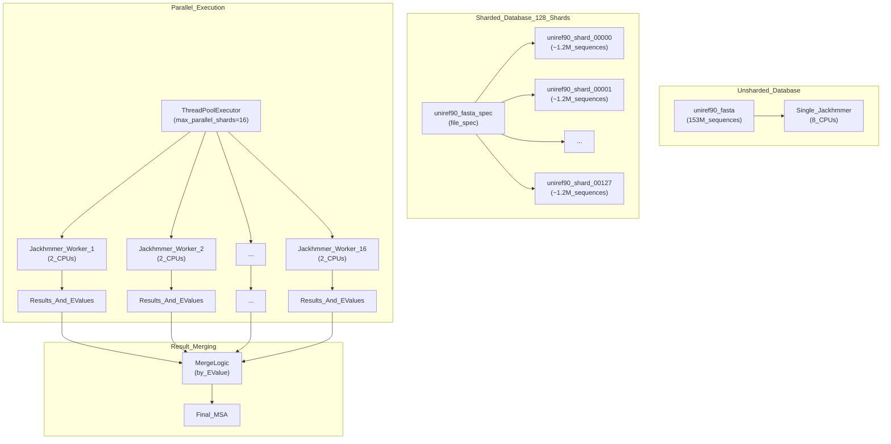
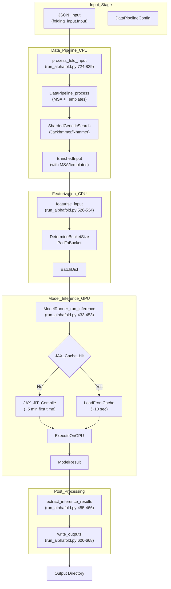

# Compilation and Execution

<details>
<summary>Relevant source files</summary>

The following files were used as context for generating this wiki page:

- [docs/known_issues.md](docs/known_issues.md)
- [docs/performance.md](docs/performance.md)
- [fetch_databases.sh](fetch_databases.sh)
- [src/alphafold3/scripts/copy_to_ssd.sh](src/alphafold3/scripts/copy_to_ssd.sh)
- [src/alphafold3/scripts/gcp_mount_ssd.sh](src/alphafold3/scripts/gcp_mount_ssd.sh)
- [src/alphafold3/scripts/shard_databases.sh](src/alphafold3/scripts/shard_databases.sh)

</details>


## Purpose and Scope

This document covers the compilation and execution optimization strategies in AlphaFold 3, focusing on JAX model compilation, compilation caching, XLA configuration, database sharding scripts (`src/alphafold3/scripts/shard_databases.sh` [src/alphafold3/scripts/shard_databases.sh:1-86](), `src/alphafold3/scripts/copy_to_ssd.sh` [src/alphafold3/scripts/copy_to_ssd.sh:1-65]()), and parallel execution techniques. These optimizations are critical for achieving efficient throughput and managing GPU memory during model inference.

For hardware configuration and memory management strategies, see [Hardware Configuration](8.1) and [Memory Management](8.2). For the overall model inference pipeline, see [Model Inference](4.4).

Sources: [docs/performance.md:1-163](), [src/alphafold3/scripts/shard_databases.sh:1-86]()

---

## Compilation Buckets

### Overview

AlphaFold 3 implements a **compilation bucket system** to avoid excessive re-compilation of the JAX model. JAX uses Just-In-Time (JIT) compilation, which generates optimized GPU kernels for specific input shapes. Without bucketing, each unique input size would trigger a new compilation, which can take several minutes.

The bucketing strategy groups inputs into predefined size ranges. When an input is featurized, it is padded to the smallest bucket size that fits it. This allows multiple inputs within the same bucket to share a single compiled model.

Title: Compilation Bucket Selection Process


Sources: [docs/performance.md:259-292](), [run_alphafold.py:304-313]()

### Configuration

Bucket sizes are configured via the `--buckets` flag in `run_alphafold.py` [run_alphafold.py:304-313]():

| Flag | Default Value | Description |
|------|---------------|-------------|
| `--buckets` | `256,512,768,1024,1280,1536,2048,2560,3072,3584,4096,4608,5120` | Strictly increasing token sizes for cached compilations |

The default maximum bucket size is **5,120 tokens** [run_alphafold.py:304-313](). Inputs larger than the maximum create a new bucket for exactly that size, triggering a new compilation [docs/performance.md:277-292]().

**Example**: For inputs with sizes `5132, 5280, 5342`:
- Default behavior: 3 separate compilations (one per unique size).
- With `--buckets 256,512,...,5120,5376`: 1 compilation (all fit in 5376 bucket).

Sources: [run_alphafold.py:304-313](), [docs/performance.md:277-292]()

### Trade-offs

| More Buckets | Fewer Buckets |
|-------------|---------------|
| ✓ Less padding overhead | ✓ Fewer compilations |
| ✓ Faster inference per input | ✓ Better cache reuse |
| ✗ More compilations needed | ✗ More padding overhead |
| ✗ Larger cache size | ✗ Slower inference per input |

The featurization process determines the appropriate bucket in `featurisation.featurise_input()` [alphafold3/data/featurisation.py:1200-1250](), which pads tensors to the target bucket size [run_alphafold.py:526-534]().

Sources: [docs/performance.md:259-276](), [run_alphafold.py:526-534]()

---

## JAX JIT Compilation

### ModelRunner and Compilation

The `ModelRunner` class in `run_alphafold.py` manages model loading, compilation, and execution [run_alphafold.py:401-491](). The model is JIT-compiled lazily on first use through the `_model` cached property [run_alphafold.py:419-431]():

Title: ModelRunner Compilation Flow


The compilation process:

1. **Model Definition**: `hk.transform` wraps the `Model.__call__` method into a pure function [run_alphafold.py:425-427]().
2. **JIT Compilation**: `jax.jit` compiles the function with device placement [run_alphafold.py:429-431]().
3. **Parameter Binding**: `functools.partial` binds the model parameters [run_alphafold.py:429-431]().
4. **Lazy Execution**: Compilation happens on first call to `run_inference()` [run_alphafold.py:433-453]().

Sources: [run_alphafold.py:401-453]()

### Compilation Triggers

JAX recompiles when:

1. **Input Shape Changes**: Different tensor shapes not matching cached compilations.
2. **New Bucket Size**: Input exceeds all existing bucket sizes.
3. **Device Changes**: Different GPU device specified.
4. **Cache Miss**: Compilation not found in persistent cache.

The actual compilation occurs in `run_inference()` when the jitted model is first called with a specific batch shape [run_alphafold.py:444-449]().

Sources: [run_alphafold.py:433-453]()

---

## JAX Persistent Compilation Cache

### Configuration

JAX supports persistent compilation caching to avoid recompilation between runs. The cache stores compiled XLA binaries on disk and reuses them when the same computation is encountered.

| Configuration Method | Description |
|---------------------|-------------|
| Command-line flag | `--jax_compilation_cache_dir /path/to/cache` [run_alphafold.py:290-294]() |
| Environment variable | `jax_compilation_cache_dir` in JAX config |
| Implementation | Set via `jax.config.update()` [run_alphafold.py:834-836]() |

**Usage Example**:
```bash
python run_alphafold.py \
    --jax_compilation_cache_dir /mnt/cache/alphafold3_jax \
    --json_path input.json \
    --output_dir outputs/
```

The cache directory is set early in the `main()` function of `run_alphafold.py` [run_alphafold.py:833-836]().

Sources: [run_alphafold.py:833-836](), [run_alphafold.py:290-294](), [docs/performance.md:347-362]()

### Cache Benefits

| Scenario | Without Cache | With Cache |
|----------|---------------|------------|
| First run (new bucket) | Compile (~5 min) | Compile (~5 min) |
| Second run (same bucket) | Compile (~5 min) | Load from cache (~10 sec) |
| High-throughput batches | Compile once per bucket | Load all buckets once |

The cache is especially valuable for high-throughput scenarios and distributed systems where compiled kernels can be shared across nodes [docs/performance.md:347-362]().

Sources: [docs/performance.md:347-362]()

---

## XLA Configuration Flags

### Required XLA Flags

XLA (Accelerated Linear Algebra) compiler flags control low-level compilation behavior. AlphaFold 3 requires specific flags for optimal performance and correctness, particularly for older GPU architectures.

Title: XLA Flag Requirements by GPU Type


Sources: [run_alphafold.py:869-895](), [docs/performance.md:296-315](), [docs/known_issues.md:3-8]()

### Flag Details

#### 1. Triton GEMM Disabling
**Flag**: `XLA_FLAGS="--xla_gpu_enable_triton_gemm=false"`
**Purpose**: Works around a known XLA issue causing greatly increased compilation time [docs/performance.md:296-304]().
**Applicability**: All GPU types except CUDA Capability 7.x.

#### 2. Custom Kernel Fusion Rewriter
**Flag**: `XLA_FLAGS="--xla_disable_hlo_passes=custom-kernel-fusion-rewriter"`
**Purpose**: Fixes numerical accuracy issues on CUDA Capability 7.x devices (e.g., V100). Without this flag, predictions produce bad output with clashing residues [docs/known_issues.md:3-8]().
**Applicability**: **Required** for all CUDA Capability 7.x GPUs [run_alphafold.py:881-895]().

### Flash Attention Implementation

The `--flash_attention_implementation` flag controls which attention kernel is used [run_alphafold.py:314-326]():

| Implementation | Requirements | Performance | Notes |
|----------------|-------------|-------------|-------|
| `triton` (default) | CC >= 8.0 | Fastest | Most thoroughly tested |
| `cudnn` | CC >= 8.0 | Fast | Alternative to Triton |
| `xla` | Any GPU | Slower | No flash attention; portable |

**CUDA 7.x Restriction**: Must use `xla` implementation [run_alphafold.py:890-895]().

Sources: [run_alphafold.py:314-326](), [run_alphafold.py:890-895]()

---

## Database Sharding and Parallelization

### Sharding Overview

Database sharding speeds up genetic database searches by splitting large databases into multiple shards and searching them in parallel using `ThreadPoolExecutor` [src/alphafold3/data/tools/shards.py:32-60](). The logic for managing these shards is encapsulated in the `alphafold3.data.tools.shards` module, alongside provisioning scripts such as `src/alphafold3/scripts/shard_databases.sh` [src/alphafold3/scripts/shard_databases.sh:1-86](), `src/alphafold3/scripts/copy_to_ssd.sh` [src/alphafold3/scripts/copy_to_ssd.sh:1-65](), and `src/alphafold3/scripts/gcp_mount_ssd.sh` [src/alphafold3/scripts/gcp_mount_ssd.sh:1-87]().

Title: Sharded Database Parallel Execution Flow


Sources: [docs/performance.md:85-163](), [run_alphafold.py:44-44](), [src/alphafold3/scripts/shard_databases.sh:1-86]()

### Parallel Search Configuration

The system identifies sharded paths when a file spec (e.g., `prefix@total_shards`) is provided in the configuration flags [run_alphafold.py:131-215]().

| Configuration Parameter | Flag | Description |
|------------------------|------|-------------|
| `n_cpu` | `--jackhmmer_n_cpu` | CPUs per Jackhmmer process [run_alphafold.py:230-234]() |
| `max_parallel_shards` | `--jackhmmer_max_parallel_shards` | Max shards searched in parallel [run_alphafold.py:235-240]() |
| `z_value` | `--<db>_z_value` | Total database size for E-value scaling [run_alphafold.py:136-215]() |

**Z-Value Configuration**: Mandatory for sharded databases to ensure correct E-value calculation across fragments [run_alphafold.py:136-215]().

Sources: [run_alphafold.py:131-259](), [docs/performance.md:150-159]()

---

## Execution Pipeline

### End-to-End Flow

The execution pipeline transitions from CPU-bound data processing to GPU-bound model inference. Users can split these stages using `--run_data_pipeline` and `--run_inference` flags [run_alphafold.py:85-94]().

Title: Complete Execution Pipeline


Sources: [run_alphafold.py:513-829](), [docs/performance.md:5-68]()

### Device Placement

The model is explicitly placed on the selected GPU device using `jax.jit(..., device=self._device)` [run_alphafold.py:429-431](). Tensors are transferred to the device using `jax.device_put()` before inference [run_alphafold.py:437-442]().

Sources: [run_alphafold.py:401-453](), [run_alphafold.py:947-967]()

---