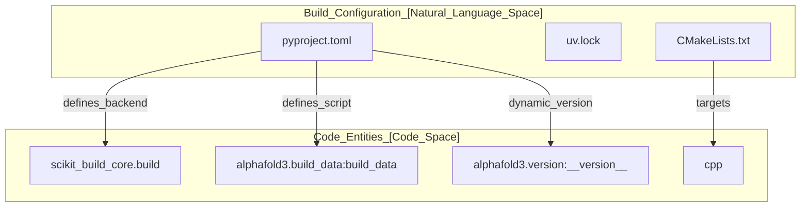
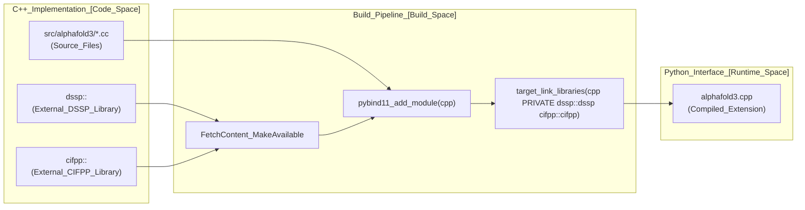

# Build System

<details>
<summary>Relevant source files</summary>

The following files were used as context for generating this wiki page:

- [CMakeLists.txt](CMakeLists.txt)
- [pyproject.toml](pyproject.toml)
- [src/alphafold3/version.py](src/alphafold3/version.py)
- [uv.lock](uv.lock)

</details>


## Purpose and Scope

This document explains the AlphaFold 3 build system architecture, including dependency management, C++ extension compilation, and intermediate data generation. It covers the `pyproject.toml` configuration, the use of `uv` for dependency management, `scikit-build-core` for building C++ extensions via CMake, and the process for generating required chemical data. For information about running the built system, see [Running AlphaFold 3](3.2). For container setup details, see [Container Setup](2.2).

---

## Build Architecture Overview

The AlphaFold 3 build system uses a modern Python packaging approach utilizing `uv` for dependency management and `scikit-build-core` as the build backend to orchestrate CMake compilation of native C++ modules.

### Build Entity Map
The following diagram maps high-level build concepts to specific files and tools in the codebase.



**Sources:** [pyproject.toml:1-74](), [src/alphafold3/version.py:22](), [CMakeLists.txt:26-29]()

---

## pyproject.toml Configuration

The [pyproject.toml:1-74]() file defines the build system, project metadata, dependencies, and tool configurations according to PEP 621 standards.

### Build System Declaration

```toml
[build-system]
requires = [
    "scikit_build_core",
    "pybind11",
    "cmake>=3.28",
    "ninja",
    "numpy",
]
build-backend = "scikit_build_core.build"
```

| Requirement | Purpose |
|------------|---------|
| `scikit_build_core` | Build backend for CMake-based Python extensions [pyproject.toml:3]() |
| `pybind11` | C++/Python binding library [pyproject.toml:4]() |
| `cmake>=3.28` | Cross-platform build system generator [pyproject.toml:5]() |
| `ninja` | Fast build executor [pyproject.toml:6]() |
| `numpy` | Required for C++ extension compilation (NumPy headers) [pyproject.toml:7]() |

**Sources:** [pyproject.toml:1-9]()

### Project Metadata and Dependencies

The version string is defined in [src/alphafold3/version.py:22]() as `__version__ = '3.0.4'`, which is pulled dynamically by the build system via `setuptools_scm` [pyproject.toml:13](), [pyproject.toml:64]().

```toml
[project]
name = "alphafold3"
dynamic = ["version"]
requires-python = ">=3.12"
dependencies = [
    "absl-py>=2.3.1",
    "dm-haiku==0.0.17",
    "etils[epath]",
    "jax==0.10.2",
    "jax[cuda12]==0.10.2; sys_platform != 'darwin'",
    "jax-mps==0.10.9; sys_platform == 'darwin' and platform_machine == 'arm64'",
    "msgpack",
    "numpy",
    "rdkit==2026.3.3",
    "tokamax==0.0.12",
    "tqdm",
    "zstandard",
]
```

**Sources:** [pyproject.toml:11-30](), [src/alphafold3/version.py:20-22]()

---

## C++ Extension Build System

AlphaFold 3 uses CMake to manage the compilation of its C++ components, which are exposed to Python via `pybind11`.

### CMake Configuration
The [CMakeLists.txt:1-136]() handles external dependencies and module compilation.

1.  **Git Ref Format Fix**: To ensure compatibility with newer Git versions when fetching dependencies, the environment is configured to use the `files` backend for `FetchContent` operations [CMakeLists.txt:24]().
2.  **Dependency Management**: Uses `FetchContent` to pull specific pinned versions of:
    *   `abseil-cpp` [CMakeLists.txt:47-51]()
    *   `pybind11` [CMakeLists.txt:53-57]()
    *   `pybind11_abseil` [CMakeLists.txt:59-63]()
    *   `boost-rx` [CMakeLists.txt:67-71]()
    *   `my-eigen3` [CMakeLists.txt:73-77]()
    *   `libmcfp` [CMakeLists.txt:79-83]()
    *   `cifpp` [CMakeLists.txt:85-90]()
    *   `dssp` [CMakeLists.txt:92-96]()
3.  **Module Creation**: The `cpp` pybind11 module is compiled from all `.cc` files under `src/alphafold3/`, excluding test, main, and benchmark targets [CMakeLists.txt:108-113]().

### C++ to Python Data Flow
The following diagram illustrates how C++ logic (such as DSSP and cifpp) is compiled and exposed to the Python runtime via pybind11 targets.



**Sources:** [CMakeLists.txt:47-127]()

---

## uv Dependency Management

AlphaFold 3 utilizes `uv` for high-performance dependency resolution and virtual environment management, supported by a deterministic `uv.lock` file [uv.lock:1-3]().

### uv Configuration
The [pyproject.toml:43-49]() specifies package mode and target execution environments across platforms:
*   `linux/x86_64` [pyproject.toml:46]()
*   `linux/aarch64` [pyproject.toml:47]()
*   `darwin/arm64` [pyproject.toml:48]()

**Sources:** [pyproject.toml:43-49](), [uv.lock:1-19]()

---

## Intermediate Data Build (`build_data`)

AlphaFold 3 requires a pre-processing step to convert the Chemical Component Dictionary (CCD) from mmCIF format into optimized Python pickles.

### Entry Point and Execution
This process is registered as a command-line script in [pyproject.toml:73-74]():
```toml
[project.scripts]
build_data = "alphafold3.build_data:build_data"
```

**Sources:** [pyproject.toml:73-74]()

---

## Wheel and Distribution

The `scikit-build-core` tool is configured to produce lean wheels by excluding source files while including necessary legal and policy documents.

### Wheel Exclusions and SDist Inclusions
*   **Wheel Exclusions**: Source files (`**.cc`, `**.h`, `**.pyx`) and build files (`**/CMakeLists.txt`) are excluded from built wheels [pyproject.toml:51-57]().
*   **SDist Inclusions**: The source distribution includes licensing and policy files (`LICENSE`, `OUTPUT_TERMS_OF_USE.md`, `WEIGHTS_PROHIBITED_USE_POLICY.md`, `WEIGHTS_TERMS_OF_USE.md`) [pyproject.toml:58-63]().

**Sources:** [pyproject.toml:51-63]()

---