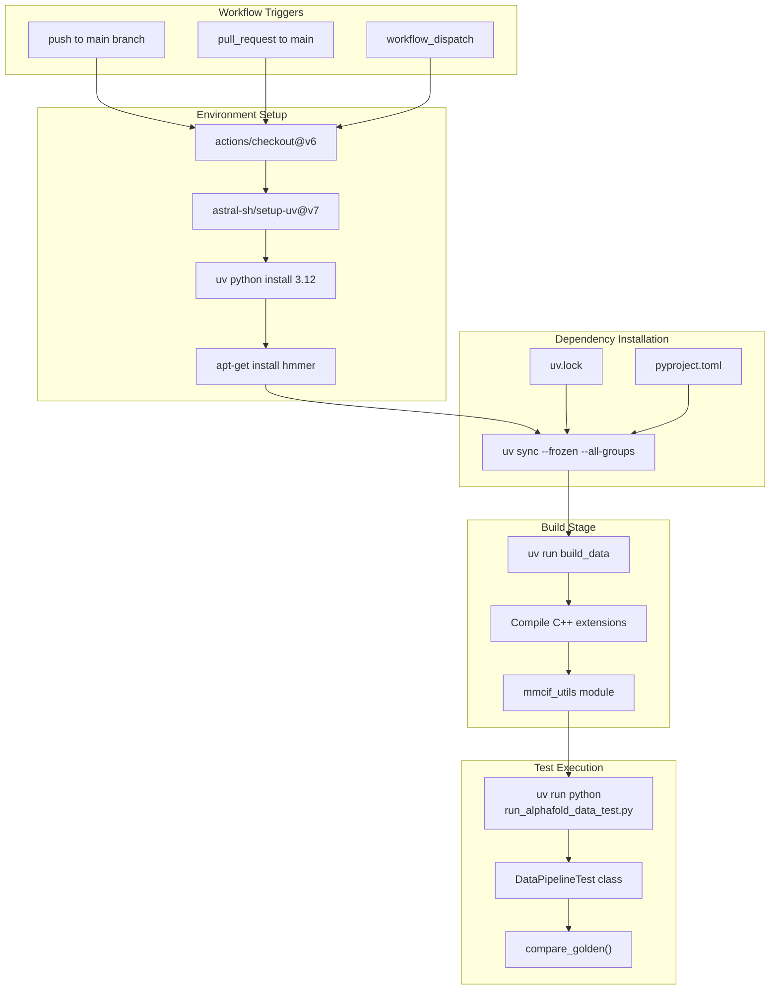
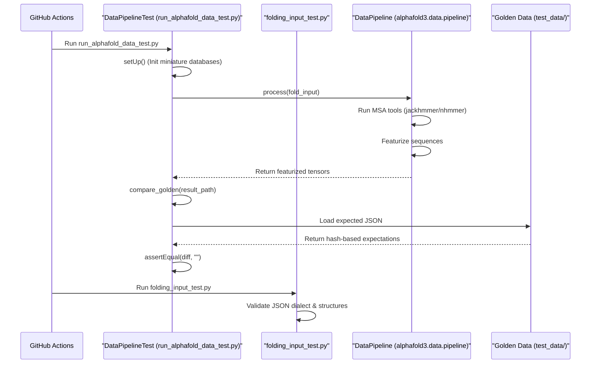

# CI/CD Pipeline

Relevant source files

The following files were used as context for generating this wiki page:

- [.github/workflows/ci.yaml](.github/workflows/ci.yaml)
- [CONTRIBUTING.md](CONTRIBUTING.md)
- [run_alphafold_data_test.py](run_alphafold_data_test.py)
- [src/alphafold3/test_data/featurised_example.json](src/alphafold3/test_data/featurised_example.json)

## Purpose and Scope

This document describes the continuous integration (CI) infrastructure for AlphaFold 3. It covers the GitHub Actions workflow configuration, automated test execution, dependency management, and contribution guidelines. The pipeline is designed to validate the core data processing and featurization logic on every code change. For information about the build system configuration, see [Build System](). For details about the testing framework and test data, see [Test Infrastructure]().

**Sources:** [.github/workflows/ci.yaml:1-46](), [CONTRIBUTING.md:1-36]()

## Overview

The AlphaFold 3 CI pipeline is implemented using GitHub Actions and provides automated testing for code changes. The pipeline focuses on CPU-only testing to verify the data pipeline, input processing, and featurization without requiring GPU resources. It integrates with the `uv` package manager for fast, reproducible dependency installation and uses the `scikit-build-core` build backend for compiling C++ extensions like `mmcif_utils`.

**Sources:** [.github/workflows/ci.yaml:1-46](), [run_alphafold_data_test.py:41-46]()

## Workflow Architecture

**Workflow Execution Flow**

The CI pipeline executes in a linear sequence. GitHub Actions triggers the workflow on commits to the `main` branch, pull requests targeting `main`, or manual dispatch. The core validation happens in `run_alphafold_data_test.py` and `folding_input_test.py`, which verify data structures and pipelines against reference standards.

**Sources:** [.github/workflows/ci.yaml:3-11](), [.github/workflows/ci.yaml:23-46](), [run_alphafold_data_test.py:100-111]()

## GitHub Actions Configuration

### Workflow Definition

The CI workflow is defined in `.github/workflows/ci.yaml` with the following key characteristics:

| Property | Value | Purpose |
|----------|-------|---------|
| Name | `Continuous Integration` | Identifies the workflow in GitHub UI |
| Triggers | `push`, `pull_request`, `workflow_dispatch` | Automatic and manual execution |
| OS | `ubuntu-latest` | Linux environment for compatibility |
| Python Version | `3.12` | Required version for runtime |
| Job Name | `build` | Single job for all CI tasks |

**Sources:** [.github/workflows/ci.yaml:1-22]()

### Workflow Steps

The workflow executes the following steps in order:

1.  **Code Checkout**: Uses `actions/checkout@v6` to clone the repository.
2.  **uv Setup**: Uses `astral-sh/setup-uv@v7` with caching enabled based on `uv.lock`.
3.  **Python Installation**: Installs Python 3.12 using uv.
4.  **System Dependencies**: Installs `hmmer` via `apt-get` to provide binaries like `jackhmmer` and `nhmmer` required for MSA generation.
5.  **Python Dependencies**: Runs `uv sync --frozen --all-groups` to install exact versions from the lock file.
6.  **Build Data**: Executes `uv run build_data` to compile C++ extensions.
7.  **Run Tests**: Executes `run_alphafold_data_test.py` and `folding_input_test.py`.

**Sources:** [.github/workflows/ci.yaml:23-46](), [run_alphafold_data_test.py:41-46]()

## Test Execution

### CPU-Only Test Strategy

The CI pipeline runs integration and unit tests that do not require a GPU accelerator.

**Test Coverage and Validation**

*   **Miniature Databases**: The `setUp` method configures paths to subsampled versions of BFD, MGnify, UniProt, and PDB databases stored in `test_data/miniature_databases/` [run_alphafold_data_test.py:112-149]().
*   **Featurization Validation**: The `DataPipelineTest` runs the full `DataPipeline.process` flow and validates the resulting feature tensors [run_alphafold_data_test.py:109-111]().
*   **Golden Comparison**: The `compare_golden` function compares the generated JSON outputs (containing hashed data) against reference files like `featurised_example.json` [run_alphafold_data_test.py:189-196](), [src/alphafold3/test_data/featurised_example.json:1-65]().
*   **Data Hashing**: To handle large tensors and complex objects, the test uses a `_hash_data` singledispatch function to generate stable SHA256 hashes for comparison [run_alphafold_data_test.py:63-95]().

**Sources:** [run_alphafold_data_test.py:54-196](), [.github/workflows/ci.yaml:43-46]()

## Contribution Guidelines

Contributions to AlphaFold 3 follow standard open-source practices governed by specific project requirements outlined in `CONTRIBUTING.md`.

### Pull Request & Code Review Process
* **Scope**: The maintainers welcome small patches related to bug fixes and documentation, but major architectural changes are generally not accepted [CONTRIBUTING.md:3-4]().
* **Code Reviews**: All submissions, including contributions from project members, require review via GitHub pull requests [CONTRIBUTING.md:31-36]().
* **Contributor License Agreement (CLA)**: Contributors (or their employers) must retain copyright and have signed a CLA via Google Developers before contributions can be accepted [CONTRIBUTING.md:19-29]().

### AI-Generated Code Policy
AI tools may be used for generating code, documentation, or PR descriptions provided that:
1. The use of AI is transparently labelled in the PR description [CONTRIBUTING.md:11-12]().
2. The author has manually reviewed the code prior to submission [CONTRIBUTING.md:13]().
3. Changes have been manually tested, without hallucinated test results [CONTRIBUTING.md:14-17]().

**Sources:** [CONTRIBUTING.md:1-36]()

## Dependency Management

### uv Package Manager Integration

The CI pipeline leverages `uv` for fast, deterministic dependency installation. The `--frozen` flag ensures that `uv.lock` is used without modification, preventing non-deterministic dependency resolution during CI runs.

**Sources:** [.github/workflows/ci.yaml:25-30](), [.github/workflows/ci.yaml:38]()

### System Tool Integration

The pipeline relies on external bioinformatics tools that are installed via `apt-get` in the CI environment. The `run_alphafold_data_test.py` script detects these binaries using `shutil.which` [run_alphafold_data_test.py:50-55]().

| Binary | Source | Role in Pipeline |
|--------|--------|------------------|
| `jackhmmer` | `hmmer` package | Protein MSA generation |
| `nhmmer` | `hmmer` package | RNA/DNA MSA generation |
| `hmmsearch` | `hmmer` package | Template search |
| `hmmbuild` | `hmmer` package | Profile construction |

**Sources:** [run_alphafold_data_test.py:50-55](), [.github/workflows/ci.yaml:34-36]()

## Caching Strategy

The CI workflow enables caching through the `astral-sh/setup-uv@v7` action. This significantly reduces CI execution time by persisting the Python virtual environment and package cache between runs.

*   **Cache Key**: The cache is keyed by the `uv.lock` file using glob matching.
*   **Cache Content**: uv's internal package cache and the installed Python toolchains.

**Sources:** [.github/workflows/ci.yaml:25-30]()

## CI/CD Limitations

The AlphaFold 3 CI pipeline has several intentional limitations:

| Limitation | Rationale | Impact |
|------------|-----------|--------|
| CPU-only tests | GitHub Actions standard runners lack GPUs | Model inference and JAX JIT compilation are not verified in CI |
| Miniature Databases | Full databases (PDB, UniRef90) are multi-terabyte | MSA results in CI are based on subsampled data |
| No Weights Testing | Model weights require a separate license/download | The CI does not test weight loading or inference accuracy |

**Sources:** [.github/workflows/ci.yaml:43-46](), [run_alphafold_data_test.py:112-149]()

## Related Pages

- [Build System]() - Detailed build system configuration with `scikit-build-core`.
- [Test Infrastructure]() - Detailed organization of the `DataPipelineTest` and unit tests.
- [Test Data and Validation]() - Explanation of the golden data format and hashing strategy.

---