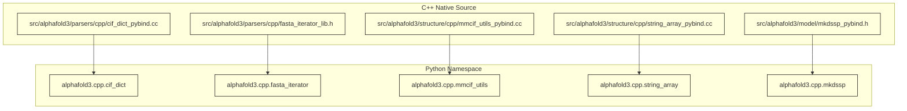
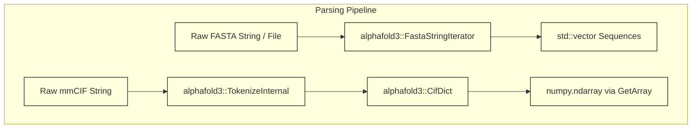

# Native C++ Extensions

Relevant source files

The following files were used as context for generating this wiki page:

- [src/alphafold3/model/mkdssp_pybind.h](src/alphafold3/model/mkdssp_pybind.h)
- [src/alphafold3/parsers/cpp/cif_dict.pyi](src/alphafold3/parsers/cpp/cif_dict.pyi)
- [src/alphafold3/parsers/cpp/cif_dict_lib.cc](src/alphafold3/parsers/cpp/cif_dict_lib.cc)
- [src/alphafold3/parsers/cpp/cif_dict_pybind.cc](src/alphafold3/parsers/cpp/cif_dict_pybind.cc)
- [src/alphafold3/parsers/cpp/fasta_iterator_lib.h](src/alphafold3/parsers/cpp/fasta_iterator_lib.h)
- [src/alphafold3/structure/cpp/mmcif_utils.pyi](src/alphafold3/structure/cpp/mmcif_utils.pyi)
- [src/alphafold3/structure/cpp/mmcif_utils_pybind.cc](src/alphafold3/structure/cpp/mmcif_utils_pybind.cc)
- [src/alphafold3/structure/cpp/string_array_pybind.cc](src/alphafold3/structure/cpp/string_array_pybind.cc)

## Purpose and Scope
This page documents the native C++ extension modules used in AlphaFold 3 (`src/alphafold3/parsers/cpp/` and `src/alphafold3/structure/cpp/`). These performance-critical modules handle mmCIF dictionary parsing [src/alphafold3/parsers/cpp/cif_dict_lib.cc:20](), fast FASTA iteration [src/alphafold3/parsers/cpp/fasta_iterator_lib.h:46](), string array manipulations [src/alphafold3/structure/cpp/string_array_pybind.cc:50](), mmCIF structural layout, alternate locations, structural connectivity [src/alphafold3/structure/cpp/mmcif_utils_pybind.cc:44](), and DSSP secondary structure assignment [src/alphafold3/model/mkdssp_pybind.h:28](). They are exposed to Python via `pybind11` [src/alphafold3/parsers/cpp/cif_dict_pybind.cc:47]().

---

## 1. Extension Module Overview and Python Binding Architecture

AlphaFold 3 implements performance-sensitive parsing, featurization, and structure manipulation routines in C++ and exposes them to Python via `pybind11` extension modules. These modules are unified and registered into the Python namespace through C++ translation units.

*Figure 1: Mapping of C++ binding modules to Python namespace entities.*

Sources: 
- `src/alphafold3/parsers/cpp/cif_dict_pybind.cc` [src/alphafold3/parsers/cpp/cif_dict_pybind.cc:47]()
- `src/alphafold3/parsers/cpp/fasta_iterator_lib.h` [src/alphafold3/parsers/cpp/fasta_iterator_lib.h:46]()
- `src/alphafold3/structure/cpp/mmcif_utils_pybind.cc` [src/alphafold3/structure/cpp/mmcif_utils_pybind.cc:44]()
- `src/alphafold3/structure/cpp/string_array_pybind.cc` [src/alphafold3/structure/cpp/string_array_pybind.cc:40]()
- `src/alphafold3/model/mkdssp_pybind.h` [src/alphafold3/model/mkdssp_pybind.h:28]()

---

## 2. Parsing Extensions (`cif_dict` and `fasta_iterator`)

The `parsers/cpp` directory houses high-performance parsers for mmCIF files and sequence files.

### `cif_dict`
`cif_dict_lib.cc` implements a tokenizer adhering to the CIF v1.1 specification [src/alphafold3/parsers/cpp/cif_dict_lib.cc:60](). It handles quoted tokens, comments (`#`), semicolons (`;`) for multiline values, and row loops.
* **`SplitLineInline`**: Tokenizes a single line while respecting single and double quotes [src/alphafold3/parsers/cpp/cif_dict_lib.cc:58]().
* **`TokenizeInternal`**: Parses multiline records and skips comments [src/alphafold3/parsers/cpp/cif_dict_lib.cc:124]().
* **`CifDict` Python Bindings**: Exposed via `cif_dict_pybind.cc`, providing `get_array()` for fast NumPy conversion [src/alphafold3/parsers/cpp/cif_dict_pybind.cc:136](), `extract_loop_as_dict()`, and `extract_loop_as_list()` [src/alphafold3/parsers/cpp/cif_dict.pyi:45]().

### `fasta_iterator`
`fasta_iterator_lib.h` provides both eager parsing (`ParseFasta`, `ParseFastaIncludeDescriptions`) and lazy iterators (`FastaFileIterator`, `FastaStringIterator`) to parse large sequence files efficiently [src/alphafold3/parsers/cpp/fasta_iterator_lib.h:38]().

*Figure 2: Data flow through parsing native extensions.*

Sources:
- `src/alphafold3/parsers/cpp/cif_dict_lib.cc` [src/alphafold3/parsers/cpp/cif_dict_lib.cc:58]()
- `src/alphafold3/parsers/cpp/fasta_iterator_lib.h` [src/alphafold3/parsers/cpp/fasta_iterator_lib.h:38]()

---

## 3. Structure Manipulation Extensions (`structure/cpp`)

The `structure/cpp` directory contains modules for mmCIF layout analysis, alternative locations (`altlocs`), structural connectivity (`struct_conn`), and array string operations.

### `mmcif_utils` (`mmcif_layout`, `altlocs`, `struct_conn`)
`mmcif_utils_pybind.cc` binds core structural inspection routines:
* **`AtomSiteLoop` & `EntityLoop`**: Validates and extracts loop columns from `CifDict` such as `_atom_site.id`, `_atom_site.label_asym_id`, and `_entity.type` [src/alphafold3/structure/cpp/mmcif_utils_pybind.cc:85]() [src/alphafold3/structure/cpp/mmcif_utils_pybind.cc:125]().
* **`SelectChains`**: Filters chains based on polymer types, nucleotides, ligands, and water flags [src/alphafold3/structure/cpp/mmcif_utils_pybind.cc:157]().
* **`fix_residues`**: Corrects residue topologies and coordinate placements [src/alphafold3/structure/cpp/mmcif_utils_pybind.cc:38]().

### `string_array`
`string_array_pybind.cc` accelerates NumPy object array and string operations:
* **`RemapNumpyArrayObjects`**: In-place or copying dictionary remapping of object arrays using `NpyIter` [src/alphafold3/structure/cpp/string_array_pybind.cc:50]().
* **`FormatFloatArray`**: Converts float spans to fixed-decimal string vectors faster than Python comprehensions [src/alphafold3/structure/cpp/string_array_pybind.cc:138]().
* **`IsIn`**: Fast element containment tests returning boolean NumPy arrays [src/alphafold3/structure/cpp/string_array_pybind.cc:152]().

Sources:
- `src/alphafold3/structure/cpp/mmcif_utils_pybind.cc` [src/alphafold3/structure/cpp/mmcif_utils_pybind.cc:38]()
- `src/alphafold3/structure/cpp/string_array_pybind.cc` [src/alphafold3/structure/cpp/string_array_pybind.cc:50]()

---

## 4. Secondary Structure Assignment (`mkdssp`)

Secondary structure assignment is exposed via `mkdssp_pybind.h` [src/alphafold3/model/mkdssp_pybind.h:28](). 
* **`RegisterModuleMkdssp`**: Registers the DSSP calculation module into the Python module structure (`alphafold3.cpp.mkdssp`) to evaluate hydrogen bonds and secondary structure elements directly from C++ coordinate buffers.

Sources:
- `src/alphafold3/model/mkdssp_pybind.h` [src/alphafold3/model/mkdssp_pybind.h:20]()

---