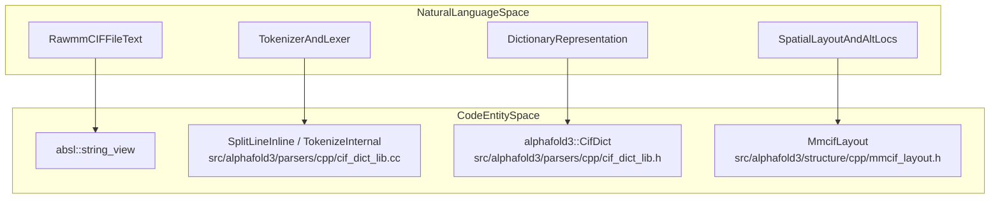
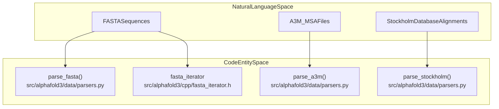

# File Format Reference

Relevant source files

The following files were used as context for generating this wiki page:

- [src/alphafold3/parsers/cpp/cif_dict_lib.cc](src/alphafold3/parsers/cpp/cif_dict_lib.cc)
- [src/alphafold3/structure/parsing.py](src/alphafold3/structure/parsing.py)
- [src/alphafold3/structure/structure.py](src/alphafold3/structure/structure.py)

This page provides a high-level reference for the file formats used by AlphaFold 3, focusing on mmCIF parsing, structure representation, and sequence/alignment formats. For comprehensive details, see the child pages:
- [mmCIF Format](#10.1)
- [Structure Parsing](#10.2)
- [Sequence and Alignment Formats](#10.3)

---

## Overview of File Formats

AlphaFold 3 processes three main categories of file formats: structural data (mmCIF), job specifications (JSON), and sequence/alignment data (FASTA, A3M, Stockholm). The system employs a hybrid architecture utilizing performance-critical C++ modules integrated with Python for high-level structure manipulation.

| Format | Purpose | Key C++ / Python Entities |
|--------|---------|---------------------------|
| **mmCIF** | Structural input and output coordinates/metadata | `alphafold3::CifDict` [src/alphafold3/parsers/cpp/cif_dict_lib.cc:358](), `Mmcif` [src/alphafold3/structure/mmcif.py](), `Structure` [src/alphafold3/structure/structure.py:20]() |
| **JSON** | Input job specifications, chain definitions, ligands | `Input` [src/alphafold3/datamodels/input.py](), `ProteinChain`, `Ligand` |
| **FASTA/A3M/Stockholm** | Sequences and multiple sequence alignments (MSAs) | `src/alphafold3/data/parsers.py`, `fasta_iterator` [src/alphafold3/cpp/fasta_iterator.h]() |

Sources: [src/alphafold3/parsers/cpp/cif_dict_lib.cc:358-478](), [src/alphafold3/structure/structure.py:20-50]()

---

## mmCIF Parsing and Layout

The mmCIF parsing subsystem converts raw text strings into structured dictionaries (`CifDict`) and then into spatial coordinate hierarchies (`Structure`). 

**Diagram: mmCIF Parsing Bridge (Natural Language to Code Entities)**

For deeper technical details on tokenization rules, loop structures, and serialization, refer to [mmCIF Format](#10.1). For details on converting `CifDict` into `Structure` objects via `mmcif_utils`, see [Structure Parsing](#10.2).

Sources: [src/alphafold3/parsers/cpp/cif_dict_lib.cc:47-154](), [src/alphafold3/parsers/cpp/cif_dict_lib.cc:358-478]()

---

## Sequence and Alignment Formats

Sequence and profile databases are queried during the data pipeline stage, consuming formats such as FASTA, A3M, and Stockholm.

**Diagram: Sequence and Alignment Parsing Bridge (Natural Language to Code Entities)**

For comprehensive documentation on parsing functions, sharded database support, and C++ helper integrations, see [Sequence and Alignment Formats](#10.3).

Sources: [src/alphafold3/parsers/cpp/cif_dict_lib.cc:1-50]()

---