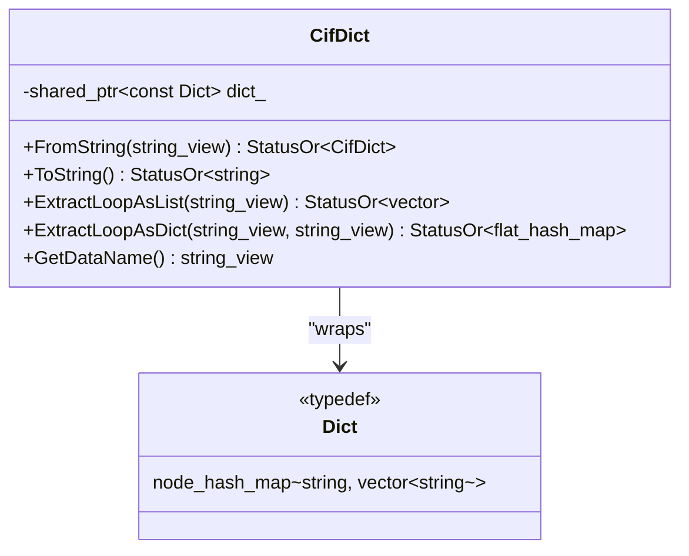
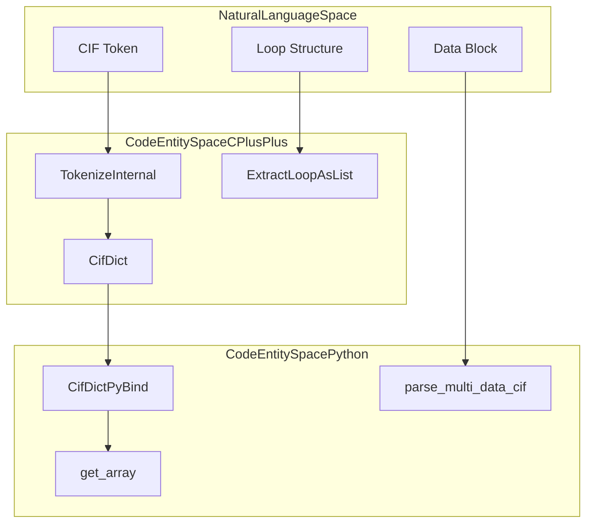
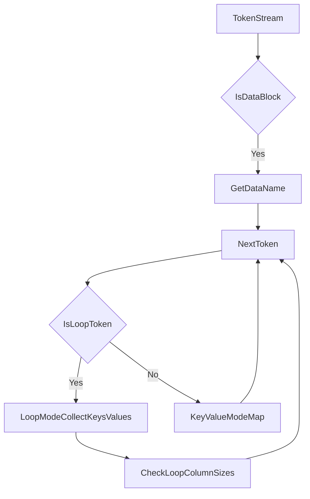
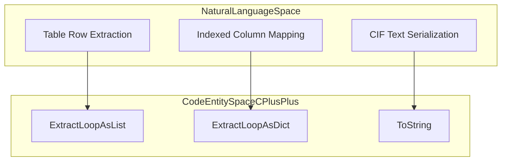

# mmCIF Format

Relevant source files

The following files were used as context for generating this wiki page:

- [src/alphafold3/data/cpp/msa_profile_pybind.h](src/alphafold3/data/cpp/msa_profile_pybind.h)
- [src/alphafold3/parsers/cpp/cif_dict.pyi](src/alphafold3/parsers/cpp/cif_dict.pyi)
- [src/alphafold3/parsers/cpp/cif_dict_lib.cc](src/alphafold3/parsers/cpp/cif_dict_lib.cc)
- [src/alphafold3/parsers/cpp/cif_dict_lib.h](src/alphafold3/parsers/cpp/cif_dict_lib.h)
- [src/alphafold3/parsers/cpp/cif_dict_pybind.cc](src/alphafold3/parsers/cpp/cif_dict_pybind.cc)

## Purpose and Scope

This document describes the low-level mmCIF (macromolecular Crystallographic Information File) parsing and serialization implemented in the `CifDict` library. The library provides a C++-based parser that converts mmCIF text into a dictionary-like structure and back. This page covers tokenization rules, loop structures, serialization logic, and the Python interface.

For details on converting these parsed dictionaries into high-level structural models, see [Structure Parsing](10.2).

Sources: `[src/alphafold3/parsers/cpp/cif_dict_lib.h:20-21]()`, `[src/alphafold3/parsers/cpp/cif_dict_lib.cc:20-21]()`

## Overview

AlphaFold 3 utilizes a custom C++ parser implemented in `cif_dict_lib.cc` to handle the CIF v1.1 specification. The parser is exposed to Python via `pybind11` in `cif_dict_pybind.cc`. This implementation is optimized for the large datasets typical of the Protein Data Bank (PDB), such as the Chemical Component Dictionary (CCD).

Sources: `[src/alphafold3/parsers/cpp/cif_dict_lib.cc:20-40]`, `[src/alphafold3/parsers/cpp/cif_dict_pybind.cc:20-53]()`

## CifDict Architecture

### Core Data Structure
The `CifDict` class manages a shared dictionary (`Dict`) mapping string keys to vectors of string values.

Title: CifDict Class Structure

Sources: `[src/alphafold3/parsers/cpp/cif_dict_lib.h:39-43]`, `[src/alphafold3/parsers/cpp/cif_dict_lib.cc:30-40]()`

### Code Entity Mapping
This diagram bridges the natural language concepts of mmCIF parsing to the specific C++ and Python entities.

Title: mmCIF Concept to Code Mapping

Sources: `[src/alphafold3/parsers/cpp/cif_dict_lib.h:39-156]`, `[src/alphafold3/parsers/cpp/cif_dict_pybind.cc:45-184]`, `[src/alphafold3/parsers/cpp/cif_dict.pyi:26-135]()`

## Tokenization Process

### Tokenization Pipeline
The tokenizer handles whitespace, comments, and complex quoting rules. It uses `string_view` to point into the original buffer whenever possible to minimize copies.

| Token Category | Identification Rule | Implementation |
| :--- | :--- | :--- |
| **Inline** | Separated by whitespace or tabs. | `SplitLineInline` `[src/alphafold3/parsers/cpp/cif_dict_lib.cc:57-121]()` |
| **Quoted** | Enclosed in `'` or `"` at token boundaries. | `IsQuote` `[src/alphafold3/parsers/cpp/cif_dict_lib.cc:53-53]()` |
| **Multiline** | Starts with `;` at the beginning of a line. | `TokenizeInternal` `[src/alphafold3/parsers/cpp/cif_dict_lib.cc:123-166]()` |
| **Comments** | Starts with `#`; ignored until end of line. | `SplitLineInline` `[src/alphafold3/parsers/cpp/cif_dict_lib.cc:74-76]()` |

Sources: `[src/alphafold3/parsers/cpp/cif_dict_lib.cc:53-166]()`

### Quoting Rules for Serialization
When converting back to string (`ToString`), the library applies specific quoting logic:
1. **Trivial Tokens**: No quotes if characters are `[A-Za-z0-9.?-]`. `[src/alphafold3/parsers/cpp/cif_dict_lib.cc:170-178]()`
2. **Multiline**: If a token contains a newline or both quote types, it is written as a multiline block starting with `;`. `[src/alphafold3/parsers/cpp/cif_dict_lib.cc:180-195]()`

Sources: `[src/alphafold3/parsers/cpp/cif_dict_lib.cc:170-195]()`

## Parsing and Loop Structures

### Main Parsing Logic
The parser iterates through tokens, switching between single-key and loop modes.

Title: mmCIF Parsing State Machine

Sources: `[src/alphafold3/parsers/cpp/cif_dict_lib.cc:123-166]()`

### Loop Extraction and Serialization Concept Mapping
This diagram bridges loop extraction and serialization natural language requirements to concrete C++ methods.

Title: Loop and Serialization Concept to Code Mapping

Sources: `[src/alphafold3/parsers/cpp/cif_dict_lib.h:66-83]()`, `[src/alphafold3/parsers/cpp/cif_dict_lib.h:54-54]()`

## Python Integration and NumPy Support

The `CifDict` is highly optimized for Python via `cif_dict_pybind.cc`. A key feature is `get_array()`, which allows direct conversion of mmCIF columns into NumPy arrays with specific dtypes.

### NumPy Array Conversion (`get_array`)
The implementation uses `GatherArray` to efficiently map string values to numerical or object arrays.

| Feature | Implementation Detail |
| :--- | :--- |
| **Dtypes** | Supports `int16/32/64`, `uint16/32/64`, `float32/64`, and `object`. `[src/alphafold3/parsers/cpp/cif_dict_pybind.cc:140-184]()` |
| **String Interning** | Identical strings reference the same object to save space. `[src/alphafold3/parsers/cpp/cif_dict.pyi:109-109]()` |
| **Missing Values** | Treat `.` or `?` as `NaN` for float arrays. `[src/alphafold3/parsers/cpp/cif_dict.pyi:107-108]()` |
| **Gathering** | Supports slices or index arrays to extract subsets of data. `[src/alphafold3/parsers/cpp/cif_dict.pyi:92-104]()` |

Sources: `[src/alphafold3/parsers/cpp/cif_dict_pybind.cc:55-184]`, `[src/alphafold3/parsers/cpp/cif_dict.pyi:92-115]()`

## Chemical Components (CCD) Handling

AlphaFold 3 uses the `CifDict` library to parse the PDB Chemical Component Dictionary.

1. **Parsing Multiple Data Blocks**: Utilizes `ParseMultiDataCifDict` to process multi-record CIF files such as component dictionaries. `[src/alphafold3/parsers/cpp/cif_dict_lib.h:151-152]()`
2. **Python Bindings**: Exposed via `parse_multi_data_cif` in the pybind module. `[src/alphafold3/parsers/cpp/cif_dict.pyi:135-135]()`

Sources: `[src/alphafold3/parsers/cpp/cif_dict_lib.h:151-152]`, `[src/alphafold3/parsers/cpp/cif_dict.pyi:134-135]()`

---