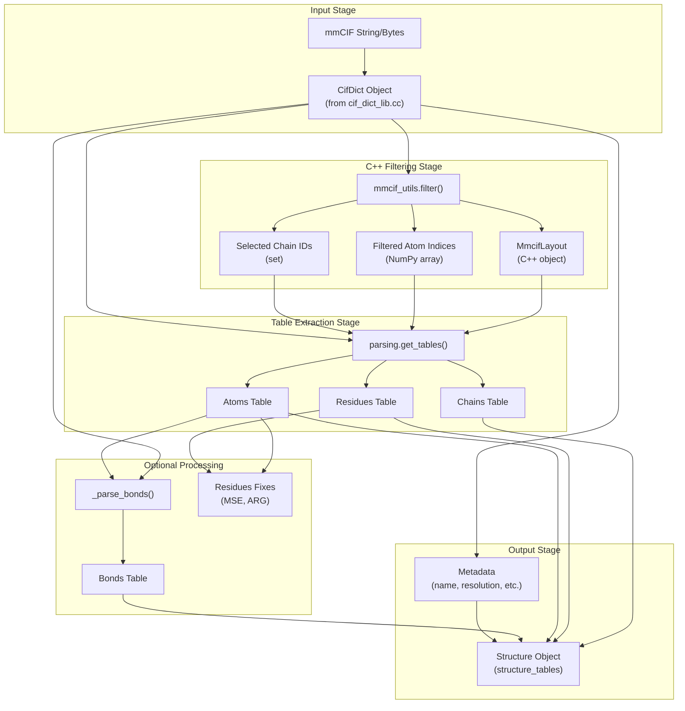
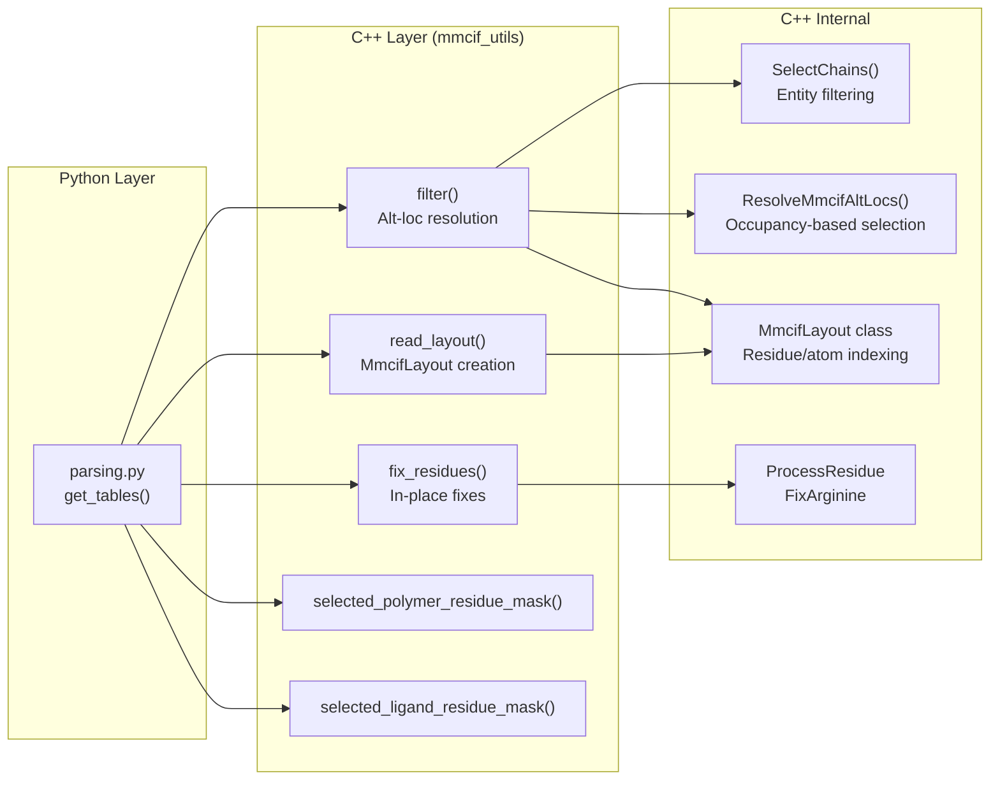
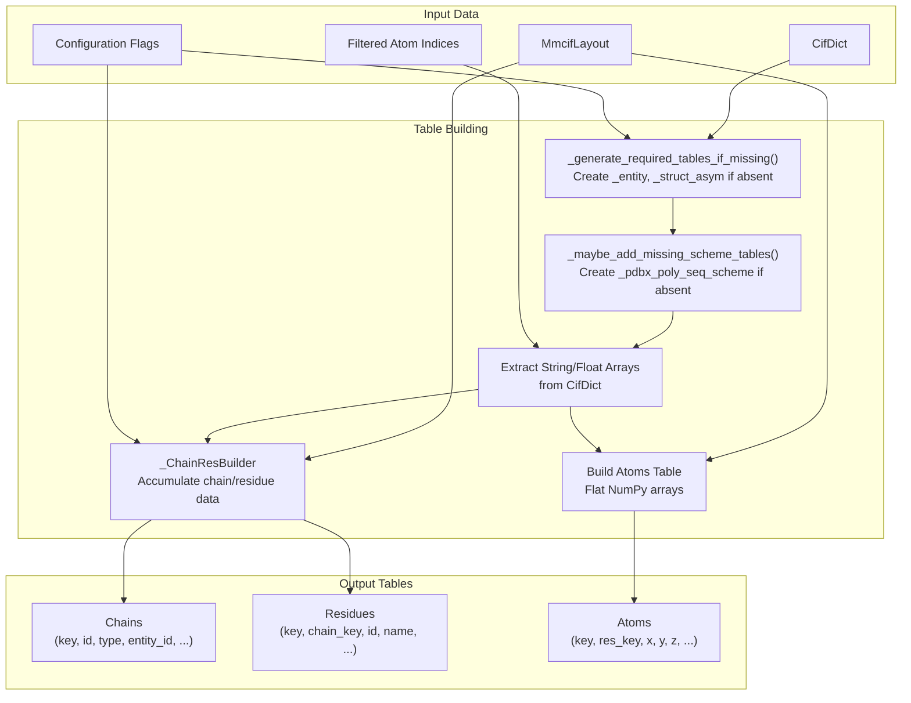
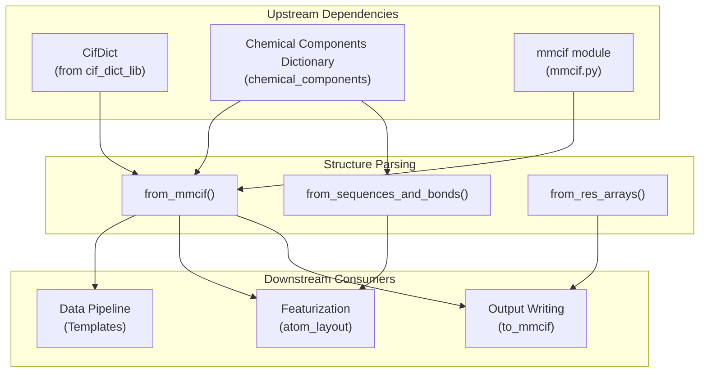

# Structure Parsing

Relevant source files

The following files were used as context for generating this wiki page:

- [src/alphafold3/structure/cpp/mmcif_altlocs.h](src/alphafold3/structure/cpp/mmcif_altlocs.h)
- [src/alphafold3/structure/cpp/mmcif_utils.pyi](src/alphafold3/structure/cpp/mmcif_utils.pyi)
- [src/alphafold3/structure/cpp/mmcif_utils_pybind.cc](src/alphafold3/structure/cpp/mmcif_utils_pybind.cc)
- [src/alphafold3/structure/parsing.py](src/alphafold3/structure/parsing.py)
- [src/alphafold3/structure/structure.py](src/alphafold3/structure/structure.py)

## Overview

Structure Parsing provides the conversion layer between the mmCIF file format and the internal `Structure` representation used throughout AlphaFold 3. This module takes parsed mmCIF data (as `CifDict` objects, see [mmCIF Format](#10.1)) and produces `Structure` objects containing chains, residues, atoms, and optionally bonds in a table-based format optimized for downstream processing.

The primary implementation is in [src/alphafold3/structure/parsing.py](), with performance-critical operations delegated to the C++ `mmcif_utils` module exposed via [src/alphafold3/structure/cpp/mmcif_utils_pybind.cc](). For information about the underlying `Structure` data representation, see [Structure Representation](#5.2).

**Sources:** [src/alphafold3/structure/parsing.py:20-41](), [src/alphafold3/structure/cpp/mmcif_utils_pybind.cc:1-796]()

## Conversion Pipeline

The structure parsing pipeline transforms raw mmCIF data through multiple stages to produce a validated `Structure` object:

Title: Structure Parsing Pipeline

**Pipeline Stages:**

1.  **Input Stage**: mmCIF string parsed into `CifDict` using C++ tokenizer.
2.  **C++ Filtering Stage**: `mmcif_utils.filter()` performs alt-loc resolution, chain selection, and generates layout metadata [src/alphafold3/structure/cpp/mmcif_utils_pybind.cc:358-427]().
3.  **Table Extraction Stage**: Python code extracts and organizes data into table structures via `get_tables()` [src/alphafold3/structure/parsing.py:1301-1398]().
4.  **Optional Processing**: Bonds parsed if requested [src/alphafold3/structure/parsing.py:202-253](), residue fixes applied [src/alphafold3/structure/cpp/mmcif_utils_pybind.cc:429-472]().
5.  **Output Stage**: Tables combined with metadata to create final `Structure` [src/alphafold3/structure/parsing.py:307-396]().

**Sources:** [src/alphafold3/structure/parsing.py:20-41](), [src/alphafold3/structure/cpp/mmcif_utils_pybind.cc:358-427]()

## Main Entry Points

### from_mmcif()

Primary function for parsing mmCIF strings directly into `Structure` objects [src/alphafold3/structure/parsing.py:399-453]().

**Parameters:**
*   `mmcif_string`: Raw mmCIF file content.
*   `fix_mse_residues`: Convert selenomethionine (MSE) to methionine (MET) by changing SE to SD.
*   `fix_arginines`: Ensure NH1 is closer to CD than NH2 in arginine residues.
*   `fix_unknown_dna`: Replace residue name `N` with `DN` in DNA chains.
*   `include_water`: Include HOH molecules in parsing.
*   `include_other`: Include non-standard entity types.
*   `include_bonds`: Parse `_struct_conn` table for bond information.
*   `model_id`: Which model to parse - `ModelID.FIRST`, `ModelID.ALL`, or integer ID.

**Sources:** [src/alphafold3/structure/parsing.py:399-453]()

### from_parsed_mmcif()

Optimized variant that accepts an already-parsed `Mmcif` object [src/alphafold3/structure/parsing.py:307-396](). This function is called internally by `from_mmcif()` but can be used directly when the mmCIF has already been parsed for other purposes.

**Sources:** [src/alphafold3/structure/parsing.py:307-396]()

### Model Selection

The `model_id` parameter supports three modes via the `ModelID` enum:

| Value | Behavior | Coordinates Shape |
| :--- | :--- | :--- |
| `ModelID.FIRST` | Parse only the first model | `(num_atoms, 3)` |
| `ModelID.ALL` | Parse all models | `(num_models, num_atoms, 3)` |
| `int` | Parse specific model by ID | `(num_atoms, 3)` |

The `_get_str_model_id()` helper converts these values to string model IDs used internally [src/alphafold3/structure/parsing.py:169-199]().

**Sources:** [src/alphafold3/structure/parsing.py:62-68](), [src/alphafold3/structure/parsing.py:169-199]()

## C++ Performance Layer

Performance-critical operations are implemented in C++ and exposed via the `mmcif_utils` module. This layer handles alt-loc resolution, filtering, and layout computation.

Title: C++ Performance Layer Architecture

**Sources:** [src/alphafold3/structure/cpp/mmcif_utils_pybind.cc:1-796](), [src/alphafold3/structure/cpp/mmcif_utils.pyi:28-80]()

### mmcif_utils.filter()

The core filtering function returns atom indices to keep after alt-loc resolution and chain selection [src/alphafold3/structure/cpp/mmcif_utils_pybind.cc:358-427]().

**Returns:**
*   NumPy array of shape `(num_models, num_atoms)` containing atom indices.
*   Set of selected chain IDs.
*   `MmcifLayout` object encoding residue boundaries and model structure.

**Alt-loc Resolution Logic:**
Alt-locs (alternate locations) are resolved by the C++ logic inside `mmcif_utils.filter()` which utilizes `ResolveMmcifAltLocs` [src/alphafold3/structure/cpp/mmcif_altlocs.h:49-54](). This groups atoms by ID and selects the highest occupancy alt-loc, with alphabetical tie-breaks.

**Sources:** [src/alphafold3/structure/cpp/mmcif_altlocs.h:49-54](), [src/alphafold3/structure/cpp/mmcif_utils_pybind.cc:358-427]()

### MmcifLayout Class

C++ class that encodes the hierarchical structure of the `_atom_site` table [src/alphafold3/structure/cpp/mmcif_layout.h:28-140]():

*   `num_models()`: Number of models in the layout.
*   `num_chains()`: Total number of chains.
*   `num_residues()`: Total number of residues (excluding unresolved).
*   `num_atoms()`: Total number of atoms.
*   `atom_site_from_residue_index(residue_idx)`: Maps residue index to starting atom index.
*   `atom_range(residue_idx)`: Returns `(start, end)` atom indices for a residue.

**Sources:** [src/alphafold3/structure/cpp/mmcif_layout.h:28-140]()

### mmcif_utils.fix_residues()

Performs in-place fixes on residue data, currently supporting arginine atom reordering [src/alphafold3/structure/cpp/mmcif_utils_pybind.cc:429-472](). For arginine residues, it ensures NH1/NH2 are ordered correctly relative to CD.

**Sources:** [src/alphafold3/structure/cpp/mmcif_utils_pybind.cc:429-472](), [src/alphafold3/structure/cpp/mmcif_utils.pyi:38-46]()

## Table Construction

The `get_tables()` function orchestrates conversion from filtered mmCIF data to table structures [src/alphafold3/structure/parsing.py:1301-1398]():

Title: Table Construction Data Flow

**Sources:** [src/alphafold3/structure/parsing.py:1301-1398]()

### Missing Table Generation

The `_generate_required_tables_if_missing()` function infers missing mmCIF tables from available data [src/alphafold3/structure/parsing.py:1010-1102]().

**Table Inference Logic:**

| Missing Table | Inferred From | Strategy |
| :--- | :--- | :--- |
| `_struct_asym` | `_atom_site.label_asym_id`, `_atom_site.label_entity_id` | Deduplicate (entity\_id, asym\_id) pairs [src/alphafold3/structure/parsing.py:1020-1044]() |
| `_entity` | `_atom_site` residues + `group_PDB` | Guess entity type via `_guess_entity_type()` [src/alphafold3/structure/parsing.py:1046-1081]() |
| `_entity_poly` | `_entity` + residue names | Guess polymer type (protein/DNA/RNA) [src/alphafold3/structure/parsing.py:1083-1102]() |

**Sources:** [src/alphafold3/structure/parsing.py:1010-1102]()

### Scheme Table Generation

The `_maybe_add_missing_scheme_tables()` function creates residue numbering scheme tables [src/alphafold3/structure/parsing.py:1105-1269](). These tables (`_pdbx_poly_seq_scheme`, `_pdbx_nonpoly_scheme`, `_pdbx_branch_scheme`) are essential for handling structures with non-sequential residue numbering or insertion codes.

**Sources:** [src/alphafold3/structure/parsing.py:1105-1269]()

### _ChainResBuilder

Helper class that incrementally builds chain and residue tables by accumulating data during iteration over atoms [src/alphafold3/structure/parsing.py:842-1000](). It deduplicates chains and applies fixes (MSE→MET, N→DN) before creating final tables.

**Sources:** [src/alphafold3/structure/parsing.py:842-1000]()

## Bond Parsing

When `include_bonds=True`, the `_parse_bonds()` function extracts covalent bond information from the `_struct_conn` table [src/alphafold3/structure/parsing.py:202-253]().

**Bond Filtering:**
*   Removes bonds with symmetry operators other than `1_555`.
*   Removes bonds referencing atoms filtered out.
*   Preserves all standard bond types: `covale`, `disulf`, `metalc`, `hydrog`.

**Sources:** [src/alphafold3/structure/parsing.py:202-253]()

## Alternative Construction Methods

### from_sequences_and_bonds()

Creates minimal structures from sequence strings and bonded atom pairs [src/alphafold3/structure/parsing.py:628-839]().

**Sequence Formats:**
*   `FASTA`: Single-letter amino acid or nucleotide codes [src/alphafold3/structure/parsing.py:74-74]().
*   `CCD_CODES`: Multiple-letter chemical components dictionary ids [src/alphafold3/structure/parsing.py:75-75]().
*   `LIGAND_SMILES`: SMILES string defining a molecule [src/alphafold3/structure/parsing.py:76-76]().

**Sources:** [src/alphafold3/structure/parsing.py:71-77](), [src/alphafold3/structure/parsing.py:628-839]()

### from_res_arrays()

Constructs structures from residue-shaped NumPy arrays [src/alphafold3/structure/parsing.py:456-588](). This is used to convert model outputs back to `Structure` objects by flattening atom arrays based on an `atom_mask`.

**Sources:** [src/alphafold3/structure/parsing.py:456-588]()

## Special Data Handling

### Insertion Code Remapping

Insertion codes use a specific remapping to normalize values [src/alphafold3/structure/parsing.py:49-49]():
`_INSERTION_CODE_REMAP: Mapping[str, str] = {'.': '?'}`.

**Sources:** [src/alphafold3/structure/parsing.py:49-50]()

### Chain Key Ordering

The `_get_chain_key_by_chain_id()` function ensures chain keys respect both `_struct_asym` table order and actual resolution order in `_atom_site` [src/alphafold3/structure/parsing.py:1272-1298]().

**Sources:** [src/alphafold3/structure/parsing.py:1272-1298]()

### Error Handling

The module defines specific exceptions for parsing failures:

| Exception | Raised When |
| :--- | :--- |
| `NoAtomsError` | mmCIF has no atoms or `_atom_site.pdbx_PDB_model_num` missing [src/alphafold3/structure/parsing.py:52-54]() |
| `ValueError` | Invalid sequences, mismatched chain IDs, duplicate keys [src/alphafold3/structure/parsing.py:164-168]() |

**Sources:** [src/alphafold3/structure/parsing.py:52-54](), [src/alphafold3/structure/parsing.py:164-168]()

## Integration Points

Structure Parsing integrates with other AlphaFold 3 subsystems:

Title: Structure Parsing Integration

**Sources:** [src/alphafold3/structure/parsing.py:20-41]()

---