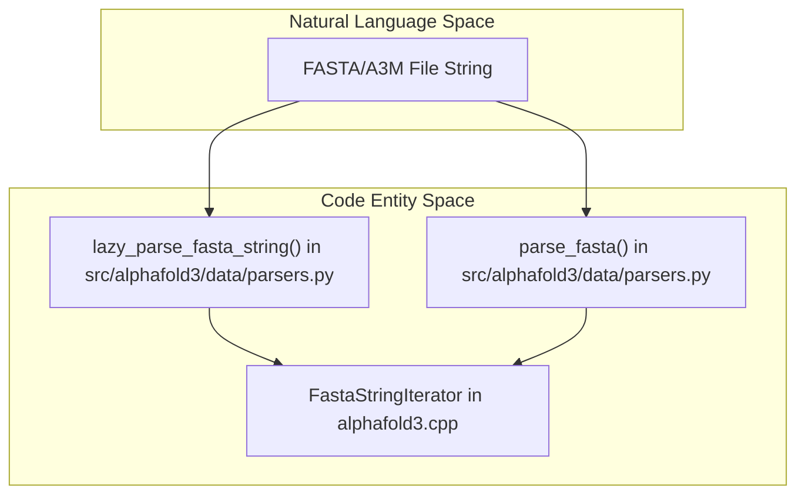
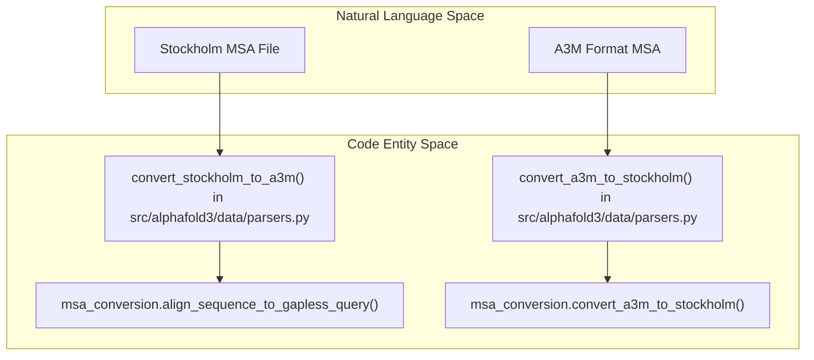

# Sequence and Alignment Formats

Relevant source files

The following files were used as context for generating this wiki page:

- [src/alphafold3/data/parsers.py](src/alphafold3/data/parsers.py)
- [src/alphafold3/data/tools/hmmalign.py](src/alphafold3/data/tools/hmmalign.py)
- [src/alphafold3/data/tools/hmmbuild.py](src/alphafold3/data/tools/hmmbuild.py)
- [src/alphafold3/data/tools/hmmsearch.py](src/alphafold3/data/tools/hmmsearch.py)
- [src/alphafold3/parsers/cpp/fasta_iterator_pybind.h](src/alphafold3/parsers/cpp/fasta_iterator_pybind.h)
- [src/alphafold3/parsers/cpp/msa_conversion_pybind.h](src/alphafold3/parsers/cpp/msa_conversion_pybind.h)

## Purpose and Scope
This page details the parsing, validation, and conversion infrastructure for biological sequences and Multiple Sequence Alignments (MSAs) within AlphaFold 3. It covers the core Python parser interface in `src/alphafold3/data/parsers.py`, the performance-optimized C++ fasta iterator (`fasta_iterator`), and alignment format conversion utilities (`msa_conversion`). It also documents how these parsers interface with external search and profile-building tools such as HMMER.

Sources:
- `src/alphafold3/data/parsers.py:20-28` [src/alphafold3/data/parsers.py:20-28]()

---

## 1. FASTA and A3M Parsing Architecture
AlphaFold 3 processes single sequences and alignment files (such as FASTA and A3M formats) using memory-efficient iterators implemented in C++ and exposed via pybind11 bindings.

### Python Parsers and C++ Backends
The primary entry points for reading raw sequence strings are `lazy_parse_fasta_string` and `parse_fasta` defined in `src/alphafold3/data/parsers.py`. 

- `lazy_parse_fasta_string(fasta_string: str)`: Wraps `fasta_iterator.FastaStringIterator` to stream sequence-description tuples `(sequence, description)` lazily from memory without loading all items into intermediate Python lists [src/alphafold3/data/parsers.py:32-55]().
- `parse_fasta(fasta_string: str)`: Invokes `fasta_iterator.parse_fasta_include_descriptions` to fully parse a FASTA/A3M string into parallel lists of amino-acid sequences and their corresponding comment-line descriptions [src/alphafold3/data/parsers.py:58-71]().

*Figure 1: FASTA parsing data flow from input strings to iterator components.*

Sources:
- `src/alphafold3/data/parsers.py:32-71` [src/alphafold3/data/parsers.py:32-71]()
- `src/alphafold3/parsers/cpp/fasta_iterator_pybind.h:20-31` [src/alphafold3/parsers/cpp/fasta_iterator_pybind.h:20-31]()

---

## 2. Alignment Format Conversions (A3M and Stockholm)
Multiple Sequence Alignments transition between A3M (used by HHblits/Jackhmmer workflows) and Stockholm format (used by HMMER suite tools like `hmmsearch` and `hmmbuild`).

### Conversion Functions
- `convert_a3m_to_stockholm(a3m: str, max_seqs: int | None)`: Parses sequences via `parse_fasta`, sanitizes and indexes unique sequence identifiers (`name_index`), calls `msa_conversion.convert_a3m_to_stockholm` to adjust insertion gaps, and appends reference column annotation (`#=GC RF`) [src/alphafold3/data/parsers.py:73-110]().
- `convert_stockholm_to_a3m(stockholm: IO[str], max_sequences: int | None, remove_first_row_gaps: bool, linewidth: int | None)`: Streams through Stockholm lines, extracts alignment rows and `#=GS` description lines, and invokes `msa_conversion.align_sequence_to_gapless_query` to realign sequences against a gapless query before formatting into chunked FASTA/A3M blocks [src/alphafold3/data/parsers.py:113-186]().

*Figure 2: Alignment conversion routines bridging Stockholm and A3M formats.*

Sources:
- `src/alphafold3/data/parsers.py:73-186` [src/alphafold3/data/parsers.py:73-186]()
- `src/alphafold3/parsers/cpp/msa_conversion_pybind.h:20-31` [src/alphafold3/parsers/cpp/msa_conversion_pybind.h:20-31]()

---

## 3. Integration with HMMER Tool Wrappers
Parsed alignments are transformed into profile Hidden Markov Models (HMMs) via wrappers for `hmmbuild`, `hmmsearch`, and `hmmalign`.

### Tool Workflows
- **Hmmbuild**: Constructs HMM profiles from either Stockholm or A3M inputs. When processing A3M strings, `Hmmbuild.build_profile_from_a3m` uses `lazy_parse_fasta_string` to strip out lowercase insertion columns prior to profile construction [src/alphafold3/data/tools/hmmbuild.py:79-97]().
- **Hmmsearch**: Queries database files using either raw HMM profiles, A3M alignments, or Stockholm alignments, subsequently calling `convert_stockholm_to_a3m` to process output alignments [src/alphafold3/data/tools/hmmsearch.py:109-161]().
- **Hmmalign**: Aligns sequence lists or A3M files against profile HMMs, cleaning gaps via `str.maketrans` and `lazy_parse_fasta_string` before invoking the binary [src/alphafold3/data/tools/hmmalign.py:55-153]().

Sources:
- `src/alphafold3/data/tools/hmmsearch.py:109-162` [src/alphafold3/data/tools/hmmsearch.py:109-161]()
- `src/alphafold3/data/tools/hmmbuild.py:61-155` [src/alphafold3/data/tools/hmmbuild.py:61-155]()
- `src/alphafold3/data/tools/hmmalign.py:55-154` [src/alphafold3/data/tools/hmmalign.py:55-153]()

---