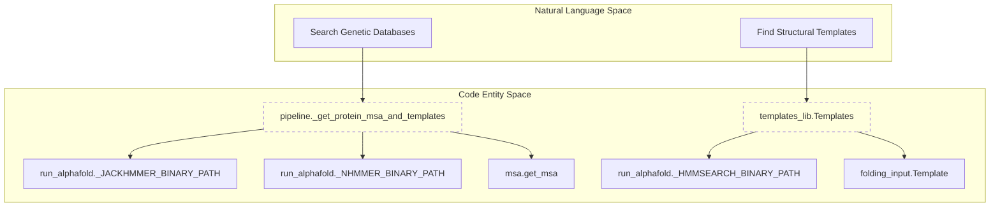
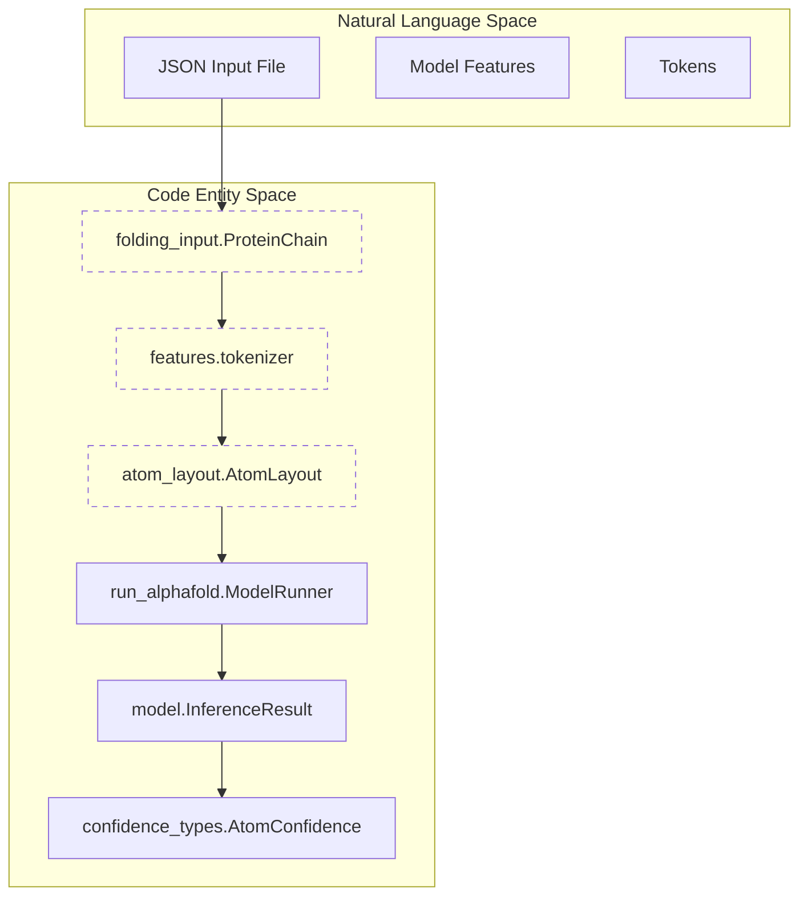

# Glossary

Relevant source files

The following files were used as context for generating this wiki page:

- [run_alphafold.py](run_alphafold.py)
- [run_alphafold_test.py](run_alphafold_test.py)
- [src/alphafold3/common/folding_input.py](src/alphafold3/common/folding_input.py)
- [src/alphafold3/common/folding_input_test.py](src/alphafold3/common/folding_input_test.py)
- [src/alphafold3/data/msa_config.py](src/alphafold3/data/msa_config.py)
- [src/alphafold3/data/pipeline.py](src/alphafold3/data/pipeline.py)
- [src/alphafold3/data/templates.py](src/alphafold3/data/templates.py)
- [src/alphafold3/data/tools/shards.py](src/alphafold3/data/tools/shards.py)
- [src/alphafold3/model/confidence_types.py](src/alphafold3/model/confidence_types.py)
- [src/alphafold3/model/json_serialize_pybind.cc](src/alphafold3/model/json_serialize_pybind.cc)
- [src/alphafold3/model/json_serialize_pybind.h](src/alphafold3/model/json_serialize_pybind.h)

This page provides definitions for codebase-specific terms, biological domain concepts, and computational jargon used throughout AlphaFold 3. It serves as a technical reference for onboarding engineers to navigate the system's architecture and data flow.

## Biological and Domain Concepts

### CCD (Chemical Component Dictionary)
A reference library of all standard and non-standard residues, ligands, and ions found in the PDB. AlphaFold 3 uses this dictionary for featurization, looking up SMILES strings, and generating atom layouts.
*   **Implementation**: `Ccd` class in [src/alphafold3/constants/chemical_components.py:179-199]().
*   **Usage**: Used during tokenization to retrieve the layout of standard residues [src/alphafold3/model/features.py:177-183]().

### MSA (Multiple Sequence Alignment)
A collection of sequences evolutionary related to a query sequence. AlphaFold 3 uses MSAs to extract co-evolutionary signals.
*   **Paired MSA**: Sequences from the same organism across different chains, used to compute paired features [src/alphafold3/common/folding_input.py:155-159]().
*   **Unpaired MSA**: Deduplicated sequences used for single-chain features [src/alphafold3/common/folding_input.py:160-164]().
*   **Container**: Managed by the `Msa` class, which handles deduplication and merging [src/alphafold3/data/msa.py:52-111]().

### Template
A known 3D structure of a protein that is homologous to the query sequence. Templates provide structural hints to the model during the initial stages of folding.
*   **Implementation**: `Template` class in [src/alphafold3/common/folding_input.py:99-194]().
*   **Features**: Converted into AlphaFold 3 format (e.g., `template_aatype`, `template_atom_positions`) for model consumption [src/alphafold3/data/templates.py:45-52]().

**Sources**: [src/alphafold3/common/folding_input.py:99-194](), [src/alphafold3/data/msa.py:52-111](), [src/alphafold3/data/templates.py:45-52](), [src/alphafold3/constants/chemical_components.py:179-199]()

---

## Computational and Model Terms

### AtomLayout
A structural representation that maps atoms to their metadata (chain ID, residue ID, element) and positions. It acts as the bridge between raw coordinates and tokenized features.
*   **Implementation**: `AtomLayout` in [src/alphafold3/model/atom_layout/atom_layout.py]().
*   **Tokenization**: The `tokenizer` function converts a flat `AtomLayout` into a token-based layout for the Evoformer [src/alphafold3/model/features.py:164-220]().

### Token
The fundamental unit of processing in the AlphaFold 3 model. A token typically represents one polymer residue (amino acid or nucleotide) or one atom in a ligand.
*   **Max Atoms per Token**: Defined by `max_atoms_per_token` (typically 47). This constant determines the padding size for atom-level features within a token [src/alphafold3/model/features.py:167-183]().

### Z-Value
A normalization constant representing the database size (number of sequences for protein or megabases for RNA) used for E-value calculation in sharded genetic searches.
*   **Configuration**: Defined via flags such as `small_bfd_z_value` or `ntrna_z_value` [run_alphafold.py:147-204]().
*   **Significance**: Must be set correctly for sharded databases to ensure E-value calculations remain consistent with non-sharded runs [src/alphafold3/data/msa_config.py:71-72]().

**Sources**: [src/alphafold3/model/features.py:164-220](), [run_alphafold.py:147-204](), [src/alphafold3/data/msa_config.py:71-72]()

---

## Software Engineering and Pipeline Terms

### Dialect
Refers to the specific JSON schema used for input. AlphaFold 3 supports two dialects: `alphafold3` (native) and `alphafoldserver` (compatibility mode).
*   **Constants**: Defined in [src/alphafold3/common/folding_input.py:46-52]().
*   **Versions**: Native dialect currently supports versions 1 through 4 [src/alphafold3/common/folding_input.py:47-48]().

### Sharding
The process of splitting large genetic databases into smaller pieces (shards) to allow parallel search across multiple CPU cores, significantly reducing data pipeline runtime.
*   **Implementation**: Logic for handling sharded paths (e.g., `prefix@N`) is found in [src/alphafold3/data/tools/shards.py:57-83]().
*   **Performance**: Sharding enables concurrent tool execution across multi-core machines [src/alphafold3/data/pipeline.py:96-120]().

### PaddingShapes
A dataclass used to define the target dimensions for padding feature tensors before batching.
*   **Fields**: Includes dimensions for tokens, MSAs, chains, templates, and atoms [src/alphafold3/model/features.py:51-57]().

**Sources**: [src/alphafold3/common/folding_input.py:46-52](), [src/alphafold3/data/tools/shards.py:57-83](), [src/alphafold3/data/pipeline.py:96-120](), [src/alphafold3/model/features.py:51-57]()

---

## System Architecture Diagrams

### From Natural Language to Code Entities: Data Pipeline
This diagram maps high-level data acquisition concepts to the specific classes and binaries used in the AlphaFold 3 pipeline.

**Data Search Flow**

**Sources**: [run_alphafold.py:114-138](), [src/alphafold3/data/pipeline.py:81-162](), [src/alphafold3/data/templates.py:51-61]()

### From Natural Language to Code Entities: Featurization
This diagram maps the conceptual "Data Prep" phase to the internal JAX/Numpy feature processing logic.

**Featurization Mapping**

**Sources**: [src/alphafold3/common/folding_input.py:196-200](), [src/alphafold3/model/features.py:164-196](), [run_alphafold.py:159-179]()

---

## Summary Table of Key Classes

| Term | Class / File | Description |
| :--- | :--- | :--- |
| **Input Model** | `folding_input.Input` | Root dataclass for a prediction job [src/alphafold3/common/folding_input.py:204-205](). |
| **Protein Chain** | `folding_input.ProteinChain` | Metadata and sequence for a protein, including MSAs [src/alphafold3/common/folding_input.py:196-200](). |
| **Ligand** | `folding_input.Ligand` | Represents small molecules (SMILES/CCD) [src/alphafold3/common/folding_input.py:178-184](). |
| **Structure** | `structure.Structure` | Internal 3D representation [src/alphafold3/structure/mmcif.py:39-40](). |
| **Inference Result** | `model.InferenceResult` | Contains predicted structure and confidence scores [src/alphafold3/model/confidence_types.py:113-124](). |
| **Atom Confidence** | `confidence_types.AtomConfidence` | Dataclass for 1D per-atom confidences and categories [src/alphafold3/model/confidence_types.py:96-103](). |

**Sources**: [src/alphafold3/common/folding_input.py:178-205](), [src/alphafold3/structure/mmcif.py:39-40](), [src/alphafold3/model/confidence_types.py:96-124]()