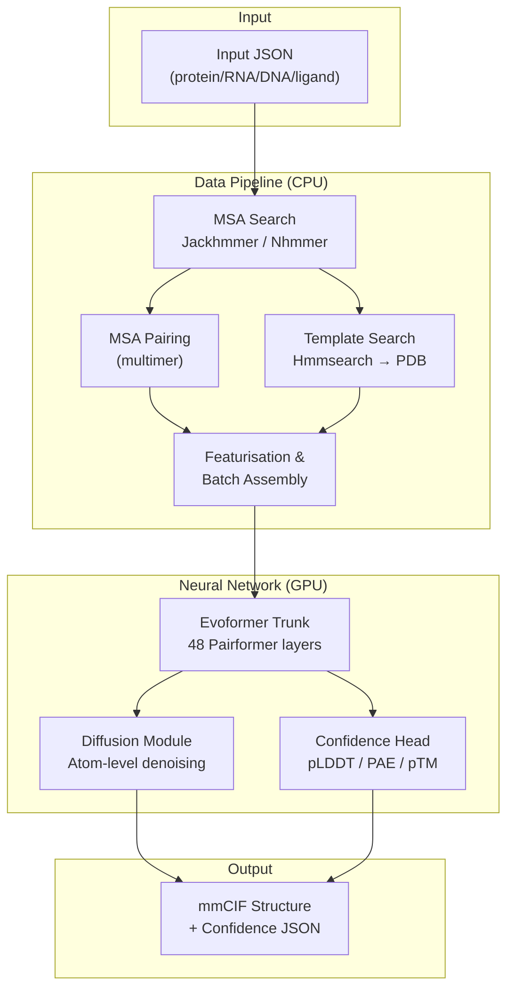

**AlphaFold 3** is DeepMind's third-generation protein structure prediction system — a quantum leap beyond its predecessors. Where AlphaFold 2 predicted single-chain and multimer protein structures, AlphaFold 3 extends its reach to **biomolecular interactions** across the entire structural biology landscape: proteins, RNA, DNA, small molecule ligands, post-translational modifications, and covalent bonds between entities. This is the inference pipeline implementation, licensed under Apache 2.0 with model parameters governed by separate terms of use.


Sources: [README.md](/README.md#L1-L25), [src/alphafold3/__init__.py](/src/alphafold3/__init__.py#L20-L21)

## What AlphaFold 3 Predicts

AlphaFold 3 models the **3D atomic structure** of biomolecular complexes from sequence information alone. The system accepts a JSON input describing one or more chains and ligands, runs a genetic and structural database search pipeline, feeds the resulting features through a deep neural network, and outputs atomic coordinates in mmCIF format alongside per-residue and per-atom confidence metrics.

| Entity Type | Input Specification | Capability |
|---|---|---|
| **Protein** | Amino acid sequence + optional modifications | Full atomistic prediction, MSA + template search |
| **RNA** | Nucleotide sequence + optional modifications | MSA search via Nhmmer against NT-RNA / Rfam / RNAcentral |
| **DNA** | Nucleotide sequence + optional modifications | Structure prediction without MSA search |
| **Ligand (CCD)** | Chemical Component Dictionary code | 3D conformer from CCD or RDKit generation |
| **Ligand (SMILES)** | SMILES string | RDKit conformer generation |
| **Covalent bonds** | Bond definitions between entities | Inter-chain and intra-chain covalent linking |

Sources: [docs/input.md](/docs/input.md#L29-L41), [src/alphafold3/common/folding_input.py](/src/alphafold3/common/folding_input.py#L43-L51)

## Architecture at a Glance

AlphaFold 3 operates as a **two-stage pipeline** that can be independently controlled: a CPU-bound **data pipeline** (MSA + template search) and a GPU-bound **inference pipeline** (neural network forward pass + post-processing). The following diagram shows the end-to-end flow from input JSON to output structure.



Sources: [run_alphafold.py](/run_alphafold.py#L48-L59), [src/alphafold3/data/pipeline.py](/src/alphafold3/data/pipeline.py#L20-L36), [src/alphafold3/model/model.py](/src/alphafold3/model/model.py#L38-L47)

## Project Structure

The codebase is organized as a Python package (`alphafold3`) with C++ extensions for performance-critical components (MSA profiles, JSON serialization, DSSP, structure parsing). The entry point is `run_alphafold.py` at the repository root.

```
alphafold3/
├── run_alphafold.py              # Main entry point — orchestrates both pipelines
├── src/alphafold3/
│   ├── common/                   # Shared types: FoldingInput, BaseConfig, Resources
│   ├── constants/                # Chemical constants: atom types, residue names, periodic table
│   ├── data/                     # Data pipeline: MSA search, templates, featurisation
│   │   ├── pipeline.py           #   → Orchestrates MSA + template tools
│   │   ├── featurisation.py      #   → Converts raw data → model features
│   │   ├── tools/                #   → Jackhmmer, Nhmmer, Hmmsearch wrappers
│   │   └── cpp/                  #   → C++ MSA profile computation
│   ├── model/                    # Neural network: inference core
│   │   ├── network/              #   → Evoformer, DiffusionHead, ConfidenceHead, AtomCrossAttention
│   │   ├── pipeline/             #   → Model featurizer & structure cleaning
│   │   ├── scoring/              #   → Alignment, chirality, ranking scores
│   │   └── model.py              #   → Top-level model class & InferenceResult
│   ├── jax/geometry/             # JAX-based rigid body geometry operations
│   ├── structure/                # Structure I/O: mmCIF parsing, bonds, bioassemblies
│   └── parsers/                  # C++ accelerated bioinformatics parsers
├── examples/                     # 13 sample input JSON files
├── docker/                       # Dockerfile + jackhmmer patch
└── docs/                         # Official documentation
```

Sources: [src/alphafold3/](/src/alphafold3/__init__.py#L20-L21), [run_alphafold.py](/run_alphafold.py#L48-L66)

## Neural Network Core

The model architecture represents a fundamental redesign from AlphaFold 2. Three key innovations define the AlphaFold 3 network:

**Evoformer Trunk** — The backbone processing module takes MSA, pair, and single embeddings through 48 Pairformer layers (replacing the separate MSA + pair streams of AF2). It integrates template embeddings and per-atom cross-attention conditioning to produce refined single and pair representations. Channel dimensions are `seq_channel=384` and `pair_channel=128`.

**Diffusion Module** — AlphaFold 3 replaces AF2's structure module with a **diffusion-based atom-level decoder**. Instead of predicting an SE(3) frame per residue, it directly predicts all atom positions through iterative denoising. The `SIGMA_DATA=16.0` constant governs the noise schedule, calibrated against the multimer training set. Multiple diffusion samples (default: 5) are generated per seed, and the top-ranking prediction is selected.

**Confidence Head** — A lightweight 4-layer Pairformer predicts per-token pLDDT scores, predicted aligned error (PAE), and predicted TM-score (pTM). These metrics guide the ranking of multiple sampled predictions.

| Component | Key Parameter | Default Value |
|---|---|---|
| Pairformer layers | `num_layer` | 48 |
| Sequence channel | `seq_channel` | 384 |
| Pair channel | `pair_channel` | 128 |
| MSA channel | `msa_channel` | 64 |
| Diffusion samples | `num_diffusion_samples` | 5 |
| Recycles | `num_recycles` | 10 |
| Confidence Pairformer layers | `num_layer` | 4 |

> [!TIP]
> The data pipeline (`--run_data_pipeline`) is CPU-only and can be run separately from inference (`--run_inference`), which requires a GPU. Decoupling these stages is essential for resource-efficient batch processing.

Sources: [src/alphafold3/model/network/evoformer.py](/src/alphafold3/model/network/evoformer.py#L39-L74), [src/alphafold3/model/network/diffusion_head.py](/src/alphafold3/model/network/diffusion_head.py#L38-L39), [src/alphafold3/model/network/confidence_head.py](/src/alphafold3/model/network/confidence_head.py#L38-L60), [run_alphafold.py](/run_alphafold.py#L379-L389)

## Runtime Requirements

AlphaFold 3 has significant hardware demands driven by the size of the genetic databases (~1 TB) and the GPU memory requirements for inference on large complexes.

| Requirement | Specification |
|---|---|
| **Operating System** | Linux only |
| **GPU** | NVIDIA Compute Capability ≥ 8.0 (Ampere+) |
| **Verified GPUs** | A100 80 GB, H100 80 GB |
| **Max tokens on A100/H100** | 5,120 tokens |
| **RAM** | ≥ 64 GB (for long targets during genetic search) |
| **Disk** | ~1 TB SSD recommended (for databases) |
| **CUDA** | 12.6 (Docker host requirement) |
| **Python** | ≥ 3.12 |

> [!TIP]
> Token count is the primary scaling dimension. A token corresponds to one amino acid/nucleotide or one ligand entity. Inputs exceeding 5,120 tokens require GPUs with more than 80 GB VRAM or model parallelism.

Sources: [docs/installation.md](/docs/installation.md#L1-L13), [pyproject.toml](/pyproject.toml#L14-L29), [run_alphafold.py](/run_alphafold.py#L356-L365)

## Key Dependencies

The implementation leverages several specialized libraries for its computational backbone:

| Library | Role |
|---|---|
| **JAX** (0.10.2) | Differentiable computing framework — all neural network ops |
| **Haiku** (0.0.17) | JAX-native neural network library (module abstractions) |
| **Tokamax** (0.0.12) | Flash attention implementations (Triton/cuDNN/XLA) |
| **RDKit** (2025.9.4) | Small molecule conformer generation, SMILES parsing |
| **HMMER Suite** | Jackhmmer (protein MSA), Nhmmer (RNA MSA), Hmmsearch (templates) |
| **DSSP** | Secondary structure assignment from predicted coordinates |
| **pybind11** | C++ ↔ Python bindings for performance-critical parsers |

Sources: [pyproject.toml](/pyproject.toml#L17-L29), [README.md](/README.md#L137-L152)

## Input → Output at a Glance

**Input** is a JSON file specifying chains, ligands, bonds, and model seeds. The format supports both the native `alphafold3` dialect (more features) and the `alphafoldserver` dialect (auto-converted). Thirteen example input files cover common scenarios — protein-protein complexes, protein-ligand binding, RNA-protein interactions, glycosylated proteins, and modified DNA/RNA.

**Output** is a directory containing per-sample mmCIF files with predicted atomic coordinates, per-sample confidence JSONs, a top-ranking prediction symlink, and a `ranking_scores.csv` summarizing all samples. Embeddings and distograms can optionally be saved.

Sources: [docs/input.md](/docs/input.md#L1-L15), [docs/output.md](/docs/output.md#L1-L46), [examples/barnase_barstar.json](/examples/barnase_barstar.json#L1-L22)

## License & Model Parameters

The source code is under **Apache License 2.0**, but the model parameters are governed by separate [Terms of Use](https://github.com/google-deepmind/alphafold3/blob/main/WEIGHTS_TERMS_OF_USE.md). Parameters may only be used if received directly from Google (downloadable from `gs://alphafold3/af3.bin.zst`). Outputs are predictions with varying confidence and are **not intended for clinical use**.

Sources: [README.md](/README.md#L171-L200), [WEIGHTS_TERMS_OF_USE.md](/WEIGHTS_TERMS_OF_USE.md#L1-L1)

---

## Where to Go Next

Start with the practical setup, then deepen your understanding of the architecture:

1. **[Quick Start](2-quick-start)** — Install, configure databases, and run your first prediction
2. **[Input JSON Format](3-input-json-format)** — Master the input specification for all entity types
3. **[Architecture Overview](7-architecture-overview)** — Deep dive into the full system architecture and data flow
4. **[Output Format and Metrics](15-output-format-and-metrics)** — Understand prediction outputs and confidence scores