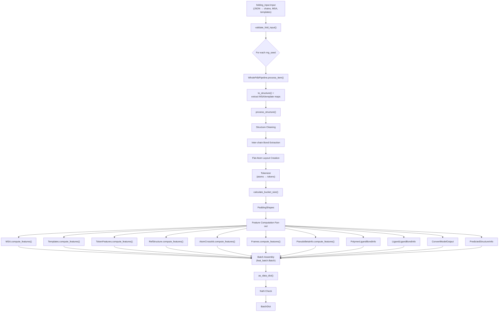
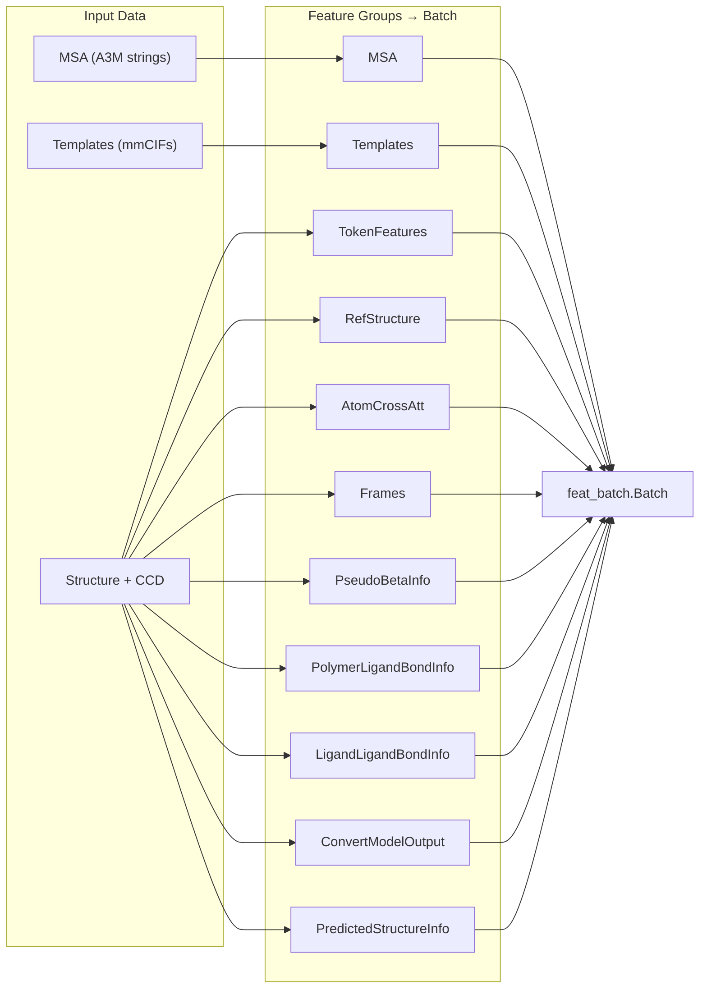

The featurisation and batching stage is the critical bridge between AlphaFold 3's search pipelines and its neural network core. It transforms raw MSA hits, template structures, and input sequences into a **padded, bucketed tensor batch** (`BatchDict`) that the Evoformer and Diffusion modules consume directly. Understanding this pipeline is essential for diagnosing shape mismatches, compilation overhead, and feature-level bugs.

## Architectural Overview

The featurisation pipeline follows a strict layered architecture: **validation → tokenization → per-feature computation → bucket-based padding → batch assembly → NaN check**. Each layer is stateless and deterministic for a given random seed, enabling reproducible inference across runs.



Sources: [featurisation.py](src/alphafold3/data/featurisation.py#L47-L121), [pipeline.py](src/alphafold3/model/pipeline/pipeline.py#L86-L438)

## Entry Point: `featurise_input()`

The public API for featurisation is [`featurise_input()`](src/alphafold3/data/featurisation.py#L47), which takes a validated `folding_input.Input`, a CCD object, and optional bucket sizes, then returns a `Sequence[BatchDict]` — one batch per `rng_seed`. The function first validates that all protein chains carry unpaired MSA, paired MSA, and templates, and that all RNA chains carry at least unpaired MSA. It then instantiates a `WholePdbPipeline` with the provided configuration and processes each seed independently, producing a fully materialized NumPy batch per seed.

Key configuration parameters passed through to the pipeline include `buckets` (for JAX compilation control), `resolve_msa_overlaps` (deduplication of unpaired against paired MSA), `fix_standalone_glycans` (training-matching behavior for glycan leaving atoms), and `conformer_max_iterations` (RDKit conformer search budget).

Sources: [featurisation.py](src/alphafold3/data/featurisation.py#L33-L121)

## Tokenization: From Atoms to Evoformer Tokens

The **tokenizer** is the central mapping that determines how atomic representations collapse into the token grid that the Evoformer operates on. This is not a simple residue-level mapping — it is a **polymorphic tokenizer** whose behavior depends on chain type and residue standardness.

| Chain Type | Standard Residue | Token Granularity | Representative Atom |
|---|---|---|---|
| Protein | Standard (e.g. ALA) | 1 token per residue | CA |
| Protein | Non-standard + MSE | 1 token per residue | CA |
| Protein | Non-standard (other) | 1 token per atom | Each atom |
| RNA/DNA | Standard (e.g. A, DA) | 1 token per residue | C1' |
| RNA/DNA | Non-standard | 1 token per atom | Each atom |
| Ligand (non-polymer) | N/A | 1 token per atom | Each atom |

The tokenizer produces three outputs: **`all_tokens`** (an `AtomLayout` with one representative atom per token), **`all_token_atoms_layout`** (an `AtomLayout` with shape `(num_tokens, max_atoms_per_token)` listing all atoms per token), and **`standard_token_idxs`** (a mapping used to align MSA/template columns to the potentially-expanded token grid). The `max_atoms_per_token` defaults to **24**, accommodating the largest standard residue atom count from the CCD.

> [!TIP]
> Non-standard polymer residues are "flattened" into one-token-per-atom mode when `flatten_non_standard_residues=True` (the default). This means a modified residue like SEP (phosphoserine) generates 12+ tokens instead of 1, significantly inflating the token count and bucket size. For large complexes with many modifications, this can trigger JAX recompilation if bucket sizes aren't pre-configured.

Sources: [features.py](src/alphafold3/model/features.py#L173-L408)

## Bucket-Based Padding and Compilation Control

JAX compiles a separate XLA program for each distinct input shape. To prevent excessive recompilation, AlphaFold 3 uses a **bucketing scheme** that pads all inputs to a predetermined set of token counts. The `calculate_bucket_size()` function uses binary search (`bisect_left`) to find the smallest bucket ≥ the actual token count.

```python
# Default bucket behavior: no pre-defined buckets → pad to exact token count
buckets = None  # → padded_token_length = num_tokens

# Pre-defined buckets: pad to next bucket, avoiding recompilation
buckets = [256, 512, 1024, 2048, 4096]  # → e.g. 300 tokens → pad to 512
```

If the token count exceeds the largest bucket, a warning is logged and the token count itself is used as the bucket size — which **will trigger recompilation**. The padding shapes are then derived from the bucket size:

| Padding Dimension | Calculation |
|---|---|
| `num_tokens` | `padded_token_length` (from bucket) |
| `msa_size` | `msa_crop_size` (default 16384) |
| `num_chains` | `pad_num_chains` (default 1000) |
| `num_templates` | `max_templates` (default 4) |
| `num_atoms` | `padded_token_length × average_num_atoms_per_token`, rounded up to `atom_cross_att_queries_subset_size` (default 32) |

Sources: [pipeline.py](src/alphafold3/model/pipeline/pipeline.py#L43-L71), [pipeline.py](src/alphafold3/model/pipeline/pipeline.py#L279-L292)

## Feature Computation: The Eleven Feature Groups

The `Batch` dataclass assembles exactly **eleven feature groups**, each a frozen dataclass with its own `compute_features()` classmethod. Every group independently pads its output to the `PaddingShapes` dimensions before returning.



### MSA Features

The `MSA` feature group is the most complex, performing **per-chain featurization → cross-chain pairing → cropping → merging → padding**. For each chain, the unpaired A3M is parsed into an `Msa` object and featurized (producing `msa`, `deletion_matrix` arrays). Paired MSA is featurized separately and suffixed with `_all_seq`. Profile features (per-position residue frequency) and deletion means are computed via `data3.get_profile_features()`.

When multiple unique protein chains exist (detected via `num_unique_chains > 1`), **MSA pairing** is activated: `msa_pairing.create_paired_features()` pairs sequences across chains by species taxonomy, limited by `max_paired_sequence_per_species` (default 600). Paired sequences are then deduplicated against unpaired sequences if `resolve_msa_overlaps=True`.

MSA cropping uses `choose_paired_unpaired_msa_crop_sizes()` to allocate the total `msa_crop_size` budget (default 16384) between paired and unpaired rows, with a 50% cap on paired rows. After merging chains via `merge_msa_features()` and `merge_paired_and_unpaired_msa()`, the MSA is cropped to standard token indices and padded.

| MSA Field | Shape | dtype | Description |
|---|---|---|---|
| `msa` | `(msa_size, num_tokens)` | int8 | Residue types per MSA row/column |
| `msa_mask` | `(msa_size, num_tokens)` | bool | Valid MSA entries |
| `deletion_matrix` | `(msa_size, num_tokens)` | int8 | Deletion counts (clipped) |
| `profile` | `(num_tokens, num_residue_types)` | float32 | Position-wise residue frequency |
| `deletion_mean` | `(num_tokens,)` | float32 | Mean deletions per position |
| `num_alignments` | scalar | int32 | Actual MSA depth before padding |

Sources: [features.py](src/alphafold3/model/features.py#L411-L715)

### Template Features

Template features are computed per protein chain by parsing each template's mmCIF, extracting polymer features via `templates.get_polymer_features()` (which realigns template residues to the query), and packaging them with `package_template_features()`. Templates are reduced to `max_templates` (default 4) per chain, then concatenated across chains on the token dimension. Like MSA, template columns are indexed by `standard_token_idxs` to handle non-standard residue expansion.

| Template Field | Shape | dtype |
|---|---|---|
| `template_aatype` | `(num_templates, num_tokens)` | int32 |
| `template_atom_positions` | `(num_templates, num_tokens, 24, 3)` | float32 |
| `template_atom_mask` | `(num_templates, num_tokens, 24)` | bool |

Sources: [features.py](src/alphafold3/model/features.py#L718-L883)

### Token Features

`TokenFeatures` encodes per-token identity and topology: residue type (`aatype`), position indices (`residue_index`, `token_index`), chain symmetry identifiers (`asym_id`, `entity_id`, `sym_id`), and chain-type boolean flags (`is_protein`, `is_rna`, `is_dna`, `is_ligand`, `is_nonstandard_polymer_chain`, `is_water`). The symmetry identifiers follow the convention where identical sequences share an `entity_id` but receive distinct `asym_id` and incrementing `sym_id` values.

Sources: [features.py](src/alphafold3/model/features.py#L904-L997)

### Reference Structure and Frames

`RefStructure` generates 3D reference coordinates for each atom in the `all_token_atoms_layout`. For standard polymer residues, these come from ideal CCD coordinates. For ligands, RDKit conformer generation is attempted (with a fallback to CCD model coordinates if `ref_max_modified_date` allows). A **deterministic** reference structure is also computed with a fixed seed (`12312837`) for frame construction when `deterministic_frames=True`.

`Frames` builds local coordinate frames (origin + 3 orthonormal axes) per token from the reference structure, which the Diffusion Head uses to define noise in a rotation-invariant local frame.

Sources: [pipeline.py](src/alphafold3/model/pipeline/pipeline.py#L360-L421)

## The Batch Object: Final Assembly and Validation

After all eleven feature groups are computed, they are assembled into a single `feat_batch.Batch` frozen dataclass. This object is registered as a JAX pytree via `jax.tree_util.register_dataclass`, enabling seamless `jax.jit` compilation. The `Batch` exposes:

- **`as_data_dict()`** → flattens all feature groups into a single `dict[str, np.ndarray]` (`BatchDict`) for model consumption
- **`from_data_dict()`** → reconstructs the structured `Batch` from a flat dictionary
- **`num_res`** property → returns `token_features.aatype.shape[-1]`

The final step in `process_item()` is a **NaN check**: every numeric field in the `BatchDict` is summed and tested for NaN, raising `NanDataError` if any is found. This catches upstream issues (e.g., failed conformer generation producing NaN coordinates) before they propagate into the model.

> [!TIP]
> The `Batch` object is a JAX pytree, meaning `jax.jit`-compiled functions can accept it directly as an argument. However, the model's forward pass actually consumes the flattened `BatchDict` (via `as_data_dict()`), not the structured `Batch`. The pytree registration primarily benefits checkpoint serialization and `jax.grad` traversal over batch elements.

Sources: [feat_batch.py](src/alphafold3/model/feat_batch.py#L28-L93), [pipeline.py](src/alphafold3/model/pipeline/pipeline.py#L423-L482)

## WholePdbPipeline Configuration Reference

The `WholePdbPipeline.Config` controls all aspects of featurisation and batching. The table below lists every configurable parameter with its default and purpose.

| Parameter | Default | Purpose |
|---|---|---|
| `max_atoms_per_token` | 24 | Atom slots per token (dense atom representation width) |
| `pad_num_chains` | 1000 | Padding for chain-count dimensions |
| `buckets` | None | Bucket sizes for padding (None = no bucketing) |
| `max_total_residues` | None | Reject inputs exceeding this token count |
| `min_total_residues` | None | Reject inputs below this token count |
| `msa_crop_size` | 16384 | Maximum MSA depth across all chains |
| `max_template_date` | None | Cutoff date for template inclusion |
| `ref_max_modified_date` | None | CCD fallback date for conformer generation |
| `max_templates` | 4 | Maximum template structures per chain |
| `max_paired_sequence_per_species` | 600 | MSA pairing limit per taxonomic species |
| `drop_ligand_leaving_atoms` | True | Remove leaving atoms from ligand CCD entries |
| `average_num_atoms_per_token` | 24 | Expected atoms/token for atom count padding |
| `atom_cross_att_queries_subset_size` | 32 | Query subset size for atom cross attention |
| `atom_cross_att_keys_subset_size` | 128 | Key subset size for atom cross attention |
| `flatten_non_standard_residues` | True | Expand non-standard residues to 1-token-per-atom |
| `deterministic_frames` | True | Use fixed-seed reference positions for frames |
| `conformer_max_iterations` | None | Override RDKit conformer search iterations |
| `resolve_msa_overlaps` | True | Deduplicate unpaired MSA against paired MSA |
| `fix_standalone_glycans` | False | Keep glycan leaving atoms even if unbonded |

Sources: [pipeline.py](src/alphafold3/model/pipeline/pipeline.py#L89-L159)

## Data Flow: From Search Results to Batch

The featurisation pipeline receives its MSA and template data from the [MSA Search Pipeline](8-msa-search-pipeline) and [Template Search](9-template-search) stages. The `process_item()` method on `WholePdbPipeline` extracts these from the `folding_input.Input` object by iterating over chains: `ProteinChain` instances contribute unpaired MSA, paired MSA, and templates; `RnaChain` instances contribute only unpaired MSA. All other chain types (DNA, ligands) contribute no evolutionary information but are fully represented in the token and structural features.

The resulting `BatchDict` flows directly into the [Evoformer Trunk](11-evoformer-trunk), which consumes MSA rows, template features, and token features to produce pairwise representations, and subsequently into the [Diffusion Head](12-diffusion-head) and [Atom Cross Attention](13-atom-cross-attention) modules, which consume the reference structure, frames, and atom cross-attention features to denoise atomic coordinates.
