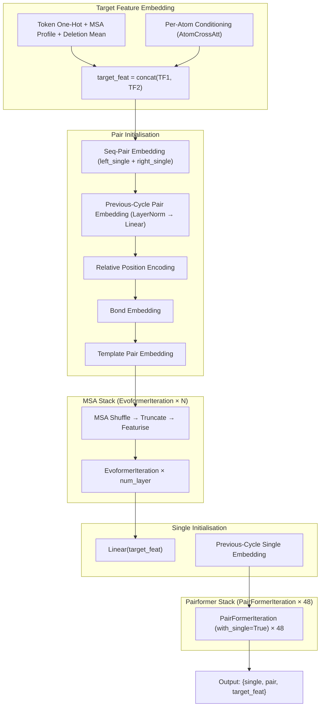
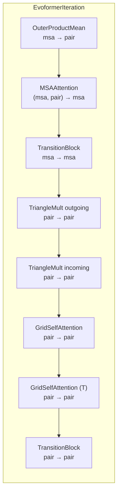
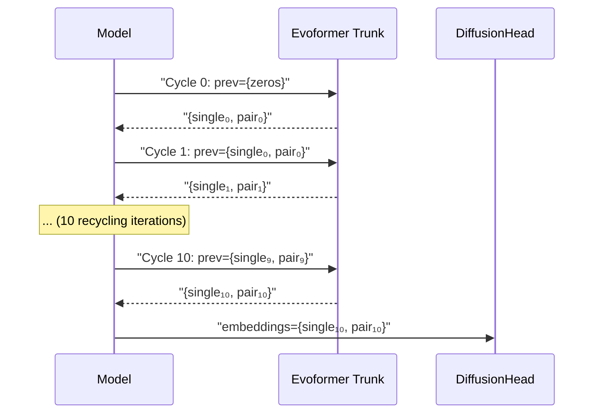

The **Evoformer Trunk** is the representational backbone of AlphaFold 3 — the module that transforms raw input features (MSA, templates, bonds, relative positions) into the **single embeddings** and **pair embeddings** that drive every downstream prediction head. Unlike AlphaFold 2's monolithic Evoformer stack, AlphaFold 3 decomposes its trunk into two distinct phases: an **MSA-aware Evoformer stack** that jointly evolves MSA and pair representations, followed by a **Pairformer stack** that refines pair and single representations without MSA. This two-phase architecture is the key structural innovation enabling AlphaFold 3's generalised input space (proteins, RNA, DNA, ligands, ions, covalent bonds) while remaining computationally tractable.

Sources: [evoformer.py](src/alphafold3/model/network/evoformer.py#L39-L84), [model.py](src/alphafold3/model/model.py#L280-L319)

## Architecture Overview

The Evoformer Trunk executes a strict sequential pipeline. Each phase enriches the pair representation before handing it to the next, and only the final Pairformer phase produces the single representation consumed by downstream heads.

The full `__call__` method enforces this ordering: pair embedding → previous-cycle injection → relative encoding → bond embedding → template embedding → MSA stack → single embedding → previous-cycle single injection → Pairformer stack. This is not merely a convention — the `del key` statement after the MSA phase signals that all stochastic processing is complete before the deterministic Pairformer begins.

Sources: [evoformer.py](src/alphafold3/model/network/evoformer.py#L252-L356)

## Channel and Layer Configuration

The default configuration establishes the dimensional contract that all downstream heads rely upon:

| Parameter | Default | Role |
|---|---|---|
| `msa_channel` | 64 | Width of MSA activations within the Evoformer stack |
| `seq_channel` | 384 | Width of the single (per-token) representation |
| `pair_channel` | 128 | Width of the pair (token×token) representation |
| `num_msa` | 1024 | Maximum MSA rows fed into the Evoformer stack |
| `max_relative_idx` | 32 | Clipping range for relative residue/token index encoding |
| `max_relative_chain` | 2 | Clipping range for relative chain index encoding |
| `pairformer.num_layer` | 48 | Number of PairFormer iterations in the trunk stack |
| `msa_stack.num_layer` | 4 (default) | Number of Evoformer iterations in the MSA stack |

The **48-layer Pairformer** is the dominant computational phase. Its configuration is a `PairformerConfig` that extends `PairFormerIteration.Config` with rematerialisation controls (`block_remat`, `remat_block_size`) for memory-efficient backpropagation through the deep stack.

Sources: [evoformer.py](src/alphafold3/model/network/evoformer.py#L46-L74)

## Phase 1: Pair Initialisation

### Sequence-Pair Embedding

The pair representation is bootstrapped from the target features via a **decomposition into left and right single projections**: `pair = Linear_left(target_feat)[:, None] + Linear_right(target_feat)[None, :]`. This produces a `[N, N, pair_channel]` tensor where each position `(i, j)` receives information from both token `i` and token `j` independently. A pair mask is constructed as the outer product of per-token masks.

### Previous-Cycle Embedding

In recurrent inference (up to 10 recycling iterations), the pair output from the previous cycle is injected via `LayerNorm → Linear` with the `global_config.final_init` initialiser. This residual pathway allows the trunk to refine its representations across cycles — the initial cycle passes a zero tensor, making this a no-op on the first forward pass.

### Relative Position Encoding

The `_relative_encoding` method calls `featurization.create_relative_encoding`, which computes four one-hot feature maps from the `TokenFeatures` metadata:

| Feature | Source Fields | Encoding |
|---|---|---|
| Relative residue index | `residue_index` | Clipped offset, one-hot over `[−max_relative_idx, +max_relative_idx]`; out-of-chain mapped to sentinel |
| Relative token index | `token_index` | Same clipped-offset scheme, but only active within the same residue |
| Same entity | `entity_id` | Binary indicator `entity_id[i] == entity_id[j]` |
| Relative chain (symmetry) | `sym_id` | Clipped offset within entity, one-hot over `[−max_relative_chain, +max_relative_chain]` |

The concatenated features are projected to `pair_channel` via a linear layer and added to the pair activations. This encoding is critical for the model to learn distance-dependent and chain-dependent structural priors.

### Bond Embedding

The `_embed_bonds` method constructs a **contact matrix** from two bond sources: `polymer_ligand_bonds` and `ligand_ligand_bonds`. Each bond's token indices are gathered, validated against their masks, and used to set entries in the contact matrix. The resulting `[N, N, 1]` tensor is projected to `pair_channel` and added to the pair activations. This is the mechanism by which AlphaFold 3 communicates covalent bond topology (e.g., ligand-protein bonds, DNA-protein crosslinks) to the trunk.

### Template Pair Embedding

The `TemplateEmbedding` module processes structural templates through a `SingleTemplateEmbedding` (which runs a 2-layer `PairFormerIteration` over each template's distogram and unit-vector features), then aggregates across templates via scan summation. A **multichain mask** (`asym_id[:, None] == asym_id[None, :]`) restricts template features to intra-chain pairs, since templates are per-chain. The aggregated template activations are added to the pair representation.

Sources: [evoformer.py](src/alphafold3/model/network/evoformer.py#L86-L206), [featurization.py](src/alphafold3/model/network/featurization.py#L177-L257)

## Phase 2: MSA Stack (EvoformerIteration)

The MSA processing phase transforms the pair representation using evolutionary information from the multiple sequence alignment. The pipeline is: **shuffle → truncate → featurise → Evoformer stack**.

The MSA is shuffled with a padding-consistent Gumbel argsort, then truncated to `num_msa` rows. Feature construction produces a per-row tensor concatenating a one-hot encoding of the MSA residue types, a binary deletion indicator, and a scaled deletion value (`arctan(d/3) * 2/π`). The MSA activations are initialised as `Linear(msa_feat) + Linear(target_feat)[None]` — the target features broadcast across all MSA rows.

Each **EvoformerIteration** performs the following operations in sequence:

| Sub-module | Input → Output | Key Mechanism |
|---|---|---|
| **OuterProductMean** | msa `[S,N,C_m]` → pair `[N,N,C_z]` | Projects MSA rows to left/right channels, computes chunked einsum outer product, normalises by mask product |
| **MSAAttention** | msa + pair → msa | Pair-conditioned attention: softmax over pair-derived logits aggregates MSA values across rows, with gating |
| **TriangleMultiplication** (×2) | pair → pair | Outgoing (`ikc,jkc→ijc`) and incoming (`kjc,kic→ijc`) triangle updates with GLU gating |
| **GridSelfAttention** (×2) | pair → pair | Row-wise and column-wise self-attention (transpose=True for columns) with pair bias and flash attention |
| **TransitionBlock** (×2) | msa → msa, pair → pair | Two-layer MLP with Swish-gated linear unit (GLU) and 4× expansion factor |

All updates are **residual** — each sub-module's output is added to its input. The MSA and pair representations evolve jointly through this block, enabling information to flow from evolutionary statistics (MSA) into pairwise structural constraints and vice versa. After the final EvoformerIteration, only the **pair output** is retained; the MSA representation is discarded.

Sources: [modules.py](src/alphafold3/model/network/modules.py#L542-L633), [evoformer.py](src/alphafold3/model/network/evoformer.py#L208-L250)

## Phase 3–4: Pairformer Stack

After the MSA stack completes, the **single representation** is initialised as `Linear(target_feat) + Linear(LayerNorm(prev_single))`, mirroring the pair initialisation pattern. The Pairformer stack then jointly refines both representations.

Each **PairFormerIteration** (with `with_single=True`) performs:

| Step | Operation | Tensor Shape |
|---|---|---|
| 1 | TriangleMultiplication (outgoing) | `[N,N,C_z] → [N,N,C_z]` |
| 2 | TriangleMultiplication (incoming) | `[N,N,C_z] → [N,N,C_z]` |
| 3 | GridSelfAttention (row-wise) | `[N,N,C_z] → [N,N,C_z]` |
| 4 | GridSelfAttention (column-wise) | `[N,N,C_z] → [N,N,C_z]` |
| 5 | TransitionBlock (sharded) | `[N,N,C_z] → [N,N,C_z]` |
| 6 | Single Attention with pair bias | `[N,C_s] → [N,C_s]` |
| 7 | Single TransitionBlock | `[N,C_s] → [N,C_s]` |

The **single attention** mechanism is a key architectural detail: the pair representation is projected to pair logits via `Linear(LayerNorm(pair))`, which serve as a position-dependent bias for the self-attention over the single representation. This allows the pairwise structural information accumulated through 48 Pairformer layers to directly modulate the per-token embeddings. The pair logits are transposed to `[num_heads, N, N]` and passed to `diffusion_transformer.self_attention` alongside the sequence mask.

The pair transition block supports **sharded application** — controlled by `shard_transition_blocks` and `pair_transition_shard_spec` in the global config — which splits the transition computation along the token dimension to manage memory pressure on large inputs.

Sources: [modules.py](src/alphafold3/model/network/modules.py#L422-L539)

## Core Sub-Modules Deep Dive

### TransitionBlock

A gated two-layer MLP: `LayerNorm → GLU(Swish) → Linear`. The GLU kernel uses `tokamax.gated_linear_unit` for fused computation when `use_glu_kernel=True`, decomposing the intermediate projection into gate and value branches (`Swish(a) * b`). The expansion factor defaults to 4×, controlled by `num_intermediate_factor`.

### TriangleMultiplication

Implements the geometric triangle update — the signature operation that gives Evoformer its name. Two variants exist:

| Variant | Equation | Geometric Interpretation |
|---|---|---|---|
| Outgoing | `ikc,jkc→ijc` | Information flows along edges sharing a source vertex `i` |
| Incoming | `kjc,kic→ijc` | Information flows along edges sharing a target vertex `j` |

Both apply `LayerNorm → GLU projection → split into a,b → einsum → LayerNorm → Linear → sigmoid gate`. The GLU kernel fuses the projection and gating for efficiency.

### GridSelfAttention

Row-wise or column-wise (transpose) self-attention over the pair representation. Uses `tokamax.dot_product_attention` with flash attention implementation selection. The query/key/value projections use transposed weights for the Q and K branches. A pair bias term from the linear projection of the input is added to attention logits. The output is gated by a sigmoid-linear projection of the input. The computation is wrapped in `inference_subbatch` for chunked processing at inference time.

### MSAAttention

Pair-conditioned attention across the MSA rows dimension: softmax over pair-derived logits `[H, N, N]` aggregates MSA values `[S, N, C]` across the sequence dimension `S`, producing a weighted average that blends evolutionary statistics with pairwise structure. The key insight is that the pair representation controls which positions each MSA row attends to, creating a feedback loop between structural and evolutionary information.

### OuterProductMean

Projects MSA activations to left and right channels of dimension `num_outer_channel` (default 32), then computes the mean outer product via a chunked einsum `abc,ade,cef→bdf` with a learned weight tensor `[C_outer, C_outer, C_z]`. The result is normalised by the outer product of masks (`ε + mask^T @ mask`), ensuring well-defined output even for heavily padded MSAs.

Sources: [modules.py](src/alphafold3/model/network/modules.py#L50-L419)

## Recycling Loop

The Evoformer Trunk is invoked within a recycling loop in the `Model.__call__` method. The loop runs for `num_recycles + 1` iterations (default 11 total: 1 initial + 10 recycling). On each iteration:

1. The previous cycle's `single` and `pair` embeddings are injected via the `_prev_embedding` and `_prev_single_embedding` pathways (zero on the first iteration).
2. The Evoformer Trunk produces new embeddings.
3. Embeddings are cast to `float32` for numerical stability before the next cycle.

During `hk.running_init()` (parameter initialisation), only a single forward pass is executed to avoid excessive compile time. At inference, `hk.fori_loop` enables efficient XLA-compiled recycling.

Sources: [model.py](src/alphafold3/model/model.py#L289-L319)

## Bfloat16 Precision Context

The entire Evoformer Trunk forward pass executes within a `bfloat16_context()` manager, controlled by `global_config.bfloat16`. When set to `'all'`, all activations and computations use `bfloat16` for throughput on TPUs, with explicit `float32` casting of the output embeddings at the recycling boundary. The `assert self.global_config.bfloat16 in {'all', 'none'}` guard at the trunk's entry point enforces that only these two precision modes are valid.

Sources: [evoformer.py](src/alphafold3/model/network/evoformer.py#L260-L269)

## Target Feature Embedding

Before entering the Evoformer, the `target_feat` is constructed by concatenating two sources: (1) token-level features from `featurization.create_target_feat` (one-hot residue type, MSA profile, deletion mean) and (2) per-atom conditioning from `atom_cross_attention.atom_cross_att_encoder`. The per-atom conditioning runs a 3-block AtomTransformer over the atom-level features, producing a token-level summary that encodes local atomic geometry (element types, reference positions, atom masks). This fusion of token-level and atom-level information at the input is unique to AlphaFold 3 and enables the model to reason about ligand geometry from the very first layer.

Sources: [model.py](src/alphafold3/model/model.py#L152-L180)

## Output Contract

The Evoformer Trunk returns a dictionary with three keys:

| Key | Shape | Dtype | Consumer |
|---|---|---|---|
| `single` | `[N, 384]` | bfloat16 or float32 | DiffusionHead, ConfidenceHead, DistogramHead |
| `pair` | `[N, N, 128]` | bfloat16 or float32 | DiffusionHead, ConfidenceHead, DistogramHead |
| `target_feat` | `[N, D_target]` | as computed | ConfidenceHead |

Shape assertions at lines 342–348 verify the output dimensions match the configured `pair_channel` and `seq_channel`, serving as compile-time guards against configuration errors.

> [!TIP]
> The 48-layer Pairformer stack is the computational bottleneck of the trunk. The `block_remat` and `remat_block_size` parameters in `PairformerConfig` control rematerialisation granularity — setting `block_remat=True` with `remat_block_size=8` checkpoints every 8 layers, trading 12.5% recomputation for approximately 8× reduction in peak activation memory during backpropagation.

> [!TIP]
> The MSA representation is discarded after the Evoformer stack — only the pair output survives. This design choice means the Pairformer's 48 layers operate purely on pair+single representations, eliminating the `[S, N, C_m]` MSA tensor from memory during the deepest and most parameter-intensive phase of the trunk.

Sources: [evoformer.py](src/alphafold3/model/network/evoformer.py#L342-L356)

## Navigation

- **Upstream**: The Evoformer consumes features produced by [MSA Search Pipeline](8-msa-search-pipeline), [Template Search](9-template-search), and [Featurisation and Batching](10-featurisation-and-batching).
- **Downstream**: Its embeddings feed [Diffusion Head](12-diffusion-head), [Atom Cross Attention](13-atom-cross-attention), and [Confidence Head](14-confidence-head).
- **Context**: See [Architecture Overview](7-architecture-overview) for how the trunk fits into the full model pipeline.