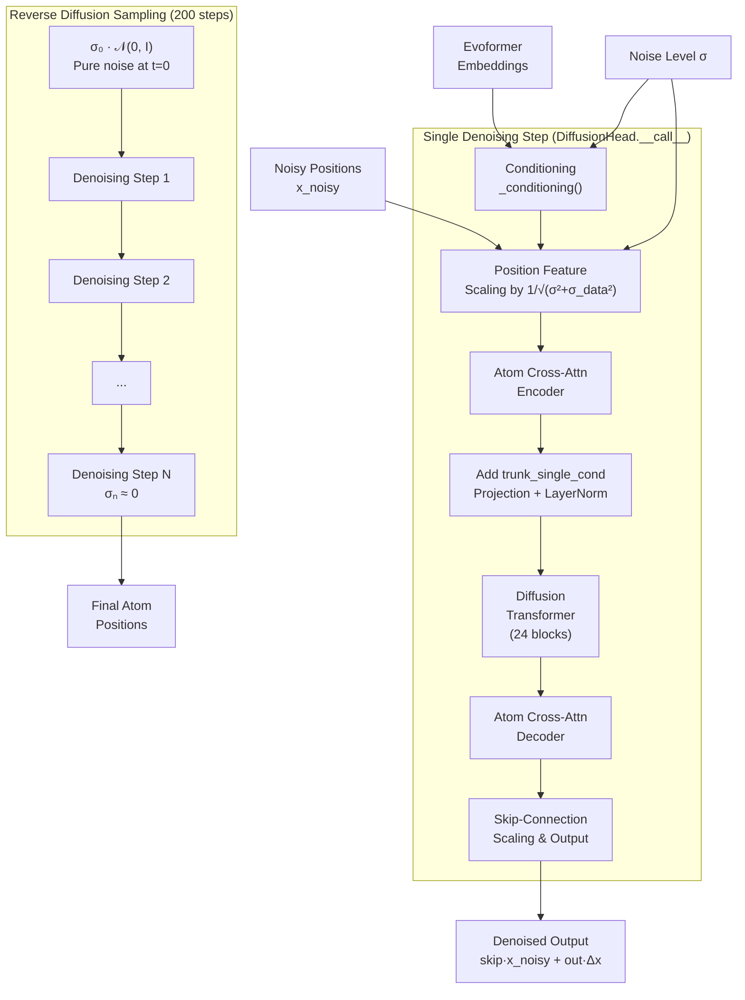
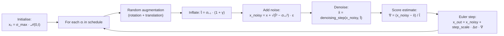

The **Diffusion Head** is AlphaFold 3's structure generation engine — a score-based denoising diffusion model that progressively refines noisy 3D atom coordinates into physically plausible structures. Unlike AlphaFold 2's structure module which operated on residue-level frames, AlphaFold 3's Diffusion Head operates directly at **atom granularity**, enabling it to predict coordinates for proteins, nucleic acids, small molecules, ions, and modified residues within a single unified framework. The module encompasses four tightly coupled subsystems: a **conditioning network** that fuses Evoformer trunk embeddings with noise-level information, an **Atom Cross-Attention encoder-decoder** that bridges token-level and atom-level representations, a **Diffusion Transformer** that performs the core denoising computation, and an **iterative sampler** that executes the reverse diffusion process at inference time.

Sources: [diffusion_head.py](src/alphafold3/model/network/diffusion_head.py#L1-L382), [model.py](src/alphafold3/model/model.py#L225-L270)

## Architecture Overview

The Diffusion Head sits downstream of the [Evoformer Trunk](11-evoformer-trunk), consuming its single and pair embeddings as conditioning signals. At inference time, it executes a full reverse diffusion loop — starting from pure Gaussian noise and iteratively denoising across 200 scheduled steps — to produce `num_samples` independent structure predictions (default 5). Each denoising step invokes the full forward pass of the `DiffusionHead` module. The diagram below captures the end-to-end data flow:



Sources: [diffusion_head.py](src/alphafold3/model/network/diffusion_head.py#L211-L303), [diffusion_head.py](src/alphafold3/model/network/diffusion_head.py#L306-L381)

## Noise Schedule and Data Scale

The diffusion process is parameterised by a continuous noise level σ that follows a **power-law schedule**. The constant `SIGMA_DATA = 16.0` is empirically derived from the average atom-position variance across the multimer training set, and it anchors the entire normalisation scheme.

The noise schedule maps a normalised time step `t ∈ [0, 1]` to a noise level:

```
σ(t) = σ_data · (s_max^(1/p) + t · (s_min^(1/p) − s_max^(1/p)))^p
```

| Parameter | Value | Role |
|-----------|-------|------|
| `SIGMA_DATA` | 16.0 | Empirical data standard deviation; anchors input/output scaling |
| `s_min` | 0.0004 | Minimum noise level (final denoising resolution) |
| `s_max` | 160.0 | Maximum noise level (initial noise magnitude) |
| `p` | 7 | Power-law exponent controlling schedule curvature |

At `t=0` the noise level is `σ_data · s_max = 2560` (maximum corruption); at `t=1` it drops to `σ_data · s_min = 0.0064` (near-clean). The high value of `p=7` concentrates most denoising steps at the low-noise regime where fine-grained atomic coordination emerges.

Sources: [diffusion_head.py](src/alphafold3/model/network/diffusion_head.py#L38-L92)

## Noise Level Embeddings

The noise level σ is injected into the conditioning pathway via **Fourier feature embeddings** with 256 fixed-dimensionality. The embedding pipeline is:

1. **Scale** the noise level by `σ / σ_data` (normalising relative to data scale)
2. **Log-transform**: `z = (1/4) · log(σ / σ_data)`
3. **Affine projection**: `h = z · W + b` where `W ∈ ℝ²⁵⁶` and `b ∈ ℝ²⁵⁶` are **frozen constants** (not learned), originally generated from `jax.random.normal` and `jax.random.uniform` with seed 42
4. **Cosine encoding**: `embedding = cos(2π · h)`

Freezing the weight and bias at compile time ensures deterministic, reproducible embeddings regardless of JAX PRNG implementation changes across versions. The resulting 256-dimensional vector is projected into the single conditioning channel space via a learned linear layer.

Sources: [noise_level_embeddings.py](src/alphafold3/model/network/noise_level_embeddings.py#L20-L151), [diffusion_head.py](src/alphafold3/model/network/diffusion_head.py#L189-L202)

## Conditioning Network

The `_conditioning` method prepares the pair and single conditioning signals that modulate the Diffusion Transformer's Adaptive LayerNorm. It has a critical training-time feature: **probabilistic dropout** of trunk embeddings (controlled by `conditioning.prob = 0.8`), which forces the model to partially rely on raw atom-level information and improves robustness.

**Pair Conditioning Pipeline:**
- The Evoformer pair embedding is optionally zeroed by `(1 - use_conditioning)` scaling, then concatenated with **relative positional encodings** (relative token index up to 32, relative chain index up to 2)
- A LayerNorm → Linear projection maps to `pair_channel = 128` dimensions
- Two transition blocks (each with GLU-gated feedforward) further refine the pair conditioning

**Single Conditioning Pipeline:**
- The Evoformer single embedding is optionally zeroed, then concatenated with `target_feat` (residue type one-hot, MSA profile, deletion mean)
- LayerNorm → Linear projects to `seq_channel = 384` dimensions
- The **noise level embedding** is projected and added
- Two transition blocks refine the single conditioning

Sources: [diffusion_head.py](src/alphafold3/model/network/diffusion_head.py#L143-L209), [featurization.py](src/alphafold3/model/network/featurization.py#L145-L200)

## Forward Pass: Denoising a Single Step

The `DiffusionHead.__call__` method implements a single denoising step — the core neural network that maps `(x_noisy, σ) → x_denoised`. The computation proceeds through five stages:

### 1. Input Normalisation
The noisy atom positions are masked and **scaled by the inverse of the combined standard deviation**: `x_scaled = x_noisy / √(σ² + σ_data²)`. This ensures the input has approximately unit variance regardless of noise level, which is critical for stable training across the full noise schedule.

### 2. Atom Cross-Attention Encoder
The scaled positions enter the [Atom Cross Attention](13-atom-cross-attention) encoder, which converts per-token-atom 3D coordinates into per-token activation vectors by running cross-attention over atom subsets. The encoder also injects trunk single/pair conditioning and reference structure metadata (atom types, element, charge, atom names, pairwise distances). It returns both a per-token activation and a skip-connection state for the decoder.

### 3. Trunk Single Conditioning Injection
The encoder's per-token output is augmented with a **projected and layer-normalised** version of the trunk single conditioning, bridging the Evoformer's sequence-level understanding into the diffusion pathway.

### 4. Diffusion Transformer
A **24-block Transformer** with Adaptive LayerNorm (AdaLN) processes the per-token activations. Each block consists of multi-head self-attention (with pair-bias logits from the pair conditioning) followed by a transition block. The Adaptive LayerNorm mechanism uses the single conditioning to compute per-token scale and shift parameters: `output = sigmoid(scale) · LayerNorm(x) + bias`, following the **AdaLN-Zero** design from "Scalable Diffusion Models with Transformers" (Peebles & Xie, 2022). The zero-initialisation of the adaptive conditioning projections ensures that each transformer block starts as an identity at the beginning of training.

### 5. Atom Cross-Attention Decoder and Skip Connection
The transformer's output passes through the Atom Cross-Attention decoder, which maps per-token features back to per-atom 3D position updates. The final output applies a **CPSLT-style skip connection** (consistent with the theoretical derivation for denoising score matching):

```
x_denoised = skip_scaling · x_noisy + out_scaling · Δx
```

where:
- `skip_scaling = σ_data² / (σ² + σ_data²)` — attenuates the noisy input at low noise levels
- `out_scaling = σ · σ_data / √(σ² + σ_data²)` — amplifies the correction appropriately

This formulation ensures that at high noise levels (σ ≫ σ_data), the model relies on the learned correction Δx, while at low noise levels (σ ≪ σ_data), it preserves the near-clean input.

> [!TIP]
> The entire denoising forward pass executes within a `bfloat16_context()`, except for the transformer attention logits which are computed in float32 to prevent gradient norm blow-up. This mixed-precision strategy is essential for both numerical stability and TPU performance.

Sources: [diffusion_head.py](src/alphafold3/model/network/diffusion_head.py#L211-L303), [diffusion_transformer.py](src/alphafold3/model/network/diffusion_transformer.py#L32-L186)

## Diffusion Transformer Architecture

The `Transformer` module is a stack of 24 identical blocks, organised into **super-blocks** of size 4 (yielding 6 super-blocks). This organisational pattern enables **rematerialisation** — intermediate activations within each super-block can be discarded and recomputed during backpropagation, trading compute for memory. The pair conditioning is projected to pair-bias logits once per super-block (shared across all 4 internal blocks), amortising the cost of the pair projection.

| Component | Configuration |
|-----------|--------------|
| `num_blocks` | 24 |
| `super_block_size` | 4 (6 super-blocks total) |
| `num_head` | 16 |
| `num_intermediate_factor` | 2 (FFW hidden dim = 2× channels) |
| `block_remat` | False (default; remat at super-block level) |

**Adaptive LayerNorm (AdaLN):** Each attention and transition block normalises its input through a conditioning-dependent affine transform. When `single_cond` is provided: the input is LayerNorm'd without learned scale/offset; the conditioning is separately LayerNorm'd and projected to produce `scale` and `bias`; the output is `sigmoid(scale) · x_norm + bias`. The sigmoid gates ensure the scale remains positive and bounded.

**Adaptive Zero-Init:** Output projections use an additional adaptive gate from the conditioning: `output = sigmoid(cond_gate) · Linear(x)`, where `cond_gate` is initialised with bias −2.0 (so `sigmoid(−2) ≈ 0.12` at init). This makes each block near-identity at training start, dramatically improving optimisation stability for deep architectures.

**Gated Linear Unit (GLU) Transition:** The transition blocks use a **Swish-GLU** activation pattern: `c = swish(a) · b` where `[a, b] = split(Linear(x))`. When `use_glu_kernel=True`, this is dispatched to the `tokamax.gated_linear_unit` fused kernel for performance.

Sources: [diffusion_transformer.py](src/alphafold3/model/network/diffusion_transformer.py#L32-L263)

## Reverse Diffusion Sampling

The `sample` function implements the **iterative denoising loop** at inference time. It uses an algorithm closely related to the Denoising Diffusion Implicit Models (DDIM) framework with stochastic noise injection:



| Parameter | Default | Purpose |
|-----------|---------|---------|
| `steps` | 200 | Number of denoising steps in the schedule |
| `num_samples` | 5 | Independent samples generated per inference |
| `gamma_0` | 0.8 | Stochasticity coefficient for noise inflation |
| `gamma_min` | 1.0 | Noise level threshold below which γ is disabled |
| `noise_scale` | 1.003 | Multiplicative scale on injected noise |
| `step_scale` | 1.5 | Euler integration step size multiplier |

**Key implementation details:**

- **Random augmentation:** At each step, the current positions are subjected to a random rotation (via Gram-Schmidt orthogonalisation of two random normal vectors) and a random translation. This enforces SE(3) equivariance stochastically and prevents the model from exploiting any preferred coordinate frame.

- **Noise inflation:** Before denoising, the previous noise level is inflated to `t̂ = σ_prev · (1 + γ)` where `γ = gamma_0` when `σ > gamma_min` and 0 otherwise. This stochastic inflation improves sample quality by injecting controlled noise, analogous to the stochastic sampler in score-based generative models.

- **Score estimation:** The denoised output is converted to a **score function** estimate: `∇ = (x_noisy − x_denoised) / t̂`. This is the standard relationship between a denoiser and the score (∇ log p) of the data distribution at noise level t̂.

- **Vectorised sampling:** Multiple samples are generated in parallel using `hk.vmap` over the sample dimension, with per-sample RNG splitting. The denoising loop itself uses `hk.scan` with `unroll=4` for XLA compilation efficiency.

> [!TIP]
> The `gamma_min = 1.0` threshold means stochastic noise injection is disabled for the final denoising steps (when σ < 1.0). This is critical: at low noise levels, the structure is nearly converged and additional stochasticity would degrade coordinate precision. The transition from stochastic to deterministic sampling happens automatically at this threshold.

Sources: [diffusion_head.py](src/alphafold3/model/network/diffusion_head.py#L306-L381), [diffusion_head.py](src/alphafold3/model/network/diffusion_head.py#L42-L85)

## Configuration Reference

The complete `DiffusionHead.Config` inherits from both `AtomCrossAttEncoderConfig` and `AtomCrossAttDecoderConfig`, unifying all sub-module configurations:

| Config Path | Default | Description |
|-------------|---------|-------------|
| `eval_batch_size` | 5 | Sharding batch size for evaluation |
| `eval_batch_dim_shard_size` | 5 | Dimension sharding for eval batches |
| `conditioning.prob` | 0.8 | Probability of using trunk conditioning (training dropout) |
| `conditioning.pair_channel` | 128 | Pair conditioning output channels |
| `conditioning.seq_channel` | 384 | Single conditioning output channels |
| `eval.num_samples` | 5 | Number of independent samples at inference |
| `eval.steps` | 200 | Number of denoising steps |
| `eval.gamma_0` | 0.8 | Stochasticity coefficient |
| `eval.gamma_min` | 1.0 | Noise threshold for deterministic switching |
| `eval.noise_scale` | 1.003 | Injected noise multiplicative scale |
| `eval.step_scale` | 1.5 | Euler step size multiplier |
| `transformer.num_blocks` | 24 | Diffusion Transformer depth |
| `transformer.super_block_size` | 4 | Blocks per rematerialisation group |
| `transformer.attention.num_head` | 16 | Number of attention heads |
| `per_token_channels` | 768 | Encoder token-level channels |
| `per_atom_channels` | 128 | Atom-level channels in encoder/decoder |
| `per_atom_pair_channels` | 16 | Atom pair channels in encoder |

Sources: [diffusion_head.py](src/alphafold3/model/network/diffusion_head.py#L95-L131), [atom_cross_attention.py](src/alphafold3/model/network/atom_cross_attention.py#L34-L41), [diffusion_transformer.py](src/alphafold3/model/network/diffusion_transformer.py#L192-L198)

## Integration with the Full Model

Within `Model.__call__`, the diffusion head is invoked after the Evoformer's recycling loop completes. The `_sample_diffusion` method partially applies the `DiffusionHead` as a denoising function (fixing `batch`, `embeddings`, and `use_conditioning=True`), then passes it to `diffusion_head.sample` along with a fresh RNG key and the sampling configuration from `config.heads.diffusion.eval`. The resulting `atom_positions` — of shape `(num_samples, num_tokens, max_atoms_per_token, 3)` — are subsequently consumed by the [Confidence Head](14-confidence-head) for per-sample quality assessment and by the structure output pipeline for final coordinate extraction.

Sources: [model.py](src/alphafold3/model/model.py#L249-L353)

## Mathematical Foundations

The Diffusion Head implements a **variance-preserving** denoising framework on continuous-state Markov chains. The key theoretical ingredients are:

- **Forward process:** `x_noisy = x_clean + σ · ε` where `ε ~ 𝒩(0, I)` and `x_clean` has variance `σ_data² = 256`
- **Denoiser–score relationship:** The optimal denoiser `D(x, σ)` satisfies `∇_x log p_σ(x) = (x − D(x, σ)) / σ²`, connecting the network to the score of the marginal distribution
- **CPSLT output scaling:** The skip/output scaling factors derive from the conditional expectation `E[x_clean | x_noisy]` under the joint Gaussian model, ensuring0 ensuring the network learnsF learns a well-conditioned residual
- **Euler–Maruyama integration:** The sampling loop discretises the probability flow ODE `dx/dσ = (x − D(x, σ)) / σ` with first-order Euler steps and optional stochastic perturbation

Sources: [diffusion_head.py](src/alphafold3/model/network/diffusion_head.py#L295-L303), [diffusion_head.py](src/alphafold3/model/network/diffusion_head.py#L333-L357)

## Next Steps

- **[Atom Cross Attention](13-atom-cross-attention)** — Deep dive into the encoder/decoder that bridges token-level and atom-level representations within the Diffusion Head
- **[Confidence Head](14-confidence-head)** — Understanding how per-sample quality scores are computed from diffusion outputs
- **[Evoformer Trunk](11-evoformer-trunk)** — The embedding pipeline that feeds conditioning signals into the Diffusion Head